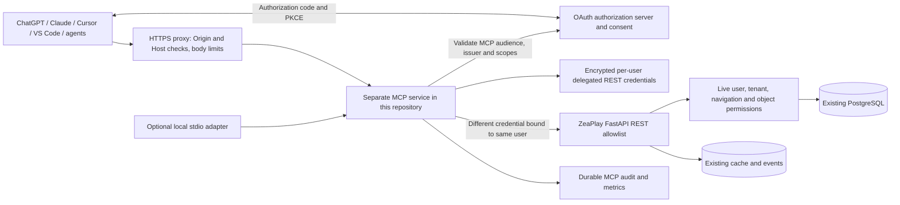

# ZeaPlay MCP Feasibility Report

Assessment date: **11 November 2026 (Asia/Calcutta)**. Scope: the current working tree of `F:\Projects\zeaplay-05\zea-play-08-05-26\zea-play`.

**Analysis only.** The sole deliverable is this report. No application code, database, dependencies, environment configuration, running services, or deployments were changed. Existing uncommitted work was preserved. Findings describe inspected source, including existing local modifications; they do not certify a running installation.

## 1. Executive summary

| Decision | Assessment |
|---|---|
| MCP compatibility | **PARTIAL** today; technically feasible after authentication and security preparation |
| Overall readiness | **Low for production remote MCP**: useful REST coverage exists, but MCP authentication, delegated credentials, tool scopes, revocation, and several authorization boundaries need work |
| Recommended architecture | **Option B: a separate Python MCP service inside this repository, consuming an explicit allowlist of existing REST endpoints** |
| Rewrite existing APIs? | No wholesale rewrite is needed. Selected reads can be wrapped without changing their REST contracts. Unsafe operations need targeted fixes before exposure. |
| Projects | **Not Supported** as a managed entity: no registered Project CRUD/status API or Project ORM model was found |
| Initial tools | List tasks, get a task overview, list overdue tasks, list task subtasks, get workload summary |
| Security release condition | Every call must resolve an active ZeaPlay user and tenant from trusted credentials, then enforce current object permissions. A client-supplied company, role, user ID, or prompt cannot grant access. |

The API readiness matrix below distinguishes source-suitable REST reuse from required changes and excluded operations. **Ready never means an MCP server already exists, authentication is complete, or production tests passed.** No MCP package, protocol endpoint, discovery metadata, or MCP client configuration was found in the inspected application modules and dependency manifests.

The primary blockers are substantive: transfer workflows can accept users from another tenant; department data is global; some ticket routes enforce tenant membership without object membership; ticket relationship setters do not consistently validate related users against the ticket tenant; task-group reads/updates can affect sibling assignments without a separate object check; ordinary audit logs are not comprehensively tenant-scoped. Existing JWT scopes are labels, not REST operation restrictions.

## 2. Method, evidence, and verification limits

Source was inspected using file reads, targeted searches, and static syntax inspection. Repository status was captured before writing. No application import, application startup, live HTTP call, database query, migration, build, package installation, or test execution was performed. This is intentional: `backend/app/database.py` executes schema helper functions at import, `main.py` has import/startup filesystem and schema behavior, and some test modules drop/create tables during collection. Even a nominal OpenAPI export by importing the application would exceed this read-only scope.

Important evidence is given as repository-relative paths and function/class names. Line references are useful within this working-tree snapshot and may move in later edits. Appendix A inventories inspected REST handler contracts without executing them. Appendix B identifies request/response schema sources.

**Not Verified:** running API/OpenAPI output, deployed source/image equivalence, actual environment values, database schema/data/RLS, production topology/TLS, external OAuth providers, effective client account permissions, dependency resolution against a new MCP SDK, performance, and live client interoperability. Existing tests were read as evidence of intended behavior only; their results were **NOT RUN** in this assessment. Missing worker source is identified below. No unreadable file was silently treated as supporting evidence.

Prior checkout notes were used only to locate security/navigation evidence and avoid unsafe runtime checks. All application conclusions below were checked against current source, rather than inheriting historical test or deployment claims.

## 3. Existing architecture findings

| Area | Verified source finding | Evidence |
|---|---|---|
| Frontend | React 19 SPA, TypeScript, Vite 6, React Router 7 hash routing, TanStack Query, Axios; context-based authentication and protected routes | `frontend/package.json`; `frontend/App.tsx::AppProviders`, `createHashRouter`; `frontend/index.tsx` |
| API client | Despite its filename, `mockApi.ts` contains the real Axios HTTP client, bearer injection and token refresh logic | `frontend/services/mockApi.ts`, `http` instance/interceptors, `refreshAccessToken` |
| Backend | Python FastAPI, Pydantic 2 schemas, synchronous SQLAlchemy 2 sessions, Uvicorn; container base Python 3.11 | `backend/requirements.txt`; `backend/Dockerfile`; `backend/app/main.py:484` |
| REST layout | Domain `APIRouter` modules, usually registered both at their own prefix and under `/api`; no common versioned `/v1` convention | `backend/app/main.py:609-675`; `routers/tasks.py`, `tickets/router.py` |
| Routing exceptions | `tickets/workflow_router.py` already has prefix `/api`; registered once. Its hidden legacy task PATCH/complete registrations collide with canonical routes registered earlier | `main.py:650,670-671`; `tickets/workflow_router.py:213,232` |
| Password login | `/auth/login` accepts JSON or form credentials; bcrypt verification; access and refresh JWTs | `routers/auth.py::_extract_credentials`, `login`; `auth.py` |
| Token identity | Access decoding verifies configured signature algorithm and optional token type; current user is fetched from DB and token tenant must equal DB tenant | `dependencies.py::_decode_access_token`, `get_current_user` |
| Permission authority | Four roles: user, manager, admin, owner. Active state and database role are checked by dependencies. `get_current_admin` includes Managers; API credential administration is Owner/Admin only | `models.py::RoleEnum`; `dependencies.py`; `permissions.py::API_ADMIN_ROLES` |
| Additional access policy | App-wide navigation guard restricts mapped endpoints using tenant navigation rules. It supplements endpoint authorization | `navigation_guard.py::enforce_navigation_policy`; `navigation_registry.py::api_pages`; `services/navigation.py` |
| Tenant model | Shared database/shared tables, users have UUID `tenant_id`; tickets carry tenant IDs. Task tenancy is derived through creator, rather than a Task tenant column | `models.py::User`, `Task`; `tickets/models.py::Ticket`; `routers/tasks.py::_ensure_task_tenant` |
| Database | SQLAlchemy models, PostgreSQL-specific UUID/JSONB/TSVECTOR, computed task full-text search; SQLite compatibility branches; Alembic migrations plus automatic schema repair helpers | `models.py`; `database.py`; `backend/alembic`; `main.py::startup_event` |
| Database isolation | Application predicates are the demonstrated boundary. No RLS policies were found in inspected Python/SQL source; live DB RLS is **Not Verified** | `dependencies.py::apply_tenant_filter`; task/ticket query helpers |
| Projects/teams | `User.projects` is a JSON list of strings; Task has a free-text `team`; `Department` is a global table. Chat `project_id`/`team_id` are metadata, not a project management API | `models.py::User`, `Task`, `Department`, `ChatConversation`; `services/task_information.py::read` explicitly returns `project: None` |
| API documentation | FastAPI created without disabling default docs: source implies `/openapi.json`, `/docs`, `/redoc`. `frontend/pages/ApiOverview.tsx` is a separate curated API UI, not authoritative OpenAPI | `main.py:484`; `frontend/pages/ApiOverview.tsx`; actual generated schema **Not Verified** |
| Realtime/cache | FastAPI task/chat/ticket WebSockets; Redis task events/cache; separate Node Express/Socket.IO presence service | `backend/app/ws`; `services/task_events.py`; `cache.py`; `presence-server/package.json`, `src/server.js` |
| Automation | n8n event forwarding, tenant-scoped webhook subscriptions/delivery/retry worker, notification/email/push dispatch, backup maintenance; Google API, Supabase and object-storage packages are present | `integrations.py`; `routers/n8n.py`; `webhooks/dispatcher.py`; `services/notification_dispatcher.py`; `backups`; `requirements.txt` |
| Reports | Reports UI fetches task/user/department data and calculates aggregates in the browser. Existing server workload snapshot and calendar/status counts are reusable; a general `/reports` analytics REST service was not found | `frontend/pages/Reports.tsx:154`, `summarizeTasks`, `workloadData`; `services/task_activity.py::snapshot`; `routers/tasks.py::list_tasks_page` |

Installed frontend packages mentioning Express or Prisma do **not** establish the backend architecture. The registered backend and deployment entry point are FastAPI/SQLAlchemy.

### Deployment configuration actually present

`docker-compose.yml` declares frontend `7300:80`, backend `7211:7211`, presence `7212:7212`, PostgreSQL **16-alpine** at host `7432`, and Redis 7 listening at `7379`. Development Compose exposes database/cache ports. `docker-compose.prod.yml` declares PostgreSQL **15**, Redis persistence, legacy published application/worker images, and a Gunicorn command. `docker-compose.github.yml` overlays source builds and replaces the backend command with Uvicorn workers. These files must not be treated as one interchangeable runtime.

The production file references `app.workers.celery_app` and `app.reporting.worker`; those source directories were not found in this checkout. `gunicorn_conf.py` is also not supplied here, as the source-build override comments acknowledge. Worker behavior/image contents are **Not Verified**.

`frontend/nginx.conf` proxies `/api/` to `http://backend:7211/`, stripping the `/api` prefix, and separately proxies `/ws/`. A future MCP route needs explicit proxy routing; the SPA fallback is unsuitable. API-only workflow routes need careful path testing because stripping `/api` can reach a different route or no route. External reverse-proxy TLS is **Not Verified**. No MCP service is currently declared.

## 4. REST API readiness matrix

### Reading the contracts and security policies

Paths below are **backend canonical paths**, excluding duplicate `/api` aliases unless the route exists only under `/api`. `id` means a path identifier; `Q` means query; `B` means JSON body. All business routes require bearer authentication and mapped navigation permissions in addition to the policy below. Standard errors are FastAPI `{"detail": ...}`; schema errors generally return 422. The backend does not use one universal success envelope.

| Policy | Existing authentication, authorization and tenant behavior |
|---|---|
| T | `get_current_active_user`; creator tenant must match. Owner/Admin can read tenant tasks; Managers can read own/assigned/followed or department-assignee tasks; ordinary users can read own/assigned/followed tasks. `_apply_task_visibility` and `_ensure_task_access` are the main boundaries. Legacy `list_tasks` omits follower visibility. |
| TW | T plus `_ensure_task_update_access`: for ticket tasks, creator or assignee only; otherwise reuses read access. Consequently some observers can reach general PATCH/delete behavior; MCP must impose narrower write scopes and policy. Approval/time services may add restrictions. |
| TA | Activity services reload active identity, enforce tenant/task access and user-specific scope. `_subject` permits own workload, Owner/Admin same-tenant workload, or a Manager's direct reports. Work logs expose only the caller's intervals. |
| K | Tickets use `get_tenant_id`, `get_current_user` and usually `require_roles()` (which also requires active user). `get_ticket_for_user`: Owner/Admin tenant-wide, Manager same department, other users creator/owner/participant/follower or pending approver. K-write conditions vary per operation. `POST /tickets` lacks the explicit active-user dependency at handler level; the app navigation guard currently supplies it. |
| U | Active user for tenant-filtered user list/get; staff dependency (Manager/Admin/Owner) for CRUD, with owner/manager escalation restrictions. Department membership is not tenant-owned. |
| C | Comments check task tenant but allow any Manager/Admin/Owner in that tenant, regardless of Manager task access. Ordinary users must be creator/assignee; followers are excluded. Staff may supply another same-tenant comment author. |
| N | Active user and `visible_query`: own inbox, tenant/null legacy rows, current access for related tasks. Ticket-linked legacy notification bodies do not receive an equivalent ticket visibility recheck here. |
| D | Department reads require active user; writes require Manager/Admin/Owner. Table and queries have **no tenant scope**. |
| L | General audit reads require active user plus logs navigation access. Configuration records receive tenant filtering; other audit records can be global for Owner/Admin and department-scoped without tenant predicate for Managers. |

**Ready** = REST behavior is source-suitable for a bounded, minimized read adapter after common MCP authentication/transport controls and acceptance tests; no REST change identified for that narrow use. **Needs Changes** = existing operation, but additional policy, validation, bounding, side-effect handling or backend repair is required. **Excluded** = existing operation deliberately withheld from the initial MCP surface. Unsupported capabilities are listed separately and are not counted as endpoints.

Every row links its policy, request/response contract and validation to current handler/schema code. Appendix A adds exact handler signatures and source line references for these and ancillary operations.

| ID | Method and endpoint | Request → response; existing validation | Policy / MCP suitability |
|---|---|---|---|
| A01 | GET `/tasks/page` | Q `page>=1,page_size=1..200`, search/status/priority/assignee/team/tag/date/quick filter/sort/cursor → `TaskListResponse` with items/counts/pagination. Enum/date parsers; malformed cursor/sort strings need adapter validation | T; **Ready**; preferred list/search/overdue source |
| A02 | GET `/tasks/{task_id}/summary` | id → `TaskSummaryResponse` (id,title,status,priority,team,assignee,creator,dates); existence/access checks | T; **Ready** |
| A03 | GET `/tasks/{task_id}/information` | id; Q section=`overview/timeline/subtasks/points/activity`, page>=1, page_size<=100, search<=200, optional subtask_id<=36 → `TaskInformationRead` | T; **Ready**; reloads active user, sanitized history/person fields, parent-scoped children, no history repair |
| A04 | GET `/tasks/activity` | optional Q user_id<=36 → workload/activity snapshot object | TA; **Ready**; server authorizes selected subject |
| A05 | GET `/tasks/{task_id}/work-intervals` | id; Q limit=1..200 → array of id,subtask_id,start/end,note,superseded | TA; **Ready**; caller's own work only |
| A06 | GET `/tasks/kanban` | Q page/page_size<=200 plus search/priority/assignee/team/tag/dates/quick_filter → `TaskKanbanResponse.columns[]` | T; **Ready** with adapter column/result limits; global column configuration is not exposed |
| A07 | GET `/tasks/calendar/summary` | required Q start_date/end_date; timezone, search/status/priority/assignee/team/tag/dates/quick_filter → date range and per-day counts | T; **Ready** with adapter date-span bound |
| A08 | GET `/users` | no Q → `UserRead[]`; DB tenant filter | U; **Ready** for minimized directory projection with output cap; excludes sensitive profile fields |
| A09 | GET `/users/{user_id}` | id → `UserRead`; tenant-filtered 404 | U; **Ready** for minimal identity projection |
| A10 | GET `/auth/me` | no body → `UserRead`; active user | U; **Ready** for identity check; not itself an OAuth flow |
| A11 | GET `/tasks` | Q assignee_name, skip_overdue_notifications=true → unpaginated `TaskRead[]`; false can create notifications and send Webex | T; **Needs Changes**; prefer A01; never expose the side-effect flag |
| A12 | GET `/tasks/{task_id}` | id; Q include_subtask_activity=false → `TaskRead`, optionally <=200 activity events | T; **Needs Changes**; nested user/dependency payload minimization and per-object checks; prefer A03 overview |
| A13 | GET `/tasks/{task_id}/group` | id → `TaskRead[]` group siblings | T on anchor only; **Needs Changes**; sibling query checks tenant but not each sibling's user access |
| A14 | GET `/tasks/calendar/tasks` | required Q start_date; optional end_date/timezone and filters → `TaskRead[]` | T; **Needs Changes**; unbounded range/results and rich nested output |
| A15 | GET `/tasks/leaderboard` | Q limit=1..5000 → `TaskLeaderboardRead[]`; visible-task predicate | T; **Needs Changes** for minimized, bounded report semantics; not a project report |
| A16 | POST `/tasks` | B `TaskCreate`: required title; status/priority/team/assignee(s)/due date/dependencies/followers/subtasks/etc → **array** `TaskRead[]` (one record per assignee), 201 | T; **Needs Changes**; bounded input, safe workflow fields, confirmation/idempotency; same-tenant assignees/followers and visible dependencies already checked |
| A17 | PATCH `/tasks/{task_id}` | B `TaskUpdate`, all fields optional → `TaskRead`; enum/dependency/same-tenant related-user checks; ticket write guard | TW; **Needs Changes**; shared title/description/priority updates propagate to group peers without per-peer authorization; no parent expected-version contract |
| A18 | DELETE `/tasks/{task_id}` | id → 204; rejects tasks with immutable v2 history (409) | T read-access gate; **Excluded** until stricter destructive policy and approval |
| A19 | POST `/tasks/{task_id}/complete` | id, no body → `TaskRead`; completion dependency/approval workflow; rewards/activity side effects | TW; **Needs Changes**; high-impact business transition |
| A20 | POST `/tasks/{task_id}/approve` | B `TaskApprovalAction` decision approved/rejected, optional comment → `TaskRead`; designated approver and approval_required checks | Active user + approver identity; **Excluded** pending explicit tenant/object guard review and human decision policy |
| A21 | POST `/tasks/transfer` | B from_user_id,to_user_id,statuses (nonempty enum list) → updated_count and transfer parameters; same-tenant users, staff; conditional Manager department check | T/staff; **Needs Changes**; bulk approval, per-task/Manager-without-department review |
| A22 | POST `/tasks/{task_id}/transfer-requests` | B to_user_id,note? → `TaskTransferWorkflowRead`; target existence, duplicate pending check; staff auto-approve | T; **Needs Changes**; missing target tenant check; recipient selection also broad |
| A23 | GET `/tasks/{task_id}/transfer-requests` | id → workflow array; task access check | T; **Needs Changes**; depends on repairing transfer relationships |
| A24 | POST `/tasks/transfer-requests/{request_id}/approve` | B decision approved/rejected,comment? → workflow object; staff and pending-state checks | Staff; **Needs Changes**; explicit task object/department check absent in handler; reconciliation enforces actor tenant but does not establish operation permission |
| A25 | PATCH `/tasks/{task_id}/subtasks/{subtask_id}` | B `SubtaskUpdate` → parent `TaskRead`; managed version, transitions, dates and explicit actual-time confirmation checked | TW plus canonical activity write guard; **Needs Changes**; constrain fields, confirmation, minimize response |
| A26 | POST `/tasks/{task_id}/activity` | B action START/PAUSE/RESUME/STOP, expected_version>=0, request_id UUID, optional subtask_id → snapshot | TA; **Needs Changes**; changes personal timer state; existing replay/version/state checks useful |
| A27 | POST `/tasks/{task_id}/work-intervals` | B started_at,ended_at,request_id,confirmed=true; note/subtask/supersedes optional → id/start/end/supersedes, 201 | TA; **Needs Changes**; timezone and positive interval validation; actual human time confirmation must not be fabricated |
| A28 | GET `/comments/task/{task_id}` | id → `CommentRead[]`; task existence/access | C; **Needs Changes**; reconcile Manager/follower policy and add bounds |
| A29 | POST `/comments` | B task_id,user_id,content → `CommentRead`, 201; author existence/tenant and ordinary-user self-author check | C; **Needs Changes**; derive user_id from authenticated identity, bound content, prevent impersonation |
| A30 | DELETE `/comments/{comment_id}` | id → 204; own-comment restriction for ordinary users | C; **Excluded** initially |
| A31 | GET `/tickets` | Q status,priority,department_id UUID,assignee_id,follower_id,search,myTickets → `{success,data:TicketRead[]}` | K; **Needs Changes**; unpaginated; role/membership-sensitive cached results not reauthorized on hit |
| A32 | GET `/tickets/{ticket_id}` | UUID → `TicketRead` including status_history, approval_cycles and tasks | K; **Needs Changes**; GET marks notifications read, can emit SLA/Webex notifications and commits |
| A33 | POST `/tickets` | B `TicketCreate`: title 1..255, nonempty description; optional department/owner/assignee/followers/approval settings/due_date → `TicketRead`, 201 | K; **Needs Changes**; missing related-user tenant validation; approval min/max/due-date checks exist |
| A34 | PATCH `/tickets/{ticket_id}` | UUID; B `TicketUpdate` → `TicketRead`; close requires separate endpoint; resolution checks pending tasks/approvals | K; creator/owner/assignee or Owner/Admin; **Needs Changes**; validate related-user tenant IDs and workflow contract |
| A35 | DELETE `/tickets/{ticket_id}` | UUID → 204, soft delete | K; ticket owner or Owner/Admin; **Excluded** initially |
| A36 | POST `/tickets/{ticket_id}/transfer` | B department_id UUID → `TicketRead`; owner or Owner/Admin | K; **Needs Changes**; destination department/default assignee not tenant-owned |
| A37 | POST `/tickets/{ticket_id}/participants` | B add/remove arrays of user_id,role OWNER/ASSIGNEE/FOLLOWER → `TicketRead` | K; owner or Owner/Admin; **Needs Changes**; related user tenant validation missing |
| A38 | GET `/tickets/{ticket_id}/participants` | UUID → `TicketParticipantRead[]` | K with object guard; **Needs Changes** until participant integrity and output bounds verified |
| A39 | GET `/tickets/{ticket_id}/followers` | UUID → `TicketFollowerRead[]` | K with object guard; **Needs Changes** until follower integrity verified |
| A40 | GET `/tickets/{ticket_id}/activity` | UUID → `TicketActivityRead[]` | K with object guard; **Needs Changes** for bounded/redacted history |
| A41 | GET `/tickets/{ticket_id}/timeline` | UUID → `TicketTimelineRead` | K with object guard; **Needs Changes** for bounded history contract |
| A42 | GET `/api/tickets/{ticket_id}/tasks` | UUID → global `TaskRead[]` | Tenant + app navigation only; **Needs Changes**; no user-specific ticket/task access check in handler/service |
| A43 | GET `/api/tickets/{ticket_id}/logs` | UUID; Q page=1,page_size=25; service clamps size<=50 → `TicketAuditLogPage` | Tenant + app navigation only; **Needs Changes**; no ticket membership guard |
| A44 | POST `/api/tickets/{ticket_id}/tasks` | B priority,due_at?,approval_required=false,approver_id? → global `TaskRead`, 201 | K, assigned ticket user only; **Needs Changes**; approver existence checked without tenant check |
| A45 | POST `/api/tickets/{ticket_id}/status` | B status enum → `{ticket_id,status}`; workflow guards | K plus staff/creator/owner/assignee; **Needs Changes**; transition/side-effect review and approval policy |
| A46 | GET `/notifications/inbox` | Q limit=1..500,offset>=0 → user_id,items,unread_count,sound/push flags,quiet,server_now | N; **Needs Changes**; legacy ticket notices need current object-access review; minimize content |
| A47 | GET `/notifications` | no body → unpaginated `NotificationRead[]` | N; **Needs Changes**; same review and prefer bounded inbox |
| A48 | POST `/notifications/read` | B array of notification IDs → 204; updates only visible own rows | N; **Needs Changes**; write scope and bounded batch |
| A49 | POST `/notifications/read-all` | no body → 204; visible own rows | N; **Needs Changes**; explicit bulk-state intent |
| A50 | POST `/notifications/{notification_id}/read` | id → 204; visible own row or 404 | N; **Needs Changes**; write scope |
| A51 | DELETE `/notifications/{notification_id}` | id → 204; durable alerts dismissed, others deleted | N; **Excluded** initially |
| A52 | POST `/users` | B `UserCreate` name,email,password>=6, role/status/profile fields → `UserRead`, 201; email uniqueness, manager/owner role constraints | U; **Excluded**; account provisioning and secret handling |
| A53 | PATCH `/users/{user_id}` | B `UserUpdate`, optional expected_updated_at and profile/role/status/password/reward fields → `UserRead` | U; **Excluded**; privileged mutation, needs dedicated narrow tool if ever justified |
| A54 | DELETE `/users/{user_id}` | id → 204; owner/manager target restrictions | U; **Excluded**; identity/history impact |
| A55 | GET `/departments` | no body → `DepartmentRead[]` | D; **Needs Changes**; globally visible metadata |
| A56 | POST `/departments` | B name 1..255 → `DepartmentRead`, 201; global unique name | D; **Excluded**; global mutation |
| A57 | PATCH `/departments/{department_id}` | B optional name 1..255 → `DepartmentRead`; existence check | D; **Excluded**; global mutation |
| A58 | DELETE `/departments/{department_id}` | id → 204 | D; **Excluded**; global mutation |
| A59 | GET `/logs/audit` | Q category/entity_type/action/actor/severity/source/status CSV filters, start/end datetime, include_deleted,page>=1,size<=200 → `AuditLogListResponse` | L; **Needs Changes**; ordinary log tenant isolation and redaction incomplete |

**Count:** 59 distinct method/path operations in this decision matrix, excluding aliases. **10 Ready**, **38 Needs Changes**, **11 Excluded**. These are scoped reuse counts, not the entire application endpoint count. The 48 Ready/Needs Changes rows are existing reuse candidates; only the 10 narrowly defined reads have no identified REST-change prerequisite. All 48 still require the new MCP service and security controls. Appendix A lists additional existing routes without inflating these readiness counts.

### Missing or composite capabilities

| Requested capability | Evidence-based status |
|---|---|
| Project list/get/create/update/delete/status | **Not Supported**. No matching Project router/model found. User project tags and chat IDs cannot supply this contract. |
| Standalone Team CRUD/membership | **Not Supported**. Departments and task team strings are not a tenant-owned Team entity. Department endpoints exist as above. |
| Subtask create/read/delete | Existing nested functionality: create through TaskCreate.subtasks or TaskUpdate.subtasks, read through task/information, soft delete/restore via SubtaskUpdate.deleted. No standalone POST/DELETE `/subtasks` route found. Do not invent one. |
| Task status/assignment | Existing PATCH fields and dedicated complete/approve/transfer workflows, not generic new `/tasks/{id}/status` or `/assign` routes. |
| Reports and analytics | Task page status_counts, calendar summary, workload snapshot and leaderboard exist. UI report calculations are not a server report API. Cross-user/project analytics need a defined authorized aggregation contract. |
| Search/filtering | Task `/page` and ticket list filters exist. No independent global `/search` endpoint found among registered routers. PostgreSQL task search currently uses text-vector title/description; non-PostgreSQL branch also searches team/assignee. Do not promise identical search behavior. |

## 5. MCP compatibility and SDK assessment

| Question | Finding |
|---|---|
| Add MCP without REST rewrite? | **Yes, for the narrow read surface.** Translate typed tools into fixed REST calls and minimize results. Targeted authorization repairs remain required for flagged endpoints. |
| Separate module/service in repo? | **Yes.** An eventual sibling service can have its own dependency lock, Docker image and tests without importing the backend app. No directory/service was created in this phase. |
| REST or internal services? | Prefer REST initially. It preserves FastAPI dependencies, navigation policy, request validation, identity and normal side effects. Many services are mixed with router code or lack actor context; direct invocation can bypass the intended boundary. |
| Maintainability/security tradeoff | Internal services reduce one network hop but require canonical actor-aware entry points and service-level guard coverage. REST gives a clear boundary and contract tests. Never directly query the database from MCP or import `main.py` merely to reuse functions. |
| Official SDK | Official **Python `mcp` SDK**, Tier 1; official docs currently describe stable v2, Python 3.11+, stdio/Streamable HTTP and legacy SSE. This matches the source container's Python 3.11. Pin a tested stable release at implementation, rather than copying older FastMCP v1 examples. Package resolution with this application's dependencies is **Not Verified**. [Official SDK docs](https://py.sdk.modelcontextprotocol.io/), [SDK registry](https://modelcontextprotocol.io/docs/sdk). |
| Alternative SDK | Official TypeScript SDK is also Tier 1 and fits the repository's Node presence/frontend languages, but adds a second backend language for domain contracts. Python is the preferred default. [SDK registry](https://modelcontextprotocol.io/docs/sdk). |
| Existing OAuth supports remote MCP? | **No verified compatible flow.** Password JWT login, a broken/legacy password-grant route and OAuth configuration records are not an OAuth 2.1 authorization server. |
| Reuse users/permissions? | Yes, live backend user/tenant/object/navigation policy remains authoritative. It must be intersected with narrower MCP grant scopes and repaired where identified. |
| Independent Docker service? | Yes, architecturally. Add a future service/image without DB credentials or backend startup imports. It is not configured or deployed today. |
| Multiple AI clients? | Yes by design: per-grant credentials and request-local identity, bounded parallel calls, tenant quotas, shared revocation state and isolated caches. Concurrent identity isolation is **Not Verified** until tested. |

### Transport and protocol strategy

Use **HTTPS Streamable HTTP** at one explicit MCP endpoint for remote clients. MCP is a protocol layer, not a REST base URL or ZeaPlay Socket.IO/WebSocket endpoint. Use SDK framing, version negotiation/compatibility handling, cancellation, errors and structured tool results. Validate Origin and Host; reject invalid presented Origin, authorize every request, and configure reverse-proxy streaming/timeouts. stdio is suitable for a local client-launched process; keep protocol stdout clean and credentials out of arguments/logs. The MCP auth specification uses a different credential model for stdio than HTTP. [Transport specification](https://modelcontextprotocol.io/specification/latest/basic/transports), [HTTP binding](https://modelcontextprotocol.io/specification/2026-07-28/basic/transports/streamable-http).

Official documentation currently resolves the latest specification to **2026-07-28**. Some clients still use older protocol revisions or legacy HTTP+SSE. SDK adoption can differ from specification publication. Establish an explicit tested protocol/client version matrix in Phase 1; enable legacy SSE only when a required client needs it. Do not equate the current HTTP binding's request-scoped SSE responses with the older standalone SSE transport. [Protocol transports](https://modelcontextprotocol.io/specification/latest/basic/transports), [SDK version guidance](https://modelcontextprotocol.io/docs/sdk).

## 6. Recommended architecture and deployment options



Everything labeled MCP/OAuth/vault/stdio in this diagram is **proposed**, not implemented. OAuth issuer validation can use cached verified signing keys rather than a synchronous authorization-server call on every request. The vault is a logical trust boundary; exact storage/provider selection requires later design.

| Criterion | A: in existing backend | B: separate service, same repository | C: independently managed REST gateway |
|---|---|---|---|
| Security | Same process/DB-secret blast radius; easy to accidentally bypass router dependencies | Isolated process, allowlisted REST, no DB secret; common policy can be reviewed alongside backend | Similar process isolation; independent credentials and policy drift need more coordination |
| Performance | No REST network hop if using services; shared worker capacity | One internal REST hop, reusable HTTP pools; separate concurrency budgets | Additional network/TLS latency if remote; location dependent |
| Scalability | MCP traffic competes with UI/API workers and maintenance | MCP scales independently while backend DB limits stay enforced | Independent scaling; another external network dependency |
| Maintainability | Tight protocol/backend lifecycle coupling | Shared source review, schemas and contract tests; independent package lock/image | Independent release/version contract and extra ownership burden |
| Deployment complexity | Fewest new processes; higher risk to existing app startup | One additional service plus auth/vault/proxy components | Separate delivery pipeline, network policy, secrets and endpoint compatibility |
| Multi-tenant suitability | Possible only with full dependency/service discipline | Strongest practical fit if each REST call preserves user identity | Suitable with the same tenant constraints; gateway alone cannot fix unsafe APIs |
| Resources | Lower incremental container overhead; long streams consume shared resources | Modest added service memory/CPU plus connection pools | Similar gateway resources plus remote networking/management |
| Cost | Lowest incremental hosting, potentially greater regression cost | Moderate operational overhead, fewer independent release systems | Highest coordination overhead in this repository's current setup |

**Recommend Option B**, deployed independently as a Docker service and using REST as in Option C's gateway pattern. B describes source ownership here; C describes a gateway with independent source/release ownership. The distinction is explicit to avoid presenting two near-identical processes as different security mechanisms. No approach removes the need to repair REST authorization defects.

## 7. Proposed MCP tools

These are proposals based on existing functionality. None is currently callable. All tool inputs must be JSON objects with `additionalProperties: false`; optional fields below may be omitted. Identity, tenant, role, REST origin, access tokens, and arbitrary URLs are never model-supplied arguments. Proposed scope names are **new**, not currently enforced by ZeaPlay. Array/string/date-span/output limits below are adapter requirements, not claims about current REST validation.

Output schema references mean a minimized projection of the verified REST schema, not raw ORM serialization. Every tool should return typed `structuredContent` and a concise text summary where required by the negotiated client version. Preserve IDs, timestamps, pagination/truncation and coverage warnings. Tool failures must not include stack traces or raw upstream credential/configuration data.

### Input/output schema vocabulary

| Schema | Proposed JSON contract |
|---|---|
| TaskQuery | All optional: `page:integer>=1=1`, `page_size:integer 1..100=20`, `search:string<=200`, `status:TaskStatus`, `priority:TaskPriority`, `assignee_id:string<=36`, `team:string<=255`, `tag:string<=100`, `due_date:string<=64`, `created_date:string<=64`, `quick_filter:enum(createdByMe,myTasks,overdue,completed)`, `sort_by:enum(created_at,dueAt,priority,status,assignee,lastUpdated,title)` from source, `sort_order:enum(asc,desc)`. Initial catalog omits raw cursor until its parser is hardened. |
| TaskId | Required `task_id:string 1..36`. This identifies a target; it is never an authorization grant. |
| TaskInfoInput | TaskId plus optional `section:enum(overview,timeline,subtasks,points,activity)=overview`, `page>=1=1`, `page_size:integer 1..100=25`, `search:string<=200`, `subtask_id:string 1..36`. |
| CreateTaskInput | Required `title:string 1..255`; optional `description:string<=10000`, `priority:TaskPriority=MEDIUM`, `team:string<=255=General`, `assigned_to_ids:string[]` capped at 20, `due_at:date-time` with explicit offset, `estimated_hours:number>=0`, `tags:string[]` capped at 20. Initial writes omit status, recurrence, existing task_group_id, attachments, approval settings and subtasks. |
| UpdateTaskInput | Required task_id and `changes:object` with at least one allowlisted title/description/priority/due_at/estimated_hours/tags field; same limits as create. `approval_receipt` is a proposed opaque proof issued by a trusted approval flow, never an LLM-generated boolean. Group-shared fields remain blocked until backend checks are repaired. |
| TaskPage | `{items:TaskCard[],page,page_size,total,total_pages,status_counts,next_cursor?,has_more,truncated?}`; cards keep id,title,status,priority,team,assignee ID,due/created/updated dates, safe estimates/tags. Description and subtasks only when requested/allowed. |
| TaskOverview | Projection of `TaskInformationRead.overview`: id/name/description/status/priority/team, authorized minimal people, dates, estimated/productive/elapsed time; retain coverage/limitations/as_of. |
| InformationPage | TaskInformationRead wrapper with viewer/task/section/as_of, typed InformationEvent or InformationSubtask items, total/page/page_size/coverage; no raw network/security metadata. |
| Workload | Snapshot projection: user_id,server_now,timezone,active_count,workload period/manual/overlap/remaining/capacity/overdue/deadline fields; preserve unknown capacity and timezone warnings. |
| TicketInput | Required title 1..255,description 1..10000; optional priority enum LOW/MEDIUM/HIGH/CRITICAL, due_date date-time, department_id UUID, assigned_user_id string. Related users require verified same-tenant membership. Approval configuration omitted initially. |
| Inbox | `{items:[id,type,title,body,is_read,entity_type,entity_id,created_at],unread_count,server_now,truncated?}` after live object-access checks and content minimization. |

`TaskStatus` uses the source business values: WAITING_FOR_REQUIREMENT, TODO, IN_PROGRESS, BUG_FIXING, IN_REVIEW, BLOCKED, ON_HOLD, DONE, DEPLOYED, FAILED, GRAVEYARD. `TaskPriority`: LOW, MEDIUM, HIGH, URGENT. Display labels are not replacement status enums. Exact response fields/defaults are in `schemas.py`, `schemas_task_information.py` and `tickets/schemas.py`.

### Tool catalog

Authentication **M** in every supported row means: remote OAuth access token valid for this MCP resource, mapped to an active ZeaPlay user and tenant; distinct delegated REST credential; optional local stdio uses the same effective user boundary through a secure local credential flow. No anonymous business tools.

| Tool name | Description | Existing API | Input schema | Output schema | Auth | Authorization / proposed scope | Risk | Availability |
|---|---|---|---|---|---|---|---|---|
| `zeaplay_list_tasks` | Search/filter tasks the user can see | A01 GET `/tasks/page` | TaskQuery | TaskPage | M | T + tasks:read | Low | **Ready** |
| `zeaplay_get_task` | Read one authorized task overview | A03 GET `/tasks/{id}/information?section=overview` | TaskId | TaskOverview + coverage/as_of | M | T + tasks:read | Low | **Ready** |
| `zeaplay_list_overdue_tasks` | List visible tasks with overdue business filter | A01 with quick_filter=overdue fixed by adapter | TaskQuery without quick_filter | TaskPage | M | T + tasks:read | Low | **Ready** |
| `zeaplay_list_subtasks` | Read paginated subtasks of one task | A03 section=subtasks | TaskId,page>=1,size<=100,search<=200 | InformationPage of InformationSubtask | M | T + tasks:read | Low | **Ready** |
| `zeaplay_get_workload_summary` | Read own or authorized report's workload | A04 GET `/tasks/activity` | optional user_id string<=36 | Workload | M | TA + workload:read; default self | Medium | **Ready** |
| `zeaplay_get_task_activity` | Read filtered recorded task history | A03 section=activity | TaskId,page,size,optional subtask_id | InformationPage of InformationEvent | M | T + tasks:read; history fields minimized | Medium | **Ready** |
| `zeaplay_get_task_timeline` | Read recorded transitions and known durations | A03 section=timeline | TaskId,page,size,subtask_id? | InformationPage | M | T + tasks:read | Medium | **Ready** |
| `zeaplay_get_work_intervals` | Read the caller's confirmed intervals on a task | A05 | TaskId,limit integer 1..100 | `{items:[id,subtask_id,started_at,ended_at,note?,superseded]}` | M | TA + time:read | Medium | **Ready** |
| `zeaplay_get_calendar_summary` | Read visible task counts by day | A07 | required start_date/end_date ISO dates; timezone?; optional source-supported filters; max 93-day adapter span | TaskCalendarSummaryResponse | M | T + tasks:read | Low | **Ready** |
| `zeaplay_list_users` | Resolve same-company assignment identities | A08 | optional adapter name filter and limit<=100; REST has no such Q | `{items:[id,name,role,department_id],truncated}` | M | U + users:read; directory opt-in | Medium | **Ready** with minimized projection |
| `zeaplay_create_task` | Create one task or explicit per-assignee records | A16 POST `/tasks` | CreateTaskInput plus trusted approval receipt for write policy | `{tasks:[minimal TaskOverview],created_count}`; REST returns array | M | T + tasks:write; tenant consent | Medium | **Needs Changes** |
| `zeaplay_update_task` | Update approved ordinary task fields | A17 PATCH | UpdateTaskInput | minimal task + changed fields | M | TW + tasks:write; group fixes required | High | **Needs Changes** |
| `zeaplay_assign_task` | Assign a permitted task to a same-tenant user | A17 PATCH assigned_to_id | required task_id,assigned_to_id; approval receipt | minimal task/assignment | M | TW + tasks:assign; target validated server-side | High | **Needs Changes** |
| `zeaplay_set_task_status` | Apply a permitted workflow status | A17 PATCH status; completion uses A19 | required task_id,status enum; approval receipt | minimal task/status/approval state | M | TW + tasks:write; do not bypass completion/approval effects | High | **Needs Changes** |
| `zeaplay_update_subtask` | Apply a legal subtask action/edit | A25 | task_id,subtask_id,expected_version>=1; allowlisted title/status or action; dates/confirm fields only via separate human flow | minimal SubtaskRead and parent ID | M | TW + tasks:write; canonical subtask service checks | High | **Needs Changes** |
| `zeaplay_start_task_activity` | Start/pause/resume/stop the caller's activity | A26 | task_id,action enum,expected_version>=0,request_id UUID,subtask_id? | minimized snapshot | M | TA + time:write; explicit action intent | Medium | **Needs Changes** |
| `zeaplay_record_work_interval` | Record human-confirmed work times | A27 | task_id,started_at,ended_at,request_id,confirmed=true; note/subtask/supersedes?; approval receipt | id/start/end/supersedes | M | TA + time:write; trusted human confirmation | High | **Needs Changes** |
| `zeaplay_list_task_comments` | Read task discussion | A28 | task_id; adapter limit<=100 | `{items:CommentRead[],truncated}` | M | C + tasks:read; reconcile task/comment policy | Medium | **Needs Changes** |
| `zeaplay_add_task_comment` | Post as the authenticated user | A29 | task_id,content 1..10000; user_id derived server-side | CommentRead | M | C + comments:write | Medium | **Needs Changes** |
| `zeaplay_list_tickets` | Filter authorized tickets | A31 | optional status/priority/department_id/assignee_id/follower_id/search<=200/myTickets; adapter bounds | minimized TicketListResponse | M | K + tickets:read; cache/relationship repairs | Medium | **Needs Changes** |
| `zeaplay_get_ticket` | Read one permitted ticket | A32 | ticket_id UUID | minimized TicketRead | M | K + tickets:read; requires side-effect-free read path or explicit changed contract | Medium | **Needs Changes** |
| `zeaplay_create_ticket` | File a ticket using verified company identities | A33 | TicketInput + trusted write approval receipt | minimized TicketRead | M | K + tickets:write; relationship tenant fixes | High | **Needs Changes** |
| `zeaplay_get_notifications` | Read current authorized inbox | A46 | limit integer 1..100=20,offset>=0 | Inbox | M | N + notifications:read; recheck ticket object access | Medium | **Needs Changes** |
| `zeaplay_mark_notifications_read` | Mark selected own visible notices read | A48 | notification_ids array 1..100 strings | `{updated:true}`; REST is 204 and supplies no count | M | N + notifications:write | Low | **Needs Changes** |
| `zeaplay_list_projects` | List managed projects | None | Not defined; no source contract | Not defined | M if implemented later | Project policy absent | Medium | **Not Supported** |
| `zeaplay_get_project_status` | Get project progress | None | Not defined | Not defined | M if implemented later | Project relationship/aggregation absent | Medium | **Not Supported** |
| `zeaplay_get_reports` | Fetch a generalized server analytics report | None; browser reports and specific summary endpoints exist | Not defined; must specify scope/metric/window | Not defined | M if implemented later | Reports-specific authorization needed | Medium | **Not Supported** as a general REST-backed tool |

The top five rows form the recommended initial catalog. Project tools are deliberately unavailable. Deletion, bulk transfer, approval decisions, reward changes, account/credential administration, arbitrary webhook dispatch, backup/restore and arbitrary REST proxy tools are not recommended initially. A tool named `delete_task` should not be added merely because a DELETE route exists.

## 8. Authentication and authorization design

### Current gaps

1. `auth.py::OAuth2PasswordBearer(tokenUrl="auth/login")` describes bearer acquisition for API docs; it is not a browser authorization-code implementation. No PKCE, authorization-code issuance/one-time storage, consent grants, protected-resource discovery, issuer metadata or resource/audience-bound MCP tokens were found.
2. `routers/oauth2_server.py::login_for_access_token` uses a hardcoded placeholder signing key and password grant. `authenticate_user` reads `user.password_hash`, while the real User model uses `hashed_password`; tokens have only subject/expiry and omit tenant. Its successful compatibility with the normal bearer dependency is not established and would fail the tenant requirement. Do not expose or reuse it as MCP authorization. No key value is reproduced here.
3. `routers/config.py` stores/rotates tenant OAuth client configuration. This is credential administration, not proof of an OAuth issuer or token validator. Its client secrets/API keys must never become tool output.
4. `generate_scoped_token` accepts custom scope strings and durations up to ten years per `TokenMintRequest`; REST dependencies do not enforce those scopes. A token labeled tasks:read can still reach write routes under its user's role. Access defaults are 24 hours and refresh defaults seven days in source configuration; deployed values are **Not Verified**.
5. `_decode_access_token` does not require issuer/audience, mandatory expiry claims, token ID/revocation lookup, or endpoint scopes. The issuer normally emits exp, but the decoder does not demonstrate a required-expiry policy. Token type is optional in this decoder.
6. Logout logs an event; it does not revoke issued JWTs. Refresh creates another refresh token but does not invalidate the old one or maintain a refresh family/reuse detector. It also does not explicitly check active status before issuing new tokens. Most protected routes reject inactive users, but that is different from revocation.

### Proposed remote flow

Use an established OAuth authorization server with authorization code + PKCE S256, strict redirect validation, user consent, short-lived MCP audience tokens, and protected resource metadata/challenges. Link the issuer's stable subject to a ZeaPlay user through an authenticated, server-verified account-link process; never link by a model-provided email/user/tenant ID. Tenant selection must come from authorized membership and consent. Current ZeaPlay users have one tenant field, not a verified general multi-company membership/switching API.

The current MCP auth spec prefers client-ID metadata documents and supports preregistration; legacy dynamic registration may be needed for older clients. Implement the mechanisms required by the tested client matrix, not an assumption that every client supports DCR or a client secret. [MCP authorization](https://modelcontextprotocol.io/specification/latest/basic/authorization).

Keep the **MCP resource token separate from the downstream REST credential**. Validate issuer/signature/audience/expiry/scope at MCP; use a securely stored, separately consented user-bound REST credential for the fixed upstream. Do not forward the inbound MCP token to ZeaPlay or accept arbitrary REST tokens as audience-valid MCP tokens. Token passthrough is a documented MCP security anti-pattern. [MCP security practices](https://modelcontextprotocol.io/docs/2026-07-28/tutorials/security/security_best_practices).

This delegated bridge is **required development**, not an existing facility. A REST-only MVP could maintain encrypted credentials obtained in a trusted ZeaPlay account-link flow, never asking the AI client or model to collect passwords. Production should provide a first-party short-lived delegated-token issuer/exchange and revocation mechanism with REST audience/scope enforcement. If backend changes are prohibited in a future phase too, broad long-lived user JWTs in a vault remain a residual risk and production writes should stay disabled. Do not solve the bridge by sharing ZeaPlay's JWT signing secret with the gateway or using a company-wide Owner token.

At every tool call:

1. Authenticate the grant and resolve the linked user/tenant; reject revoked grants and inactive/moved users.
2. Intersect OAuth consent scopes, client/tenant tool allowlist, current ZeaPlay navigation policy, role and object permissions. Tool discovery filtering is useful but execution must enforce the same checks.
3. Validate input with explicit schemas and limits; map to one fixed API operation. Do not allow arbitrary hosts, paths, headers, tenant IDs, actor IDs, scripts or SQL.
4. Call REST with the bound user's credential. Preserve 401/403/404/409/422 semantics safely. Redact denied-object details and sensitive upstream errors.
5. Minimize and authorize nested output. Recheck sensitive results after role/membership changes and before returning a cached response.
6. Audit user, tenant, OAuth client/grant, tool, target, approved field diff, correlation ID, outcome and duration without tokens or full task content by default.

Use the same boundary for stdio: a local process/OS user is not automatically a ZeaPlay administrator. A trusted local broker can protect credentials and call the remote gateway. No credentials should enter prompts, checked-in configs or tool results. [MCP stdio/HTTP authorization distinction](https://modelcontextprotocol.io/specification/latest/basic/authorization).

## 9. Multi-tenant and security risk assessment

Severity below is static assessment of impact if reached, not a claim that an exploit was executed. All negative/security tests remain **NOT RUN**. Authorization in downstream helpers can sometimes reject a path earlier than the handler suggests; that does not establish consistent protection. Each flagged operation stays blocked until a test demonstrates the intended end-to-end boundary.

| Finding | Severity | Source evidence and implication | Required control before exposure |
|---|---|---|---|
| S01: transfer relationships and approval scope | **Critical release blocker** | `routers/tasks.py::create_task_transfer_request` checks target exists, not target tenant; staff can auto-approve. `act_on_transfer_request` checks staff/pending but lacks an explicit object/department guard. Downstream `_reconcile(authorized_parent_write=True)` rejects a foreign-tenant task and rolls back on failure; the handler omission is not proof of a completed cross-tenant approval. However, assignee tenant validation occurs only after managed policy children exist; tasks with no such children return earlier. Same-tenant unrelated staff access and foreign target assignment still require repair/tests. Recipient selection includes global staff queries. | Same-tenant active target, task object permission and authorized approver at every entry/decision; tenant-scoped notifications; rollback/negative tests. Never rely on a guessed UUID being hard to obtain. |
| S02: ticket relationship integrity | **High** | `tickets/service.py::create_ticket`, `update_ticket`, `_set_followers`, `update_participants` accept related user IDs without consistently loading a same-tenant user. `_resolve_default_assignee` queries department managers without tenant. `task_engine_service.py::create_ticket_task` checks approver existence only. | Enforce user/department ownership, active state and actor permission for every owner/assignee/follower/participant/approver link. Review notification destinations. |
| S03: tenant-only ticket subresources | **High** | `workflow_router.py::list_ticket_tasks_handler`, `list_ticket_logs_handler` lack current user/object authorization; services filter by tenant/ticket only. App navigation proves module access, not ticket membership. | `get_ticket_for_user` before access plus per-task visibility for expansions; tests for same-tenant unrelated users and every alias/proxy path. |
| S04: global department/configuration scope | **High** | `models.py::Department` has no tenant column; all department CRUD queries are global; shared Kanban column configuration is also global. | Withhold company administration tools. Decide intentionally shared metadata versus tenant-owned data and repair scope under separately approved work. |
| S05: task group sibling exposure/mutation | **High** | `get_task_group` checks anchor access then returns all same-tenant siblings. `update_task` copies shared title/description/priority to peers without per-peer permission. | Apply assignment/group policy to every read/write; scope rules must explicitly authorize shared metadata. No inferred access from matching group ID. |
| S06: audit data isolation | **High** | `routers/logs.py::_apply_scope_filters` returns ordinary logs unchanged for Owner/Admin; only configuration records receive a tenant restriction. Manager department lookup lacks tenant condition. | Tenant-scope ordinary records and joins, redact PII/security details; prefer task_information's filtered history instead of exposing audit admin tools. |
| S07: scopes, audience and revocation | **High** | Custom JWT scopes are not checked by ordinary REST dependencies; no issuer/audience boundary or per-grant revocation; logout is logging only; long-lived token minting exists. | Separate MCP OAuth resource tokens, short-lived delegated REST credentials, enforced scopes, refresh rotation/reuse detection, grant revocation and signing-key lifecycle. |
| S08: read side effects | **Medium** | `GET /tasks` can create overdue alerts with a flag; `GET /tickets/{id}` marks notices read, emits SLA/Webex alerts and commits. | Use safe alternative reads or later add a side-effect-free contract. Never advertise such routes as readOnly merely because HTTP method is GET. |
| S09: access-sensitive caches | **High** | Task caches restrict body caching to Owner/Admin and include role/department. Ticket list cache includes tenant/user/path/query but not role or current memberships; hit returns cached data before service permission checks. | Reauthorize cached results, version membership/policy keys, invalidate grants/membership changes, isolate tenant/user/scope/client as appropriate. MCP cache must not reproduce this gap. |
| S10: inconsistent observer/comment writes | **High** | General task update access reuses read checks outside ticket tasks; task deletion also uses read access. Comment Managers have broader access than task Managers; staff can choose another same-tenant author. Activity services add observer-write protection that general PATCH does not universally provide. | Define operation-specific write policy and self-authorship. MCP may restrict further but must not conceal backend policy defects. |
| S11: notification legacy bodies | **Medium/High** | `workload_notifications.py::visible_query` protects current task access and own/tenant notifications, but permits legacy null tenant rows and does not mirror ticket object membership for all ticket notices. | Revalidate ticket links/content; review legacy ownership and active membership before AI export. |
| S12: secrets/config defaults | **High** | Placeholder signing configuration in legacy OAuth module; current config source supplies development defaults. Configuration endpoints expose credentials to authorized API admins. | Verify secret provisioning/rotation without exporting values. Exclude every credential endpoint from MCP, including for Owner clients. |

### Other required MCP controls

| Concern | Current source / proposed requirement |
|---|---|
| Prompt injection | Task descriptions, comments, ticket text and attachment names are untrusted data. Never execute instructions embedded in them, follow external links automatically, or turn their requests into authorization. Tool output must distinguish data from instructions. Do not expose arbitrary HTTP, shell, database, webhook or credential tools. Test hostile content and cross-tool exfiltration. |
| Input validation | Pydantic validates enums, UUID ticket IDs, subtask dates/versions and work confirmations, but task titles/descriptions/comments and several query strings lack consistent bounds. New tools should forbid extra fields, cap arrays/strings/ranges, require offset timestamps, validate sort/cursor/date syntax and reject identity override fields. |
| Rate limiting | `rate_limit.py` supports Redis/in-memory limits, used by media presign; no general auth/task/ticket limiter was found. Activity concurrency limits are not request rate limits. Add per-user, tenant, client/grant and operation budgets with shared enforcement and body/connection limits. |
| Audit logging | AuditLog queue/thread provides request context; security middleware records 401/403/429; canonical activity events are transactional. `_write_log` rolls back and suppresses failures; daemon queue is not a guaranteed durable MCP audit trail. Add durable write intent/result linkage and monitoring, including authorized reads and denials. |
| Sensitive/destructive actions | Existing task/ticket approvals and immutable history provide useful business controls. They are not universal AI action approvals. Start with read tools; require trusted confirmation bound to user/tenant/tool/target/field diff/expiry and one-time request ID for sensitive writes. Client `destructiveHint`/read-only annotations are metadata, not enforcement. |
| Retry/idempotency | Activity commands/manual work already use request IDs; managed subtasks use optimistic versions. Task/ticket create/update do not establish universal idempotency or parent optimistic versions. Do not automatically retry writes after uncertain timeouts; add deduplication and conflict handling first. |
| Origin/TLS/SSRF | HTTPS, valid Host/Origin and proxy trust configuration, fixed upstream allowlist, no redirect-following to arbitrary hosts, secure metadata fetching for OAuth client documents; reject invalid origins while allowing authenticated nonbrowser clients without Origin. CORS alone does not authenticate server-to-server clients. |
| Tokens/logs | Encrypt per-grant refresh/downstream credentials; use separate keys/least-privilege secret access and redact Authorization headers/query/body errors. Rotate/revoke on compromise, unlink and user deletion/deactivation/tenant move. Avoid copying a shared JWT signing secret into MCP. |
| External data handling | MCP sends authorized company data to AI clients. Consent must describe content/scope; redact profile notes/phone/manager email and attachment links unless needed. Tenant administrators should be able to disable tools/clients/export. Do not infer a user's authorization to export secrets from their access to a settings screen. |

MCP transport, token-audience and proxy security controls are grounded in the [official security practices](https://modelcontextprotocol.io/docs/2026-07-28/tutorials/security/security_best_practices) and [HTTP binding](https://modelcontextprotocol.io/specification/2026-07-28/basic/transports/streamable-http). These controls are proposed requirements, not statements that ZeaPlay currently implements them.

## 10. Client and automation compatibility

Compatibility means a plausible standards-based path; **no ZeaPlay MCP connection was tested**. Client version, account/workspace policy and network reachability must be acceptance-test inputs. No installed client support is inferred from a product name.

| Client | Direct MCP path | Requirements and limitations |
|---|---|---|
| Claude Desktop | Local stdio configuration/extension, or account-configured remote MCP connector | Remote connector traffic can originate from Anthropic infrastructure even when Desktop is used; localhost alone is not a remote hosting plan. OAuth/account permission and supported transport must be tested. Local adapter is optional, not required when remote connector works. [Claude remote connector guide](https://support.claude.com/en/articles/11175166-get-started-with-custom-connectors-using-remote-mcp). |
| Claude Code | Direct HTTP MCP, local stdio; legacy SSE also documented | Configure remote URL and OAuth sign-in, or local executable. Test protocol generation and token refresh. Do not reuse another client's config format blindly. [Claude Code MCP](https://code.claude.com/docs/en/mcp). |
| ChatGPT | Direct remote custom MCP server through supported plugin/app connection flow | Official docs list streaming HTTP and SSE with OAuth options and workspace restrictions. Secure tunnel is an optional supported reachability path. Local stdio is not the documented custom remote-server flow. No special search/fetch names are required for general custom tools. Account availability is **Not Verified**. [Add custom MCP server](https://developers.openai.com/api/docs/guides/custom-mcp-server). |
| ChatGPT OAuth | OAuth 2.1 protected resource/server flow | Issuer discovery, PKCE, client identity mechanism and resource/audience validation are needed; fixed callback and registration behavior vary by configured mode. Do not hardcode an old callback assumption. [OpenAI authentication guidance](https://developers.openai.com/plugins/build/auth). |
| Cursor | Direct stdio, SSE or Streamable HTTP | Official matrix distinguishes local single-user stdio/manual auth from multi-user remote OAuth. Verify desktop/CLI/cloud variant; cloud clients must reach the endpoint. [Cursor MCP](https://cursor.com/docs/mcp). |
| VS Code / Copilot | Direct HTTP/SSE or stdio with supported harness configuration | Official VS Code MCP support has auth/trust prompts and differing config formats. Other VS Code extensions are separate clients; version, OAuth and transport support are **Not Verified** individually. Some need preregistered client credentials/adapter when automatic discovery/registration differs. [VS Code setup](https://code.visualstudio.com/docs/agent-customization/mcp-servers), [developer auth guidance](https://code.visualstudio.com/api/extension-guides/ai/mcp). |
| Other compliant clients | Direct when supported protocol/transport/auth intersect | Require tested tools discovery, JSON Schema/structured output, OAuth/refusal/error behavior and pagination. A compliant stdio-only client needs local launch or a reviewed transport adapter for remote access. |
| Custom AI agents | Official SDK MCP client, or an API-specific remote-MCP connector | Implement token lifecycle, per-user grants, approval handling, retry budgets and error mapping. REST/function-calling adapters are custom integrations, not automatic MCP support. [Official SDKs](https://modelcontextprotocol.io/docs/sdk). |
| n8n | MCP Client workflow node or MCP Client Tool for an AI Agent | Official docs support bearer/header/OAuth2 credentials. Workflow node offers a transport selector; Client Tool docs still describe an SSE endpoint. Validate the deployed n8n node/version against the chosen Streamable HTTP endpoint; an adapter/legacy endpoint may be needed. [MCP Client](https://docs.n8n.io/integrations/builtin/core-nodes/n8n-nodes-langchain.mcpclient), [MCP Client Tool](https://docs.n8n.io/integrations/builtin/cluster-nodes/sub-nodes/n8n-nodes-langchain.toolmcp.md). |

Existing ZeaPlay n8n webhook forwarding (`integrations.py`, `routers/n8n.py`, `docs/webex_reply_n8n.md`) is an **event/REST integration**, not an MCP client or server. It remains reusable separately. A future n8n credential must be one user-bound tenant grant or a separately designed restricted automation principal; never a shared Owner credential across companies. The repository's current outbound n8n target is global configuration, so tenant payload routing and consent also need review before using it for multi-company exports.

## 11. Deployment, performance and operational strategy

Proposed service design: independent Python image and dependency lock, fixed backend private URL, read tool allowlist, pooled async HTTP client, bounded timeouts/concurrency/output, no direct Postgres or media-volume access, and separate OAuth/vault permissions. Run as a non-root user with minimal writable filesystem, health/readiness endpoints, resource limits and an explicit HTTPS proxy location. Configuration and container files are future work; none were generated here.

Start with ordinary request/response tools; no need to push ZeaPlay notifications over MCP in Phase 2. Let clients explicitly fetch state. Do not couple Socket.IO, Redis event payloads or application WebSocket credentials to MCP authentication. For older protocol sessions, bind any session handle to authenticated user/grant and never treat it as authentication. For newer stateless HTTP operation, keep request identity local to the call. If compatibility introduces resumable streams, externalize only the required state with tenant/grant isolation and TTLs.

Use `/tasks/page` instead of the unbounded task list. Paginate history/subtasks, clamp calendar ranges, remove unnecessary nested users/attachments/rewards and surface truncation. `/users` and ticket lists are unpaginated upstream; limiting returned MCP rows does not bound upstream memory/DB work, so large tenants need server pagination before scaling those tools. Workload snapshots and information history can perform several queries/aggregations; profile with representative tenant sizes rather than assuming every GET is cheap.

The default SQLAlchemy pool is 10 plus 20 overflow per process, with 30-second pool timeout (`config.py`, `database.py`). New MCP replicas can increase API traffic and exhaust existing per-worker pools even without their own DB connections. Budget concurrency against backend worker count, DB connection limits, notification/gamification side effects and OAuth/vault availability. Reuse HTTP connections, cache validated public signing keys, and avoid caching sensitive business responses initially.

Define SLOs only after baselining. An initial **proposed test target**, not measured capacity, is 25 concurrent authenticated clients across at least two tenants, zero identity/response mixing, bounded queue lengths and no sustained pool exhaustion. Measure p50/p95/p99, upstream calls/tool, response bytes, DB/HTTP pool wait, error rate, OAuth refresh and tenant fairness under both slow upstreams and client cancellation.

Resource/cost numbers are **Not Verified**. A small read gateway may fit a modest additional container, but auth/vault/observability, stream durations, number of replicas and data sizes dominate cost. No dollar estimate is justified without deployment/provider/load inputs. Roll out behind a tenant/client allowlist and read-only feature switch; rollback disables MCP routing/grants without rolling back ZeaPlay data.

## 12. Limitations and required development

| Work item | Why required | Scope |
|---|---|---|
| OAuth issuer/resource integration and account linking | Existing password JWTs do not supply interoperable per-client consent | New service/auth integration; possibly a narrow backend delegation endpoint |
| Delegated REST credential lifecycle | Avoid token passthrough, shared Owner tokens and gateway possession of JWT signing keys | Auth/vault design, revocation, short lifetimes and scopes |
| Authorization repairs S01-S06/S09-S11 | Prevent cross-company or unauthorized same-company reads/writes | Targeted backend work under a later approval; no changes in this phase |
| Tool schemas, allowlist and output projections | Raw OpenAPI exposure is too broad and leaks rich data/side effects | New MCP adapter, error/pagination contract and tool policy |
| Write approval/idempotency/conflict policy | A model's instruction/confirmation flag cannot authorize sensitive changes | Trusted user flow plus durable operation records; parent version strategy |
| Tenant-owned department/team/project design | Current global departments/free-text team/project tags cannot meet project CRUD promises | Separate product/domain requirement; not prerequisite for task-only MVP |
| Pure ticket reads/pagination/cache repair | Current detail GET writes state and ticket list caches can outlive membership | Targeted REST repair or explicitly narrowed later tools |
| MCP proxy/transport configuration | Existing Nginx route/SPA fallback is not a protocol endpoint | Separate deployment profile, TLS/Origin/Host/stream limits |
| Durable audits/quotas/observability | Current generic logging and presign limiter are insufficient | Shared quotas, audit delivery monitoring and dashboards |
| Client contract/security suite | Compatibility is not verified by documentation alone | Isolated fixtures; no production/destructive tests |

## 13. Phased implementation roadmap and effort

Estimates are engineering **person-days**, not calendar commitments or measured work. Assumptions: one backend/MCP engineer with part-time security/QA/operations review, access to a maintained OAuth provider and sandbox client accounts, an isolated representative PostgreSQL test environment, five initial task/workload tools, no project domain build, no major hosting change, and timely product decisions on group/observer/department policy. New dependencies, schemas, code and deployment remain subject to explicit future approval. Add 25-40% contingency for undocumented data/legacy clients. Work on each phase starts only after its dependencies and authorization are satisfied.

| Phase | Deliverables | Dependencies | Main risks | Acceptance criteria | Testing requirements | Effort |
|---|---|---|---|---|---|---|
| **1. Architecture and security preparation** | Threat model; selected SDK/protocol/client matrix; OAuth/delegation design; approved group/write policies; scoped fixes for launch blockers; contract baseline | Security/product identity decisions, sandbox IdP, isolated DB | Legacy relationships, insufficient grant/revocation facilities | Two-tenant actor model documented; launch tool endpoints pass negative access tests; no shared admin key/signing secret at gateway; project gap accepted | Cross-tenant/role/demotion/deactivation/alias/nested access tests; metadata/PKCE/audience/expiry/refresh/revocation tests; schema dependency resolution in a future isolated env | **8-15 days** |
| **2. Minimal read-only MCP** | Independent service; initial five tools; Streamable HTTP; schemas/minimized results, bounded calls, tenant/client feature gate; optional stdio plan | Phase 1 auth bridge and read security gates | Wrong identity propagation, output volume, expensive workload queries | Initial tools match authorized UI/API data; every business call authenticated; no writes caused by tools; unsupported projects not advertised | SDK/protocol tests, mocked REST contract tests, isolated multi-user integration, prompt injection content, pagination/truncation/cancellation, denied-role tool execution | **5-8 days** |
| **3. Authenticated task creation and updates** | Narrow create/update/assign/status tools; trusted confirmation, deduplication, conflict and notification behavior; group repairs complete | Phase 2, approved write policy and backend fixes | Group fanout, duplicate creates, reward/approval/time side effects | Scoped grants cannot reach unauthorized fields/users/tasks; approved action executed once; unapproved destructive/approval paths denied; history preserved | Same/cross-tenant assignment, sibling records, observer writes, stale version, retry/timeout/replay, transition and reward/notification consistency tests | **6-10 days** |
| **4. Tickets, reporting, notifications and additional tools** | Tenant-safe ticket tools, side-effect-free read contract, pagination/cache repair; bounded notifications; existing specific summaries/history/time tools | Relationship fixes, report semantics and legacy data decisions | Legacy cross-tenant links, read side effects, general report scope creep | Ticket membership enforced on every subresource; revocation respected on cache hits; notification content authorized; report coverage/truncation explicit | Parent/child permissions, approver/follower integrity, cache revocation, no-read-write assertions, result-size/timezone/aggregate tests | **7-12 days** |
| **5. Client integration testing** | Versioned compatibility record for ChatGPT, Claude Desktop/Code, Cursor, selected VS Code client, custom SDK and n8n; setup documentation without secrets | Working sandbox auth and service, account/network access | Callback/registration differences, old transports, client UX | Each required client discovers/calls tools, refreshes/revokes correctly, reports refusals/errors and honors approved-write flow; unsupported combinations documented | Real sandbox clients with two tenants, OAuth denial/expiry/refresh, transport fallback, structured results, approval and disconnect/reconnect | **4-7 days** |
| **6. Production deployment and hardening** | Reviewed Docker/proxy delivery, secret rotation/revocation, quotas, durable audit/metrics, backup/rollback/runbooks, staged tenant rollout | All release gates, approved deployment window and operator ownership | Upstream saturation, audit loss, environment/image drift, leaked grants | No open blockers; load/security SLOs agreed and met; grant kill switch and rollback demonstrated; release explicitly approved | Isolated load/soak, upstream failure, quota and audit-failure tests, TLS/Origin/Host/proxy checks, deployment rehearsal and restore/rollback without destroying company data | **5-9 days** |

Total base effort: **35-61 person-days**; with contingency approximately **44-86 person-days**. A narrow read-only MVP is Phases 1-2: **13-23 person-days** before contingency. Project/Team entity development, data cleanup/migration, SSO consolidation, compliance review and custom approval UI can extend this and are **not included**. Deployment approval is not implied by this report.

### Mandatory security acceptance matrix

At minimum, fixtures must include two tenants, each with Owner/Admin/Manager/User, unrelated same-tenant users, creator/assignee/follower, same-department and unrelated Managers, ticket participants/approvers and group siblings. Prove denial with another tenant's IDs in every path/query/body/nested array, including target assignees, followers, approvers, comments and transfer requests. A forbidden object must not appear through counts, search, activity, logs, notifications, cached results, error messages or attached user/dependency expansions.

Repeat using demoted/inactive/moved users, revoked grants, stale refresh tokens, wrong issuer/audience, missing/expired tokens, role claims conflicting with DB, policy-disabled tools and tampered approval receipts. Verify direct REST routes, `/api` aliases and real proxy paths. Use inert fixtures and disposable environments; do not execute deletes, migrations or credential rotation against production for acceptance.

## 14. Final recommendation

Approve a future **security-first task/workload MCP project using Option B**, beginning with the five read tools above. Existing FastAPI REST contracts make this feasible without an application rewrite. Production remote access is not ready today: OAuth/delegation and authorization repairs are mandatory gates, and managed project tooling is unsupported by this source.

This report is a design recommendation only. No implementation phase has begun. Wait for explicit approval before creating MCP code, dependencies, authentication configuration, schema changes, tests that write data, or deployment artifacts.

## 15. Key source references and validation record

| Source | Functions/classes inspected for this assessment |
|---|---|
| `backend/app/main.py` | FastAPI construction, navigation dependency, security middleware, startup/shutdown and all router registrations |
| `backend/app/database.py` | Engine/session settings, import-time schema helpers, `get_db` |
| `backend/app/auth.py`; `dependencies.py`; `permissions.py` | Token creation/decoding, tenant/user/active/admin/API-admin/role dependencies |
| `backend/app/routers/auth.py`; `oauth2_server.py`; `config.py` | Login/refresh/logout/token minting, legacy password grant, OAuth/config ownership |
| `backend/app/models.py`; `schemas.py`; `schemas_task_information.py` | User/Task/Department, request/response/enum contracts, nested information models |
| `backend/app/routers/tasks.py` | Task visibility, serializers, filters, CRUD, groups/transfers, activity, subtasks, summary/information |
| `backend/app/services/task_information.py`; `task_activity.py`; `subtasks.py`; `subtask_rewards.py` | Safe read model, subject/work scopes, dates/transitions/version/reward interactions |
| `backend/app/services/audit_logger.py`; `workload_notifications.py`; `notifications.py` | Task activity guard, durable events versus async logs, inbox/current access, notice dispatch |
| `backend/app/routers/comments.py`; `users.py`; `departments.py`; `notifications.py`; `logs.py`; `kanban.py` | Domain handlers, manager/owner rules, tenant filters and gaps |
| `backend/app/tickets/router.py`; `workflow_router.py`; `service.py`; `workflow_service.py`; `task_engine_service.py`; `models.py`; `schemas.py` | Ticket membership, workflows, nested tasks/logs, related-user integrity, read side effects |
| `backend/app/navigation_guard.py`; `navigation_registry.py`; `services/navigation.py` | Server navigation permission boundary |
| `backend/app/rate_limit.py`; `integrations.py`; `routers/n8n.py`; `routers/webhooks.py`; `webhooks/dispatcher.py` | Request limits, event forwarding, tenant subscription delivery/signing/retries |
| `frontend/package.json`; `App.tsx`; `index.tsx`; `services/mockApi.ts`; `pages/Reports.tsx`; `pages/ApiOverview.tsx` | SPA stack/routing, real HTTP client, frontend analytics and API overview |
| Dockerfiles; all three root Compose files; `frontend/nginx.conf`; `presence-server/package.json` | Runtime language, service split, version/image/port differences and proxy rewriting |
| `backend/tests/test_ticket_tenant_permissions.py`; `test_oauth2_server.py`; `test_settings_security.py`; `test_navigation_readiness.py`; `test_final_api_contracts.py` | Existing security/contract test intent and unsafe import/collection behavior; **NOT RUN** |

| Verification | Result |
|---|---|
| Current-source inspection | Completed; conclusions and limitations recorded |
| Official MCP/client documentation | Read online on assessment date; direct links appear beside relevant claims |
| Live REST / DB / deployed OpenAPI | **NOT RUN / Not Verified** |
| Security exploitation / destructive tests / migrations | **NOT RUN** |
| Builds / dependency install / service restart / deployment | **NOT RUN** |
| New MCP implementation | None |
| File change scope | Only `docs/MCP_FEASIBILITY_REPORT.md` created by this assessment; pre-existing changes preserved |


## Appendix A. Static REST contract inventory

This appendix records **107 route declarations** across ten selected modules, including supporting template, approval, account and integration routes beyond the 59-operation decision matrix. Declarations are not unique effective routes: canonical task handlers shadow two hidden workflow registrations. Root versus `/api` aliases are not duplicated here. Paths use the router prefix exactly as declared. These signatures were read through Python AST only; the application was not imported.

Parameters show declared types/defaults/Query/Form constraints, including path IDs and body-schema references. Dependencies show actual handler-level authentication; app navigation applies additionally. Request/Response/DB/background injection parameters are omitted. Request-only handlers such as login parse bodies manually. Missing response models are explicit. Ancillary operations not assigned Ready are **not approved for MCP exposure**; service permissions not discussed in the matrix are **Not Verified**.


### `backend/app/routers/tasks.py`

Policy: T/TW/TA; details in matrix.

| Operation / handler | Declared input | Response / handler authentication |
|---|---|---|
| `GET /tasks`<br>[list_tasks](../backend/app/routers/tasks.py#L488) | `assignee_name: Optional[str] = Query(default=None, description='Filter tasks by assignee name (partial match).')`; `skip_overdue_notifications: bool = Query(default=True, description='Skip overdue notification side effects for faster task listing.')` | `List[schemas.TaskRead]`<br>current_user=Depends(get_current_active_user) |
| `POST /tasks/transfer`<br>[transfer_tasks](../backend/app/routers/tasks.py#L631) | `payload: schemas.TaskTransferRequest (required)` | `schemas.TaskTransferResponse`<br>current_user=Depends(get_current_active_user) |
| `POST /tasks/{task_id}/transfer-requests`<br>[create_task_transfer_request](../backend/app/routers/tasks.py#L708) | `task_id: str (required)`; `payload: schemas.TaskTransferWorkflowRequest (required)` | `schemas.TaskTransferWorkflowRead`<br>current_user=Depends(get_current_active_user) |
| `GET /tasks/{task_id}/transfer-requests`<br>[list_task_transfer_requests](../backend/app/routers/tasks.py#L825) | `task_id: str (required)`; `status_filter: Optional[models.TaskTransferStatusEnum] = Query(default=None)` | `List[schemas.TaskTransferWorkflowRead]`<br>current_user=Depends(get_current_active_user) |
| `POST /tasks/transfer-requests/{request_id}/approve`<br>[act_on_transfer_request](../backend/app/routers/tasks.py#L842) | `request_id: str (required)`; `payload: schemas.TaskTransferWorkflowDecision (required)` | `schemas.TaskTransferWorkflowRead`<br>current_user=Depends(get_current_active_user) |
| `GET /tasks/page`<br>[list_tasks_page](../backend/app/routers/tasks.py#L917) | `page: int = Query(1, ge=1)`; `page_size: int = Query(20, ge=1, le=200)`; `search: Optional[str] = Query(default=None, description='Search title, description, team, or assignee name.')`; `status: Optional[models.TaskStatusEnum] = Query(default=None)`; `priority: Optional[models.TaskPriorityEnum] = Query(default=None)`; `assignee_id: Optional[str] = Query(default=None)`; `team: Optional[str] = Query(default=None)`; `tag: Optional[str] = Query(default=None)`; `due_date: Optional[str] = Query(default=None)`; `created_date: Optional[str] = Query(default=None)`; `quick_filter: Optional[str] = Query(default=None)`; `sort_by: str = Query(default='created_at')`; `sort_order: str = Query(default='desc')`; `cursor: Optional[str] = Query(default=None, description="Cursor in the form '<sort-value>&#124;<task-id>' for forward pagination.")` | `schemas.TaskListResponse`<br>current_user=Depends(get_current_active_user) |
| `GET /tasks/kanban`<br>[list_tasks_kanban](../backend/app/routers/tasks.py#L1031) | `page: int = Query(1, ge=1)`; `page_size: int = Query(default_factory=lambda: settings.kanban_page_size_per_column, ge=1, le=200)`; `search: Optional[str] = Query(default=None)`; `priority: Optional[models.TaskPriorityEnum] = Query(default=None)`; `assignee_id: Optional[str] = Query(default=None)`; `team: Optional[str] = Query(default=None)`; `tag: Optional[str] = Query(default=None)`; `due_date: Optional[str] = Query(default=None)`; `created_date: Optional[str] = Query(default=None)`; `quick_filter: Optional[str] = Query(default=None)` | `schemas.TaskKanbanResponse`<br>current_user=Depends(get_current_active_user) |
| `GET /tasks/calendar/summary`<br>[get_calendar_summary](../backend/app/routers/tasks.py#L1133) | `start_date: str = Query(..., description='Visible range start date, YYYY-MM-DD.')`; `end_date: str = Query(..., description='Visible range end date, YYYY-MM-DD.')`; `calendar_timezone: str &#124; None = Query(default=None, alias='timezone', max_length=64)`; `search: Optional[str] = Query(default=None)`; `status_filter: Optional[models.TaskStatusEnum] = Query(default=None, alias='status')`; `priority: Optional[models.TaskPriorityEnum] = Query(default=None)`; `assignee_id: Optional[str] = Query(default=None)`; `team: Optional[str] = Query(default=None)`; `tag: Optional[str] = Query(default=None)`; `due_date: Optional[str] = Query(default=None)`; `created_date: Optional[str] = Query(default=None)`; `quick_filter: Optional[str] = Query(default=None)` | `schemas.TaskCalendarSummaryResponse`<br>current_user=Depends(get_current_active_user) |
| `GET /tasks/calendar/tasks`<br>[get_calendar_tasks](../backend/app/routers/tasks.py#L1238) | `start_date: str = Query(...)`; `end_date: Optional[str] = Query(default=None)`; `calendar_timezone: str &#124; None = Query(default=None, alias='timezone', max_length=64)`; `search: Optional[str] = Query(default=None)`; `status_filter: Optional[models.TaskStatusEnum] = Query(default=None, alias='status')`; `priority: Optional[models.TaskPriorityEnum] = Query(default=None)`; `assignee_id: Optional[str] = Query(default=None)`; `team: Optional[str] = Query(default=None)`; `tag: Optional[str] = Query(default=None)`; `due_date: Optional[str] = Query(default=None)`; `created_date: Optional[str] = Query(default=None)`; `quick_filter: Optional[str] = Query(default=None)` | `List[schemas.TaskRead]`<br>current_user=Depends(get_current_active_user) |
| `GET /tasks/{task_id}/information`<br>[get_task_information](../backend/app/routers/tasks.py#L1283) | `task_id: str (required)`; `section: Literal['overview', 'timeline', 'subtasks', 'points', 'activity'] = 'overview'`; `page: int = Query(1, ge=1, le=1000000)`; `page_size: int = Query(25, ge=1, le=100)`; `search: str = Query('', max_length=200)`; `subtask_id: Optional[str] = Query(None, max_length=36)` | `TaskInformationRead`<br>current_user=Depends(get_current_active_user) |
| `GET /tasks/{task_id}/summary`<br>[get_task_summary](../backend/app/routers/tasks.py#L1302) | `task_id: str (required)` | `schemas.TaskSummaryResponse`<br>current_user=Depends(get_current_active_user) |
| `GET /tasks/leaderboard`<br>[list_tasks_for_leaderboard](../backend/app/routers/tasks.py#L1313) | `limit: int = Query(1000, ge=1, le=5000)` | `List[schemas.TaskLeaderboardRead]`<br>current_user=Depends(get_current_active_user) |
| `POST /tasks`<br>[create_task](../backend/app/routers/tasks.py#L1326) | `payload: schemas.TaskCreate (required)` | `List[schemas.TaskRead]; status.HTTP_201_CREATED`<br>current_user=Depends(get_current_active_user) |
| `GET /tasks/task-templates`<br>[list_task_templates](../backend/app/routers/tasks.py#L1605) | None | `List[schemas.TaskTemplateRead]`<br>current_user=Depends(get_current_active_user) |
| `POST /tasks/task-templates`<br>[create_task_template](../backend/app/routers/tasks.py#L1615) | `payload: str = Form(...)`; `featured_image: UploadFile = File(None)` | `schemas.TaskTemplateRead; status.HTTP_201_CREATED`<br>current_user=Depends(get_current_active_user) |
| `GET /tasks/task-templates/{template_id}`<br>[get_task_template](../backend/app/routers/tasks.py#L1671) | `template_id: str (required)` | `schemas.TaskTemplateRead`<br>current_user=Depends(get_current_active_user) |
| `PATCH /tasks/task-templates/{template_id}`<br>[update_task_template](../backend/app/routers/tasks.py#L1684) | `template_id: str (required)`; `payload: str = Form(...)`; `featured_image: UploadFile = File(None)` | `schemas.TaskTemplateRead`<br>current_user=Depends(get_current_active_user) |
| `DELETE /tasks/task-templates/{template_id}`<br>[delete_task_template](../backend/app/routers/tasks.py#L1756) | `template_id: str (required)` | `return None; status.HTTP_204_NO_CONTENT`<br>current_user=Depends(get_current_active_user) |
| `POST /tasks/task-templates/{template_id}/assign`<br>[assign_task_template](../backend/app/routers/tasks.py#L1776) | `template_id: str (required)`; `payload: schemas.TaskTemplateAssignRequest (required)` | `List[schemas.TaskRead]`<br>current_user=Depends(get_current_active_user) |
| `GET /tasks/activity`<br>[get_personal_activity](../backend/app/routers/tasks.py#L2008) | `user_id: Optional[str] = Query(None, max_length=36)` | `No declared response model; inspect return`<br>current_user=Depends(get_current_active_user) |
| `POST /tasks/{task_id}/activity`<br>[change_personal_activity](../backend/app/routers/tasks.py#L2014) | `task_id: str (required)`; `payload: schemas.ActivityCommand (required)` | `No declared response model; inspect return`<br>current_user=Depends(get_current_active_user) |
| `GET /tasks/{task_id}/work-intervals`<br>[get_confirmed_work](../backend/app/routers/tasks.py#L2024) | `task_id: str (required)`; `limit: int = Query(50, ge=1, le=200)` | `No declared response model; inspect return`<br>current_user=Depends(get_current_active_user) |
| `POST /tasks/{task_id}/work-intervals`<br>[add_confirmed_work](../backend/app/routers/tasks.py#L2030) | `task_id: str (required)`; `payload: schemas.ConfirmedWorkInput (required)` | `No declared response model; inspect return; 201`<br>current_user=Depends(get_current_active_user) |
| `GET /tasks/{task_id}`<br>[get_task](../backend/app/routers/tasks.py#L2040) | `task_id: str (required)`; `include_subtask_activity: bool = Query(False)` | `schemas.TaskRead`<br>current_user=Depends(get_current_active_user) |
| `GET /tasks/{task_id}/group`<br>[get_task_group](../backend/app/routers/tasks.py#L2059) | `task_id: str (required)` | `List[schemas.TaskRead]`<br>current_user=Depends(get_current_active_user) |
| `PATCH /tasks/{task_id}`<br>[update_task](../backend/app/routers/tasks.py#L2074) | `task_id: str (required)`; `payload: schemas.TaskUpdate (required)` | `schemas.TaskRead`<br>current_user=Depends(get_current_active_user) |
| `POST /tasks/{task_id}/complete`<br>[complete_task](../backend/app/routers/tasks.py#L2450) | `task_id: str (required)` | `schemas.TaskRead`<br>current_user=Depends(get_current_active_user) |
| `POST /tasks/{task_id}/approve`<br>[approve_task](../backend/app/routers/tasks.py#L2554) | `task_id: str (required)`; `payload: schemas.TaskApprovalAction (required)` | `schemas.TaskRead`<br>current_user=Depends(get_current_active_user) |
| `DELETE /tasks/{task_id}`<br>[delete_task](../backend/app/routers/tasks.py#L2631) | `task_id: str (required)` | `return None; status.HTTP_204_NO_CONTENT`<br>current_user=Depends(get_current_active_user) |
| `PATCH /tasks/{task_id}/subtasks/{subtask_id}`<br>[update_subtask](../backend/app/routers/tasks.py#L2721) | `task_id: str (required)`; `subtask_id: str (required)`; `payload: schemas.SubtaskUpdate (required)` | `schemas.TaskRead`<br>current_user=Depends(get_current_active_user) |

### `backend/app/routers/comments.py`

Policy: C.

| Operation / handler | Declared input | Response / handler authentication |
|---|---|---|
| `GET /comments/task/{task_id}`<br>[list_comments_for_task](../backend/app/routers/comments.py#L34) | `task_id: str (required)` | `List[schemas.CommentRead]`<br>current_user=Depends(get_current_active_user) |
| `POST /comments`<br>[create_comment](../backend/app/routers/comments.py#L51) | `payload: schemas.CommentCreate (required)` | `schemas.CommentRead; status.HTTP_201_CREATED`<br>current_user=Depends(get_current_active_user) |
| `DELETE /comments/{comment_id}`<br>[delete_comment](../backend/app/routers/comments.py#L119) | `comment_id: str (required)` | `return None; status.HTTP_204_NO_CONTENT`<br>current_user=Depends(get_current_active_user) |

### `backend/app/routers/users.py`

Policy: U; avatar/password endpoints excluded.

| Operation / handler | Declared input | Response / handler authentication |
|---|---|---|
| `GET /users`<br>[list_users](../backend/app/routers/users.py#L254) | None | `list[schemas.UserRead]`<br>current_user=_active_dependency |
| `PATCH /users/me`<br>[update_current_user](../backend/app/routers/users.py#L272) | `payload: schemas.UserProfileUpdate (required)` | `schemas.UserRead`<br>current_user=_active_dependency |
| `GET /users/{user_id}/avatar-image`<br>[legacy_avatar_image](../backend/app/routers/users.py#L391) | `user_id: str (required)` | `No declared response model; inspect return`<br>current_user=_active_dependency |
| `GET /users/{user_id}`<br>[get_user](../backend/app/routers/users.py#L433) | `user_id: str (required)` | `schemas.UserRead`<br>current_user=_active_dependency |
| `POST /users`<br>[create_user](../backend/app/routers/users.py#L454) | `payload: schemas.UserCreate (required)` | `schemas.UserRead; status.HTTP_201_CREATED`<br>current_user=_admin_dependency |
| `PATCH /users/{user_id}`<br>[update_user](../backend/app/routers/users.py#L615) | `user_id: str (required)`; `payload: schemas.UserUpdate (required)` | `schemas.UserRead`<br>current_user=_admin_dependency |
| `DELETE /users/{user_id}`<br>[delete_user](../backend/app/routers/users.py#L709) | `user_id: str (required)` | `return None; status.HTTP_204_NO_CONTENT`<br>current_user=_admin_dependency |
| `POST /users/me/avatar`<br>[upload_current_user_avatar](../backend/app/routers/users.py#L809) | None | `schemas.UserRead`<br>current_user=_active_dependency |
| `POST /users/{user_id}/avatar`<br>[upload_avatar_for_user](../backend/app/routers/users.py#L865) | `user_id: str (required)`; `payload: schemas.AvatarUploadPayload (required)` | `schemas.UserRead`<br>current_user=_active_dependency |
| `POST /users/me/change-password`<br>[change_current_user_password](../backend/app/routers/users.py#L896) | `payload: schemas.UserPasswordChange (required)` | `return None; status.HTTP_204_NO_CONTENT`<br>current_user=_active_dependency |
| `POST /users/{user_id}/reset-password`<br>[reset_user_password](../backend/app/routers/users.py#L924) | `user_id: str (required)`; `payload: schemas.UserResetPassword (required)` | `return None; status.HTTP_204_NO_CONTENT`<br>current_user=_admin_dependency |
| `GET /users/by-employer-id/{employer_id}`<br>[get_user_by_employer_id](../backend/app/routers/users.py#L961) | `employer_id: str (required)` | `schemas.UserRead`<br>current_user=_active_dependency |

### `backend/app/routers/departments.py`

Policy: D; global.

| Operation / handler | Declared input | Response / handler authentication |
|---|---|---|
| `GET /departments`<br>[list_departments](../backend/app/routers/departments.py#L15) | None | `list[schemas.DepartmentRead]`<br>_=Depends(get_current_active_user) |
| `POST /departments`<br>[create_department](../backend/app/routers/departments.py#L30) | `payload: schemas.DepartmentCreate (required)` | `schemas.DepartmentRead; status.HTTP_201_CREATED`<br>current_user=Depends(get_current_admin) |
| `PATCH /departments/{department_id}`<br>[update_department](../backend/app/routers/departments.py#L68) | `department_id: str (required)`; `payload: schemas.DepartmentUpdate (required)` | `schemas.DepartmentRead`<br>current_user=Depends(get_current_admin) |
| `DELETE /departments/{department_id}`<br>[delete_department](../backend/app/routers/departments.py#L103) | `department_id: str (required)` | `No declared response model; inspect return; status.HTTP_204_NO_CONTENT`<br>current_user=Depends(get_current_admin) |

### `backend/app/routers/notifications.py`

Policy: N.

| Operation / handler | Declared input | Response / handler authentication |
|---|---|---|
| `GET /notifications`<br>[list_notifications](../backend/app/routers/notifications.py#L25) | None | `list[schemas.NotificationRead]`<br>current_user=Depends(get_current_active_user) |
| `GET /notifications/inbox`<br>[inbox](../backend/app/routers/notifications.py#L34) | `limit: int = Query(100, ge=1, le=500)`; `offset: int = Query(0, ge=0)` | `No declared response model; inspect return`<br>current_user=Depends(get_current_active_user) |
| `POST /notifications/read-all`<br>[mark_all_read](../backend/app/routers/notifications.py#L47) | None | `return None; status.HTTP_204_NO_CONTENT`<br>current_user=Depends(get_current_active_user) |
| `POST /notifications/read`<br>[mark_notifications_read](../backend/app/routers/notifications.py#L83) | `notification_ids: list[str] (required)` | `return None; status.HTTP_204_NO_CONTENT`<br>current_user=Depends(get_current_active_user) |
| `POST /notifications/{notification_id}/read`<br>[mark_notification_read](../backend/app/routers/notifications.py#L125) | `notification_id: str (required)` | `return None; status.HTTP_204_NO_CONTENT`<br>current_user=Depends(get_current_active_user) |
| `DELETE /notifications/{notification_id}`<br>[delete_notification](../backend/app/routers/notifications.py#L161) | `notification_id: str (required)` | `return None; status.HTTP_204_NO_CONTENT`<br>current_user=Depends(get_current_active_user) |

### `backend/app/tickets/router.py`

Policy: K; operation-specific service gates.

| Operation / handler | Declared input | Response / handler authentication |
|---|---|---|
| `POST /tickets`<br>[create_ticket_handler](../backend/app/tickets/router.py#L94) | `payload: TicketCreate (required)` | `TicketRead; status.HTTP_201_CREATED`<br>tenant_id=Depends(get_tenant_id); current_user=Depends(get_current_user) |
| `GET /tickets`<br>[list_tickets_handler](../backend/app/tickets/router.py#L106) | `status_filter: Optional[TicketStatusEnum] = Query(default=None, alias='status')`; `priority: Optional[TicketPriorityEnum] = Query(default=None, alias='priority')`; `department_id: Optional[uuid.UUID] = Query(default=None)`; `assignee_id: Optional[str] = Query(default=None)`; `follower_id: Optional[str] = Query(default=None)`; `search: Optional[str] = Query(default=None)`; `my_tickets: bool = Query(default=False, alias='myTickets')` | `TicketListResponse`<br>tenant_id=Depends(get_tenant_id); current_user=Depends(get_current_user); roles=Depends(require_roles()) |
| `GET /tickets/{ticket_id}`<br>[get_ticket_handler](../backend/app/tickets/router.py#L182) | `ticket_id: uuid.UUID (required)` | `TicketRead`<br>tenant_id=Depends(get_tenant_id); current_user=Depends(get_current_user); roles=Depends(require_roles()) |
| `PATCH /tickets/{ticket_id}`<br>[update_ticket_handler](../backend/app/tickets/router.py#L252) | `ticket_id: uuid.UUID (required)`; `payload: TicketUpdate (required)` | `TicketRead`<br>tenant_id=Depends(get_tenant_id); current_user=Depends(get_current_user); roles=Depends(require_roles()) |
| `DELETE /tickets/{ticket_id}`<br>[delete_ticket_handler](../backend/app/tickets/router.py#L273) | `ticket_id: uuid.UUID (required)` | `None; status.HTTP_204_NO_CONTENT`<br>tenant_id=Depends(get_tenant_id); current_user=Depends(get_current_user); roles=Depends(require_roles()) |
| `POST /tickets/{ticket_id}/transfer`<br>[transfer_ticket_handler](../backend/app/tickets/router.py#L291) | `ticket_id: uuid.UUID (required)`; `payload: TicketTransfer (required)` | `TicketRead`<br>tenant_id=Depends(get_tenant_id); current_user=Depends(get_current_user); roles=Depends(require_roles()) |
| `POST /tickets/{ticket_id}/participants`<br>[update_participants_handler](../backend/app/tickets/router.py#L312) | `ticket_id: uuid.UUID (required)`; `payload: TicketParticipantsUpdate (required)` | `TicketRead`<br>tenant_id=Depends(get_tenant_id); current_user=Depends(get_current_user); roles=Depends(require_roles()) |
| `GET /tickets/{ticket_id}/participants`<br>[list_participants_handler](../backend/app/tickets/router.py#L333) | `ticket_id: uuid.UUID (required)` | `list[TicketParticipantRead]`<br>tenant_id=Depends(get_tenant_id); current_user=Depends(get_current_user); roles=Depends(require_roles()) |
| `GET /tickets/{ticket_id}/followers`<br>[list_followers_handler](../backend/app/tickets/router.py#L351) | `ticket_id: uuid.UUID (required)` | `list[TicketFollowerRead]`<br>tenant_id=Depends(get_tenant_id); current_user=Depends(get_current_user); roles=Depends(require_roles()) |
| `GET /tickets/{ticket_id}/activity`<br>[list_ticket_activity_handler](../backend/app/tickets/router.py#L369) | `ticket_id: uuid.UUID (required)` | `list[TicketActivityRead]`<br>tenant_id=Depends(get_tenant_id); current_user=Depends(get_current_user); roles=Depends(require_roles()) |
| `GET /tickets/{ticket_id}/approvals`<br>[list_ticket_approvals_handler](../backend/app/tickets/router.py#L388) | `ticket_id: uuid.UUID (required)` | `list[TicketApprovalCycleRead]`<br>tenant_id=Depends(get_tenant_id); current_user=Depends(get_current_user); roles=Depends(require_roles()) |
| `GET /tickets/{ticket_id}/timeline`<br>[get_ticket_timeline_handler](../backend/app/tickets/router.py#L406) | `ticket_id: uuid.UUID (required)` | `TicketTimelineRead`<br>tenant_id=Depends(get_tenant_id); current_user=Depends(get_current_user); roles=Depends(require_roles()) |
| `GET /tickets/{ticket_id}/timeline.csv`<br>[export_ticket_timeline_csv_handler](../backend/app/tickets/router.py#L424) | `ticket_id: uuid.UUID (required)` | `No declared response model; inspect return`<br>tenant_id=Depends(get_tenant_id); current_user=Depends(get_current_user); roles=Depends(require_roles()) |
| `POST /tickets/{ticket_id}/approvals`<br>[request_ticket_approval_handler](../backend/app/tickets/router.py#L449) | `ticket_id: uuid.UUID (required)`; `payload: TicketApprovalRequestPayload (required)` | `TicketApprovalCycleRead; status.HTTP_201_CREATED`<br>tenant_id=Depends(get_tenant_id); current_user=Depends(get_current_user); roles=Depends(require_roles()) |
| `POST /tickets/{ticket_id}/approvals/{approval_id}/decisions`<br>[decide_ticket_approval_handler](../backend/app/tickets/router.py#L470) | `ticket_id: uuid.UUID (required)`; `approval_id: uuid.UUID (required)`; `payload: TicketApprovalDecision (required)` | `TicketApprovalRead`<br>tenant_id=Depends(get_tenant_id); current_user=Depends(get_current_user); roles=Depends(require_roles()) |
| `POST /tickets/{ticket_id}/approve`<br>[approve_ticket_action_handler](../backend/app/tickets/router.py#L491) | `ticket_id: uuid.UUID (required)`; `payload: TicketApprovalActionPayload (required)` | `TicketApprovalCycleRead`<br>tenant_id=Depends(get_tenant_id); current_user=Depends(get_current_user); roles=Depends(require_roles()) |
| `POST /tickets/{ticket_id}/reject`<br>[reject_ticket_action_handler](../backend/app/tickets/router.py#L511) | `ticket_id: uuid.UUID (required)`; `payload: TicketApprovalActionPayload (required)` | `TicketApprovalCycleRead`<br>tenant_id=Depends(get_tenant_id); current_user=Depends(get_current_user); roles=Depends(require_roles()) |
| `POST /tickets/{ticket_id}/close`<br>[close_ticket_handler](../backend/app/tickets/router.py#L531) | `ticket_id: uuid.UUID (required)`; `payload: TicketClosePayload (required)` | `TicketRead`<br>tenant_id=Depends(get_tenant_id); current_user=Depends(get_current_user); roles=Depends(require_roles()) |
| `POST /tickets/{ticket_id}/override-close/request`<br>[request_override_close_handler](../backend/app/tickets/router.py#L552) | `ticket_id: uuid.UUID (required)` | `return dict; status.HTTP_201_CREATED`<br>tenant_id=Depends(get_tenant_id); current_user=Depends(get_current_user); roles=Depends(require_roles()) |
| `POST /tickets/{ticket_id}/override-close/act`<br>[act_override_close_handler](../backend/app/tickets/router.py#L572) | `ticket_id: uuid.UUID (required)`; `payload: ApprovalActionPayload (required)` | `return dict; status.HTTP_200_OK`<br>tenant_id=Depends(get_tenant_id); current_user=Depends(get_current_user); roles=Depends(require_roles()) |
| `POST /tickets/{ticket_id}/reopen`<br>[reopen_ticket_handler](../backend/app/tickets/router.py#L596) | `ticket_id: uuid.UUID (required)` | `TicketRead`<br>tenant_id=Depends(get_tenant_id); current_user=Depends(get_current_user); roles=Depends(require_roles()) |
| `POST /tickets/{ticket_id}/tasks/create`<br>[create_task_from_ticket_handler](../backend/app/tickets/router.py#L615) | `ticket_id: uuid.UUID (required)` | `TaskRead; status.HTTP_201_CREATED`<br>tenant_id=Depends(get_tenant_id); current_user=Depends(get_current_user); roles=Depends(require_roles()) |
| `POST /tickets/{ticket_id}/tasks/split`<br>[split_ticket_into_tasks_handler](../backend/app/tickets/router.py#L633) | `ticket_id: uuid.UUID (required)`; `payload: TicketTaskSplitRequest (required)` | `list[TaskRead]; status.HTTP_201_CREATED`<br>tenant_id=Depends(get_tenant_id); current_user=Depends(get_current_user); roles=Depends(require_roles()) |

### `backend/app/tickets/workflow_router.py`

Policy: K or tenant-only gap S03.

| Operation / handler | Declared input | Response / handler authentication |
|---|---|---|
| `POST /api/tickets/{ticket_id}/status`<br>[update_ticket_status_handler](../backend/app/tickets/workflow_router.py#L45) | `ticket_id: uuid.UUID (required)`; `payload: TicketStatusUpdate (required)` | `dict; status.HTTP_200_OK`<br>tenant_id=Depends(get_tenant_id); current_user=Depends(get_current_user); roles=Depends(require_roles()) |
| `POST /api/tickets/{ticket_id}/approvals/request`<br>[request_ticket_approval_handler](../backend/app/tickets/workflow_router.py#L65) | `ticket_id: uuid.UUID (required)`; `payload: TicketApprovalRequestPayload (required)` | `TicketApprovalCycleRead`<br>tenant_id=Depends(get_tenant_id); current_user=Depends(get_current_user); roles=Depends(require_roles()) |
| `POST /api/approvals/{approval_id}/act`<br>[act_on_approval_handler](../backend/app/tickets/workflow_router.py#L95) | `approval_id: str (required)`; `payload: ApprovalActionPayload (required)` | `ApprovalRead`<br>tenant_id=Depends(get_tenant_id); current_user=Depends(get_current_user); roles=Depends(require_roles()) |
| `POST /api/approvals/{cycle_id}/approve`<br>[approve_ticket_handler](../backend/app/tickets/workflow_router.py#L130) | `cycle_id: uuid.UUID (required)`; `payload: TicketApprovalActionPayload (required)` | `TicketApprovalCycleRead`<br>tenant_id=Depends(get_tenant_id); current_user=Depends(get_current_user); roles=Depends(require_roles()) |
| `POST /api/approvals/{cycle_id}/reject`<br>[reject_ticket_handler](../backend/app/tickets/workflow_router.py#L149) | `cycle_id: uuid.UUID (required)`; `payload: TicketApprovalActionPayload (required)` | `TicketApprovalCycleRead`<br>tenant_id=Depends(get_tenant_id); current_user=Depends(get_current_user); roles=Depends(require_roles()) |
| `GET /api/approvals/pending`<br>[list_pending_approvals_handler](../backend/app/tickets/workflow_router.py#L168) | `include_all: bool = Query(default=False, alias='includeAll')` | `list[PendingApprovalItemRead]`<br>tenant_id=Depends(get_tenant_id); current_user=Depends(get_current_user); roles=Depends(require_roles()) |
| `GET /api/tickets/{ticket_id}/tasks`<br>[list_ticket_tasks_handler](../backend/app/tickets/workflow_router.py#L185) | `ticket_id: uuid.UUID (required)` | `list[TaskRead]`<br>tenant_id=Depends(get_tenant_id) |
| `POST /api/tickets/{ticket_id}/tasks`<br>[create_ticket_task_handler](../backend/app/tickets/workflow_router.py#L194) | `ticket_id: uuid.UUID (required)`; `payload: TicketLinkedTaskCreate (required)` | `TaskRead; status.HTTP_201_CREATED`<br>tenant_id=Depends(get_tenant_id); current_user=Depends(get_current_user); roles=Depends(require_roles()) |
| `PATCH /api/tasks/{task_id}`<br>[update_ticket_task_handler](../backend/app/tickets/workflow_router.py#L214) | `task_id: uuid.UUID (required)`; `payload: TicketTaskUpdate (required)` | `TicketTaskRead; hidden legacy registration`<br>tenant_id=Depends(get_tenant_id); current_user=Depends(get_current_user); roles=Depends(require_roles()) |
| `POST /api/tasks/{task_id}/complete`<br>[complete_ticket_task_handler](../backend/app/tickets/workflow_router.py#L233) | `task_id: uuid.UUID (required)` | `TicketTaskRead; hidden legacy registration`<br>tenant_id=Depends(get_tenant_id); current_user=Depends(get_current_user); roles=Depends(require_roles()) |
| `GET /api/tickets/{ticket_id}/logs`<br>[list_ticket_logs_handler](../backend/app/tickets/workflow_router.py#L250) | `ticket_id: uuid.UUID (required)`; `page: int = 1`; `page_size: int = 25` | `TicketAuditLogPage`<br>tenant_id=Depends(get_tenant_id) |

### `backend/app/routers/auth.py`

Policy: Public credential flows; protected self/mint routes as declared.

| Operation / handler | Declared input | Response / handler authentication |
|---|---|---|
| `POST /auth/register`<br>[register_user](../backend/app/routers/auth.py#L50) | `payload: schemas.UserCreate (required)` | `schemas.AuthResponse; status.HTTP_201_CREATED`<br>No handler identity dependency (app guard may apply) |
| `POST /auth/login`<br>[login](../backend/app/routers/auth.py#L133) | None | `schemas.AuthResponse`<br>No handler identity dependency (app guard may apply) |
| `POST /auth/refresh`<br>[refresh_token](../backend/app/routers/auth.py#L197) | `payload: schemas.RefreshRequest (required)` | `schemas.Token`<br>No handler identity dependency (app guard may apply) |
| `GET /auth/me`<br>[get_me](../backend/app/routers/auth.py#L230) | None | `schemas.UserRead`<br>current_user=Depends(get_current_active_user) |
| `POST /auth/forgot-password`<br>[forgot_password](../backend/app/routers/auth.py#L236) | `payload: schemas.LoginRequest (required)` | `No declared response model; inspect return; status.HTTP_202_ACCEPTED`<br>No handler identity dependency (app guard may apply) |
| `POST /auth/logout`<br>[logout](../backend/app/routers/auth.py#L265) | None | `return None; status.HTTP_204_NO_CONTENT`<br>current_user=Depends(get_current_active_user) |
| `POST /auth/generate-token`<br>[generate_scoped_token](../backend/app/routers/auth.py#L285) | `payload: schemas.TokenMintRequest (required)` | `schemas.TokenMintResponse`<br>current_user=Depends(get_current_api_admin) |
| `GET /auth/presence-token`<br>[issue_presence_token](../backend/app/routers/auth.py#L313) | None | `schemas.TokenMintResponse`<br>current_user=Depends(get_current_active_user) |

### `backend/app/routers/logs.py`

Policy: L; administration/export excluded.

| Operation / handler | Declared input | Response / handler authentication |
|---|---|---|
| `GET /logs`<br>[list_logs](../backend/app/routers/logs.py#L20) | `subject_type: str &#124; None = Query(default='reward')`; `subject_id: str &#124; None = Query(default=None)`; `action: str &#124; None = Query(default=None)`; `page: int = Query(1, ge=1)`; `page_size: int = Query(20, ge=1, le=100)` | `schemas.RewardLogListResponse`<br>current_user=Depends(get_current_admin) |
| `GET /logs/audit`<br>[list_audit_logs](../backend/app/routers/logs.py#L147) | `category: str &#124; None = Query(default=None)`; `entity_type: str &#124; None = Query(default=None)`; `action: str &#124; None = Query(default=None)`; `actor_id: str &#124; None = Query(default=None)`; `severity: str &#124; None = Query(default=None)`; `source: str &#124; None = Query(default=None)`; `status_filter: str &#124; None = Query(default=None, alias='status')`; `start_at: datetime &#124; None = Query(default=None)`; `end_at: datetime &#124; None = Query(default=None)`; `include_deleted: bool = Query(default=False)`; `page: int = Query(1, ge=1)`; `page_size: int = Query(50, ge=1, le=200)` | `schemas.AuditLogListResponse`<br>current_user=Depends(get_current_active_user) |
| `GET /logs/audit/export`<br>[export_audit_logs](../backend/app/routers/logs.py#L203) | `format: str = Query(default='csv')`; `category: str &#124; None = Query(default=None)`; `entity_type: str &#124; None = Query(default=None)`; `action: str &#124; None = Query(default=None)`; `actor_id: str &#124; None = Query(default=None)`; `severity: str &#124; None = Query(default=None)`; `source: str &#124; None = Query(default=None)`; `status_filter: str &#124; None = Query(default=None, alias='status')`; `start_at: datetime &#124; None = Query(default=None)`; `end_at: datetime &#124; None = Query(default=None)`; `include_deleted: bool = Query(default=False)` | `return Response`<br>current_user=Depends(get_current_active_user) |
| `GET /logs/retention`<br>[get_retention_config](../backend/app/routers/logs.py#L295) | None | `schemas.AuditRetentionConfigRead`<br>current_user=Depends(get_current_admin) |
| `PATCH /logs/retention`<br>[update_retention_config](../backend/app/routers/logs.py#L304) | `payload: schemas.AuditRetentionConfigUpdate (required)` | `schemas.AuditRetentionConfigRead`<br>current_user=Depends(get_current_admin) |
| `POST /logs/retention/apply`<br>[apply_retention_policy](../backend/app/routers/logs.py#L321) | None | `schemas.AuditRetentionApplyResponse`<br>current_user=Depends(get_current_admin) |
| `POST /logs/audit/{log_id}/retry`<br>[retry_audit_log](../backend/app/routers/logs.py#L345) | `log_id: str (required)` | `No declared response model; inspect return`<br>current_user=Depends(get_current_admin) |

### `backend/app/routers/n8n.py`

Policy: Owner and API navigation; no MCP exposure.

| Operation / handler | Declared input | Response / handler authentication |
|---|---|---|
| `GET /integrations/n8n/config`<br>[get_n8n_config](../backend/app/routers/n8n.py#L12) | None | `No declared response model; inspect return`<br>_=Depends(get_current_owner) |
| `POST /integrations/n8n/trigger`<br>[trigger_custom_event](../backend/app/routers/n8n.py#L21) | `payload: schemas.N8NTriggerRequest (required)` | `No declared response model; inspect return; status.HTTP_202_ACCEPTED`<br>current_user=Depends(get_current_owner) |
| `POST /integrations/n8n/test`<br>[send_test_event](../backend/app/routers/n8n.py#L30) | None | `No declared response model; inspect return; status.HTTP_202_ACCEPTED`<br>_=Depends(get_current_owner) |

## Appendix B. Schema source contracts

These are **declared source fields**, not generated OpenAPI or production data. Bases identify inherited fields. Fields without assignments are required; Optional/None means nullable, and assigned defaults normally make fields optional. Validators and service checks remain authoritative; model_config is configuration, not input. Credential field names document contracts only; no credential values are included. Field constraints are retained verbatim.


### `backend/app/schemas.py`

[Token](../backend/app/schemas.py#L163) ? bases: `BaseModel`.

```python
access_token: str
refresh_token: Optional[str] = None
token_type: str = 'bearer'
```

[TokenMintRequest](../backend/app/schemas.py#L176) ? bases: `BaseModel`.

```python
label: Optional[str] = Field(default=None, max_length=255)
scopes: List[str] = Field(default_factory=list)
expires_in_minutes: Optional[int] = Field(default=None, ge=5, le=60 * 24 * 365 * 10)
```

[TokenMintResponse](../backend/app/schemas.py#L182) ? bases: `BaseModel`.

```python
access_token: str
token_type: str = 'bearer'
scopes: List[str] = Field(default_factory=list)
issued_at: datetime
expires_at: datetime
subject: str
label: Optional[str] = None
```

[AuthResponse](../backend/app/schemas.py#L2488) ? bases: `BaseModel`.

```python
token: Token
user: UserRead
```

[DepartmentBase](../backend/app/schemas.py#L210) ? bases: `BaseModel`.

```python
name: str = Field(min_length=1, max_length=255)
```

[DepartmentCreate](../backend/app/schemas.py#L214) ? bases: `DepartmentBase`.

```python
```

[DepartmentUpdate](../backend/app/schemas.py#L218) ? bases: `BaseModel`.

```python
name: Optional[str] = Field(default=None, min_length=1, max_length=255)
```

[DepartmentRead](../backend/app/schemas.py#L222) ? bases: `DepartmentBase`.

```python
id: str
```

[UserBase](../backend/app/schemas.py#L293) ? bases: `ProfileFields`.

```python
name: str
email: EmailStr
employer_id: Optional[str] = None
role: RoleEnum = RoleEnum.USER
status: UserStatusEnum = UserStatusEnum.ACTIVE
department_id: Optional[str] = None
avatar_asset_id: Optional[str] = None
avatar_frame: Optional[str] = None
manager_id: Optional[str] = None
manager_email: Optional[str] = None
shift_name: Optional[str] = None
shift_start: Optional[str] = None
shift_end: Optional[str] = None
morning_break_start: Optional[str] = None
morning_break_end: Optional[str] = None
lunch_break_start: Optional[str] = None
lunch_break_end: Optional[str] = None
evening_break_start: Optional[str] = None
evening_break_end: Optional[str] = None
title: Optional[str] = None
phone: Optional[str] = None
location: Optional[str] = None
timezone: Optional[str] = None
notes: Optional[str] = None
projects: Optional[List[str]] = None
```

[UserCreate](../backend/app/schemas.py#L321) ? bases: `UserBase`.

```python
password: str = Field(min_length=6)
```

[UserUpdate](../backend/app/schemas.py#L326) ? bases: `ProfileFields`.

```python
expected_updated_at: Optional[datetime] = None
name: Optional[str] = None
employer_id: Optional[str] = None
role: Optional[RoleEnum] = None
status: Optional[UserStatusEnum] = None
department_id: Optional[str] = None
password: Optional[str] = Field(default=None, min_length=6)
points: Optional[int] = None
tasks_created: Optional[int] = None
tasks_completed: Optional[int] = None
clarity_scores: Optional[List[int]] = None
claimed_reward_ids: Optional[List[str]] = None
unlocked_achievement_ids: Optional[List[str]] = None
avatar_asset_id: Optional[str] = None
avatar_frame: Optional[str] = None
manager_id: Optional[str] = None
manager_email: Optional[str] = None
shift_name: Optional[str] = None
shift_start: Optional[str] = None
shift_end: Optional[str] = None
morning_break_start: Optional[str] = None
morning_break_end: Optional[str] = None
lunch_break_start: Optional[str] = None
lunch_break_end: Optional[str] = None
evening_break_start: Optional[str] = None
evening_break_end: Optional[str] = None
title: Optional[str] = None
phone: Optional[str] = None
location: Optional[str] = None
timezone: Optional[str] = None
notes: Optional[str] = None
projects: Optional[List[str]] = None
```

[UserRead](../backend/app/schemas.py#L396) ? bases: `UserBase`.

```python
_include_private_fields: bool = PrivateAttr(default=False)
_include_internal_notes: bool = PrivateAttr(default=False)
skills: Optional[List[str]] = None
id: str
employer_id: Optional[str] = None
points: int
overall_xp_points: int = 0
claimed_xp_points: int = 0
tasks_created: int
tasks_completed: int
clarity_scores: List[int]
claimed_reward_ids: List[str]
unlocked_achievement_ids: List[str]
avatar_asset: Optional[AvatarAssetRead] = None
avatar_url: Optional[str] = None
profile_image_key: Optional[str] = None
profile_image_url: Optional[str] = None
created_at: datetime
updated_at: datetime
department: Optional[DepartmentRead] = None
```

[UserProfileUpdate](../backend/app/schemas.py#L368) ? bases: `ProfileFields`.

```python
expected_updated_at: Optional[datetime] = None
phone: Optional[str] = Field(default=None, max_length=50)
location: Optional[str] = Field(default=None, max_length=255)
timezone: Optional[str] = Field(default=None, max_length=64)
name: Optional[str] = None
employer_id: Optional[str] = None
department_id: Optional[str] = None
avatar_asset_id: Optional[str] = None
avatar_frame: Optional[str] = None
manager_email: Optional[str] = None
shift_name: Optional[str] = None
shift_start: Optional[str] = None
shift_end: Optional[str] = None
morning_break_start: Optional[str] = None
morning_break_end: Optional[str] = None
lunch_break_start: Optional[str] = None
lunch_break_end: Optional[str] = None
evening_break_start: Optional[str] = None
evening_break_end: Optional[str] = None
```

[CommentBase](../backend/app/schemas.py#L898) ? bases: `BaseModel`.

```python
content: str
```

[CommentCreate](../backend/app/schemas.py#L902) ? bases: `CommentBase`.

```python
task_id: str
user_id: str
```

[CommentRead](../backend/app/schemas.py#L907) ? bases: `CommentBase`.

```python
id: str
task_id: str
user_id: str
created_at: datetime
```

[SubtaskBase](../backend/app/schemas.py#L452) ? bases: `BaseModel`.

```python
title: str
completed: bool = False
```

[SubtaskRead](../backend/app/schemas.py#L465) ? bases: `SubtaskBase`.

```python
id: str
planned_start_date: Optional[date] = None
planned_end_date: Optional[date] = None
actual_start_at: Optional[datetime] = None
actual_end_at: Optional[datetime] = None
priority_override: Optional[TaskPriorityEnum] = None
point_policy_version: str = 'legacy'
version: int = 1
created_at: Optional[datetime] = None
status: SubtaskStatusEnum = SubtaskStatusEnum.TODO
managed: bool = False
effective_priority: Optional[TaskPriorityEnum] = None
deleted_at: Optional[datetime] = None
reward_timezone: Optional[str] = None
```

[_SubtaskDates](../backend/app/schemas.py#L484) ? bases: `BaseModel`.

```python
planned_start_date: Optional[date] = None
planned_end_date: Optional[date] = None
actual_start_at: Optional[datetime] = None
actual_end_at: Optional[datetime] = None
priority_override: Optional[TaskPriorityEnum] = None
```

[SubtaskCreate](../backend/app/schemas.py#L514) ? bases: `_SubtaskDates`.

```python
title: str = Field(min_length=1, max_length=255)
completed: Literal[False] = False
planned_start_date: date
planned_end_date: date
```

[SubtaskUpdate](../backend/app/schemas.py#L529) ? bases: `_SubtaskDates`.

```python
deleted: Optional[bool] = None
expected_version: Optional[int] = Field(default=None, ge=1, strict=True)
title: Optional[str] = Field(default=None, min_length=1, max_length=255)
completed: Optional[bool] = None
status: Optional[SubtaskStatusEnum] = None
action: Optional[Literal['START', 'PAUSE', 'RESUME', 'SEND_TO_TESTING', 'COMPLETE', 'REOPEN']] = None
confirm_actual_times: bool = False
manage: bool = False
```

[SubtaskInput](../backend/app/schemas.py#L553) ? bases: `SubtaskUpdate`.

```python
id: Optional[str] = None
title: str = Field(min_length=1, max_length=255)
```

[ManualWorkIntervalInput](../backend/app/schemas.py#L616) ? bases: `BaseModel`.

```python
started_at: datetime
ended_at: datetime
note: Optional[str] = Field(default=None, max_length=10000)
request_id: str = Field(min_length=1, max_length=128)
```

[ActivityCommand](../backend/app/schemas.py#L639) ? bases: `BaseModel`.

```python
action: Literal['START', 'PAUSE', 'RESUME', 'STOP']
subtask_id: Optional[str] = Field(default=None, min_length=1, max_length=36)
expected_version: int = Field(ge=0, strict=True)
request_id: UUID
```

[ConfirmedWorkInput](../backend/app/schemas.py#L647) ? bases: `ManualWorkIntervalInput`.

```python
confirmed: Literal[True]
subtask_id: Optional[str] = Field(default=None, min_length=1, max_length=36)
supersedes_id: Optional[str] = Field(default=None, min_length=1, max_length=36)
```

[TaskBase](../backend/app/schemas.py#L660) ? bases: `BaseModel`.

```python
title: str
description: str = ''
status: TaskStatusEnum = TaskStatusEnum.TODO
priority: TaskPriorityEnum = TaskPriorityEnum.MEDIUM
team: str = 'General'
assigned_to_id: Optional[str] = None
task_group_id: Optional[str] = None
due_at: Optional[datetime] = None
recurrence_rule: RecurrenceRuleEnum = RecurrenceRuleEnum.NONE
recurring_task_id: Optional[str] = None
clarity_rating: Optional[int] = None
attachments: List[str] = Field(default_factory=list)
estimated_hours: Optional[float] = None
tags: List[str] = Field(default_factory=list)
```

[TaskCreate](../backend/app/schemas.py#L677) ? bases: `TaskBase`.

```python
assigned_to_ids: List[str] = Field(default_factory=list)
follower_ids: List[str] = Field(default_factory=list)
dependencies: List[str] = Field(default_factory=list)
subtasks: List[SubtaskCreate] = Field(default_factory=list)
```

[TaskUpdate](../backend/app/schemas.py#L684) ? bases: `BaseModel`.

```python
title: Optional[str] = None
description: Optional[str] = None
status: Optional[TaskStatusEnum] = None
priority: Optional[TaskPriorityEnum] = None
team: Optional[str] = None
assigned_to_id: Optional[str] = None
approval_required: Optional[bool] = None
approver_id: Optional[str] = None
due_at: Optional[datetime] = None
completed_at: Optional[datetime] = None
recurrence_rule: Optional[RecurrenceRuleEnum] = None
recurring_task_id: Optional[str] = None
clarity_rating: Optional[int] = None
attachments: Optional[List[str]] = None
estimated_hours: Optional[float] = None
tags: Optional[List[str]] = None
follower_ids: Optional[List[str]] = None
dependencies: Optional[List[str]] = None
subtasks: Optional[List[SubtaskInput]] = None
```

[TaskRead](../backend/app/schemas.py#L768) ? bases: `TaskBase`.

```python
id: str
status: TaskStatusEnum
created_by_id: str
created_at: datetime
updated_at: datetime
assigned_at: Optional[datetime] = None
completed_at: Optional[datetime] = None
ticket_id: Optional[str] = None
approval_required: bool = False
approval_status: TaskApprovalStatusEnum = TaskApprovalStatusEnum.NONE
approver_id: Optional[str] = None
assignee: Optional['UserRead'] = None
creator: Optional['UserRead'] = None
subtasks: List[SubtaskRead]
subtask_activity: List[SubtaskActivityRead] = Field(default_factory=list)
subtask_rewards: Optional[Dict[str, Any]] = None
dependencies: List[TaskSummary]
follower_ids: List[str] = Field(default_factory=list)
status_title: Optional[str] = None
```

[TaskSummaryResponse](../backend/app/schemas.py#L830) ? bases: `BaseModel`.

```python
id: str
title: str
status: TaskStatusEnum
priority: TaskPriorityEnum
team: str
assigned_to_id: Optional[str] = None
created_by_id: str
created_at: datetime
updated_at: datetime
due_at: Optional[datetime] = None
```

[TaskListItem](../backend/app/schemas.py#L793) ? bases: `BaseModel`.

```python
id: str
title: str
description: str = ''
status: TaskStatusEnum
priority: TaskPriorityEnum
team: str
assigned_to_id: Optional[str] = None
task_group_id: Optional[str] = None
created_by_id: str
created_at: datetime
updated_at: datetime
due_at: Optional[datetime] = None
completed_at: Optional[datetime] = None
recurrence_rule: RecurrenceRuleEnum = RecurrenceRuleEnum.NONE
recurring_task_id: Optional[str] = None
clarity_rating: Optional[int] = None
attachments: List[str] = Field(default_factory=list)
estimated_hours: Optional[float] = None
tags: List[str] = Field(default_factory=list)
follower_ids: List[str] = Field(default_factory=list)
subtasks: List[SubtaskRead] = Field(default_factory=list)
```

[TaskListResponse](../backend/app/schemas.py#L819) ? bases: `BaseModel`.

```python
items: List[TaskListItem]
page: int
page_size: int
total: int
total_pages: int
status_counts: Dict[str, int] = Field(default_factory=dict)
next_cursor: Optional[str] = None
has_more: bool = False
```

[TaskKanbanColumn](../backend/app/schemas.py#L845) ? bases: `BaseModel`.

```python
status: str
title: str
order: int
count: int
items: List[TaskListItem]
```

[TaskKanbanResponse](../backend/app/schemas.py#L853) ? bases: `BaseModel`.

```python
columns: List[TaskKanbanColumn]
```

[TaskCalendarDaySummary](../backend/app/schemas.py#L857) ? bases: `BaseModel`.

```python
date: date
total: int = 0
completed: int = 0
overdue: int = 0
urgent: int = 0
high: int = 0
medium: int = 0
low: int = 0
due_soon: int = 0
```

[TaskCalendarSummaryResponse](../backend/app/schemas.py#L869) ? bases: `BaseModel`.

```python
start_date: date
end_date: date
days: List[TaskCalendarDaySummary]
```

[TaskLeaderboardRead](../backend/app/schemas.py#L876) ? bases: `BaseModel`.

```python
id: str
status: TaskStatusEnum
status_title: Optional[str] = None
priority: TaskPriorityEnum
team: str
assigned_to_id: Optional[str] = None
created_by_id: str
created_at: datetime
updated_at: datetime
due_at: Optional[datetime] = None
completed_at: Optional[datetime] = None
clarity_rating: Optional[int] = None
```

[TaskTransferRequest](../backend/app/schemas.py#L706) ? bases: `BaseModel`.

```python
from_user_id: str
to_user_id: str
statuses: List[TaskStatusEnum] = Field(min_length=1)
```

[TaskTransferResponse](../backend/app/schemas.py#L712) ? bases: `BaseModel`.

```python
from_user_id: str
to_user_id: str
statuses: List[TaskStatusEnum]
updated_count: int
```

[TaskTransferWorkflowRequest](../backend/app/schemas.py#L719) ? bases: `BaseModel`.

```python
to_user_id: str
note: Optional[str] = None
```

[TaskTransferWorkflowDecision](../backend/app/schemas.py#L724) ? bases: `BaseModel`.

```python
decision: Literal['approved', 'rejected']
comment: Optional[str] = None
```

[TaskTransferWorkflowRead](../backend/app/schemas.py#L729) ? bases: `BaseModel`.

```python
id: str
task_id: str
from_user_id: Optional[str] = None
to_user_id: str
requested_by_id: str
approved_by_id: Optional[str] = None
status: TaskTransferStatusEnum
note: Optional[str] = None
created_at: datetime
acted_at: Optional[datetime] = None
```

[TaskApprovalAction](../backend/app/schemas.py#L744) ? bases: `BaseModel`.

```python
decision: Literal['approved', 'rejected']
comment: Optional[str] = None
```

[NotificationBase](../backend/app/schemas.py#L2092) ? bases: `BaseModel`.

```python
type: NotificationTypeEnum
title: Optional[str] = None
body: Optional[str] = None
message: str
entity_type: Optional[NotificationEntityTypeEnum] = None
entity_id: Optional[str] = None
deep_link: Optional[str] = None
related_task_id: Optional[str] = None
related_reward_id: Optional[str] = None
related_chat_id: Optional[str] = None
```

[NotificationRead](../backend/app/schemas.py#L2109) ? bases: `NotificationBase`.

```python
id: str
user_id: str
is_read: bool
created_at: datetime
alert_kind: Optional[str] = None
```


### `backend/app/schemas_task_information.py`

[InformationPerson](../backend/app/schemas_task_information.py#L8) ? bases: `BaseModel`.

```python
id: str
name: str
```

[InformationOverview](../backend/app/schemas_task_information.py#L13) ? bases: `BaseModel`.

```python
id: str
name: str
description: str
team: str
project: str | None = None
creator: InformationPerson | None
assignees: list[InformationPerson]
priority: str
status: str
created_at: datetime
updated_at: datetime
assigned_at: datetime | None
planned_start_date: date | None = None
planned_end_date: date | None = None
actual_start_at: datetime | None = None
actual_end_at: datetime | None = None
estimated_hours: float | None
productive_seconds: float
elapsed_seconds: float
due_at: datetime | None
completed_at: datetime | None
approval_status: str
approval_required: bool
limitations: list[str]
```

[InformationEvent](../backend/app/schemas_task_information.py#L56) ? bases: `BaseModel`.

```python
kind: Literal['event'] = 'event'
id: str
source: str
event_type: str
timestamp: datetime
actor: InformationPerson | None
subtask_id: str | None = None
channel: str
previous_status: str | None = None
new_status: str | None = None
duration_seconds: float | None = None
before: dict[str, Any] | None = None
after: dict[str, Any] | None = None
details: dict[str, Any] = Field(default_factory=dict)
```

[InformationSubtask](../backend/app/schemas_task_information.py#L73) ? bases: `BaseModel`.

```python
kind: Literal['subtask'] = 'subtask'
id: str
name: str
assignee: InformationPerson | None
effective_priority: str
priority_inherited: bool
planned_start_date: date | None
planned_end_date: date | None
actual_start_at: datetime | None
actual_end_at: datetime | None
status: str
completed: bool
deleted_at: datetime | None
created_at: datetime | None
policy_version: str
additional_base_value: int
available_base: int
earned: int | None
components: dict[str, int]
productive_seconds: float
elapsed_seconds: float
```

[TaskInformationRead](../backend/app/schemas_task_information.py#L97) ? bases: `BaseModel`.

```python
viewer_id: str
task_id: str
section: Literal['overview', 'timeline', 'subtasks', 'points', 'activity']
as_of: datetime
overview: InformationOverview | None = None
points: InformationPoints | None = None
items: list[InformationEvent | InformationSubtask] = Field(default_factory=list)
total: int = 0
page: int = 1
page_size: int = 25
created_at: datetime | None = None
coverage: str
```


### `backend/app/tickets/schemas.py`

[TicketCreate](../backend/app/tickets/schemas.py#L27) ? bases: `BaseModel`.

```python
title: str = Field(min_length=1, max_length=255)
description: str = Field(min_length=1)
department_id: Optional[uuid.UUID] = None
owner_id: Optional[str] = None
assigned_user_id: Optional[str] = None
priority: TicketPriorityEnum = TicketPriorityEnum.MEDIUM
due_date: Optional[datetime] = None
followers: list[str] = Field(default_factory=list)
approval_enabled: bool = False
approval_type: Optional[TicketApprovalTypeEnum] = None
min_approvals: Optional[int] = None
approvers: list[str] = Field(default_factory=list)
approval_deadline: Optional[datetime] = None
```

[TicketUpdate](../backend/app/tickets/schemas.py#L43) ? bases: `BaseModel`.

```python
title: Optional[str] = Field(default=None, min_length=1, max_length=255)
description: Optional[str] = Field(default=None, min_length=1)
status: Optional[TicketStatusEnum] = None
priority: Optional[TicketPriorityEnum] = None
owner_id: Optional[str] = None
assigned_user_id: Optional[str] = None
due_date: Optional[datetime] = None
approval_enabled: Optional[bool] = None
approval_type: Optional[TicketApprovalTypeEnum] = None
min_approvals: Optional[int] = None
approval_deadline: Optional[datetime] = None
approvers: Optional[list[str]] = None
```

[TicketTransfer](../backend/app/tickets/schemas.py#L58) ? bases: `BaseModel`.

```python
department_id: uuid.UUID
```

[TicketParticipantChange](../backend/app/tickets/schemas.py#L62) ? bases: `BaseModel`.

```python
user_id: str
role: TicketParticipantRoleEnum
```

[TicketParticipantsUpdate](../backend/app/tickets/schemas.py#L74) ? bases: `BaseModel`.

```python
add: list[TicketParticipantChange] = Field(default_factory=list)
remove: list[TicketParticipantChange] = Field(default_factory=list)
```

[TicketRead](../backend/app/tickets/schemas.py#L88) ? bases: `BaseModel`.

```python
id: uuid.UUID
tenant_id: uuid.UUID
department_id: Optional[uuid.UUID] = None
created_by: str
owner_id: Optional[str] = None
assigned_user_id: Optional[str] = None
title: str
description: str
due_at: Optional[datetime] = None
approval_enabled: bool = False
approval_type: Optional[TicketApprovalTypeEnum] = None
min_approvals: Optional[int] = None
approval_deadline: Optional[datetime] = None
approval_approver_ids: list[str] = Field(default_factory=list)
status: TicketStatusEnum
priority: TicketPriorityEnum
sla_first_response_minutes: Optional[int] = None
sla_resolution_minutes: Optional[int] = None
first_response_due_at: Optional[datetime] = None
resolution_due_at: Optional[datetime] = None
first_response_at: Optional[datetime] = None
resolved_at: Optional[datetime] = None
closed_at: Optional[datetime] = None
resolution_type: Optional[TicketResolutionEnum] = None
created_at: datetime
updated_at: datetime
status_history: list['TicketStatusHistoryRead'] = Field(default_factory=list)
approval_cycles: list['TicketApprovalCycleRead'] = Field(default_factory=list)
tasks: list['TicketTaskRead'] = Field(default_factory=list)
```

[TicketListResponse](../backend/app/tickets/schemas.py#L122) ? bases: `BaseModel`.

```python
success: bool = True
data: list[TicketRead] = Field(default_factory=list)
```

[TicketParticipantRead](../backend/app/tickets/schemas.py#L67) ? bases: `BaseModel`.

```python
user_id: str
role: TicketParticipantRoleEnum
```

[TicketFollowerRead](../backend/app/tickets/schemas.py#L127) ? bases: `BaseModel`.

```python
user_id: str
```

[TicketActivityRead](../backend/app/tickets/schemas.py#L171) ? bases: `BaseModel`.

```python
id: uuid.UUID
ticket_id: uuid.UUID
event_type: str
payload: Optional[dict] = None
actor_id: Optional[str] = None
created_at: datetime
```

[TicketApprovalRequestPayload](../backend/app/tickets/schemas.py#L225) ? bases: `BaseModel`.

```python
approval_type: TicketApprovalTypeEnum
approvers: list[TicketApprovalMessage] = Field(min_length=1, max_length=5)
deadline_utc: Optional[datetime] = None
```

[TicketApprovalActionPayload](../backend/app/tickets/schemas.py#L231) ? bases: `BaseModel`.

```python
message: Optional[str] = None
```

[TicketLinkedTaskCreate](../backend/app/tickets/schemas.py#L272) ? bases: `BaseModel`.

```python
due_at: Optional[datetime] = None
priority: TaskPriorityEnum = TaskPriorityEnum.MEDIUM
approval_required: bool = False
approver_id: Optional[str] = None
```

[TicketClosePayload](../backend/app/tickets/schemas.py#L279) ? bases: `BaseModel`.

```python
resolution_type: TicketResolutionEnum
duplicate_ticket_id: Optional[uuid.UUID] = None
```

[TicketStatusUpdate](../backend/app/tickets/schemas.py#L284) ? bases: `BaseModel`.

```python
status: TicketStatusEnum
```

[TicketAuditLogRead](../backend/app/tickets/schemas.py#L288) ? bases: `BaseModel`.

```python
id: uuid.UUID
ticket_id: uuid.UUID
event_type: str
actor_user_id: Optional[str] = None
created_at_utc: datetime
summary: str
payload_json: Optional[dict] = None
```

[TicketAuditLogPage](../backend/app/tickets/schemas.py#L313) ? bases: `BaseModel`.

```python
items: list[TicketAuditLogRead] = Field(default_factory=list)
total: int
page: int
page_size: int
```

[TicketTimelineRead](../backend/app/tickets/schemas.py#L307) ? bases: `BaseModel`.

```python
stages: list[TicketTimelineStageRead] = Field(default_factory=list)
total_resolution_seconds: Optional[int] = None
total_resolution_label: Optional[str] = None
```


### Additional validation evidence

- `schemas.py::_SubtaskDates`: timezone-aware actual timestamps and ordered date ranges; SubtaskCreate requires planned dates and rejects actual-time entries at creation; SubtaskUpdate requires one transition representation and explicit manual-time confirmation.
- `services/subtasks.py::edit`: expected_version for managed subtasks, conflicts, legal transitions and soft-delete/restore rules.
- `ManualWorkIntervalInput` and `ConfirmedWorkInput`: positive timezone-aware interval, nonblank request ID, strict confirmation. Activity services check ownership, correction scope and replay.
- Canonical task create/update validates same-tenant assignees/followers/approvers and visible dependencies; transfer routes have S01 gaps.
- Ticket creation/update validates due dates for approvals, maximum five approvers and minimum approvals. UUID parsing does not prove company membership.
- `routers/users.py::_check_profile_version`, `_apply_user_updates`, `_validate_manager`: profile conflicts, role restrictions and same-tenant manager validation; global department IDs remain a limitation.
- Task information has a typed read wrapper, selected fields, minimal people and coverage warnings.

No schema was executed, regenerated or installed for this report.
