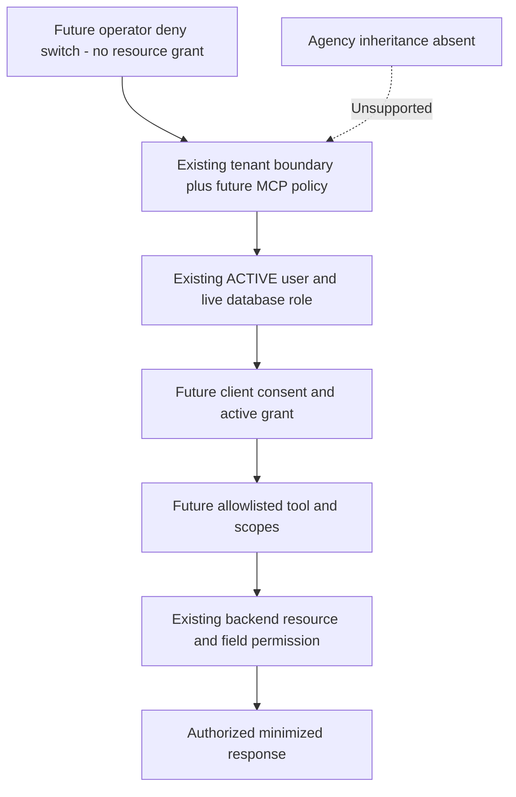

# Proposed MCP permission model

Date: **11 November 2026, Asia/Calcutta**. This is a future enforcement contract, not implemented scopes or a schema migration. Current backend authorization remains the authoritative resource-access boundary. Read with [architecture](PHASE_1_ARCHITECTURE.md), [security review](PHASE_1_SECURITY_REVIEW.md) and [Settings contracts](MCP_SETTINGS_DESIGN.md).

## 1. Which hierarchy exists

| Requested layer | Current evidence | Proposed treatment |
|---|---|---|
| Platform / Super Agency | No Platform/SuperAgency role, membership or tenant-parent ORM relationship found in inspected `backend/app` source. `RoleEnum.OWNER` is an application user role, not proof of global authority. | Future operator emergency switch can be deployment/control-plane authority. Do not grant cross-tenant resource reads or invent a platform database role. |
| Agency | No Agency model/agency-company membership found. | Unsupported inheritance layer. No agency policy routes or UI selector until relationships are explicitly designed/approved. |
| Company / Tenant | `models.User.tenant_id` UUID; tickets own tenant UUID; task tenancy follows creator. `routers/auth.py::_derive_tenant_id` uses employer ID for registration, but no managed Company/Tenant CRUD model proves hierarchy. | Tenant policy keyed by trusted current user's tenant. Company is a presentation term, not an invented ORM entity. Never derive access from client employer/email/domain input. |
| User | `models.User`, roles USER/MANAGER/ADMIN/OWNER, status ACTIVE/DEACTIVATED, department and manager pointers. `dependencies.py` reloads identity/tenant and current role. | Grant subject maps to this existing identity. Live role/status and actual resource relationships apply on every operation. |
| OAuth Client / Grant | `OAuthConfig` stores integration configuration; no demonstrated remote MCP client consent/grant/refresh-family registry. Existing tokens contain optional labels. | Future distinct client, subject binding, consent, connection and revocation records. Do not reuse configuration rows as grants or expose their credentials. |
| MCP Tool | No MCP registry/server exists. | Static server-owned catalog with exact required scopes, fixed REST method/path templates, input/output schema, side-effect class and release status. |
| Specific Resource | Existing task/child, ticket/member, workload subject, user tenant and notification access checks, with documented gaps. | Backend checks object, operation, relationship, requested fields and nested expansions; MCP may restrict further and can never broaden them. |

`Department` and `KanbanColumn` are global, not extra tenant ownership layers. `User.projects` is a string list; `Task.team` is text. Neither establishes a project/agency/team permission entity. No new relationship is inferred from these fields.



## 2. Deny-first evaluation

For every `tools/call`, independently authorized batch element and result stream/resumption, evaluate:

```text
ALLOW = deployment enabled
    AND tenant MCP enabled
    AND valid MCP issuer/audience/token/client/identity binding
    AND live ACTIVE user with matching tenant
    AND active, unrevoked client + consent + connection/grant
    AND tool released in static catalog
    AND tool in tenant allowlist AND in user grant allowlist
    AND required scopes subset of (token scopes intersect current consent intersect registered-client ceiling intersect tenant scope ceiling)
    AND (operation is approved read OR tenant is not read-only)
    AND existing backend navigation/module policy
    AND existing backend operation/resource/related-user/field policy
    AND request bounds, quotas and durable audit admission
```

Any unknown/missing authority, disabled parent, revoked state, unavailable policy store or unsupported hierarchy denies. Tenant settings cannot enable an unreleased tool, add arbitrary REST routes, expand a user's role or suppress resource checks. A grant cannot retain a deleted permission through a stale token. Read-only mode applies to all side effects, not HTTP GET alone (S08). Emergency disable overrides every consent and token.

`tools/list` applies identity/grant/tenant/client/scope/catalog/navigation ceilings without checking an unspecified resource or enumerating its records. It discloses eligible tool metadata only, not a promise of access to a particular task. `tools/call` additionally checks the actual resource, fields, related objects and output on every execution, independently of discovery. Knowing a hidden tool's name cannot authorize a call. Batch partial success must not leak rejected items. Model text, request headers such as `X-Tenant-ID`, task IDs, client-supplied roles and UI hiding never authorize anything.

Authorization context is request-local: `{issuer,subject,user_id,tenant_id,client_id,grant_id,scopes,policy_revision,request_id}` established by trusted services. Caller-supplied resource IDs are only targets. No mutable global current-user/client/credential state, admin impersonation or cross-request token reuse. A delegated REST token binds this context and a permitted operation set; backend dependency and operation guards enforce it again.

## 3. Proposed scopes

These eight names are **future scopes only**. Existing REST endpoints do not currently enforce them. They deliberately differ from labels such as `tasks.read` seen in existing token tests. An alias/name translation must never silently grant the new meaning.

| Scope | Intended capability | Existing resource boundary / restrictions |
|---|---|---|
| `tasks:read` | Bounded task list/overview/overdue/subtask reads | `routers/tasks.py::_apply_task_visibility`, `_ensure_task_access`; `task_information.read` reloads actor and binds children. No group sibling bypass, raw audit export or unrestricted dependency expansion. |
| `workload:read` | Read own workload or an authorized subject | `task_activity._subject`: self; Owner/Admin same-tenant active target; Manager direct report (`manager_id`), not every same-department user. No global workload sweep. |
| `users:read` | Minimal same-tenant directory resolution | Tenant-filtered `/users` and `/users/{id}`; `routers/users.py::_hydrate_user_avatar` already limits some private fields. MCP further permits only id/name and approved role/department fields, excluding contacts, notes, credentials and storage keys. Initial five-tool pilot does not require it. |
| `tasks:write` | Approved ordinary task creation/field edits and separately released child/status actions | `_ensure_task_update_access`, subtask/activity guards and workflow/reward policy still apply. Does not imply assignment, deletion, approval, time fabrication, arbitrary group IDs or configuration. Initially disabled. |
| `tasks:assign` | Change an approved task assignment to a verified same-tenant target | Explicit operation permission plus same-tenant relationship validation; transfer workflow separately withheld. Require this scope whenever create/update includes assignment fields, in addition to `tasks:write` when also editing/creating. Initially disabled. |
| `tickets:read` | Authorized ticket reads and separately approved expansions | `tickets.service.get_ticket_for_user`; S02/S03/S09 and side effects must be resolved for the exposed contract. Scope does not grant every ticket in tenant. Initially disabled. |
| `tickets:write` | Approved ticket operations with validated relationships | Existing operation rules in service/workflow modules; no inferred close/approve/override authority. Assignment/approver policies need separate field/action restrictions. Initially disabled. |
| `notifications:read` | Own currently authorized, bounded inbox | `workload_notifications.visible_query` plus future ticket/legacy repair. No read/dismiss mutation; no visibility from recipient ownership alone. Initially disabled. |

Do not add `time:*`, `comments:write`, `notifications:write`, generic admin or wildcard scopes in this phase. The feasibility report discusses such future candidates; they are outside this eight-scope foundation. A scope permits an operation family, not every action/field in it. Static tool-level field allowlists are still required.

## 4. Existing resource rules to preserve

| Resource / operation | Verified behavior | Consequence for MCP |
|---|---|---|
| Task read | Creator-tenant match first. Owner/Admin tenant-wide; Manager own/assigned/followed or same-department assignee; ordinary user creator/assignee/follower. `_apply_task_visibility` mirrors this for paginated queries. Legacy `/tasks` has visibility/side-effect differences. | Use paginated/information reads; never union policy from a broader endpoint. |
| Task group | Direct/list checks authorize individual assignment rows; isolated review reproduced `/group` returning a sibling whose direct read returns 403, on both aliases. Shared updates propagate without per-peer authorization. | Assignment visibility is **FAIL** across the complete surface. Passing direct/list tests cannot certify group protection. S05 decision/repair required; IDs/data/UX stay unchanged now. |
| Parent task write | Ordinary non-ticket task update inherits read access; ticket task restricts creator/assignee, including when actor is staff. Parent delete uses read gate plus immutable-history protection. | S10 decision required; no broad write scope rollout. |
| Activity/subtask write | `audit_logger._activity_context` refreshes ACTIVE actor, applies parent write policy, explicitly rejects ordinary observer writes, checks child belongs to parent. | Preserve independent observer denial and version/workflow checks; scope alone cannot bypass them. |
| Workload | Own or same-tenant authorized subject; Managers direct-report relationship rather than just department. | A Manager may see a department task while being denied its assignee's workload. Preserve this distinction. |
| Ticket read | Tenant first. Owner/Admin tenant-wide. Manager requires matching nonempty department and is denied before ordinary creator/participant fallback. Ordinary users require creator/owner, live participant/follower or pending approver relationship. | Do not replace with task policy or a universal staff rule. |
| Ticket write | Varies by action: participant management/transfer has owner/admin rules; some linked-task/close operations require assigned user. | Define tool per approved action. No universal `tickets:write => Manager may modify` shortcut. |
| User management | `get_current_admin` includes Managers; `routers/users.py::_apply_user_updates` restricts protected fields and Owner changes. API credential administration is separately Owner/Admin. | Exclude user/admin tools; never conflate staff with credential administrator. |
| Comments | Same-tenant Managers have broader access than task Managers, ordinary observers excluded; staff author delegation allowed. | Keep out until S10 policy resolved. |
| Notifications | Own/tenant-or-legacy-null plus live related-task predicates and subject rules; ticket-body rechecks absent. | Keep out until S11 policy resolved. |

Relevant code: `dependencies.py`, `permissions.py`, `routers/tasks.py`, `routers/users.py`, `routers/comments.py`, `tickets/service.py`, `tickets/task_engine_service.py`, `services/task_information.py`, `services/audit_logger.py`, `services/task_activity.py`, `services/workload_notifications.py`. The [security review](PHASE_1_SECURITY_REVIEW.md) identifies the exceptions and missing checks; this table must not be read as approval of those gaps.

## 5. Proposed management versus resource authority

Recommended defaults, pending product approval:

| Role | Tenant MCP administration | Personal client consent / connection revocation | Tool resource access |
|---|---|---|---|
| User | None | Own grants only; choose a subset of tenant-approved read tools | Only existing user-visible resources |
| Manager | None | Own grants only | Existing department task/direct-report workload/ticket policy, without implicit administration |
| Admin | Tenant policy, tools, client approvals and tenant connection revocation | Own grants; revoke tenant grants with reason | Own user-bound backend permissions, never impersonation |
| Owner | Same tenant administration; approve sensitive tenant defaults/emergency recovery as specified in Settings design | Own grants; revoke tenant grants | Same user-bound tenant boundary; no platform access |
| Deployment operator | Out-of-band global disable and operational health only | No automatic right to consent as users | No inferred data access |

Keep a separate personal connection area within the same future Settings tab so users can revoke their own access without obtaining administrative API rights. Backend API checks and server navigation ceilings enforce sections separately. Navigation policy can narrow access; it cannot widen role capabilities. These are proposed MCP defaults; no existing role changed.

For any proposed policy or client update, backend comparison of persisted **before/after effective authority** decides the capability needed. Any added mutation scope/tool/client ceiling or removal of read-only protection is Owner-only with a server-verified, short-lived step-up receipt. This applies to policy patches and client creation/updates alike; Admin cannot bypass it through an indirect field or a dormant write allowlist. An approval boolean or stale web-token issuance time is insufficient. Privilege-reducing edits remain available to Admin/Owner. The exact receipt contract and provider dependency are in the Settings design; none is implemented.

## 6. Policy state, revocation and audit

Future logical records: tenant policy `(tenant_id,enabled,read_only,allowed_tools,allowed_scopes,revision)`; client registration/tenant approval; subject-to-user binding; per-user/client/tenant consent; connection/grant with issued/revoked timestamps and effective permissions; refresh-family metadata held by AS; tenant-attributable audit events. These are design concepts, not ORM additions. Store only necessary metadata and token hashes/opaque references, not readable bearer/refresh tokens in UI/audit. Do not store new fields inside existing OAuth provider configuration to avoid a migration review.

Policy edits require optimistic revision checks and durable audit. Broadening allowlists never expands old user consent; reducing them takes effect immediately. Re-enabling a tenant or tool does not revive revoked grants. New role/membership authority can require fresh consent before added access; prior tenant grants are revoked on tenant movement. Use the most restrictive current state; do not union cached/token/admin snapshots.

A registered AS client may be shared across tenants; its tenant approval and each user's grant are separate authorities. Tenant client revocation disables only that approval and its tenant grants. A tenant Owner/Admin cannot modify/revoke an operator-shared registration or any other tenant's grants. Management IDs and mutability checks must express this ownership explicitly; an OAuth client ID by itself does not grant global client administration.

Revocation happens at the AS/connection registry and backend execution gate, not only within one MCP process. All replicas and in-flight response/resumption paths consult the same authority. Policy/authorization state outage denies new operations. Backend resource caches also need current authorization; MCP cannot repair S09 by changing its own cache key.

Record denied and allowed calls with minimal principal/client/tool/resource provenance and policy revision. Tenant administrators see only attributable tenant events; users see only their own approved connection activity. Do not reuse S06's broad audit query. See architecture for durability and Settings design for visibility/retention contracts.

## 7. Decisions requiring approval

Missing platform/agency layers remain unsupported. Product approval is needed for group sharing/edit authority, observer/Manager/comment writes, transfer approvers, Department/global configuration ownership, active related-user eligibility, MCP Admin/Owner controls, user consent/offline retention, and sensitive audit visibility. Until settled, affected tools are unavailable; no speculative business policy is implemented. Phase 1 tests preserve only explicit existing boundaries, as mapped in [the test plan](PHASE_1_TEST_PLAN.md).
