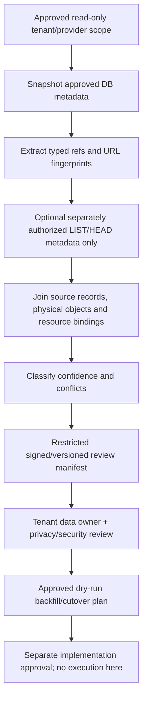

# Historical media reconciliation specification

Date: **12 November 2026, Asia/Calcutta**. **PLAN ONLY. No customer metadata inventory, file read/download, storage listing, backfill, migration, copy or deletion was executed.** [Ownership](MEDIA_OWNERSHIP_ARCHITECTURE.md), [visibility](MEDIA_VISIBILITY_MATRIX.md), [phase decisions](PHASE_2A_1_2A_MEDIA_POLICY.md).

## Scope and evidence hierarchy

A future read-only inventory requires explicit tenant/provider scope, authorized metadata-only credentials, approved output retention/access and a reviewed query program. It must not import the running application or call schema-repair startup. Use read-only database transactions/snapshots through an independent reviewed inventory process, not current application imports or destructive test collection. Production inventory is **not** authorized by this design.

Metadata allowlist: record IDs, explicit tenant/creator/uploader/resource references, created/updated/deleted dates, stored provider config/bucket/key or contained path, existing MIME/size/checksum metadata, domain reference slots and known policy/audit provenance. Later provider listing/HEAD may inspect only approved object namespaces, sizes/types/last-modified/version identifiers and permitted policy metadata. Do not GET bodies, generate thumbnails, sniff content, open ZIP/PDF, compute new content hashes or follow URLs. Existing stored hashes may be compared; ETag is not universally a content hash, especially multipart/encrypted objects. Avoid arbitrary custom metadata/tags containing customer data unless specifically approved.

Ownership evidence is temporal and may conflict:

| Strength | Example | Use / restriction |
|---|---|---|
| Strong explicit creation anchor | TicketAttachment.tenant_id consistent with ticket; AvatarAsset.tenant_id set at creation; reviewed upload/audit record identifying exact object at creation | Validate integrity and timestamps; an explicit column alone is not proof it was never altered |
| Strong corroborating history | Trusted, immutable tenant-scoped audit event tied to exact creation/binding and time; approved original-owner manifest or export | Current task-audit version2 tenant snapshots may help only if exact linkage exists; never assume they cover every media upload |
| Derived/conflicting resource evidence | Several task/ticket/chat/template refs, later copies, transferred parent/uploader | Candidate ownership with conflict, not automatic selection of the first/last/current tenant |
| Weak | Current uploader tenant, department ID/name, email domain, path prefix, filename, random key, public URL or directory location | Useful for review flags only; **never sole historical ownership proof** |
| Missing | Deleted uploader/parent, absent snapshots, external URL-only record | Orphan/UNKNOWN review; no default tenant or PLATFORM assignment |

The current uploader-derived [media guard](../../backend/app/services/media_access.py), cascade relationships in [models](../../backend/app/models.py), explicit [ticket attachment tenant](../../backend/app/tickets/models.py), legacy avatar fallback and [chat tenant-or-member lookup](../../backend/app/chat/repositories.py) explain why naive current-user joins cannot safely backfill original ownership.

## Metadata-only workflow



1. Freeze inventory schema/version, code digest, source revision, approved namespace/tenant allowlist and snapshot boundary. Record source row counts/high-water marks without fetching content.
2. Extract legacy tables and parent references in bounded pages: MediaItem lineage, MediaFile pending/confirmed/deleted status, avatars/user legacy keys, ticket attachments, chat/message refs, task/template URL slots, reward/badge art, recognized seed blueprints and existing backup reference formats. Preserve array slot/order and source primary keys. Never write through to source tables.
3. Parse URLs offline. Preserve a restricted canonical source-reference hash and token-presence flag; strip credentials/query/fragment from ordinary review output. Do not resolve external DNS, dereference redirects or call Supabase/Drive public URLs to see whether they work. Distinguish external host, same-origin route, signed bearer URL and malformed reference.
4. Only under separately approved provider read-only access, list/HEAD exact owned namespaces and page boundaries. Do not scan arbitrary buckets/filesystems. An object absent from DB is **unattributed**, not proof it belongs to ZeaPlay or is safe to delete. Provider policy/list permission itself may reveal unrelated objects; constrain the operator role first.
5. Build a typed reference graph and map exact provider object/version identities; distinguish same URL spelling, same physical object and actual same content. Metadata-only review cannot prove that different objects contain identical bytes. Normalize cautiously: case sensitivity, percent encoding, S3 literal key semantics, local path containment and provider generations differ. Never canonicalize distinct provider keys into one destructive target.
6. Emit conflicts/confidence and proposed actions. A later human review attaches provenance, category classification and original owner approval. Unresolved records remain UNKNOWN/unmapped for new privileged operations; existing public exposure is separately tracked until approved closure.

## Review manifest schema — proposed

Header fields: manifest schema/version/ID, inventory code/source digests, snapshot IDs/timestamps, approved scope IDs, collection permissions, row/object/ref counts, pagination completion markers, creator/operator ID, output retention and cryptographic integrity/sign-off metadata. A private manifest may contain necessary object references; it is not an API response or a public report.

Per-entry fields:

| Group | Required fields |
|---|---|
| Source | source_type/source_id/source_slot, source_schema_revision, expected_row_version/updated_at, source_reference_digest, prior_mapping_id |
| Object | provider_configuration_id, opaque physical_reference_id, internal encrypted/restricted resolver reference, provider version/generation, metadata-only existence status, observed size/type/mtime, existing checksum provenance |
| Attribution | creator/uploader ID if present, explicit tenant at creation evidence, current uploader tenant as a **separate weak observation**, parent refs and tenant evidence with timestamps |
| Policy | current declared visibility if any, observed_public_path flag, proposed visibility/owner/mode, review status/confidence, publication/custody approvers, desired vs effective policy |
| Risks | conflicts[], duplicate_reference_group, soft_deleted_with_retained_object, orphan/missing_owner, external/tokenized URL flag, compatibility clients/link risks, legal hold/retention evidence |
| Action | PROPOSE_ONLY/KEEP_UNKNOWN/CLASSIFY/MAP/REVIEW_CLOSURE; approved target asset/version/bindings, preconditions, decision IDs, rollback journal link |

Synthetic review example; no customer identifiers, body content, working URLs, raw signatures or secrets:

```json
{
  "manifest_version":1,
  "entry_id":"review-demo-001",
  "source":{"type":"media_item","id":"legacy-demo","slot":null,"expected_updated_at":"2026-01-01T00:00:00Z","reference_digest":"synthetic-digest"},
  "object":{"provider_configuration_id":"storage-demo","physical_reference_id":"object-ref-demo","existence":"NOT_CHECKED","resolver_reference":"restricted-manifest-slot-001"},
  "ownership":{"candidate_original_tenant":null,"current_uploader_tenant":"tenant-B-demo","evidence":[{"type":"current_uploader_only","strength":"WEAK"}]},
  "visibility":{"current":"UNKNOWN","proposed":"UNKNOWN","public_path_known":true,"effective_private_verified":false},
  "conflicts":["ORIGINAL_TENANT_UNPROVEN","PUBLIC_URL_COMPATIBILITY"],
  "review":{"state":"PENDING","approved_action":null},
  "action":"KEEP_UNKNOWN"
}
```

Raw internal resolver details, if needed, belong in a separately access-controlled encrypted part with minimal operator access and integrity binding to the manifest. Standard logs use opaque refs/digests. Customer filenames/user IDs are themselves sensitive metadata; limit reviewers, export/download rights and retention. No credential, signed query, authorization header or file content belongs in either part.

## Conflict categories and review actions

| Category | Detection | Required review outcome |
|---|---|---|
| ORIGINAL_TENANT_UNPROVEN | Only current uploader/path/department evidence | Keep unresolved; seek trusted creation evidence or explicitly authorized custody, never auto backfill current tenant |
| UPLOADER_TENANT_CHANGED | Historical anchor differs from current user tenant or credible transfer history exists | Preserve original anchor; invalidate old membership-specific grants in future implementation; missing transfer history is not proof no transfer occurred |
| TENANT_CONFLICT / CROSS_TENANT_REFERENCES | Explicit attachment/parent/creation evidence disagree or bindings span tenants | Separate assets/copies or approved sharing policy; no first-reference/majority-wins rule |
| MISSING_OWNER / DELETED_SUBJECT | Broken/orphan references, creator null, user-cascade metadata loss | Tenant custodian review; storage object is not automatically deleted or platform-owned |
| DUPLICATE_REFERENCE / SHARED_OBJECT | Several records/slots resolve to one object/version | Preserve all bindings and reference counts; one unlink must not purge shared bytes |
| CONTENT_DUPLICATE_UNPROVEN | Similar names/sizes/ETags but different objects | Do not deduplicate/delete based on metadata inference |
| SOFT_DELETED_BYTES_RETAINED | Tombstoned row and known object metadata remains | Record current retention/exposure; later reviewed purge after bindings/legal hold checks, not automatic cleanup |
| PUBLIC_URL_COMPATIBILITY / PUBLIC_GRANT | Local public path, Drive anyone grant evidence, Supabase public URL, copied reference | Plan all aliases/grants/caches and owner/client notices; do not label effectively private before closure proof |
| EXTERNAL_UNKNOWN / TOKENIZED_URL | External host or signed-looking URL | Offline fingerprint/redact; provider owner approval needed; no automatic fetch/import or new public URL |
| MISSING_OBJECT / METADATA_MISMATCH | Authorized HEAD/list disagrees with DB metadata | Broken-reference queue; do not synthesize contents, trust declared MIME/size or silently point at another object's key |
| GLOBAL_CATALOG_AMBIGUOUS | Template/reward/badge/Department-shared refs | D02/D03 platform-vs-tenant approval before mapping; shared IDs preserved until approved versioned mapping |
| STALE_SOURCE / STALE_APPROVAL | Snapshot/version changed before future import | Invalidate plan/review; re-inventory changed entries rather than overwrite concurrent work |

Known current deletion behavior matters: legacy media soft delete retains public bytes; ticket soft delete retains storage bytes; MediaFile explicit delete removes object then marks metadata; avatar cleanup is transaction-aware; template/badge replacement may remove a shared file immediately; deleted message/uploader rows may leave objects without an accountable owner. The manifest must represent these differences rather than normalize them into one guessed purge policy. Runtime/provider outcomes remain unverified.

## Approval, import/backfill and rollback design

Read-only manifest generation is not migration approval. Tenant data owners review their own entries; platform/shared/orphan conflicts require explicitly delegated authority and privacy/security review. D12 defines approval separation. A reviewer cannot approve another tenant's records through a client-supplied tenant value. Store signed/versioned decisions; revalidate authority, object/version, row/binding state and legal holds immediately before any later write.

Later import is additive and idempotent: create registry assets/versions/bindings and unique legacy mappings from **approved** entries only, in bounded batches with expected source versions, transaction journal and reconciliation counts. Unknown/foreign/conflicted entries stay unresolved; no fallback to current uploader tenant. Never rewrite URL arrays or mark visibility private as a side effect of ownership backfill. New writes and historical backfill have distinct trusted paths; imports cannot disable tenant/immutability/audit guards. Existing backup column allowlists and snapshots need explicit version support before new schema activation.

Verify logical counts, foreign/composite-key integrity, temporal owner evidence and unchanged source references; compare dry-run planned mappings with applied mappings, rerun permission decision tables on synthetic fixtures and test failed-batch resumption. Real provider byte/ACL checks and old URL closure occur in a separately authorized delivery cutover, not as hidden metadata inventory work.

Rollback before cutover removes only mappings/rows created by the specific approved batch when no newer references depend on them, or marks them superseded; retain provenance/journal. After a private cutover, preserve owner enforcement and closed public paths. Do not revert to current-uploader inference, republish bytes, undo a legitimate revocation, remove another batch's rows or restore private public URLs automatically. Physical copy/purge is separately approved and may be irreversible; its rollback cannot retract downloaded copies. No rollback or backfill is executed here.

Acceptance for later reconciliation: read-only role verified; no GET/content reads/network dereference; bounded complete manifests with confidentiality controls; conflicts never guessed away; exact expected-state/idempotency checks; multi-parent/cascade/orphan cases covered; independently approved backfill/cutover/rollback plans; no production operation authorized by this specification.
