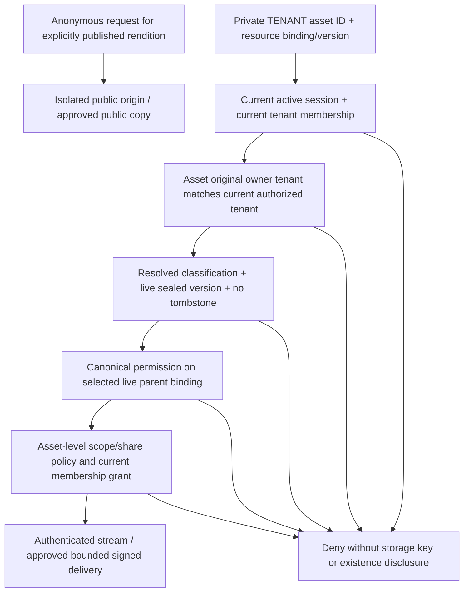

# Immutable media ownership architecture

Date: **12 November 2026, Asia/Calcutta**. **PROPOSED; no models, constraints, migrations or permissions implemented.** Approved direction: media keeps its original tenant when its uploader moves. [Phase decisions](PHASE_2A_1_2A_MEDIA_POLICY.md), [inventory](MEDIA_VISIBILITY_MATRIX.md), [historical evidence plan](MEDIA_HISTORICAL_RECONCILIATION.md).

## Current model and integrity boundaries

| Representation | Current ownership evidence | Limitation / lifecycle risk |
|---|---|---|
| MediaItem | `owner_id`→User, created_at, original_id/version lineage, provider/path/public_url | No tenant column; [require_media_owner_tenant](../../backend/app/services/media_access.py) reads uploader's **current** tenant. `User.media_items` delete-orphan and FK CASCADE can remove metadata on uploader deletion without a general provider cleanup/refcount contract. |
| MediaFile | `user_id`→User, department_id, bucket/key, type/status/dates | Same current-uploader tenant dependency; no immutable media tenant. Department is global, not ownership. User relationship/FK cascade can remove metadata; object deletion is a separate application operation. |
| AvatarAsset | Stored nullable tenant_id, created_by_id SET NULL; new [store_avatar_image](../../backend/app/avatar_utils.py) writes tenant-qualified private location | New records have a stronger explicit anchor, but no generic DB immutability constraint is demonstrated. Legacy null tenant can use creator's current tenant. Bundled default assets are a narrow explicit exception, not a null-tenant wildcard. |
| TicketAttachment | Explicit tenant_id, ticket_id FK, uploaded_by string, created_at/deleted_at | Current API checks parent tenant and canonical access. Parent FK is separate from tenant field; historical consistency must be checked, not assumed from FK presence. |
| MessageAttachment | Message FK CASCADE, storage_key/url and metadata | Tenant inherited through message/conversation; existing conversation membership may span current tenants. Membership is an access relation, not proof of file ownership transfer. |
| Task/template attachments, catalog art | Task/template creator, parent fields and URL strings; badge/reward image paths/refs | URLs have no reliable original tenant. Task creator tenancy is derived; template/Department/catalogs are global. Shared filenames and URL paths are weak evidence. |

Sources: [models.py](../../backend/app/models.py) classes `User`, `MediaItem`, `MediaFile`, `AvatarAsset`, `ChatConversation`, `MessageAttachment`, `Task`, `TaskTemplate`; [ticket models](../../backend/app/tickets/models.py); [media services](../../backend/app/services/media_service.py) and [MinIO service](../../backend/app/services/minio_media_service.py); [chat repository](../../backend/app/chat/repositories.py). A source FK or generated trigger does not establish installed production schema or runtime behavior.

## Model alternatives

| Dimension | Add ownership/policy columns to existing representations | Dedicated MediaAsset registry with legacy mappings |
|---|---|---|
| Initial migration | Smaller table-specific additions; still needs historical evidence, nullable staging and cleanup decisions | More additive tables and mapping work; retain existing rows/IDs while attaching registry IDs |
| Coverage/integrity | Duplicates constraints across MediaItem/MediaFile/Avatar/Ticket/Chat; raw URL arrays still need a reference table | One tenant/visibility/version/retention contract; all physical objects and parent bindings explicit |
| Performance | Existing joins simpler initially; cross-provider listings/policy checks remain fragmented | Indexed tenant+state+created/id lookups; extra bounded joins; measure representative workloads and avoid per-row signer/permission N+1 |
| Maintainability | Repeated lifecycle, audit and transfer logic; drift likely | Central ownership and delivery service; domain-specific authorization adapters remain canonical |
| API compatibility | Existing shape easy to retain but opaque-ID transition still separate | Existing route adapters resolve legacy IDs through unique mapping; opt-in v2 can hide raw fields without changing v1 |
| Multi-tenant scale | Every category must independently implement original-tenant filtering and indexes | Tenant-first indexes, bounded policies and storage resolver; future partitioning/sharding possible after measurement, not required now |
| Historical reconciliation | Multiple bespoke backfills and conflicting authority | One manifest/approval workflow; unresolved mappings can remain quarantined without inventing tenant |
| Failure cost | A missed category remains insecure | Registry consistency becomes critical; staged validation and fail-closed unresolved records required |

**Recommendation: a dedicated MediaAsset registry as the long-term authority, introduced additively with legacy mapping.** It should not duplicate task/ticket authorization or immediately replace all existing media models. Temporary owner-tenant columns may be justified as a separately reviewed containment step, but must not become a competing source of truth. No table or migration is added now.

## Conceptual records — names/types are a specification, not DDL

| Proposed record | Required fields / invariants |
|---|---|
| MediaAsset | Opaque UUID; owner_scope TENANT/PLATFORM; immutable owner_tenant_id for TENANT; immutable creation attribution/evidence; created_by_subject_id (nullable after permitted erasure), created_by_membership_id; effective_visibility PUBLIC/PRIVATE/UNKNOWN; classification decision/version; lifecycle state; policy_epoch; current_version_id; retention/legal-hold state; created_at. No creator deletion cascade into business assets. |
| MediaAssetVersion | Opaque version UUID; tenant/asset key; immutable validated MIME, length, optional checksum algorithm/value, original display name, object identity; validation/quarantine/sealed state. Replacement creates a new version; original is not overwritten. Hash is not an authorization credential. |
| MediaObject | Internal UUID; asset/version/tenant; allowlisted provider configuration ID; bucket/key or contained local relative path; provider version/generation if supported; canonical/public-rendition role; physical state. Provider credentials are outside this record in server secret configuration. No user-controlled URL-to-fetch. |
| MediaBinding | Tenant+asset/version+resource_type/resource_id; usage (attachment/portrait/catalog); active/deleted state; created_by_membership; sharing/approval context; domain policy revision. Foreign tenant parent cannot be attached through ordinary writes. Enforce typed parent integrity through validated adapters/association tables, not an unconstrained polymorphic foreign key claim. |
| MediaLegacyMapping | Unique `(legacy_type,legacy_id[,slot/version])`→asset/version; immutable provenance; reviewed ownership status. Legacy IDs and links remain stable until approved cutover; retries idempotent. |
| MediaGrant | Membership incarnation or approved tenant/resource audience; permission, expiry, binding/version, approved_by, revocation state. A user ID alone does not reactivate an old grant on rejoin. Existing domain visibility remains the default authority. |
| MediaUploadIntent | Opaque upload_id; asset/version; trusted tenant+uploader membership+session; exact server-selected staging object; purpose/parent; declared bounds; expected type/hash; TTL300 for compatible direct PUT; consumed/sealed state; idempotency key. Confirmation resolves this record, never a caller's arbitrary key. |
| MediaPolicyDecision / TransferEvent | Append-only actor/capability/tenant/resource, before/after policy, decision reason/evidence, approvers, expected epoch, timestamps/correlation. Raw signed URL/query/token/secret not recorded. |
| TenantMembership incarnation | Proposed stable membership ID, user/tenant, joined/left/current state and boundary generation. Fits current single-current-tenant User model via a separately designed adapter; not an implemented multi-tenant identity system. |

For platform artwork, require `owner_scope=PLATFORM`, owner_tenant_id absent by an explicit scope constraint, and a separately defined platform curator authority. No tenant role may claim PLATFORM scope. Unknown historical **ownership** is a separate review state; it does not become platform-owned or use a default tenant. Stage unresolved records in a reconciliation registry/manifest, with no tenant-private delivery until approved resolution.

### Proposed constraints and indexes

Tenant-owned assets require nonnull canonical tenant ID in the same type as the approved tenant authority. Existing String(36)/UUID variations must be mapped and validated rather than copied blindly. Immutable owner scope/tenant is protected by database guards and service policy; ordinary ORM update, bulk API, import and raw SQL paths cannot bypass it. The application database role must lack permission to disable those guards. Platform and tenant uniqueness are separate.

Use composite tenant+asset/version keys to prevent cross-tenant bindings/objects/grants. Enforce unique live legacy mapping and unique provider-configuration/bucket/key/version reference for a physical object where appropriate; shared physical references need explicit registry ownership, not duplicate delete authority. Polymorphic resource types are an allowlist with per-domain integrity checks or association tables. Never represent SQL referential integrity that the database cannot actually enforce.

**Scope clarification from independent review:** those tenant-equality constraints apply to **TENANT-owned private objects**, not as a null-equals-any-tenant rule for PLATFORM assets. Asset ownership scope and the referencing resource's tenant are distinct concepts; a reference never rewrites ownership. An explicitly published PLATFORM rendition can be read anonymously at its public origin without a tenant membership. A tenant resource referencing that approved rendition does not gain platform editing/deletion rights. D03 must resolve any platform-authenticated catalog audience and the final scope-aware association/constraint representation before schema implementation; PRIVATE/UNKNOWN platform records must not acquire anonymous or cross-tenant access through a null owner tenant. No SQL constraint or new sharing rule is implemented here.

Candidate indexes: assets `(owner_tenant_id,lifecycle,visibility,created_at,id)`; versions `(tenant_id,asset_id,id)`; bindings `(tenant_id,resource_type,resource_id,state,asset_id)` and `(tenant_id,asset_id,state)`; legacy mapping unique source key; grants `(tenant_id,membership_id,asset_id,revoked_at)`; object resolver unique backend/object identity; uploads `(tenant_id,id,status,expires_at)`. Counts/search/sort/pagination are tenant-filtered before aggregation; keyset pagination is preferred for new v2 listings, with measured caps. Filename/content search never exposes another tenant's counts, snippets, checksum existence or object keys.

RLS can be defense in depth only after a separate pooled-connection/session-context design and verification. It is not currently demonstrated and does not replace canonical object checks. No RLS policy is added in this phase.

## Proposed authorization contract

The authenticated branch is the **private TENANT delivery** decision path. It is not a prerequisite for reading already approved bundled/public artwork. Publication and private registry metadata still require their own approved authorities. Platform-authenticated catalogs remain a D03 implementation blocker rather than an implicit exception to tenant checks.

Standalone library assets use an explicit library binding and existing self/staff/department policy. Portraits keep the existing same-tenant read audience while edit/selection policy stays narrower. Task and ticket attachments invoke current canonical domain read policy; ticket attachments retain the existing additional rule. New binding creation requires permission to share that asset into the destination, not just permission to edit a parent URL field. A parent lookup or guessed ID never grants access by itself.

For several parent references, authorize the **requested context**, without exposing other bindings. Do not require read access to every parent (breaks legitimate sharing), and do not automatically grant publication because one parent is public (leaks another parent's confidential attachment). A publication decision must examine all bindings; conflicting confidentiality requires a separately approved public derivative or separate asset. Cross-tenant bindings remain denied unless a future explicit sharing policy defines them. Do not silently reinterpret existing cross-tenant chat membership as such approval.

## Tenant lifecycle and A→B→A

Current [session validation](../../backend/app/services/auth_sessions.py) checks current user, session tenant and auth_epoch; the auth migration increments epochs/revokes families on tenant/password/status/role changes. Current task-audit DDL additionally can reject user-tenant changes when protected version2 activity/ledger/work intervals depend on that identity. **Preserve both**. Neither policy is relaxed to make media transfers easy; installed trigger/schema state must be verified separately later.

| Event | Asset ownership | Required future access behavior |
|---|---|---|
| User creates file in A | A permanently captured from trusted creation context; creator attribution/membership recorded | Existing A membership/domain policy authorizes; client cannot submit owner_tenant_id |
| User leaves A for B, if existing business guards permit it | Asset remains A; no path rename/copy or owner rewrite from User change | Revoke A membership-specific grants; invalidate old session/epoch; current B cannot use uploader-self shortcut or old capability issuance |
| User returns B→A | Asset still A; new A membership incarnation, not the previous membership ID | Old A/B credentials, cookies/upload intents and grants remain invalid. Private self-only access is not restored merely because user ID is unchanged; fresh explicit grants/custodianship required |
| Returning user receives a fresh legitimate A role/audience grant | Owner remains A | Fresh current-session access may be allowed by the **new** grant, including approved tenant-wide portrait reading. This is not revival of old credentials or a permanent ban on all A data |
| User deactivated | Company files remain A; user attribution retained | User denied; authorized A custodians retain existing business access. Already issued ModeB URLs may last until their verified expiry |
| User deleted | A assets retained subject to approved retention/erasure policy; creator FK becomes nullable/tombstoned attribution, not cascade-delete | Revoke subject grants; tenant custodian handles files; legal/privacy deletion of personal portraits is a separate audited decision |
| Historical owner missing/conflicting | No invented owner, no platform/default-tenant fallback | Review queue; deny new privileged issuance until resolved. Existing public-link exposure is tracked, not magically removed |

Membership incarnation is **proposed**, not a claim about today's User model. Current uploader-derived media policy can re-admit records after a tenant round trip with fresh credentials; current session invalidation protects old credentials but does not solve immutable ownership or old user-ID grants. Tests must separate those issues.

## Cross-tenant transfer, deletion and multiple references

Baseline rule: **no ordinary in-place owner rewrite**. Recommended exceptional transfer is a separately authorized **copy into a new destination-owned asset/object with immutable provenance**, optionally followed by a separately approved source retirement. Original A asset remains A; the new logical B asset is created under B and records `derived_from/transfer_event`. Any policy requiring same-ID custody transfer needs a separate original-tenant vs current-custodian ledger design and approval; it is not implicitly enabled.

D05 approval must identify source/destination tenant authorities, purpose, exact asset/version and data rights, every binding, retention/legal holds, destination delivery policy and operator capability. Reauthorize before committing, use idempotency and expected epochs, freeze new issuance during a coordinated handoff, verify destination private policy, and audit completion. Do not share a raw key or copy a folder based on an uploader's current department. Do not bypass current task-audit transfer prohibitions.

Removing one binding unlinks only that resource. Physical purge requires zero remaining live bindings, no legal hold/retention requirement, no approved version/public replica dependency, and explicit deletion authority. Use tombstone→deny new reads/signing→retention queue→provider-specific purge→verification; account for multipart staging, object versions/delete markers, stale URLs and provider failure. Purge is idempotent and records a nonsecret deletion receipt. An offline checksum does not authorize deleting a duplicate object. No storage deletion is run now.

## Adoption and acceptance gates

Use the reconciliation manifest first. Later add the registry and mappings under reviewed migrations; write trusted tenant context for **new** assets immediately at future activation, stage uncertain history separately, and run validation before constraints/cutover. Legacy adapters must not silently fall back to current uploader tenant when a record is marked registry-authoritative/unresolved; fail closed with a review-required result while honoring an approved legacy compatibility plan. Imports/backups need versioned allowlists and mapping retention; current [backup registry](../../backend/app/backups/registry.py) deliberately fails on unreviewed schema drift.

Required later tests: direct/bulk/import attempts to rewrite owner rejected; count/page/search tenant isolation; original owner survives uploader move/delete; old memberships/sessions cannot reactivate; fresh explicit regrant works; platform-null exception cannot be forged; multi-parent read/unlink/purge rules; idempotent authorized transfer and rollback; constraint behavior on an empty fresh schema and historical synthetic fixtures. These are requirements, not executed results.
