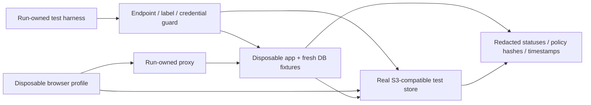

# Real object-storage verification plan — Phase 2A.1.2B

Date: **12 November 2026, Asia/Calcutta**. **PLAN ONLY; no provider tests executed in Phase 2A.1.2A.** [Phase index / D01–D12](PHASE_2A_1_2A_MEDIA_POLICY.md). This plan does not authorize starting the next phase, changing storage policy or exercising an installed ZeaPlay service.

## Current evidence and execution gate

Current source uses [storage/minio.py](../../backend/app/storage/minio.py), [minio_media_service.py](../../backend/app/services/minio_media_service.py) and [ticket attachments](../../backend/app/tickets/attachments_router.py). Media GET/PUT and ticket PUT signing use **300 seconds**. Media GET signing requests `private, no-store, max-age=0`. These are verified signing intentions, **not evidence of an enforced private bucket, correct provider responses or deployed reverse-proxy policy**. The [Phase2A.1.1 report](PHASE_2A_1_1_MEDIA_SECURITY.md) records the earlier real-provider acquisition blocker. Availability was not retested here: provider access and installations are outside this design phase.

**Actual real-store execution: BLOCKED pending D11.** All provider cases below are **NOT RUN**. A mock SDK, captured URL, pure signer test or successful application test cannot change that status. If an approved distribution cannot be obtained, stop that test layer and record the acquisition error without substituting mocks. No specific unverified image/version is designated approved by this document.

The design run also observed a changed default Docker bridge ID, followed by an unavailable Docker Desktop Linux API pipe during read-only metadata checks; cause is unknown. See the phase index. Do not reuse an unstable or unexplained environment as2B proof, attempt to repair existing services, or claim resource preservation from an unavailable snapshot. A fresh stable disposable baseline is required before execution.

The next-stage environment owner must supply:

1. An approved, obtainable real S3-compatible provider distribution, fixed version and digest/checksum, its source/provenance and security review; CPU/memory/disk allowance. Record any features differing from the intended production provider.
2. A separately authorized disposable run: unique run ID, container/project labels, empty run-owned volumes/directories, private network and loopback-only published ports. Do not reuse existing application Compose projects, networks, databases, provider credentials or storage endpoints. No public ingress.
3. New synthetic provider identities: bootstrap administration only for creating run-owned policy; a least-privilege application signer scoped to run buckets/prefixes; an unprivileged foreign principal. Never use production credentials or load existing `.env` files. Supply secrets through run-owned restricted configuration, not command output or committed files.
4. An explicit endpoint/bucket/credential allowlist and a test preflight that rejects non-loopback/unapproved endpoints, production-like supplied destinations, pre-existing resources and unexpected labels. Inside containers use the exact run-network hostname; reject redirect to any other origin. Record resolved targets without secrets.
5. Empty private and public synthetic buckets, with separate policies, and deliberately named tenant A/B fixture prefixes. Public policy grants GET only for an approved synthetic artwork prefix; it does not grant upload or LIST. Private policy denies anonymous GET/LIST and anonymous write; application credentials cannot alter bucket policies.
6. For application issuance and current-resource checks, a **fresh disposable PostgreSQL/application fixture**, explicit fixture-only DB/endpoint guards before any application import, no shared startup/schema helpers against an existing DB, unique users/tenants/resources and synthetic bytes. Fresh-schema initialization, if authorized for2B, is confined to those resources. Do not run the current unsafe module-level test collection against any installed DB.
7. For proxy/native-browser checks, a run-owned proxy with the reviewed route configuration and a real browser profile. Any CDN emulator proves only the tested configuration; a future production configuration inspection is a separate approved activity. No production URL requests.

The harness must distinguish **current-source regression**, **provider contract verification**, and **future design acceptance**. Proposed asset APIs, immutable registry, native media cookie and object sealing do not exist yet. Their cases remain NOT IMPLEMENTED/NOT RUN until separately authorized implementation; do not invent passing endpoints.

## Required provider cases

Every case uses only recognizable generated text/image fixtures with random run-scoped IDs. Capture request method, redacted opaque fixture ID, expected/actual status and provider error code, relevant safe headers, timestamps and configuration digest. Never log full signed URLs, Authorization headers, cookies, secret keys, customer filenames or body contents. Use fresh clients without SDK ambient credentials for anonymous requests.

| # / ID | Setup and actual exercise | Required result / evidence | Current status |
|---|---|---|---|
| 1 / S01 private GET | Upload synthetic object with fixture signer; unsigned GET and HEAD to exact private object through provider endpoint | Access denied; no bytes, redirect or size disclosure to unauthorized client. Record actual provider code/status; missing object alone is not proof of privacy | **NOT RUN — environment BLOCKED** |
| 2 / S02 private LIST | Unsigned ListObjectsV2 at bucket root and private prefix, including empty prefix and delimiter | Denial; no key names or listing metadata. Also test foreign credentials outside their scope | **NOT RUN** |
| 3 / S03 public artwork | Explicit public fixture prefix only; anonymous GET to generated image and unsigned LIST/write/private-prefix GET | Image readable as intended; LIST/write/private reads denied. Preserve independent private-bucket denial | **NOT RUN** |
| 4 / S04 signed PUT | Server signs exact method/key with TTL300; upload known small payload using exactly the signed headers | Successful provider write and authenticated HEAD verifying fixture size/type. Confirm no client choice of tenant prefix or policy. Record whether MIME headers are actually signed | **NOT RUN** |
| 5 / S05 signed GET | Authorize tenant A fixture then sign exact sealed/read object, TTL300, fixed cache response parameter | Successful GET with expected fixture digest checked in memory; do not print contents. Correct Content-Type and safe download policy | **NOT RUN** |
| 6 / S06 signature tamper | Change one signature character, then one signed credential/query component; keep other bytes unchanged | Provider rejects each request and returns no object bytes; not merely app rejection or a mock exception | **NOT RUN** |
| 7 / S07 key tamper | Change path to a different **existing** synthetic key, including B's object; retain original signature | Rejected; controls include separately authorized request confirming both objects exist. Path encodings/canonicalization variants must not reach another key | **NOT RUN** |
| 8 / S08 method tamper | Use GET URL for PUT/DELETE/HEAD and PUT URL for GET; validate any provider-specific HEAD behavior explicitly | No unauthorized write/read/delete. Signed-method contract documented from actual responses; a method mismatch must not be accepted as a general alternate capability | **NOT RUN** |
| 9 / S09 response parameter tamper | Modify/add/remove signed response-cache-control and disposition query parameters on a valid URL | Signature rejection where altered. Untampered actual headers match intended contract; client cannot force shared-cache behavior | **NOT RUN** |
| 10 / S10 expiration | Use the actual300-second URL before expiry, then make a **new** request after issued_at+300 seconds plus bounded measured clock-skew margin | Before valid, after denied; record real wall-clock/provider clock evidence. Do not shorten TTL, spoof time or substitute mocked expiry. Maximum wait blocks can be short enough to publish progress | **NOT RUN** |
| 11 / S11 cache headers | Inspect actual signed GET200, Range206 and conditional304 behavior, authenticated stream responses, native browser records and run-owned proxy caches; include denied/missing responses | Verify private/no-store behavior on every supported private-delivery variant, not only200. No private shared-cache HIT or response reuse by another identity. Provider compatibility fails for a required variant if the signed override is absent/ineffective; no inference from URL text | **NOT RUN** |
| 12 / S12 deleted object | Issue URL, verify valid, delete the run-owned object, retry URL; test explicitly configured versioning and any version ID | Current-key GET fails without data; documented provider error may be403/404 depending on list rights. An existing signed version URL may still read a retained version: test and block a stronger deletion claim until versions/policy are addressed | **NOT RUN** |
| 13 / S13 issued capability lifetime | Issue GET, revoke fixture app permission/session, retry the same URL before expiry, request new issuance, then retry after expiry | Existing URL **may remain readable until expiry**; new issuance denied. Report observed behavior honestly. Key/credential/policy revocation is a separate scoped provider action, not an assumed app side effect | **NOT RUN** |
| 14 / S14 cross-tenant issuance | A authenticates to disposable app. Exercise the exact current routes mapped below: foreign list exclusion, foreign confirm/finalize/delete, and foreign ticket admission before presigning | No B metadata/URL or foreign object I/O. For a list,200 with only authorized A records/count is valid; foreign object operations deny. Unknown identity/key arguments must not escalate authority, but current schemas may ignore extras rather than return422. Future strict v2 rejection is separate | **NOT RUN** |
| 15 / S15 direct access | Unsigned canonical/path-style/virtual-host alternatives available in run, foreign key credentials, wrong bucket/prefix, object ACL attempts and write attempts | No unintended direct read/list/write and no bypass of policy. Disable unsupported addressing variants explicitly rather than marking them passed | **NOT RUN** |
| 16 / S16 credential disclosure | Inspect redacted API/browser/network/error/log schema, provider policy and environment-isolation output | No secret access key, session token or app/provider Authorization exposed. A signing access-key **identifier** in a SigV4 credential field is not the secret key. A complete signed URL is a temporary bearer capability and must be redacted | **NOT RUN** |
| 17 / S17 proxy/CDN bypass | Run-owned proxy: `/uploads`, `/api/uploads`, duplicate `/api/api` router paths, `/assets/task_templates`, configured provider aliases, case/encoded path variants and cache keys | Proposed PRIVATE fixtures never bypass admission via another alias, public rendition or cache. Existing legacy public-route exposure is a recorded current limitation, **not a regression test to falsely pass**. No actual deployed/CDN claim from local success | **NOT RUN** |

For tampering, include a valid positive control before/after the denial; a dead endpoint, expired original, missing file or malformed fixture is inconclusive. Preserve expected provider errors in redacted evidence. Sign using actual application SDK/parameters for current paths; a separate synthetic signer proves only that provider contract. Verify server-generated response overrides, not attacker-supplied arbitrary query parameters.

### Executable current API mapping for S14 — future2B only

Use the fixture's direct backend base URL for these **literal backend paths**; run-owned Nginx browser cases use the external aliases in the visibility matrix. Route validation was source-only in2A.1.2A; no request below was sent.

| Current request using actual backend authentication | Fixture and expected contract |
|---|---|
| `GET /media/list?tab=images&page=1&page_size=24` | A/B confirmed image rows with distinct run-owned keys; A's response/count never includes B, including staff and shared-department fixtures. Assert real provider requests are limited to authorized returned keys. Current GET signing happens during this list; no generic current GET-by-file-ID signer exists |
| `POST /media/confirm` with `{"file_id":"B-file-id"}` | B row exists. A gets404 before HEAD/sniff/confirmation; positive A control retains normal role/uploader checks. This is admission verification, not a read-URL issuance endpoint |
| `POST /media/avatar/finalize` with B file ID and schema-valid crop metadata | B confirmed avatar row exists; A gets404 before object I/O. Validate the actual current crop schema in the future harness so a422 parsing failure cannot masquerade as tenant denial |
| `DELETE /media/B-file-id` | B row exists; foreign admission404 precedes Owner-only delete and storage work. Only run-owned synthetic records may be used |
| `POST /api/tickets/{B-ticket-id}/attachments/presign` with schema-valid `fileName/contentType/sizeBytes` | B ticket exists; A denied by canonical ticket admission before bucket creation/signing. Authorized A ticket positive control preserves exact uploadUrl/fileKey/headers and confirm fileKey flow |
| Add unsupported tenant/user/provider/key fields to current requests | Compare safe behavior to the no-extra-field control: no foreign result, owner change or caller-selected signing key. Do **not** require422 from existing BaseModel contracts that ignore extras. Future v2 DTO strict rejection remains NOT IMPLEMENTED |

Record API HTTP result separately from real-provider protocol enforcement. Where a current flow authorizes listing rather than a particular signing action, distinguish successful authorized listing from denied foreign file access. Do not add endpoints or change current schema extra-field policy to make this test pass. Generated export routes in inventory M19 are separate authenticated-response regressions, not provider signing tests.

S11 must not generalize a200 override to other statuses. [S3 GetObject documentation](https://docs.aws.amazon.com/AmazonS3/latest/API/API_GetObject.html) describes response overrides for successful200 responses; actual compatible-provider206/304 behavior requires independent evidence. Use separately valid method signatures where HEAD is supported; a GET signature sent as HEAD remains the S08 tamper test. If the provider cannot satisfy the required private cache contract, record FAIL/BLOCKED for that delivery variant and retain ModeA as the proposed alternative; do not change existing bucket metadata, proxy policy or URLs in this phase. No provider variant was executed here.

Expiration is evaluated on a new request. A transfer started while valid may finish after expiry, and downloaded copies remain outside application recall. This is part of [S3 presigned URL semantics](https://docs.aws.amazon.com/AmazonS3/latest/userguide/using-presigned-url.html); test the selected compatible provider and do not generalize identical details without evidence.

## Additional application and design acceptance cases

| Area | Future fixture/check and acceptance | Boundary |
|---|---|---|
| Current resource rules | Anonymous, unrelated same-tenant, allowed same-tenant, foreign tenant; ordinary user/Manager/Admin/Owner; task grouped assignment, ticket canonical+attachment checks, avatar tenant visibility, chat membership | Preserve existing permission distinctions. Same tenant alone is insufficient; global catalog/chat decisions D02–D04 must be explicit |
| Identity changes | Real backend login; session revoke, deactivate, role change, tenant A→B→A, page reload and stale-tab requests | No old session/grant regains authority. Existing auth/audit tenant-transfer prohibitions preserved; use only legal fixture transitions and report blocked scenarios |
| Streaming/native browser | Actual authenticated image/video/download, no unauthenticated Blob substitution; HEAD, byte ranges206, invalid range416, If-Range, interrupted transfers, concurrent limits, slow client, disconnect cleanup | Browser cannot attach Axios bearer headers through a normal anchor/img. D08 bridge must be approved and implemented before claiming ModeA native compatibility; no fake cookies/mocked login |
| Revocation races | Remove binding/permission or deactivate during issuance and streaming; retry after commit; in-flight SLO measured | New ModeA requests deny after revocation; bounded active-stream cancellation per approved SLO. Already delivered bytes not recallable; ModeB separate300-second capability behavior |
| Upload integrity | Replay signed PUT before/after confirmation; MIME mismatch/polyglot SVG/HTML; oversized actual file vs declared; concurrent/idempotent confirm; foreign upload intent; failed PUT then confirm | Current mutable-key weakness remains a finding where reproduced. Future staging→validated **different sealed key/version** prevents live PUT replacing confirmed content; no trust in declared size/type or key possession |
| Safe response | Safe Unicode/CRLF filenames, active document disposition, local SVG/HTML sandbox and isolated origin, provider Content-Type/disposition, missing object vs forbidden uniformity | Real browser execution evidence required for origin/sandbox claims. Range/HEAD validators must authorize before exposing existence/length |
| Object/version lifecycle | Revoke/delete one binding with other valid bindings; soft-deleted row and retained bytes; last binding under retention/legal hold; old signed version and CDN cache | No shared-object destruction or false immediate-deletion assertion. Verify exact configured object version and cache/policy state |
| Legacy compatibility | Existing upload→PUT→confirm fields retained; ticket fileKey echo; avatar fetch+Blob; public packaged artwork; task/template strings; provider wrappers and old copied URLs | Proposed v2 is opt-in. Current confirmed compatibility defects must not be silently rewritten as a new contract in tests |
| External providers | Synthetic separately approved Supabase/Drive sandbox, exact policy/share behavior, no customer account | Local S3 does not verify Drive anyone/reader, Supabase RLS/public URL, external-link cache or third-party revocation. **NOT RUN / separate prerequisite** |

HTTP expectations follow [RFC9110](https://www.rfc-editor.org/rfc/rfc9110.html); private cache handling follows [RFC9111](https://www.rfc-editor.org/rfc/rfc9111.html). `no-store` constrains compliant caches; it cannot erase preexisting copies or prove proxy compliance. Do not use an uncached browser response alone as shared-cache isolation proof.

## Test layers and reporting contract

| Layer | What it can establish | Phase2A.1.2A execution |
|---|---|---|
| Offline specification checks | Source syntax/route inventory, local doc links, JSON example consistency, proposed decision-vector consistency | Executed and recorded in the phase index; **not implemented authorization** |
| Application unit tests / SDK mocks | Local branch handling and call arguments | **NOT RUN**; cannot verify storage enforcement |
| Disposable app+PostgreSQL integration | Actual fixture auth, object policy and issuance boundary | **NOT RUN** |
| Real provider protocol tests S01–S17 | Actual configured provider policy/signatures/expiration/cache/deletion | **NOT RUN; environment BLOCKED** |
| Real browser with backend authentication | Native delivery, session changes, active content/origin and browser cache | **NOT RUN** |
| Production configuration / storage verification | Actual installed bucket/proxy/CDN/legacy copies | **NOT RUN, not authorized** |

Each case records PASS/FAIL/BLOCKED/NOT RUN, implementation revision and dirty-source digest, provider distribution/digest, SDK versions, redacted policy/config hashes, independent expected result, exact controls, actual results, UTC times, evidence paths and limitations. An unimplemented design assertion is NOT RUN/BLOCKED, never PASS because its documentation is consistent. A missing provider blocks provider tests even if app/unit suites are green. Preserve failures rather than changing a visibility policy to make them pass.

## Cleanup and stage exit

Create an immutable run manifest **before** creating resources; append exact container/volume/network/bucket/object/fixture IDs as they are created. Cleanup may target only those IDs after verifying their run labels, absolute path containment and endpoint allowlist. Do not use broad name/prefix discovery followed by deletion; never clean existing ZeaPlay containers, directories, buckets or rows. For versioned test objects, include only run-owned versions/delete markers. If a resource cannot be proven run-owned, leave it and report it.

On failure, stop requests, preserve redacted evidence, terminate only run-owned helpers, delete only synthetic run-owned resources when the manifest authorizes it, remove restricted temporary credentials and compare pre/post installed resource identities/states. No rollback or restart of existing services is permitted. Provider policy changes in2B apply **only** to new disposable buckets.

Phase2A.1.2B may claim provider readiness only after all applicable S01–S17 execute on the real selected provider, limitations are stated, no unauthorized resource was contacted/modified, cleanup is proved and failures have a disposition. Production readiness also needs approved ownership/classification, implemented registry/delivery controls, real browser/integration evidence and separately authorized production configuration review. Passing this test plan alone does not authorize OAuth/delegation or production rollout.
