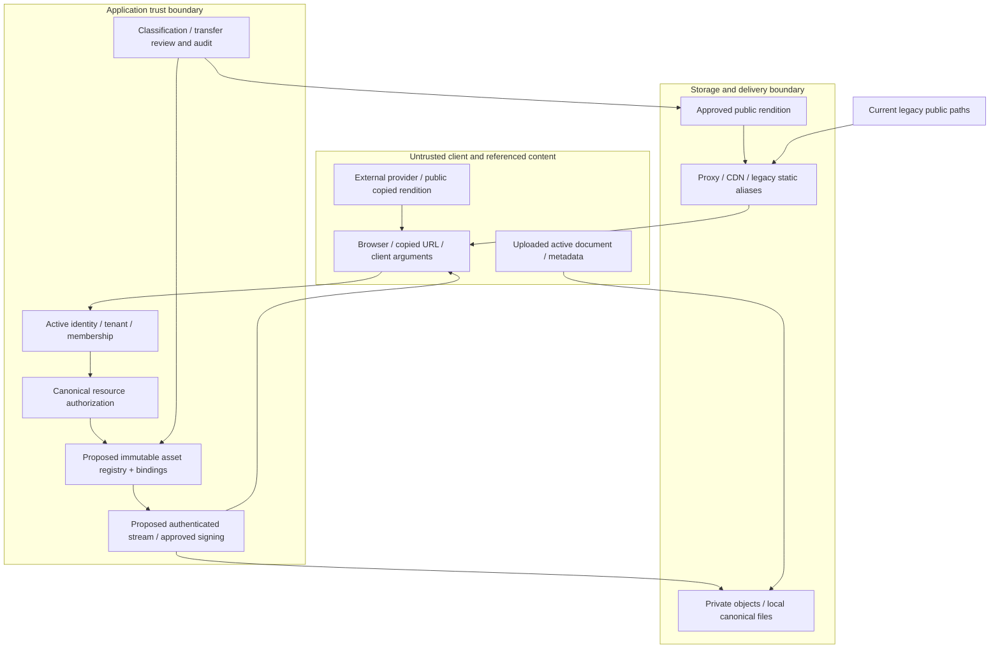

# Media security threat model

Date: **12 November 2026, Asia/Calcutta**. **Source review and proposed design only.** [Phase index and decision owners](PHASE_2A_1_2A_MEDIA_POLICY.md); [route inventory](MEDIA_VISIBILITY_MATRIX.md); [real-provider verification plan](MEDIA_STORAGE_TEST_PLAN.md). Severity describes potential impact in the stated preconditions, not a claim that a production exploit was executed. No customer objects, installed APIs or provider policies were accessed.

## Assets, boundaries and policy assumptions

Protected assets include company documents, task/ticket/chat attachments, tenant portraits, original-tenant ownership evidence, current session authority, provider secrets, metadata/manifests and object lifecycle history. Approved bundled/public artwork must remain usable. UNKNOWN is an unresolved classification; it is neither approved publication nor proof of private delivery. Random IDs, storage keys and hidden URLs are not authorization.

The proposed flow is not present enforcement. Existing local static mounts and external public links bypass resource policy today. A tenant Owner is not a platform administrator. Current auth/session checks and task-audit tenant-history guards remain independent mandatory controls; this media design does not weaken them.

## Threat register

| ID / severity | Preconditions and impact | Existing source control / evidence | Missing control or uncertainty | Proposed mitigation | Required verification |
|---|---|---|---|---|---|
| T01 **HIGH** cross-tenant media access | Attacker knows another file ID/key or uploader moves tenants; confidential bytes/metadata exposed | [media_access.py](../../backend/app/services/media_access.py) fresh uploader-tenant check; ticket canonical+attachment rule; avatar tenant check | MediaItem/MediaFile tenant derives from **current** uploader; direct public bytes have no resource check | Immutable original tenant, active membership and selected canonical resource checks before metadata/signing/streaming; no client identity/key authority | Foreign/same-tenant-unrelated/allowed fixtures across all routes; S14/S15/S17; A→B→A cases |
| T02 **HIGH** public legacy URLs | Sensitive business file was uploaded under a public static/provider path; copied URL bypasses login, deletion and tenant rules | [main.py](../../backend/app/main.py) mount + [media_http.py](../../backend/app/media_http.py) sandbox headers | No row/tenant lookup in `/uploads`; historical mixed intent; external public copies unknown | Reviewed classification, replica inventory and explicit closure/cutover; private canonical object, authorized compatibility endpoint; never automatically mark all uploads private | Anonymous actual bytes test only with synthetic fixture; every alias and old public replica verified closed before effective PRIVATE; D01/D09 |
| T03 **HIGH** stored SVG/HTML execution | Attacker uploads active content served from trusted origin; session/UI compromise or malicious navigation | Current `sandbox_uploaded_response` CSP sandbox and nosniff; [avatar_http.py](../../backend/app/avatar_http.py) applies sandbox to uploaded template art; fixed packaged avatars separately allowed | Not a confidentiality control; provider/direct/external routes may lack equivalent headers; other static namespaces not universally sandboxed | Preserve current defense; isolate untrusted media origin, validated rendition or attachment disposition; strict active-type handling, no arbitrary inline third-party HTML | Real browser synthetic SVG/HTML/polyglot checks, no script/origin escalation; inspect actual app/provider/proxy response. [CSP sandbox specification](https://www.w3.org/TR/CSP3/#directive-sandbox) |
| T04 **HIGH** shared-cache disclosure | Proxy/CDN caches private response and serves another identity; URL/key omits auth variance | `main.py::no_store_cache_headers`; signed GET response-cache override | Deployed proxy/CDN and provider override enforcement unverified; old public copies persist | Private/no-store for app/private GET; no shared cache of authenticated delivery; public/private object separation; deny/purge old public routes at cutover | S09/S11/S17 with two identities and real run-owned proxy; production configuration review separate |
| T05 **MEDIUM/HIGH by content** signed URL replay | Authorized recipient shares URL; role/session later revoked; bearer reuses until expiry | Current server signs TTL300 and key/method; app issuance has auth | No per-request app authority once URL issued; mutable provider policy/version details unverified | D07 explicit category acceptance, fixed300 seconds, private bucket, no logs/query leakage; ModeA for current revocation; do not claim immediate replay prevention | S05–S10/S13; request after permission revoke and after actual expiry; document accepted bounded exposure |
| T06 **HIGH** uploaded content spoofing | Declared image/type/size differs from bytes; executable or oversized payload bypasses validation/DoS | [minio_media_service.py](../../backend/app/services/minio_media_service.py) actual avatar size/MIME handling; ticket HEAD max-size; chat signature/MIME checks | General library confirm is not proof of full actual-size/type validation; signatures alone do not prove safe content; ticket client does not check PUT `response.ok` | Upload intent with actual bounds/type validation; safe download disposition/isolation; reject failed upload confirm; quarantine unknown content, content-scanning decision separate | Real oversize, type mismatch, active/polyglot fixture and failed PUT checks; no customer content inspection |
| T07 **MEDIUM** storage path/identifier disclosure | API/log reveals bucket/key, tenant/user prefixes or filenames; aids correlation/targeting | Keys generally server-generated; metadata endpoints require auth; UserRead removes legacy profile key | MediaItem storage_path, presign bucket/object_key, ticket keys, chat keys and finalize profile key remain; external consumer dependencies unknown | Opt-in opaque IDs; remove only unneeded fields after compatibility gates; minimize logs. A key is an identifier, **not a secret credential**, and hiding it cannot replace authorization | Field A/B/C/D consumer/contract checks; S16; old upload-confirm still functional; no wholesale field removal |
| T08 **HIGH** tenant transfers revive authority | Same user A→B→A; media follows current tenant or old grants revive; cross-tenant transfer without consent | [auth_sessions.py](../../backend/app/services/auth_sessions.py), auth epoch migration invalidate sessions on identity changes; [models.py](../../backend/app/models.py) task-audit guards may prohibit tenant change with history | No immutable tenant on legacy media; membership-incarnation grant design not implemented; installed triggers unverified | Original-tenant registry, membership-incarnation grants, fresh explicit access on rejoin; retain current auth/audit guards; D05/D06 | Fixture-only permitted transitions; old sessions/grants deny, new explicit legitimate grant works; no trigger bypass to force a scenario |
| T09 **HIGH** ownership/policy mass assignment | User injects owner_tenant, provider key, visibility, approved flag or resource binding; gains publish/transfer authority | Current upload/signing derives user/key server-side; ticket prefix validation | Future registry and transitions could accidentally trust JSON or ordinary tenant role as platform authority | Strict allowlisted DTOs, server-derived context, immutable DB tenant guard including bulk/raw SQL, distinct decision capability and optimistic policy epoch; two approvals where D12 adopted | Reject unknown/model-controlled fields; direct DB constraint tests only in fresh authorized fixture; stale approval and staff cross-tenant denial |
| T10 **HIGH** deleted uploader / orphan destruction | User deleted or creator missing; cascading media rows lost or file incorrectly reassigned/purged | `MediaItem.owner_id`/`MediaFile.user_id` cascade and User relationship behavior; Avatar creator SET NULL; tickets retain explicit ownership metadata | Business custody mixed with uploader FK; missing historical anchors; no complete shared reference ledger | Asset belongs to tenant independently; nullable creator provenance; custodian/retention/legal holds; manifest review for orphans; no current-user/default-tenant assignment | Synthetic deactivate/delete with surviving authorized assets; conflict manifest; reviewed retention and restore tests, D06/D10 |
| T11 **HIGH** external provider sharing | Drive anyone/reader or Supabase public URL exposes internal upload; app revoke cannot retract bytes | [gdrive.py](../../backend/app/storage/gdrive.py) explicitly grants public read; [supabase.py](../../backend/app/storage/supabase.py) builds public URL | Actual provider/RLS/shares/cache not inspected; no private authorization adapter for these historic links | UNKNOWN historical external links; metadata-only review; future PRIVATE use only provider capability proven confidential or ModeA proxy via trusted resolver; explicit separate revocation/copy limitations | Approved provider sandbox tests; no inference from local MinIO; D01/D09 before link cutover |
| T12 **HIGH** chat collaboration/binding laundering | Member supplies someone else's storage_key/url or cross-tenant membership is treated as asset grant | [chat services](../../backend/app/chat/services.py) conversation membership and signature/size upload checks; [repositories](../../backend/app/chat/repositories.py) tenant OR member policy | Attachment association accepts client key/URL, no issued-upload ledger; global directory/collaboration semantics unresolved; local write/URL root mismatch | Separate asset/share authorization from conversation membership; upload intent and explicit binding; D04 approved cross-tenant grants, no blanket tenant rewrite | Foreign-key/url association rejection with actual fixture upload; membership removal; agreed cross-tenant scenario; legacy display compatibility |
| T13 **HIGH** global catalog privilege escalation | Tenant staff controls global template/reward/badge media or a global Department ID is treated as tenant proof; impacts other tenants | Current template query/global catalogs and role gates; [departments.py](../../backend/app/routers/departments.py) global Department | Platform-vs-tenant ownership/curator authority unresolved; shared IDs and assignment copies spread refs | D02/D03 define platform scope and authority; tenant-private binding never becomes public through catalog reuse; copied derivative/new asset if approved | Product-approved tenant/platform role matrix, template assignment and reward/badge consumers, backup/restore shared-ID tests; no migration assumed |
| T14 **MEDIUM/HIGH future** metadata prompt injection | Future model consumes malicious filename/description claiming authority or embedding a remote command/link; tool misuse or data exfiltration | Current [Phase2A prototype](PHASE_2A_MCP_PROTOTYPE.md) is fixture-only five-tool allowlist, not live media delegation | No live integration or approved media-tool contract; metadata/content untrusted | Treat metadata as inert data with bounded fields/escaping; no identity/authorization from text, no fetching URLs or executing instructions, fixed delegated-user server context and tool allowlist | Future separately scoped adversarial metadata/protocol tests; **NOT IMPLEMENTED/NOT RUN here; no MCP/OAuth changes** |
| T15 **HIGH** path traversal / SSRF / redirect | Key/path escapes local root; client URL causes server fetch to internal host or leaks signed credentials through redirect | Local adapter path containment; avatar path validation; ticket canonical-prefix/single-leaf checks; current avatar external URL not fetched by backend | New streaming resolver could trust raw path/URL; proxy normalization and symlink boundary unverified | Resolve only stored internal object mapping; canonical allowlisted root, reject traversal/symlinks outside scope; fixed provider endpoint, no arbitrary redirects/auth forwarding; metadata inventory parses URLs offline only | Encoded/double-encoded traversal, separators, absolute path, symlink escape, hostile redirect and URL fixture; no actual internal-network probe |
| T16 **HIGH** live PUT overwrites approved bytes | Attacker reuses still-valid signed PUT after confirm, or associates a key never issued to request; validated object changes | Current library signs server key; ticket confirm validates prefix/HEAD; TTL300 bounds PUT | Current library confirm/read share mutable key; ticket lacks intent ledger; confirmation not immutable content proof | Staging key→actual validation→different sealed canonical key/version; current-authority intent and single idempotent finalize; provider policy denies client canonical writes | Replay PUT during300 seconds, concurrent confirm, foreign intent and staged replacement tests; prove only sealed version delivered |
| T17 **HIGH** deleted/revoked file still delivered | Soft-delete/unlink hides row while static bytes, cached copies or signed version remain usable | Ticket soft-delete metadata; MediaItem soft delete; MediaFile delete removes object; avatar cleanup/in-use checks | No universal physical reference ledger; versioned storage/cache behavior unknown; template/badge physical cleanup may affect shared refs | Explicit unlink/revoke/retire/purge states; per-binding policy, immutable versions, retention/legal holds, provider/version-aware deletion; ModeA for strict current checks | S12/S13/S17 plus multi-binding reference counts and soft-delete browser tests; never claim byte recall |
| T18 **HIGH** signing secrets / capability leakage | Debug traceback, provider config or URL query appears in client/log/referrer/export; credentials or bearer access stolen | Server-side provider configuration, generated signer calls; no source-review evidence that object keys themselves are secret credentials | Actual errors/logs/provider configuration not runtime-verified; full URLs can leak even without secret key | Redact auth/cookies/signature/session-token/query; no signed URL in audit/referrer; bounded generic errors; least-privilege short-lived test creds, secret scanning with redacted results | S16; failed upstream browser/API/log inspection using synthetic marker secrets; never print real values |
| T19 **MEDIUM/HIGH** streaming resource exhaustion | Authorized/anonymous requester floods streams, huge ranges, slow reads or upload intents; memory/connection/storage exhaustion | Existing upload size controls vary; static/SDK paths not uniform | Proposed streaming/concurrency/cancellation not implemented; object sizes/quotas incomplete | Bounded reads/backpressure, per-user/tenant concurrent quotas and bytes, safe range limits, idle deadlines, disconnect cleanup, intent expiration | Disposable load/slow-client/range/abort checks with resource ceilings; no stress on installed services |
| T20 **HIGH** reconciliation/rollback corrupts policy | Weak current-uploader/path inference assigns wrong tenant; stale review imports or rollback republishes private file | Historical metadata and explicit ticket/avatar tenant provide some anchors; backups have an explicit registry | No reviewed ownership manifest or new schema; shared references/global IDs and old backups conflict | [Metadata-only reconciliation](MEDIA_HISTORICAL_RECONCILIATION.md), evidence grades, immutable approval revision/preconditions, idempotent additive backfill; no insecure fallback rollback | Synthetic ambiguous manifests, stale approval rejection, backup-version compatibility and no public reopening on rollback |

Severity assumes genuinely sensitive content where applicable. PUBLIC artwork disclosure is intended; its integrity and script execution risks remain. UNKNOWN may contain sensitive data: recording uncertainty is not permission to redistribute it. The approved mixed policy prevents a blanket rule from breaking public assets while unresolved exposure is investigated under a later authorized workflow.

## Policy decisions and residual risk

| Decision / unresolved assumption | Security consequence / safe planning boundary |
|---|---|
| D01/D03/D12: which historical files and global catalog renditions are explicitly public, and who approves | No automatic reclassification or publication. A current public URL is exposure evidence, not informed consent. Platform authority must be distinct from a tenant Owner |
| D02/D04: Department/global catalog and cross-tenant chat semantics | Do not retrofit guessed tenancy onto shared IDs or treat all conversation members as private-media grantees. Separate canonical object rules and reviewed sharing |
| D05/D06: dual-tenant transfer, rejoin grants, custodianship | Recommend copy/new asset with original retained provenance; new membership incarnation, fresh explicit grants; user deletion does not delete company ownership |
| D07/D08: signed delivery acceptance, native browser bridge and active-stream cancellation | ModeB has bounded bearer replay; ModeA needs a real authenticated native transport and approved cancellation SLO. A one-use URL alone does not prove current viewer identity |
| D09/D10: public URL cutover, unknown/orphan custody and purge | Cached/downloaded copies cannot be recalled; privacy transitions require alias/replica closure evidence; no destructive cleanup or insecure rollback |
| D11: provider distribution/configuration and disposable verification | S3 signature, private policy, response headers, deletion/version and proxy behavior remain **BLOCKED/NOT RUN** until real tests execute |

The registry design itself adds risks: stale policy caches, TOCTOU during signing/transfer, binding creation as implicit sharing, bulk SQL bypass of immutability, incomplete legacy restore and asset lookup hotspots. Require current policy epochs, transactional review preconditions, tenant-leading indexes, canonical resource checks, narrow transfer capabilities and explicit restore versioning. Signed capability issuance should use a consistent authorization snapshot; if revocation races issuance, never claim a zero-length exposure window for ModeB. ModeA rechecks and measured cancellation bound future delivery, not bytes already received.

## Acceptance and verification boundary

Design acceptance requires every listed threat to have the recorded preconditions, impact, existing/missing controls, mitigation, severity and future check; it does **not** require or imply operational remediation in this phase. The threat inventory is based on the current dirty source and named routes, not an exhaustive penetration test or production certification.

Before implementation rollout: resolve applicable decisions, reproduce current defects using disposable fixtures, prove real private/public provider behavior and tampering/expiry, implement reviewed ownership/delivery controls, execute actual backend-authenticated browser tests and independently inspect the intended proxy/CDN configuration under separate authorization. Preserve current SVG sandbox, auth epochs, grouped-task/ticket checks, provider TTL300 and fixture-only MCP boundaries. No new dependency or vulnerability-scan result is claimed here.

**Current outcome: threat-model design complete; runtime/provider/browser validation NOT RUN. Production confidentiality and live OAuth/delegation readiness remain NO-GO.** A separately authorized2B may verify synthetic provider contracts without resolving every historical product classification, but must not turn undecided policy into an implemented default.
