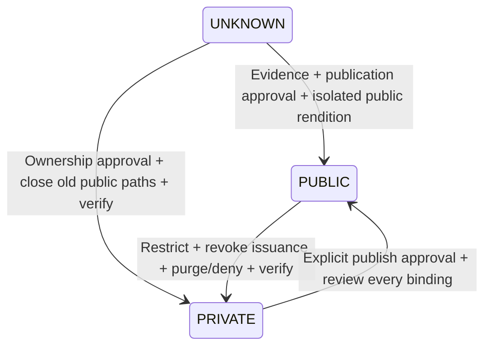

# Media visibility, source inventory and transitions

Date: **12 November 2026, Asia/Calcutta**. **Current behavior is source-verified; proposed policy is DESIGN ONLY.** No content, provider policy, URL, response or database row was changed. [Phase index and decisions D01–D12](PHASE_2A_1_2A_MEDIA_POLICY.md).

## Routing, storage and response conventions

Paths below are **backend paths** unless marked external. [main.py](../../backend/app/main.py) registers many routers at root and `/api`; [Nginx](../../frontend/nginx.conf) strips the external `/api/`. Thus `/media/list` is externally `/api/media/list` (also the legacy duplicate `/api/api/media/list`), while the ticket router's literal `/api/tickets` prefix is externally `/api/api/tickets/...`. Static mounts are not duplicated by router registration. `/api/uploads/x` reaches backend `/uploads/x`; bare frontend `/uploads/x` may fall through the SPA rather than reach storage. Effective deployed aliases/CDN rules are **unverified**.

[LocalAdapter](../../backend/app/storage/local.py) stores paths under `MEDIA_ROOT`, resolves containment and removes a duplicate `uploads` segment when constructing `MEDIA_PUBLIC_BASE` URLs. Default `MEDIA_ROOT=./media`, `MEDIA_PUBLIC_BASE=/uploads`. Main's mounted upload root is `MEDIA_ROOT/uploads`; local chat uses a different actual root as noted below. MinIO/S3 bucket names are configuration defaults, not verified deployment policy. The application does not establish bucket confidentiality by generating a signed URL.

`main.py::no_store_cache_headers` sets `Cache-Control:no-store`, Pragma/Expires on API/static responses. `media_http.py` additionally applies `sandbox allow-downloads` CSP and `nosniff` to uploaded local documents; task-template static responses get the same defense. This blocks document authority, not anonymous access. `AvatarSafeStaticFiles` exposes exactly ten bundled SVGs and blocks other `avatars/` static paths. Provider/CDN caching is separate and unverified. Private presigned GET includes signed `ResponseCacheControl=private, no-store, max-age=0`; GET and PUT lifetime are300 seconds.

## Inventory A — routes, attribution, tenancy and current classification

Classification is about **business policy**, not just observed access. `UNKNOWN/public now` does not mean public access was approved. PUBLIC candidates are not automatically historical PUBLIC assignments. Resource IDs and M-codes join the tables and detail notes.

| ID / category | Existing route and source function | Owner / tenant mechanism now | Storage / current classification |
|---|---|---|---|
| M01 legacy library upload | `POST /media/upload`; [router](../../backend/app/routers/media.py)::upload_media; [service](../../backend/app/services/media_service.py)::create_media_item | MediaItem.owner_id→current User.tenant_id; no immutable media tenant; original_id preauthorized | Local/Supabase/Drive via server default adapter. Metadata PRIVATE; bytes **UNKNOWN/public delivery** |
| M02 legacy library list/read/update/version/delete | `GET /media`, `GET/PATCH/DELETE /media/{id}`, `POST /media/{id}/replace`, `POST /media/bulk-delete`; media router/service list/get/rename/replace/delete/bulk functions | Fresh uploader-tenant check; ordinary self; Manager/Admin/Owner existing staff rules; list tenant join before count/page | Same stored object/public_url as M01; **UNKNOWN bytes**; no independent authenticated byte handler |
| M03 presigned media library | `POST /media/presign`, `POST /media/confirm`, `GET /media/list`, `DELETE /media/{id}`; router→[minio service](../../backend/app/services/minio_media_service.py) | MediaFile.user_id→current user tenant; department_id is global. List: Owner/Admin current tenant, Manager department or self without department, User self. Confirm uploader or Owner/Admin after tenant admission; delete Owner only | MinIO/S3 `minio_bucket_attachments` (default `zea-play-attachments`); **PRIVATE candidate/current authorized signed workflow**, actual bucket policy unverified |
| M04 pending avatar direct upload | Same presign/confirm with purpose avatar; `POST /media/avatar/finalize`; minio service finalize_avatar_upload | Pending MediaFile uploader; finalize uploader-self after tenant/purpose/status checks; new AvatarAsset stores tenant | MinIO original `avatars/{user}/...`; finalized local/private-avatars or MinIO. **PRIVATE portraits** under existing tenant visibility |
| M05 avatar library CRUD/bytes | `GET /avatars/policy`, `GET/POST /avatars`, `PATCH/DELETE /avatars/{id}`, `GET /avatars/{id}/image`; [avatars.py](../../backend/app/routers/avatars.py) | AvatarAsset.tenant_id when present; creator's current tenant fallback for legacy rows; bundled defaults special. CRUD/selection rights differ from tenant portrait viewing | Local private-avatars, old assets files, decoded legacy data URL, MinIO, external references. **PRIVATE** except bundled illustrations; stored tenant is not DB-enforced immutability |
| M06 user portraits | `POST /users/me/avatar`, `POST /users/{id}/avatar`, `GET /users/{id}/avatar-image`; [users.py](../../backend/app/routers/users.py), [avatar_utils.py](../../backend/app/avatar_utils.py) | Target same tenant; existing self/role update checks; read target same tenant and validated legacy avatars/{user}/ key. Session active check | Current AvatarAsset image flow; legacy MinIO user key; safe external URLs. **PRIVATE tenant portraits**, external-host visibility unverified |
| M07 bundled/static assets | `/assets/avatars/library/default-avatar-01.svg`…`10.svg`; `/assets/*`; main mount→[avatar_http.py](../../backend/app/avatar_http.py) | Bundled artwork: no tenant. Other non-avatar namespaces public by mount | Packaged SVGs/app resources **PUBLIC**. Other assets only as specifically classified in M12; no generic public approval inferred |
| M08 local legacy bytes | `/uploads/*`; main mount→[UploadedMediaStaticFiles](../../backend/app/media_http.py) | No row, user, tenant or resource lookup | `MEDIA_ROOT/uploads`; **UNKNOWN mixed legacy**, anonymous known-URL access; sandbox/nosniff does not add authorization |
| M09 task attachments | `POST/GET /tasks`, `GET /tasks/page`, `/tasks/kanban`, `GET/PATCH/DELETE /tasks/{task_id}`, `GET .../group`, `.../information`, `.../summary`; [tasks router](../../backend/app/routers/tasks.py)::create_task, list_tasks, list_tasks_page, list_tasks_kanban, get_task, update_task, get_task_group, get_task_information, get_task_summary; `Task.attachments` in [models](../../backend/app/models.py) | Task instance follows canonical creator-derived tenant and task/group policy; URL has no independent ownership metadata | List of arbitrary URL strings/local/external references; **UNKNOWN historical**. Private task attachment is a proposed PRIVATE candidate, not automatic conversion |
| M10 ticket attachments | `POST /api/tickets/{ticket}/attachments/presign`, `/confirm`; `GET .../attachments`; `DELETE .../{id}`; [attachments_router](../../backend/app/tickets/attachments_router.py) | TicketAttachment.tenant_id/ticket_id/uploaded_by. Canonical get_ticket_for_user **and** attachment-specific rule; Manager department policy retained | S3 ticket bucket default `zeaplay-ticket-attachments`; **PRIVATE** ticket attachment contract. No GET byte signer/download handler exists |
| M11 chat attachments | `POST /chat/conversations/{id}/attachments`; `POST /chat/messages/{id}/attachments`; message create/update/read/delete; [chat service](../../backend/app/chat/services.py)::AttachmentService, MessageService | Attachment inherits message/conversation relation; no direct attachment tenant. Conversation tenant OR existing membership; global directory for Admin/Manager/Owner; membership still required | Local `MEDIA_ROOT/chat/{tenant}/{conversation}/...` but default returned URL `/uploads/chat/...` maps elsewhere. **UNKNOWN historical/sharing**; confidential chat files PRIVATE candidate |
| M12 task templates | `GET/POST /tasks/task-templates`, `GET/PATCH/DELETE /tasks/task-templates/{id}`, `POST .../{id}/assign`; `_task_template_query` and handlers in tasks router; `/assets/task_templates/*` | Template.created_by_id and global department reference; template query has no tenant predicate; staff management, active-user list | Multipart featured image saved in local `assets/task_templates`; attachments string list. **UNKNOWN global catalog**; anonymous image delivery sandboxed |
| M13 reward images | `POST /rewards/images/upload`; reward CRUD/icons; [reward_storage.py](../../backend/app/services/reward_storage.py)::RewardImageService/StorageService and [rewards.py](../../backend/app/routers/rewards.py) | Upload staff dependency; reward creator/updater refs; no independent immutable image tenant; global catalog/dept whitelist | Local uploads/rewards, supplied URL or catalog icon URL; **UNKNOWN ownership/public approval** |
| M14 badge images | `POST /badges/{id}/image` + badge CRUD; [badges.py](../../backend/app/routers/badges.py), [badge_storage.py](../../backend/app/services/badge_storage.py)::BadgeImageService | Admin/Owner mutation; badge lookup/global catalog and image path; no immutable image tenant | Local uploads/badges or external image_url; **UNKNOWN** |
| M15 generated samples | No upload API; [seed.py](../../backend/app/seed.py)::seed_media_items / MEDIA_SAMPLE_BLUEPRINTS; `/uploads/seed/{category}/{filename}` | Fixed sample owner IDs and generated payloads; path is not tenancy | Local samples generated in source: **PUBLIC demonstration candidates**. Approval applies only to recognizable generated samples, not arbitrary historical objects named seed |
| M16 provider status and integrations | `POST /media/external/connect`; `_adapter_for`, get_default_adapter; [Supabase](../../backend/app/storage/supabase.py), [Drive](../../backend/app/storage/gdrive.py), [MinIO](../../backend/app/storage/minio.py) | Provider settings server-controlled; health route relies on registered navigation/auth policy; not an object permission grant | Authenticated diagnostics. Supabase public URL builder; Drive save grants anyone/reader. Historical external visibility/ownership **UNKNOWN**; real policies unverified |
| M17 external links | External avatar, task/template/chat URL, badge/reward/catalog image references | Upstream host owns access control; app metadata permission does not constrain URL host | HTTP(S), legacy URLs or data references; **UNKNOWN** unless explicitly approved public. No new redirect implementation; avatar backend does not fetch arbitrary external URLs |
| M18 adjacent backup archives | `POST /admin/data/manager/jobs/{job}/download-ticket`; `GET .../{job}/download`; import validation upload; [backups/router.py](../../backend/app/backups/router.py) | Owner/job tenant checks, one-use hash capability and requesting Owner current role/status/tenant check | Separate local archives, not media library; **PRIVATE**.60-second one-use ticket; preserve distinction from300-second S3 capability |
| M19 adjacent generated business exports | `GET /logs/audit/export?format=csv/json`, [logs.py](../../backend/app/routers/logs.py)::export_audit_logs; `GET /tickets/{ticket_id}/timeline.csv`, [tickets/router.py](../../backend/app/tickets/router.py)::export_ticket_timeline_csv_handler; `GET /admin/data/export`, [data_admin.py](../../backend/app/routers/data_admin.py)::export_data | Audit export uses active-user dependency, tenant/resource filters and audit_read redaction. Ticket CSV uses get_current_user, get_tenant_id, role/navigation guards and canonical get_ticket_for_user. Legacy admin JSON uses get_current_owner plus assert_isolated | **PRIVATE business responses**, generated from authorized database results; no media object/bucket/key or anonymous stored URL. These are adjacent download/metadata surfaces, not proposed MediaAsset records; runtime correctness was not retested |

## Inventory B — creation, delivery, response fields and deletion

| IDs | Creation / delivery fields | Lifetime and deletion semantics | Authorization / compatibility dependencies |
|---|---|---|---|
| M01/M02 | Multipart file/category/original_id; MediaItemRead returns id, owner_id, filename, ext, mime_type, **size_bytes**, category, **storage_provider**, **storage_path/public_url**, width/height/checksum_sha256, dates/deleted_at/original_id | Public URL no app expiry; soft delete hides metadata and retains bytes. Staff hard delete invokes adapter and deletes row. Replace creates version; original remains | Existing wrappers listMedia/uploadMedia/getMedia/updateMedia/deleteMedia in mockApi; wrappers mostly pass raw responses, no current component call site found for legacy upload/list/get. Legacy frontend type shape is not identical to snake_case API. `provider` form argument is sent by wrapper but upload handler chooses server default; do not promise per-request provider selection |
| M03 | Presign `{upload_url,bucket,object_key,file_id,expires_in}`; confirm `{file_id,status}`; list `{items:[id,original_filename,content_type,size_bytes,created_at,read_url],page,page_size,total}`; server-generated key | GET/PUT TTL300; list96 max/page, API no-store and signed GET cache override. Delete removes object then soft-deletes MediaFile. Pending PUT can remain reusable until expiry | MediaLibrary presign→axios.put(url,content-type)→confirm(fileId); MediaCard/DetailsDrawer img/video/anchor and copy use readUrl. Page's confirmed file is same mutable key as upload; future seal/copy is required, not currently implemented |
| M04/M05/M06 | Crop/file_id finalize response `{file_id,profile_image_key,profile_image_url}`. AvatarAssetRead id/name/storage_type/url/default/creator/dates; data_url cleared in serialization; UserRead **removes** legacy profile_image_key and exposes protected image URL | Protected image no-store globally; packaged art static; avatar utility queues file cleanup after commit, rollback cleanup for newly created files; avatar delete rejects in-use assets; finalize may delete pending original | Avatar component uses authenticated getAvatarImage→Blob/object URL for protected routes, bounded in-memory cache scoped by token; userAvatar helper selects URL, not profile key. finalize API wrapper maps profileImageKey but no UI caller found; external client dependency unknown |
| M07/M08/M15 | Static file delivery; no separate JSON metadata response. Seed creates MediaItem metadata as M01 | No signed expiry for static bytes. Global no-store on backend; public file remains until physical deletion. Directory/traversal controls and document sandbox apply but are not row deletion checks | Nginx /api route stripping and existing saved/copied URLs. Public SVG source remains untrusted even if not secret. Public class requires explicit approval, not random filename possession |
| M09/M12 | Task attachments/TaskTemplate.attachments arrays; template featured_image path; template assignment copies attachment strings into task rows | Task update/removal unlinks URL, does not revoke remote bytes. Template update/delete can remove featured file via local path; other references may still exist; no shared physical reference counter | TaskDetailModal anchors; task-template UI/services map featured image and attachment strings. Global catalog and shared references must be reconciled before deleting or privatizing files |
| M10 | Presign `{uploadUrl,fileKey,headers}`; confirm accepts **fileKey** and returns AttachmentRead including file_key, tenant/ticket/uploader/file metadata; list same fields | PUT TTL300. Confirm checks canonical prefix+single sanitized leaf, HEAD existence/max10MiB; no upload-intent ledger. DELETE marks deleted_at only; bucket bytes remain. No existing ticket download link API to preserve as if implemented | TicketAttachmentsPanel/Summary fetch PUT using headers, then echo fileKey to confirm. They do not check fetch response.ok before confirming. List/delete UI works on attachment ID, not storage key. Existing key handshake cannot be removed silently |
| M11 | ChatAttachmentCreate/Read includes file_name/original_file_name/mime_type/file_size/**storage_key/url**; upload returns metadata, message create echoes it | Local URL no signed expiry; default actual write-root/public-URL mismatch. Message deletion does not show a general storage garbage collector; message attachment rows have message CASCADE | mockApi uploadChatAttachment and mapChatMessagePayload; normalizeMessage; MessageItem/MemberPanel use attachment.url and storageKey as identity/key. Existing membership/global collaboration policy is unresolved. Stored URL input is not proof of object ownership |
| M13/M14 | Reward upload `{image_ref,image_url,mime_type,size}`; badge `{image_url,image_asset_path,...}`; external URL inputs and catalog image fields | No app URL lifetime; badge replacement/deletion can delete old local file via StorageService; reward routes/storage helper manage existing references but do not establish tenant ownership. Shared-reference safety unverified | RewardManager/RewardCard/canvas and badge renderers consume URLs; badge API mapper exposes imageAssetPath even if display uses imageUrl. Inventory actual refs before provider cleanup |
| M16/M17 | Provider details/status, external_url/profile_image_url, arbitrary referenced URL strings | Upstream sharing/cache/TTL outside app authority. Drive grants public read on save; Supabase get_public_url is not private signed delivery | Do not SSRF-fetch external refs during metadata inventory; provider credentials remain server config. `/media/providers` appears only in a legacy frontend wrapper, not as a literal registered provider-list route; authenticated GET can hit dynamic media-ID404 |
| M18 | `{ticket}` download issuance; native archive FileResponse; imports accept multipart archive | Ticket60 seconds/one use plus archive expiry; no-store/no-referrer; archive lifecycle separate from media retention | Existing backup source is a design reference for capability handling, **not proof of ModeA bearer identity**. Backup allowlists include old media/path fields and will require explicit schema-version work when adding a registry |
| M19 | Audit CSV/JSON and ticket timeline CSV are Response bodies; legacy admin JSON is DataExportBundle, including task attachment references. No upload-confirm handshake or provider redirect | No independent URL lifetime: new requests use current admission. Main middleware adds no-store; downloaded/exported copies cannot be recalled. No stored object deletion lifecycle | mockApi exportAuditLogs/exportTicketTimelineCsv/exportData; Logs page, TicketStatusTimeline and legacy export clients use authenticated requests/Blob downloads. Reports/client-side CSV and ImageEditor/Blob outputs create no additional backend media route. Export permission, CSV content safety and performance were not runtime-tested in this design audit |

Frontend source anchors: [mockApi.ts](../../frontend/services/mockApi.ts) `presignMediaUpload`, `uploadToPresignedUrl`, `confirmMediaUpload`, `listMediaFiles`, `finalizeAvatarUpload`, legacy media wrappers, ticket methods, `uploadChatAttachment`; [types.ts](../../frontend/types.ts); [MediaLibrary](../../frontend/pages/MediaLibrary.tsx); [MediaCard](../../frontend/components/media/MediaCard.tsx); [MediaDetailsDrawer](../../frontend/components/media/MediaDetailsDrawer.tsx); [Avatar](../../frontend/components/Avatar.tsx); [ticket panel](../../frontend/components/Tickets/TicketAttachmentsPanel.tsx) / [summary](../../frontend/components/Tickets/TicketAttachmentsSummary.tsx); [chat MessageItem](../../frontend/features/chat/components/MessageItem.tsx) / [MemberPanel](../../frontend/features/chat/components/MemberPanel.tsx); [TaskDetailModal](../../frontend/components/TaskDetailModal.tsx). Searches exclude node_modules and generated checks. “No caller found” is a checked-in search result, not proof there is no external API consumer.

Independent refinement scope: M19 records additional generated-response paths so the inventory does not imply that media signers and backup FileResponse are the only checked-in downloads. Relevant consumers are [Logs](../../frontend/pages/Logs.tsx), [TicketStatusTimeline](../../frontend/components/Tickets/TicketStatusTimeline.tsx), [Reports](../../frontend/pages/Reports.tsx) and [ImageEditor](../../frontend/components/media/ImageEditor.tsx). No generated export, client Blob or customer content was opened. This remains a checked-in-source inventory; installed routes, provider namespaces, reverse-proxy overrides and CDN configuration are **NOT VERIFIED**, so it is not production-complete.

## Proposed classification and publication state machine

For **new** assets, authenticated business upload creates immutable tenant ownership and defaults to PRIVATE for internal documents, task/ticket attachments, tenant portraits, internal library and confidential chat files. Approved public artwork goes through an explicit publication workflow. Platform-bundled assets use a deliberate PLATFORM scope; tenant-private assets never use null owner tenant as a wildcard. Historical rows remain UNKNOWN until reviewed; current public paths are not changed by this design. Public catalogs require D03 approval.



The three values describe **effective** approved visibility, not a claim about incomplete work. Keep desired_visibility and transition-job status separately (PROPOSED/APPROVED/PREPARING/VERIFYING/COMPLETED/FAILED). A file is not marked effectively PRIVATE while an old anonymous path or known public replica remains open; unresolved exposure remains UNKNOWN or PUBLIC with explicit `public_path_open`/`closure_unverified` findings. Do not add a fourth implicit “safe” visibility state to hide pending exposure.

| Transition | Proposed authorized actor / approval | Required work and audit | URL/cache/copy/rollback boundary |
|---|---|---|---|
| UNKNOWN→PUBLIC | Resolved tenant data owner or explicitly authorized platform curator; privacy/content reviewer; recommend two distinct approvers (D12) | Record evidence, rights/consent and all bindings; publish approved version to isolated public location; audit request/approve/publish with before/after policy epochs | Existing public copies may already exist; no automatic approval of them. Failed publication retains UNKNOWN and removes only newly owned staged publication after approval |
| UNKNOWN→PRIVATE | Resolved original-tenant authority + security reviewer; orphan/conflict custodian approval required | Identify all old paths/grants/replicas; stop new signed issuance, move/copy canonical object to private scope under reviewed plan, deny public delivery, verify unsigned denial and caches; audit evidence/closure separately | Classification alone cannot erase old bytes or copied URLs. Rollback cannot silently reopen public access; serve through authorized compatibility adapter if safe, otherwise keep blocked and escalate |
| PUBLIC→PRIVATE | Tenant owner/security incident authority within approved scope; platform-public assets require platform authority | Same closure process, every public replica and binding checked; bump policy/version epoch and invalidate future URL issuance; record CDN purge/deny evidence | Issued URLs may survive until expiry; downloaded copies cannot be recalled. Never claim immediate retroactive privacy or automatically republish on failure |
| PRIVATE→PUBLIC | Explicit tenant data owner + privacy/content publication approval, not ordinary uploader; platform policy if applicable | Verify no binding requires confidentiality; publish separate approved physical rendition/version, retain private canonical history; audit exact version/approvers and public URL | Existing private object ACL unchanged. Rollback denies public rendition and revokes issuance, but cannot retract external copies. Redacted derivatives should be separate assets with their own approval |

All decisions use current authorization and optimistic policy/version preconditions. Deny stale approvals after content, owner, binding or policy changes; keep an immutable decision record. Managers/tenant Owners do not receive cross-tenant/platform mutation power merely because today's catalog is global. Same-tenant portrait reading remains distinct from portrait editing/selection.

## Proposed policy vectors — specification examples only

These are synthetic review vectors, not executable enforcement or existing runtime tests. An offline checker may verify their consistency without importing the application.

```json
[
  {"case":"private-anonymous", "visibility":"PRIVATE", "active":false, "tenant_match":false, "object_allowed":false, "mode":"A", "expected":"DENY"},
  {"case":"private-current-member", "visibility":"PRIVATE", "active":true, "tenant_match":true, "object_allowed":true, "mode":"A", "expected":"ALLOW"},
  {"case":"foreign-private", "visibility":"PRIVATE", "active":true, "tenant_match":false, "object_allowed":true, "mode":"A", "expected":"DENY"},
  {"case":"approved-bearer-issuance", "visibility":"PRIVATE", "active":true, "tenant_match":true, "object_allowed":true, "mode":"B", "bounded_bearer_approved":true, "ttl_seconds":300, "expected":"ALLOW_ISSUANCE"},
  {"case":"unknown-publication", "visibility":"UNKNOWN", "publication_approved":false, "expected":"NO_NEW_PUBLICATION"},
  {"case":"old-A-session-on-return", "visibility":"PRIVATE", "active":true, "tenant_match":true, "object_allowed":true, "session_current":false, "expected":"DENY"},
  {"case":"old-membership-self-grant", "visibility":"PRIVATE", "active":true, "tenant_match":true, "object_allowed":false, "membership_incarnation_current":false, "expected":"DENY"}
]
```

Acceptance for later implementation: all transitions approval/audit/closure tested; known current permission denial precedes metadata or storage calls; no current-user-tenant backfill guess; public image/download compatibility retained; actual provider/CDN behavior independently verified. None of those future outcomes is established by this phase.
