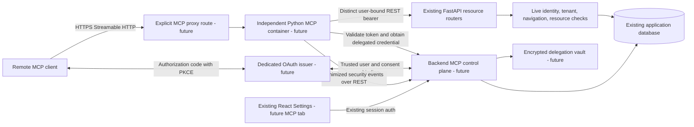

# Phase 1: MCP architecture and security foundation

Assessment: **11 November 2026, Asia/Calcutta**. Source baseline: `8978158` plus the working tree. The working tree was clean before this work. This package adds documentation and standalone isolated tests only. It does not create an MCP service, Settings interface, endpoint, migration, dependency, Docker change or deployment.

**The scoped Phase 1 documentation/test package is complete; the security foundation is not implemented. NO-GO for beginning the Phase 2 MCP service.** See [security review](PHASE_1_SECURITY_REVIEW.md), [permission model](MCP_PERMISSION_MODEL.md), [Settings design](MCP_SETTINGS_DESIGN.md) and [test results/plan](PHASE_1_TEST_PLAN.md). The starting assessment is [MCP_FEASIBILITY_REPORT.md](../MCP_FEASIBILITY_REPORT.md); findings below were checked against current code. Verification includes source inspection and explicitly identified synthetic in-process tests, not deployed security certification.

### Scope versus the feasibility roadmap

The feasibility report's section 13 gives a broader Phase 1 exit gate: a working auth bridge, approved policies, launch-blocker repairs and negative OAuth/resource tests before its minimal read-only Phase 2. The user's authorized Phase 1 deliberately excluded those implementation changes. Consequently the requested documents/tests can be delivered while that roadmap gate remains **unsatisfied**. Do not move unfinished authentication into Phase 2 by calling this package production-ready. Authorize and complete prerequisite security work separately, then rerun the relevant release gates before starting the service. No Phase 2 implementation is authorized by this review.

## 1. Verified existing architecture and reusable components

Paths in this package are repository-relative; symbols identify the inspected code without relying on moving line numbers.

| Boundary | Current implementation and reuse |
|---|---|
| Web client | `frontend/package.json`, `frontend/App.tsx`: React 19, TypeScript, Vite 6, React Router hash routing. `frontend/services/mockApi.ts` is the real Axios client with bearer/refresh handling. No Next.js architecture is assumed. |
| HTTP application | `backend/app/main.py` constructs FastAPI with `enforce_navigation_policy`, then includes most routers at canonical paths and `/api` aliases. `tickets/workflow_router.py` already has `/api` in its own prefix. Canonical task handlers precede hidden colliding workflow PATCH/complete registrations. |
| Authentication | `auth.py`, `routers/auth.py`, `dependencies.py`: password login, access/refresh JWTs, database user lookup and token/database tenant equality. `get_current_active_user` checks ACTIVE; `require_roles` uses current database role. These are useful identity/permission primitives, not remote MCP OAuth. |
| Resource permissions | `routers/tasks.py::_ensure_task_access`, `_apply_task_visibility`, `_ensure_task_update_access`; `tickets/service.py::get_ticket_for_user`; `services/audit_logger.py::_activity_context`; `services/task_activity.py::_subject`. Preserve these as backend authority, with repairs separately reviewed. |
| Tenant ownership | `models.py::User.tenant_id`; tasks derive tenancy through `Task.creator`, while `tickets/models.py::Ticket` owns `tenant_id`. There is no demonstrated Agency/Company ownership hierarchy. `Department` is global. |
| Safe task reads | `routers/tasks.py::list_tasks_page`, `get_task_summary`, `get_task_information`; `services/task_information.py::read` and `schemas_task_information.py` provide bounded, authorized, minimized read models. `task_activity.snapshot` provides existing workload semantics. Do not invent a parallel analytics engine. |
| Subtask/workflow writes | `services/subtasks.py`, `subtask_rewards.py`, `audit_logger.py`, `task_activity.py`: parent authorization, child-parent binding, managed versions, transitions, accounting and locks. MCP must call REST, never copy this logic. |
| Navigation/Settings | `navigation_registry.py`, `services/navigation.py`, `navigation_guard.py` enforce server page ceilings. `frontend/utils/settingsNavigation.ts`, `frontend/pages/Settings.tsx`, `frontend/hooks/useNavigation.tsx`, `frontend/App.tsx` compose route-backed tabs and existing components. See Settings design for exact integration points. |
| Credential administration | `permissions.py::API_ADMIN_ROLES` and `dependencies.py::get_current_api_admin` mean Owner/Admin, unlike `get_current_admin`, which includes Manager. `routers/config.py` tenant-filters provider/OAuth configuration. `models.py::OAuthConfig` stores integration configuration, not consent grants or an authorization-code server. Do not expose its secrets to MCP. |
| Database lifecycle | `database.py` runs schema helpers at import; `main.py` has seeding/schema/startup behavior. `backend/alembic/env.py` imports database/models and uses configured DB; `backend/alembic/versions`, `backend/migrations`, and schema helper modules coexist. No migration command is safe merely because it is called offline. No migration was run. |
| Cache/events | `cache.py`, `services/task_events.py`, `services/workload_notifications.py`; separate `presence-server/src/server.js` uses Node/Socket.IO. These are not MCP transports. Reuse backend domain events later; do not grant MCP Redis access by default. |

No live database/RLS, installed OpenAPI, deployed image equivalence, TLS or production worker behavior was verified. The tests construct a miniature ASGI app using actual routers; they never import `main.py` or run installed startup.

## 2. Proposed service boundary

Adopt the feasibility report's **separate Python service in this repository, consuming REST**. Everything marked future below is design only.



The proposed MCP container **must have no** database driver/URL, SQLAlchemy models, backend package import path, database network permission, shared JWT signing secret or existing provider API key. Its only application data path must be a fixed backend HTTPS/internal REST origin. Its catalog must exclude arbitrary URL, HTTP method, SQL, generic REST proxy, shell and user impersonation tools. An independent AS may have its own managed persistence; the proposed **MCP resource service** must have none. Persistent policy/grant/audit storage belongs to future backend control-plane work, requiring separately approved schema changes. No runtime implementation of these boundaries exists yet.

Future repository layout (directories/files below **do not exist as a result of Phase 1**):

```text
services/zeaplay-mcp/
  pyproject.toml             # official mcp SDK and bounded HTTP dependencies
  dependency lock           # exact tested stable versions; implementation selects format
  Dockerfile                # independent image; no backend requirements import
  src/zeaplay_mcp/
    app.py                  # SDK transport/lifecycle only; no backend startup import
    config.py               # fixed origins, issuer/resource ID, limits, workload identity
    auth.py                 # verification and request-local principal
    backend_client.py       # fixed route templates, delegation and typed REST calls
    policy.py               # intersection of grant, tenant policy and static tool catalog
    schemas.py              # strict input/output models owned by this service
    tools/tasks.py
    tools/workload.py
    audit.py                # redacted event delivery via control plane
  tests/                    # protocol, OAuth, contract and concurrency tests
backend/app/...              # future MCP control-plane/delegation additions, no duplicate domain engine
frontend/...                 # future native Settings integration
docs/mcp/                   # this Phase 1 package
```

The official Python SDK currently documents stable **v2**, Python 3.11+ and Streamable HTTP. Choose and lock a tested stable patch version when implementation is authorized; no version was resolved or installed here. Keep its lock/image independent from `backend/requirements.txt`. The backend Dockerfile uses Python 3.11; this turn's local tests used the already installed Python 3.14 interpreter. [Official Python SDK](https://github.com/modelcontextprotocol/python-sdk), [SDK documentation](https://py.sdk.modelcontextprotocol.io/).

## 3. Remote transport and deployment contract

Use one explicit HTTPS resource URI such as `https://mcp.example.invalid/mcp` (illustrative, not a selected deployment). Keep protocol negotiation, JSON-RPC validation, structured results, cancellation and streaming in the official SDK. No legacy SSE transport or stdio adapter is in the initial scope. If a required client needs another transport, review it explicitly.

Authenticate every HTTP request; a session identifier never proves user identity. Bind any server session/resumption cursor to user, tenant, client and grant. Recheck authorization before returning buffered/streamed results; terminate resumptions after revocation. Default to request-local state and no shared business-result cache. Validate Host and any presented Origin against exact approved values; allow missing Origin only for supported authenticated native clients. Configure bounded request size, concurrency, duration and response size; reject unsupported protocol versions explicitly.

Current proxy/deployment evidence:

| Source | Observed implication |
|---|---|
| `docker-compose.yml` | Frontend 7300, API 7211, presence 7212, PostgreSQL 16 at host 7432/internal 5432, Redis 7379. No MCP service. |
| `docker-compose.prod.yml` | PostgreSQL 15, legacy published images, Gunicorn configuration and worker commands. `app.workers.celery_app`, `app.reporting.worker` and the referenced Gunicorn config are not supplied here. Do not assume source/deployed equivalence. |
| `docker-compose.github.yml` | Source-build overlay, tagged images and Uvicorn command; must be reviewed with its base configuration before a later deployment. |
| `frontend/nginx.conf` | `/api/` strips the prefix when proxying to backend; `/ws/` is separate and `/` falls back to SPA HTML. This cannot serve MCP correctly without a future explicit route. API-only ticket workflow paths need actual proxy testing. |

Future MCP container: non-root user, read-only root filesystem, bounded resources, health/readiness split, no host Docker socket or database/storage volumes. Egress allowlist: backend, fixed issuer metadata/JWKS/introspection as required. Backend origin and redirects are fixed; no forwarding authorization headers across redirects. TLS/mTLS or equivalent authenticated private transport protects delegation. Separate workload identity authenticates the MCP service itself. Readiness is false if policy/revocation/audit services needed for authorization are unavailable. No Docker/proxy change is made now.

## 4. OAuth and identity design

Use a dedicated standards-compliant authorization server/managed identity component. The MCP container is the protected resource, not a password-collecting login application. Existing `/auth/login`, `/auth/refresh` and `/oauth2/token` are not reused as the remote OAuth protocol. The legacy `/oauth2/token` uses a password grant, references a mismatched password attribute and lacks tenant claims; it is not a viable basis for PKCE. Existing login behavior is unchanged.

MCP authorization requires protected-resource discovery, issuer metadata and resource-bound tokens. This design uses authorization code with PKCE S256, exact registered redirect URIs, client-bound consent, trusted issuer selection and a canonical resource audience. The `resource` parameter is carried in authorization and token requests. Token passthrough to downstream APIs is prohibited. [MCP authorization specification, 2026-07-28](https://modelcontextprotocol.io/specification/2026-07-28/basic/authorization), [MCP security guidance](https://modelcontextprotocol.io/docs/2026-07-28/tutorials/security/security_best_practices).

Proposed flow:

1. The client obtains protected-resource metadata from a 401 challenge and discovers the configured issuer. Begin with administratively registered clients; dynamic registration/client metadata documents remain disabled until a separately tested client requirement exists.
2. The client starts authorization with code challenge/method S256, canonical resource, least-privilege scopes, exact redirect URI and CSRF/mix-up protection. The AS uses a future trusted identity bridge to establish a live ZeaPlay user. No client-supplied email/domain/employer ID establishes identity or tenant.
3. Resolve `(issuer, subject)` to an existing backend user through an explicit server-controlled binding. The current user has one `tenant_id`; select that tenant from the backend. Do not manufacture agency relationships or a multi-company chooser. Any future account-linking proof is single-use, short-lived, audience-bound and delivered server-to-server from the authenticated browser session. Never send a ZeaPlay password or REST JWT to an AI client.
4. Show consent identifying client, tenant, redirect destination, scopes/tools, data categories, retention/offline duration and write capabilities. Bind consent to user + tenant + client + exact approved scopes + policy revision. Granting a scope does not grant resource access. New scopes require new consent.
5. Exchange a short-lived, one-use code bound to client, redirect, resource and verifier. Proposed starting lifetime: code <=60 seconds. Use AS security defaults if stricter. Do not implement a custom password grant.
6. MCP validates signature using a pinned issuer's approved algorithms/keys, exact issuer, expected MCP audience and required access-token profile: subject, mandatory expiry/issued-at, authenticated client identifier and trusted token/grant reference. Validate not-before when present, bounded clock skew and configured maximum age. Opaque tokens require authenticated introspection supplying equivalent active/expiry/client/grant authority; missing values deny. Reject ID tokens, refresh tokens, wrong token profiles/algorithms, unknown mappings and unknown keys after a bounded refresh. Do not follow token-supplied `jku`, `x5u` or discovery URLs. A signed tenant claim is still compared with live backend membership.
7. Through an authenticated control-plane REST request, check user status, current role/navigation, grant/client status, tenant tool policy and emergency switches. Return a distinct delegated REST token for this user/grant/action, never an Owner service account token.
8. Call an allowlisted REST operation with that delegated credential. Backend independently repeats grant, scope, live user/tenant and resource authorization, and records provenance. MCP validates/minimizes the result and records an audit outcome before releasing it.

Browser authorization/consent changes require CSRF defenses, secure HttpOnly session cookies, clickjacking protection and exact redirect matching. Redirects, issuer metadata and JWKS endpoints are operator-configured to prevent SSRF/mix-up attacks. Consent cannot be inferred from installation, a successful MCP handshake or a prompt's instructions. Protocol security details must be rechecked against the selected SDK/AS at implementation.

## 5. Delegated credential design: a mandatory new backend boundary

Existing REST JWTs contain optional scope labels but ordinary REST dependencies do not enforce them. Passing a long-lived `/auth/generate-token` token through MCP would therefore create a broader credential than the requested tool permissions. It is prohibited by this design.

| Credential | Audience/holder | Separation and proposed lifetime |
|---|---|---|
| Existing web REST access/refresh | Existing web client/backend | Unchanged in Phase 1; never accepted as remote MCP credentials. |
| MCP access | MCP resource URI; held by OAuth client | Dedicated issuer/key lifecycle, explicit scopes/client/grant; proposed <=5 minutes. Not accepted as a downstream REST bearer. |
| OAuth refresh | AS token endpoint; held by OAuth client | Rotate on use; detect family reuse and revoke that family/grant. Proposed idle <=7 days/absolute <=30 days, subject to approval and AS support. MCP does not receive the client's refresh token. |
| Service workload identity | Delegation/control plane; held by MCP container | Separate client authentication (mTLS or asymmetric client assertion), least privilege; cannot impersonate an arbitrary user. |
| Delegated REST | Dedicated ZeaPlay delegation audience; held only in MCP request memory | Proposed <=60 seconds; signed by backend-controlled keys separate from existing login keys, contains user/tenant/client/grant, authz revision, scopes and permitted operations. No offline refresh in MCP. |

Future backend exchange proposal: authenticated `POST /internal/mcp/delegations` with MCP access token as a token-exchange subject and requested **catalog tool ID**, not a trusted actor/tenant field. Service authentication and the subject token are validated independently. Response: `{access_token, token_type:"Bearer", expires_in, grant_id, policy_revision}`; `Cache-Control: no-store`. The subject token is handled as secret input and never logged. The resulting REST token identifies the same mapped user and tenant and cannot exceed the consent, tenant allowlist, current backend permissions or static operation set. This endpoint does not exist today.

This is a proposed trusted security-token-service exchange, **not** permission to replay an MCP-audience token as a REST resource bearer. Only the authenticated MCP workload may submit a subject token to this fixed exchange boundary. The backend must independently validate/introspect its trusted issuer, MCP resource audience, expiry, client and grant binding; derive user/tenant from that verified subject; and intersect requested tool with current consent, registered-client ceiling, tenant policy and released catalog. Unsigned request fields cannot select a different client/grant/user. Delegated expiry cannot exceed the remaining subject/grant lifetime. Limit exchanges by workload/user/grant, record the acting service, and prevent re-delegation. If the chosen AS cannot supply the required verified binding/exchange support, the design remains blocked: no fallback to a shared admin credential, web JWT or accepting that token on resource routes. This is a project-specific exchange profile requiring an interoperability/security test, not a claim that an RFC endpoint already exists. [OAuth token exchange](https://www.rfc-editor.org/rfc/rfc8693).

The future backend must explicitly distinguish delegated and legacy credentials with separate trusted issuer/audience/key/token profiles. A failed delegated-token validation must never fall back to legacy authentication, and an unrecognized route is denied for that credential class. Delegated tokens enforce operation/field scopes at every resource route, including aliases, before execution; ordinary JWT scope handling must not accidentally widen the delegated class. A direct request using a stolen delegated token to another endpoint/field must fail, including management/auth/configuration routes. Checks belong in shared dependencies plus operation-specific guards, not URL substring checks. Issuance alone is insufficient; this enforcement is a Phase 2 prerequisite requiring separate implementation authorization.

User movement, role/department change, deactivation, password/security reset, client disable and consent withdrawal invalidate the relevant identity/policy revision. Tenant changes revoke old grants; they never retarget them. Both MCP admission and backend execution check durable current state. Revocation is checked per operation, including before response emission, regardless of token TTL; Redis invalidation is only an optimization. An unavailable revocation/policy authority denies new calls. A write that committed before revocation cannot be undone by disconnecting; audit and disclose its completed state.

Those are future revocation requirements. Current deactivation only denies an existing token while the database user is DEACTIVATED; the isolated review confirms that reactivation makes the same unexpired JWT usable again. Neither that status gate nor a database-role refresh is persistent token/grant revocation. For the future boundary, define a backend transaction/serialization point between revocation and admission so stale exchange results cannot authorize a later execution; recheck before each result/chunk emission. Already delivered data cannot be recalled. Refresh rotation/reuse handling and revocation coverage need separate negative tests. [OAuth security best practice](https://www.rfc-editor.org/rfc/rfc9700).

## 6. First tool contracts

Only five read candidates are proposed initially. None is enabled or callable today. Tool names follow the feasibility report. Scope and backend access must both pass; result minimization cannot fix a backend authorization gap.

Common rules: strict JSON Schema objects with `additionalProperties:false`; reject coercive/oversized inputs; IDs are opaque strings of length 1..36 (do not require UUIDs for existing non-UUID task IDs). No actor/tenant/role/credential/base URL arguments. Datetimes use RFC3339 with offset; preserve unknown values and source coverage warnings. Validate backend responses against independent typed models. Limits below are proposed adapter limits.

| Tool / scope | Input schema | Fixed backend call | Output schema |
|---|---|---|---|
| `zeaplay_list_tasks` / `tasks:read` | `{page?:int>=1=1,page_size?:int[1,100]=20,search?:str<=200,status?:TaskStatus,priority?:TaskPriority}` | `GET /tasks/page`; only declared query names | `TaskPage{items:TaskCard[],page,page_size,total,total_pages,has_more,truncated}` |
| `zeaplay_list_overdue_tasks` / `tasks:read` | Same bounded pagination/search, no client quick-filter override | Same endpoint with `quick_filter=overdue` fixed | `TaskPage` |
| `zeaplay_get_task` / `tasks:read` | `{task_id:Id}` | `GET /tasks/{id}/information?section=overview` | `TaskOverviewResult{task_id,as_of,overview,coverage}` minimized from `TaskInformationRead` |
| `zeaplay_list_subtasks` / `tasks:read` | `{task_id:Id,page?:int>=1=1,page_size?:int[1,100]=25,search?:str<=200}` | Same information endpoint with `section=subtasks` | `SubtaskPage{task_id,as_of,items:Subtask[],total,page,page_size,coverage,truncated}` |
| `zeaplay_get_workload_summary` / `workload:read` | `{user_id?:Id}`; omitted means self | `GET /tasks/activity` | `WorkloadResult{user_id,server_now,timezone,active_count,workload,coverage}`; typed allowlisted projection of `task_activity.snapshot` |

`TaskCard` permits id/title/status/priority/due_at/created_at/updated_at/assigned_to_id; `Subtask` permits id/title/status/version and verified schedule fields; `overview` exposes only approved task fields and minimal authorized people. Exact type definitions must be generated/reviewed against `schemas.py`, `schemas_task_information.py` and `task_activity.snapshot` before implementation; the names above are adapter contracts, not claims that REST returns these exact wrapper fields. Dates are nullable where source data is unknown. Workload output never replaces missing capacity with invented hours. Source status and priority enums remain authoritative.

Cap serialized output at a proposed 128 KiB with explicit truncation/pagination; bound task title/description projection lengths and query execution duration. No arbitrary continuation URLs; any cursor is integrity-bound to principal, grant, query and policy revision. No unbounded full-directory scans or workload loops to aggregate other users. Reads use the backend's current user boundary. Ticket reads, notifications, group expansion, comments, writes, exports, approvals, deletion, credentials and global configuration are withheld pending the security gates.

Authentication/transport failures use HTTP 401/403 as specified; an authenticated tool's resource/validation failure uses a sanitized SDK tool error/result with code, retryability and correlation ID. Preserve backend not-found versus forbidden behavior without adding foreign object details. Do not stream raw upstream error bodies, stack traces or credentials. Tool annotations describe behavior and never authorize it.

## 7. Audit, resilience and approval gates

Audit user/tenant/client/grant/tool, operation/resource IDs where authorized, decision/reason code, policy revision, timestamp, request/correlation ID, duration, result count/truncation and outcome. Never store bearer/refresh tokens, passwords, signing material, raw prompts or full task/ticket bodies by default. Tenant-scoped backend storage owns the durable audit; the existing broad audit endpoint is not safe for this use (S06). For the initial service, deny execution if durable admission audit fails; record outcome before returning data. For later writes, commit domain change and audit atomically in the backend; handle ambiguous timeouts using idempotency status, not blind retry. Retention/access/export policy requires approval.

Start with no business-data cache in MCP. Timeouts, cancellation, bounded HTTP pools and per-tenant/user/client quotas protect backend capacity. Retry safe reads only with fresh authorization; never replay writes without an approved idempotency contract. Text from tasks/tickets is untrusted content, never an instruction to change tools, tenant, credentials or destinations.

Phase 2 planning can use this package. **Beginning the Phase 2 service remains NO-GO**: issuer/provider and user-linking ownership; delegated credential enforcement/storage and trusted exchange profile; scope/role defaults; group/observer/Manager policy decisions; legacy department/audit/notification ownership; client/version matrix; consent, step-up authentication and retention limits remain unresolved. Read-only mode is not a waiver for OAuth, revocation, safe resource checks or negative tests. Prerequisite work needs separate authorization; no existing login or business rule changes are made here. Later unsafe tools remain disabled even if a narrower read pilot is approved. Stop at Phase 1.
