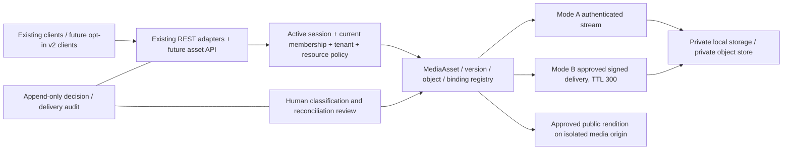

# Phase 2A.1.2A — Media policy and architecture specification

Date: **12 November 2026, Asia/Calcutta**. **DESIGN ONLY.** The only workspace changes in this phase are the eight Markdown documents linked below. Proposed controls, tables, APIs, grants and test outcomes are not implemented enforcement. No application import, test collection, database/object-storage operation, ZeaPlay/provider API request, migration, build, service startup/restart or deployment was performed. Docker was queried only for read-only resource metadata; an observed environment discrepancy is recorded below.

## Approved direction and stage decision

The user's three approved preferences are binding: **mixed PUBLIC/PRIVATE/UNKNOWN visibility**, **original tenant ownership independent of uploader transfers**, and **hybrid authenticated or deliberately bounded signed private delivery**. Historical assets are not automatically classified. The existing **300-second signed URL TTL remains the compatibility baseline**; no change is proposed without separate approval.

**Conditional GO for the defined Phase 2A.1.2B verification scope; NO-GO to start execution now. Execution remains BLOCKED pending an approved obtainable real-provider distribution, a stable disposable runtime and fresh isolation preflight. NO-GO for schema/API/storage rollout, live MCP/OAuth/delegation or production deployment.** Product decisions below do not block testing a private/public synthetic bucket contract; they do block implementing their undecided business semantics. This refinement does not begin or authorize a later phase. The independent audit below controls the current assessment.

## Deliverables

| Document | Purpose |
|---|---|
| [Visibility matrix](MEDIA_VISIBILITY_MATRIX.md) | Checked-in inventory, current behavior, proposed classification and visibility transitions |
| [Ownership architecture](MEDIA_OWNERSHIP_ARCHITECTURE.md) | Immutable ownership, membership incarnations, model comparison, constraints, references and transfer rules |
| [Hybrid delivery](MEDIA_HYBRID_DELIVERY_DESIGN.md) | Authenticated streaming, native-browser authentication gap, signed delivery and operational boundaries |
| [API compatibility](MEDIA_API_COMPATIBILITY.md) | Field usage classifications, synthetic current/proposed contracts, opt-in transition and frontend changes |
| [Historical reconciliation](MEDIA_HISTORICAL_RECONCILIATION.md) | Metadata-only manifest, evidence/conflicts, review, backfill and rollback design |
| [Storage test plan](MEDIA_STORAGE_TEST_PLAN.md) | Real S3-compatible provider prerequisites and all17 required enforcement checks |
| [Threat model](MEDIA_THREAT_MODEL.md) | Preconditions, impact, controls, gaps, severity and verification |

## Original design-entry baseline and method

Branch **`main`**; commit **`b6a220aa7fcdac29fe34bfb4fd8b949ec29b154d`**. The source reviewed is the **dirty working tree**, not that commit alone. Entry baseline records **2,352** tracked/unignored files and **402** porcelain status entries. `backend/app/main.py` is **MM**: both an existing staged change and existing unstaged changes. Existing modified authentication, tenant, task/audit/workflow, media, frontend, presence, Compose and backup files and untracked migrations/tests/MCP/evidence/docs are preserved. The complete entry status is in the appendix; no reset/stash/clean/stage/commit was performed.

The full file/index hash baseline and static route extraction are retained outside the checkout at `C:\Users\Lenovo\AppData\Local\Temp\zea-media-policy-design-rk2lkaaj`. This directory is this design run's metadata evidence, not a database or deployment artifact. Final verification compares every starting file and the Git index, permits only these eight new docs, and compares read-only Docker container identities/states and volume/network inventories. No ZeaPlay service endpoint or customer object was contacted. No `AGENTS.md` was found in the checkout or its ancestors.

Reviewed references: [feasibility](../MCP_FEASIBILITY_REPORT.md), [Phase1.4](PHASE_1_4_TENANT_SECURITY.md), [Phase1.5](PHASE_1_5_FULLSTACK_SECURITY.md), [Phase2A.1](PHASE_2A_1_INTEGRATION_READINESS.md), [Phase2A.1.1](PHASE_2A_1_1_MEDIA_SECURITY.md), [Phase2A MCP](PHASE_2A_MCP_PROTOTYPE.md). Their historical test successes are **not executions in this phase**. Current claims below were checked against source. Earlier shorthand about globally hidden storage keys or immutable AvatarAsset ownership is qualified: user serialization removes one legacy key field, and a stored tenant column alone is not an immutable database constraint.

Only text reads, searches, stdlib AST/JSON/document checks, Git metadata and read-only Docker inventory were used. No application modules or test modules were imported. Importing [database.py](../../backend/app/database.py) can run schema repair helpers unless its migration flag is set; [main.py](../../backend/app/main.py) has filesystem/import and startup schema/seeding behavior. [test_generate_token.py](../../backend/tests/test_generate_token.py) drops/creates metadata at module level; [test_chat_phase1.py](../../backend/tests/test_chat_phase1.py) creates metadata during import. `pytest --collect-only` is therefore not considered a safe read-only substitute. Existing destructive fixtures and the previous disposable launchers were **not executed**.

### Material current-source findings

| Finding | Current source anchor | Design consequence |
|---|---|---|
| MediaItem/MediaFile have uploader FKs, no asset tenant column; API tenancy follows current uploader | [models.py](../../backend/app/models.py), `MediaItem`, `MediaFile`; [media_access.py](../../backend/app/services/media_access.py), `require_media_owner_tenant` | Current guards remain valuable but cannot implement approved original-tenant ownership; historical current-user tenant is insufficient backfill evidence. |
| AvatarAsset stores nullable tenant, legacy creator fallback remains; user deletion has mixed cascades | `models.py::AvatarAsset/User`, [avatar_utils.py](../../backend/app/avatar_utils.py), `can_access_asset` | Preserve explicit tenant evidence; do not equate it to a DB-enforced immutable column. New business assets must survive uploader deletion. |
| Ticket attachments have explicit tenant/ticket and separate uploader string | [tickets/models.py](../../backend/app/tickets/models.py), `TicketAttachment`; [attachments_router.py](../../backend/app/tickets/attachments_router.py) | Stronger ownership anchor; validate against parent and temporal evidence, retain current canonical+attachment rule. No ticket byte-download handler exists. |
| Public local mounts persist, with document sandbox but no tenant admission | `main.py` mounts; [media_http.py](../../backend/app/media_http.py); [avatar_http.py](../../backend/app/avatar_http.py) | Preserve stored-SVG execution defense; sandboxing does not make public bytes private. |
| Signed GET/PUT TTL300; private GET cache override exists; no demonstrated bucket policy enforcement | [minio_media_service.py](../../backend/app/services/minio_media_service.py), signing/list/confirm/delete; [storage/minio.py](../../backend/app/storage/minio.py) | Real provider checks still required; signed delivery requires explicit bounded-bearer policy. |
| Normal UserRead removes profile key, avatar finalize returns a private path | [schemas.py](../../backend/app/schemas.py), `UserRead.serialize_profile`, `AvatarFinalizeResponse`; `finalize_avatar_upload` in media service/router | Do not remove all similarly named fields blindly; classify consumers/protocols separately. |
| Global template/catalog/Department dependencies; chat directory and membership can span tenants | [routers/tasks.py](../../backend/app/routers/tasks.py), `_task_template_query`; [departments.py](../../backend/app/routers/departments.py); [chat/repositories.py](../../backend/app/chat/repositories.py) | Shared source IDs are not tenant ownership proof. No blanket tenant predicate or migration is guessed here. |
| Authentication epochs/sessions invalidate on tenant/status/role/password change; newer task-audit guards may prohibit tenant changes for protected history | [auth migration](../../backend/alembic/versions/l2b4d6f8a0c2_auth_sessions.py); [auth_sessions.py](../../backend/app/services/auth_sessions.py); `models.py::task_audit_guard_statements_v1` and [task audit migration](../../backend/alembic/versions/e5a7c9d1f3b5_task_audit_foundation.py) | Preserve both controls. Do not assume every transfer is currently permitted or weaken audit guards to enable media migration. Model definitions do not establish which triggers are installed in any live DB. |
| MediaLibrary uses signed URL in image/video/anchor/copy actions; Avatar uses authenticated fetch+Blob | [MediaLibrary.tsx](../../frontend/pages/MediaLibrary.tsx), [MediaDetailsDrawer.tsx](../../frontend/components/media/MediaDetailsDrawer.tsx), [Avatar.tsx](../../frontend/components/Avatar.tsx), [mockApi.ts](../../frontend/services/mockApi.ts) | ModeA cannot replace a signed URL with a bearer-protected URL without a frontend/native-browser authentication bridge. |

Existing relevant migrations inspected as text include `5f2a7c3d1b0e_add_media_files.py`, `8b9c2d6a4f1e_add_media_files_metadata.py`, `c3e5f7a9b1d2_employee_profile_avatar.py`, `c9f9f2b9d2ad_create_ticket_system.py`, `6c2f1a9d5b7e_convert_ticket_ids_to_string.py`, `e5a7c9d1f3b5_task_audit_foundation.py`, `f6b8d0e2a4c6_subtask_workflow.py`, `l2b4d6f8a0c2_auth_sessions.py`, `m3c5e7f9a1d3_audit_tenant.py`. These are source history, not proof of a deployed revision/schema. Multiple historical branches/merges and UUID/String references require fresh-schema and representative historical-fixture review later. No Alembic environment was executed.

## Proposed architecture — not implemented



No current media registry, v2 routes, membership incarnation mechanism or native media cookie bridge is implied by the diagram. Existing auth/session authority is retained; future media-specific integration must be separately reviewed. No OAuth is required or implemented by this design.

## Product and security decision register

The three approved preferences resolve architectural direction, **not every category's historical classification or operational permission**. Recommendations below are proposed until the named owner approves them. Tenant Owner is not an existing platform administrator role.

| ID | Decision / recommended default | Approver / implementation gate |
|---|---|---|
| D01 | Per-category historical PUBLIC/PRIVATE decisions and public-publication review; UNKNOWN stays unclassified | Original-tenant data owner + privacy/security reviewer; evidence manifest per record, not folder-wide guess |
| D02 | Tenant-owned operational Departments vs explicitly managed global templates/catalogs | Product/data architecture; no media migration may silently split or repurpose global IDs |
| D03 | Whether globally shared template/reward/badge artwork remains platform-public, platform-authenticated or becomes tenant-owned | Product/catalog owner; platform authority must be defined separately from tenant roles |
| D04 | Cross-tenant chat collaboration and file sharing | Product/security; recommend no implicit cross-tenant private-asset grants from membership alone |
| D05 | Exceptional cross-tenant asset transfer | Source and destination tenant authorities + approved operator capability; recommend explicit copy/new asset with provenance, no ordinary owner-tenant PATCH |
| D06 | Grants after membership departure/return; retain private business assets after user deletion; custodianship and retention/legal holds | Tenant governance/privacy; recommend revoke old membership-specific grants, require fresh explicit grants on rejoin |
| D07 | Which categories allow ModeB's transferable300-second bearer access | Data/privacy owner; recommend ModeA for confidential attachments and portraits requiring current revocation |
| D08 | Native-browser authentication bridge for ModeA and in-flight cancellation SLO | Security/frontend/product; cookie-based media session is only a proposed option; no authentication change is approved here |
| D09 | Legacy link deprecation/version negotiation and old URL cutover deadlines | API/product + affected tenant owners; external client dependencies need telemetry/notice approval before any field removal |
| D10 | UNKNOWN-conflict custody, retention, deletion/purge and destructive rollback limits | Data owner/privacy/security; no bulk cleanup until reviewed, no automatic republishing on rollback |
| D11 | Disposable real storage distribution/image digest, network/resources and provider/proxy test configuration | Test-environment owner; needed to run2B; no credentials or production bucket reuse |
| D12 | Approval separation for visibility changes, platform assets, dual-tenant transfer and override emergencies | Security/product; propose two distinct approvers for public publication/conflicted ownership; current roles alone do not implement this |

## Independent refinement audit — 12 November 2026

**Architecture accepted as a design, with the documentation refinements below. Runtime media confidentiality, immutable ownership enforcement, native large-file delivery and real provider enforcement are NOT VERIFIED by this audit.** No application feature, REST schema, migration, frontend runtime or storage policy was changed. The [Phase2A.1.1 security assessment](PHASE_2A_1_1_MEDIA_SECURITY.md) remains the historical runtime baseline; its failures/blockers and browser/provider evidence are not converted into current PASS results.

### Fresh evidence and source preservation

Independent audit entry: branch `main`, commit `b6a220aa7fcdac29fe34bfb4fd8b949ec29b154d`, **2,360 starting files**, **410 status entries**, and existing staged-plus-unstaged `MM backend/app/main.py`. Evidence directory: `C:\Users\Lenovo\AppData\Local\Temp\zea-media-policy-independent-audit-wl0i1ca6`. It contains the fresh baseline, independent stdlib-only checker, extracted route declarations, initial/before/final results and checker-refinement notes. These are local temporary evidence artifacts, not committed tests or a production snapshot.

Independently comparing all **2,352 original design-entry file hashes** found no non-design-file changes or missing files. The additional eight files at this audit's entry are exactly the requested design documents. Thus existing dirty runtime/schema/frontend/MCP/OAuth/test/Compose changes relative to HEAD are pre-existing work, not Phase2A.1.2A implementation. No source change outside those documents was found against the recorded design baseline. Git status alone would not establish this; content/index hashes provide the scoped comparison. Current refinement permits changes to only the four listed documents; all other starting content, status entries, index and revision are preserved.

The audit independently extracted **309 HTTP route declarations** from current `backend/app` source and searched upload, response, redirect, static, signer and file-write producers. This is static discovery, not an installed OpenAPI/router/provider inventory. No `.env`, installed database, customer object, storage account, live ZeaPlay endpoint or application import was used. Public technical documentation was consulted for protocol semantics; that is not a storage API test. No Docker command was run in this refinement; the earlier bridge discrepancy and unavailable-pipe observation below remain historical, unresolved evidence, not a fresh runtime result.

### Findings and narrow documentation corrections

| ID | Verified issue / assessment | Refinement and boundary |
|---|---|---|
| R01 | Original inventory covered media producers and backups but did not explicitly delimit generated audit/ticket/business exports. The MediaItem field summary abbreviated literal `storage_provider`/`size_bytes` names | Visibility matrix now adds M19 and relevant frontend Blob consumers, with exact source paths, auth and response/lifecycle distinctions. Ticket timeline backend prefix is `/tickets`, unlike attachment router `/api/tickets`. Corrected the field summary. No export or file was requested; production-wide completeness is not claimed |
| R02 | Ownership authorization diagram placed an authenticated tenant-match path ahead of a combined public/private delivery label, despite approved anonymous public artwork. Generic composite tenant-key language did not distinguish PLATFORM reference scope | Diagram now explicitly separates anonymous approved-public rendition delivery from private TENANT admission. Ownership and referencing-resource tenancy remain separate. PLATFORM-authenticated catalog audience/association constraints stay blocked on D03; null tenant is never a wildcard. This clarifies the existing approved mixed policy, without deciding catalog ownership or creating schema |
| R03 | S14's generic foreign-file/key request wording could lead a harness to invent a GET-by-file-ID signer or demand422 for ignored extra fields | Plan now maps exact current list/confirm/finalize/delete/ticket-presign paths, valid payload preconditions, foreign positive controls and denial-before-provider checks. Authorized list200 with only permitted rows/count is valid. Existing DTO shapes/extra-field behavior remain unchanged; future strict opaque-ID DTO tests remain NOT IMPLEMENTED |
| R04 | Storage cache verification needed explicit coverage beyond a successful full GET | S11 now requires actual200/206/304 and relevant error/proxy observations. [S3 GetObject documentation](https://docs.aws.amazon.com/AmazonS3/latest/API/API_GetObject.html) does not establish the complete compatible-provider range/conditional cache contract. No current provider behavior was inferred, fixed or certified |
| R05 | Previous15-row design matrix did not include the source/execution/risk columns requested for this independent review | Replaced below with the full evidence boundary for each criterion. PASS denotes the specified design or action scope, never an unexecuted storage/browser control |

No additional current runtime vulnerability is claimed as reproduced. Existing risks remain: anonymous UNKNOWN legacy paths, uploader-derived MediaItem/MediaFile tenancy, reusable PUT against the confirmed object key, unresolved global/catalog/chat rules and absent real provider proof. These are source-reviewed risks and previously recorded findings, not new exploit executions.

### Architecture, compatibility and migration assessments

**Original ownership: PASS as a proposed contract.** Recommend the additive MediaAsset registry with immutable original TENANT owner, legacy ID mappings, sealed versions and explicit resource bindings. Authorization uses current session/membership and canonical parent policy independently of ownership. Leaving/rejoining does not restore old sessions or membership-specific grants; a fresh approved grant may legitimately restore access. Uploader deletion/orphans, multiple references and separately approved copy-to-new-asset transfers are covered. Today's legacy models do not enforce that contract. PLATFORM-private catalog policy and scope-aware constraints require D03 before schema work.

**API compatibility: PASS for preservation and transition design.** Current `MediaItemRead.storage_path`, media bucket/object_key, ticket fileKey/file_key and finalize profile_image_key remain unchanged. Library upload uses uploadUrl/fileId; ticket confirmation requires the returned fileKey; bucket/objectKey are mapped but no terminal checked-in consumer was found. UserRead's serializer removes profile_image_key while finalize returns it. Unknown external consumers block removal. Object keys are identifiers; signed URLs are bearer capabilities; an access-key identifier is not its secret signing key. Opaque IDs and v2 routes remain proposals. Existing provider-wrapper mismatch, missing literal provider-list route and ticket PUT response.ok gap remain documented source findings, not changed behavior.

**Hybrid delivery: PASS as a design, implementation BLOCKED.** Private ModeA requires current authorization on GET/HEAD/range/conditional paths, safe server-owned resolution, bounded streaming/backpressure, safe active-content delivery and no shared caching. Current bearer Axios does not automatically authenticate native img/video/anchor requests; D08 bridge and cancellation-SLO approval/testing are prerequisites. ModeB needs D07 category approval, verified private provider policy and fixed300-second signing. App revocation stops new issuance; previously issued URLs and downloaded copies are not immediately retractable. [S3's bearer/expiry semantics](https://docs.aws.amazon.com/AmazonS3/latest/userguide/using-presigned-url.html) and [HTTP cache limitations](https://www.rfc-editor.org/rfc/rfc9111.html#name-no-store-2) support that boundary, not proof of a deployed configuration.

**Migration/rollback: PASS for planning, BLOCKED for execution.** Metadata-only evidence, conflict manifests, additive/idempotent reviewed mapping, expected-state checks and backup-version compatibility avoid guessed ownership. No customer body read is required or permitted for the planned metadata inventory; content validation at a future upload is a separate process. No executable migration, installed schema/trigger check, backfill, restore rehearsal or cutover was run. Shared IDs, String/UUID references, PLATFORM associations, creator cascades, schema/backup drift and retention decisions require resolution before implementation. Rollback must retain established private boundaries and original ownership rather than reopen URLs or revert to current-uploader inference.

**Real storage readiness: PASS for the refined17-case plan; execution BLOCKED/NOT RUN.** Required distribution/digest, run-only identities/buckets/network, stable runtime, fresh app fixtures, real browser/proxy and redacted evidence/cleanup manifest are explicit. Wrong-tenant admission is distinct from provider policy enforcement. Mocks, SDK URL construction and static policy examples cannot satisfy real-store results. A compatible local provider can prove only that tested configuration; deployed CDN/proxy/Supabase/Drive behavior remains a separate verification gap.

### Actual audit checks and limitations

The independent checker has **19 offline assertion groups (A01–A19)** covering old/fresh file and index scope, current model/schema/signing facts, route discovery, frontend consumers, tenant/catalog dependencies, import hazards, JSON/doc coverage and the requested matrix. It parses **nine JSON examples**, validates **seven proposed decision vectors** and checks **seven Mermaid fence/declaration pairs**; diagrams are not rendered. Route/field/policy consistency is not application unit/integration or browser security testing. Final results and exact resolved-link count are in `verification-final.json` in this audit's evidence directory.

Initial checker results are retained. Its first frontend scan was stopped after verifying the exact run-owned helper PID/path and bounded to the Git file inventory; no application service was stopped. An initial Blob-URL assertion incorrectly expected construction inside Avatar.tsx rather than avatarImageCache.ts and was corrected. Static route extraction also corrected a new M19 draft's ticket-prefix mistake before finalization. Those are verifier/document-draft corrections, not application security defects. The before-refinement matrix evidence-column check failed and is corrected in this report; no failure is hidden as runtime PASS.

| Layer | Actual execution in this refinement | Evidence boundary |
|---|---|---|
| Offline source/document/specification checks | **PASS — A01–A19 on final documents** | Independent checker and final file/index comparison; no app imports or network I/O in checker |
| Application unit / component tests | **NOT RUN** | Existing tests unchanged; no previously reported count reused |
| Application/PostgreSQL integration | **NOT RUN** | No DB connection, fixture initialization, Alembic execution or test collection |
| Real backend-authenticated browser tests | **NOT RUN** | No UI automation, mocked substitute or new B02/portrait/download claim |
| Real object-storage/provider protocol | **NOT RUN; execution BLOCKED** | No provider acquisition probe, container startup, unsigned/signed request, policy operation or expiry/tamper test |
| MCP protocol regression | **NOT RUN** | Prototype source unchanged; existing five-tool catalog inspected, not executed |
| Installed/production configuration and data | **NOT RUN / NOT AUTHORIZED** | No installed service/provider/CDN/customer object inspection; original Docker exception not resolved |

## Independent 15-criterion acceptance matrix

PASS below means the **design or documented action scope** passed review. Every runtime enforcement claim remains limited by its actual execution column. No criterion certifies production-wide confidentiality or environment immutability.

| # | Criterion / result | Design evidence | Verified current source | Actual execution | Outstanding risk |
|---|---|---|---|---|---|
| 1 | Complete checked-in inventory — **PASS, source scope** | Visibility M01–M19; mounts, providers, consumers and adjacent exports | `main.py`, `avatar_http.py`, media/avatar/task/reward/badge/chat/ticket/log/data/backup routers; `frontend/nginx.conf` | A03/A08/A09/A15/A18: static route/producer/link review | Installed aliases, objects and provider configuration NOT VERIFIED; not production-complete |
| 2 | Mixed visibility — **PASS, design** | PUBLIC/PRIVATE/UNKNOWN and four approved-transition workflows | `media_http.py`, `avatar_http.py`, `storage/local.py`, `storage/supabase.py`, `storage/gdrive.py` | A09/A16/A18: source and synthetic vectors only | Historical classification/closure/publication approvals D01/D03/D09/D12; anonymous legacy bytes remain |
| 3 | Original-tenant ownership — **PASS, design** | Additive immutable MediaAsset registry; ownership distinct from access | `models.py::MediaItem/MediaFile/AvatarAsset`, `tickets/models.py::TicketAttachment`, `services/media_access.py` | A04/A05: AST facts; no DB constraint test | Legacy runtime still follows current uploader; proposed registry/guards absent; D03 scope decision |
| 4 | Transfers and history — **PASS, design** | A→B→A, membership incarnations, deletion/orphans, reviewed copy transfer | `services/auth_sessions.py`, auth-session migration, `models.py::task_audit_guard_statements_v1`, `chat/repositories.py` | A13/A14/A16: source/vectors; browser transitions NOT RUN | Preserve existing auth/audit guards; installed triggers and fresh-grant semantics unverified; D05/D06 |
| 5 | Hybrid delivery — **PASS, design** | ModeA stream/ModeB bounded capability, native-auth gap, range/performance/revocation limits | `routers/media.py`, `services/minio_media_service.py`, `storage/minio.py`, `frontend/components/Avatar.tsx`, `frontend/utils/avatarImageCache.ts`, MediaDetailsDrawer | A06/A09/A12: source; delivery/browser/provider NOT RUN | No general ModeA/native bridge or sealing implementation; D07/D08; actual206/304 cache behavior unknown |
| 6 | Identifier compatibility — **PASS, analysis** | API field A/B/C/D table and synthetic current/proposed examples | `schemas.py`, `tickets/attachments_router.py`, `frontend/services/mockApi.ts`, MediaLibrary and ticket panels | A05/A07/A10/A11/A17: AST/search/JSON only | No external-client telemetry or runtime serialization test; no path-secrecy promise for direct signed URLs |
| 7 | Compatible API evolution — **PASS, design/preservation** | Opt-in v2, unchanged v1 file_id/fileKey handshake, versioned adapters/deprecation | Existing media/ticket request/response models and frontend wrappers; baseline hashes | A01/A02/A07/A10/A17: field/source preservation | Legacy links cannot stay anonymous and become private simultaneously; D09 cutover and native-client migration required |
| 8 | Historical reconciliation — **PASS, plan** | Metadata-only manifest, evidence hierarchy, conflicts, shared refs and safe rollback | `models.py`, `tickets/models.py`, `avatar_utils.py`, task/chat references, `backups/registry.py` | A04/A05/A13/A17: source/manifest example; inventory NOT RUN | Missing temporal evidence cannot be guessed; ETag/content identity, orphans, retained bytes and external replicas unresolved |
| 9 | Department/global dependencies — **PASS, identified** | D02–D04; platform scope/reference clarification | `models.py::Department/TaskTemplate`, `routers/departments.py`, tasks/rewards/badges, `tickets/models.py`, `chat/repositories.py`, backup registry | A13: current global/query/member facts | String/UUID/shared IDs and platform-private audience/constraint design block migrations until approval |
| 10 | Real storage test plan — **PASS, plan** | S01–S17, exact current API mapping, positive controls, real expiry/cache/version/deletion and cleanup | Current media/ticket signers and DTOs, `storage/minio.py`, Nginx source | A06/A07/A08/A18: plan/source consistency; **all provider cases NOT RUN/BLOCKED** | D11 real distribution/digest, stable isolated environment, credentials/policy/proxy fixtures; no mock substitute |
| 11 | Threat model — **PASS, design** | T01–T20 with controls/gaps/severity/verification and future metadata injection | Static/signer/ownership/chat/catalog sources above; `mcp-server/src/zeaplay_mcp/catalog.py` | A04–A15/A18 source review; no penetration/provider/MCP execution | Threat mitigations mostly proposed; live delegation and production confidentiality remain NO-GO |
| 12 | No runtime behavior changed — **PASS, source/action scope** | Original2,352 files preserved; refinement modifies four docs only | Complete design-entry and fresh-audit file hashes, branch/commit/index/status | A01/A02: independent hash/Git comparison | Does not certify external service state; historical bridge change/unavailable API remains unresolved |
| 13 | No database/storage migrations — **PASS, action scope** | No migration/schema/provider-policy creation or execution | All existing models/Alembic/storage files unchanged; `database.py` import hazard recorded | A01/A02/A15: hashes/source; no app/DB import or test collection | Installed revision/drift and future migration rehearsal NOT VERIFIED |
| 14 | No production modifications — **PASS, audit actions** | Only four documentation writes; local source/Git reads and offline checks | Fresh baseline and final scope evidence; prior strict Docker failure retained | A01/A02; no production requests, storage commands or service mutation | This is an action-boundary result, not a claim that every external actor/system remained unchanged |
| 15 | Product decisions explicit — **PASS, documented** | D01–D12, approvers, implementation gates and existing three approved directions | Current global catalogs, memberships, legacy paths, DTO and delivery consumers provide the dependencies | A13/A18/A19: document/source consistency | Historical visibility, platform/chat rules, transfer/rejoin/retention, ModeB classes, native bridge and cutover approvals remain open |

### Required approvals, modified files and next-stage gate

Business/security approvals remain D01–D12 above. In particular, the three approved architectural preferences do not approve a historical file classification, platform curator role, cross-tenant chat grant, same-ID owner rewrite, automatic rejoin grant, public-link removal or a media authentication cookie. No such decision was inferred during refinement.

Repository files modified by this audit only:

- `docs/mcp/PHASE_2A_1_2A_MEDIA_POLICY.md` — controlling audit, source/test/risk matrix, safety evidence and stage gate.
- `docs/mcp/MEDIA_VISIBILITY_MATRIX.md` — generated-export boundary, literal response field names and explicit source-only completeness.
- `docs/mcp/MEDIA_OWNERSHIP_ARCHITECTURE.md` — public/private diagram and PLATFORM-vs-resource scope clarification.
- `docs/mcp/MEDIA_STORAGE_TEST_PLAN.md` — current route/payload mappings, extra-field/list semantics and cache variants.

**Conditional GO for2B's verification scope; execution remains BLOCKED, so NO-GO to begin it now.** Prerequisites: D11 approved obtainable real provider, stable isolated runtime after the unresolved prior environment observations, fresh resource/endpoint guards, synthetic fixtures, redacted evidence and exact-resource cleanup. Start only after a separate authorized next-phase request. Tests for unimplemented registry, native bridge or sealed versions must remain NOT IMPLEMENTED/NOT RUN rather than trigger feature development inside a verification phase. Production verification, schema/delivery rollout, OAuth, MCP REST integration and Settings remain NO-GO. **Stop after this refinement.**

## Original design-run verification and handoff — historical evidence

Executed offline checks: **87 route declarations** checked against AST without imports; current schema/ownership/TTL assertions; **141 local document/source links**, **nine JSON examples**, **seven proposed decision vectors**, **seven Mermaid declarations/fence pairs** and required inventory/transition/test/threat/acceptance coverage. These checks passed. Mermaid diagrams were not rendered; fence/declaration checks are not a complete parser/render test. Proposed decision vectors are **specification consistency checks**, not tests of implemented authorization. Final hashes preserve all **2,352 starting files**, the branch/commit, all **402 entry status lines** and the Git index; the only additions are these eight docs.

**Environment comparison exception:** the first exit Docker snapshot had the same empty container and volume inventories, but default `bridge` network identity changed from `6c7b6963b6fa…` to `a1f4e080e4ab…`; `host` and `none` matched. The strict network-preservation check therefore **FAILED**. A subsequent read-only metadata query could not connect to `dockerDesktopLinuxEngine` because its named pipe was unavailable; a final runtime-inventory confirmation is **BLOCKED**. Cause is unknown. No Docker create/start/restart/stop/delete/network mutation command was executed, and no attempt was made to restore or alter that environment. Preserve this discrepancy as evidence rather than claiming all resource state was unchanged. It does not change the verified documentation-only file/index scope, but a stable approved disposable runtime and a fresh preflight are prerequisites for2B execution.

The initial strict checker result and later unavailable-Docker observation are retained in the local evidence directory alongside the final offline verification. An aggregate green runtime-preservation result is **not** claimed. No application unit/integration/browser/MCP tests or actual object-storage enforcement tests ran. No optional application test files were added: doing so would add collection/import risk without improving this design deliverable.

Next-stage prerequisites are the approved disposable storage environment, explicit isolated test authorization, run-owned labels/network/credentials, empty fresh application fixtures if required, and evidence/redaction/cleanup controls in the test plan.2B must keep current300-second TTL, distinguish current vs proposed policies and block rather than substitute a mock provider. Schema/API/public-link cutover requires a later separately reviewed implementation phase and applicable D01–D12 approvals.

## Appendix — complete entry Git status

The exact entry porcelain listing follows. `MM` means staged plus unstaged changes; `??` means existing untracked files. This is an inventory, not an instruction to stage, delete or revert them.

Captured UTC: `2026-11-12T12:12:04.785702+00:00`; entry Git index SHA256: `28a3a10298346236160692311e393befd5fe507bc19e932171b4e5daea7de8af`. Full file hashes are in the local baseline noted above.

<details>
<summary>Entry Git status ? all 402 paths</summary>

```text
 M backend/alembic/env.py
 M backend/app/auth.py
 M backend/app/avatar_http.py
 M backend/app/backups/registry.py
 M backend/app/database.py
 M backend/app/dependencies.py
MM backend/app/main.py
 M backend/app/models.py
 M backend/app/notifications/service.py
 M backend/app/routers/auth.py
 M backend/app/routers/comments.py
 M backend/app/routers/logs.py
 M backend/app/routers/media.py
 M backend/app/routers/oauth2_server.py
 M backend/app/routers/tasks.py
 M backend/app/services/audit_logger.py
 M backend/app/services/media_service.py
 M backend/app/services/minio_media_service.py
 M backend/app/services/navigation_sockets.py
 M backend/app/services/notification_dispatcher.py
 M backend/app/services/task_access.py
 M backend/app/services/workload_notifications.py
 M backend/app/tickets/approvals_service.py
 M backend/app/tickets/attachments_router.py
 M backend/app/tickets/router.py
 M backend/app/tickets/service.py
 M backend/app/tickets/task_engine_service.py
 M backend/app/tickets/task_link_service.py
 M backend/app/tickets/workflow_service.py
 M backend/app/webhooks/dispatcher.py
 M backend/app/ws/chat.py
 M backend/app/ws/tasks.py
 M backend/app/ws/ticket_chat.py
 M docker-compose.prod.yml
 M docker-compose.yml
 M frontend/hooks/useAuth.tsx
 M frontend/hooks/usePresence.ts
 M frontend/services/mockApi.ts
 M frontend/services/tokenStorage.ts
 M presence-server/README.md
 M presence-server/src/server.js
?? backend/alembic/versions/l2b4d6f8a0c2_auth_sessions.py
?? backend/alembic/versions/m3c5e7f9a1d3_audit_tenant.py
?? backend/app/media_http.py
?? backend/app/services/audit_security.py
?? backend/app/services/auth_sessions.py
?? backend/app/services/media_access.py
?? backend/app/services/notification_access.py
?? backend/app/services/tenant_users.py
?? backend/app/session_models.py
?? backend/app/tickets/access.py
?? backend/checks/mcp-phase1-1-audit-frontend.txt
?? backend/checks/mcp-phase1-1-audit-independent.txt
?? backend/checks/mcp-phase1-1-audit-presence.txt
?? backend/checks/mcp-phase1-1-audit-regressions.txt
?? backend/checks/mcp-phase1-1-audit-scope.json
?? backend/checks/mcp-phase1-1-latest.txt
?? backend/checks/mcp-phase1-2-auth.txt
?? backend/checks/mcp-phase1-2-build.txt
?? backend/checks/mcp-phase1-2-frontend.txt
?? backend/checks/mcp-phase1-2-scope.json
?? backend/checks/mcp-phase1-2-static.txt
?? backend/checks/mcp-phase1-3-audit-auth.txt
?? backend/checks/mcp-phase1-3-audit-before.txt
?? backend/checks/mcp-phase1-3-audit-build.txt
?? backend/checks/mcp-phase1-3-audit-frontend.txt
?? backend/checks/mcp-phase1-3-audit-http.txt
?? backend/checks/mcp-phase1-3-audit-presence-before.txt
?? backend/checks/mcp-phase1-3-audit-scope.json
?? backend/checks/mcp-phase1-3-audit-static.txt
?? backend/checks/mcp-phase1-3-audit-typescript.txt
?? backend/checks/mcp-phase1-3-auth.txt
?? backend/checks/mcp-phase1-3-build.txt
?? backend/checks/mcp-phase1-3-compose.txt
?? backend/checks/mcp-phase1-3-frontend.txt
?? backend/checks/mcp-phase1-3-scope.json
?? backend/checks/mcp-phase1-3-static.txt
?? backend/checks/mcp-phase1-3-typescript.txt
?? backend/checks/mcp-phase1-4-audit-after.txt
?? backend/checks/mcp-phase1-4-audit-auth.txt
?? backend/checks/mcp-phase1-4-audit-before.txt
?? backend/checks/mcp-phase1-4-audit-frontend.txt
?? backend/checks/mcp-phase1-4-audit-harness-initial.txt
?? backend/checks/mcp-phase1-4-audit-navigation-fixture.txt
?? backend/checks/mcp-phase1-4-audit-proxy-initial.txt
?? backend/checks/mcp-phase1-4-audit-proxy.txt
?? backend/checks/mcp-phase1-4-audit-scope.json
?? backend/checks/mcp-phase1-4-audit-static.json
?? backend/checks/mcp-phase1-4-auth-regression.txt
?? backend/checks/mcp-phase1-4-first-run.txt
?? backend/checks/mcp-phase1-4-frontend.txt
?? backend/checks/mcp-phase1-4-scope.json
?? backend/checks/mcp-phase1-4-security.txt
?? backend/checks/mcp-phase1-4-static.json
?? backend/checks/mcp-phase1-5-browser-initial.json
?? backend/checks/mcp-phase1-5-browser-presence-retest.json
?? backend/checks/mcp-phase1-5-browser-smoke.json
?? backend/checks/mcp-phase1-5-browser.json
?? backend/checks/mcp-phase1-5-build.txt
?? backend/checks/mcp-phase1-5-regressions.txt
?? backend/checks/mcp-phase1-5-setup-failure.txt
?? backend/checks/mcp-phase1-5-startup-failure.txt
?? backend/checks/phase1-5-0febc84ac8d34d84a7bb66ea315967ba/browser-independent-audit-full.json
?? backend/checks/phase1-5-0febc84ac8d34d84a7bb66ea315967ba/build.txt
?? backend/checks/phase1-5-0febc84ac8d34d84a7bb66ea315967ba/frontend-components-after.txt
?? backend/checks/phase1-5-0febc84ac8d34d84a7bb66ea315967ba/frontend-components-audit.txt
?? backend/checks/phase1-5-0febc84ac8d34d84a7bb66ea315967ba/frontend-components-final.txt
?? backend/checks/phase1-5-0febc84ac8d34d84a7bb66ea315967ba/independent-auth-audit-current-control.json
?? backend/checks/phase1-5-0febc84ac8d34d84a7bb66ea315967ba/independent-auth-audit-final.json
?? backend/checks/phase1-5-0febc84ac8d34d84a7bb66ea315967ba/independent-auth-audit-initial-fixture-error.json
?? backend/checks/phase1-5-0febc84ac8d34d84a7bb66ea315967ba/independent-auth-audit-negative-control-configured.json
?? backend/checks/phase1-5-0febc84ac8d34d84a7bb66ea315967ba/independent-auth-audit-negative-control.json
?? backend/checks/phase1-5-0febc84ac8d34d84a7bb66ea315967ba/independent-auth-audit-serialized-bootstrap-control-reload.json
?? backend/checks/phase1-5-0febc84ac8d34d84a7bb66ea315967ba/independent-auth-audit-serialized-bootstrap-control.json
?? backend/checks/phase1-5-0febc84ac8d34d84a7bb66ea315967ba/independent-auth-audit.json
?? backend/checks/phase1-5-0febc84ac8d34d84a7bb66ea315967ba/independent-browser.json
?? backend/checks/phase1-5-0febc84ac8d34d84a7bb66ea315967ba/independent-media-after.txt
?? backend/checks/phase1-5-0febc84ac8d34d84a7bb66ea315967ba/independent-media-before.txt
?? backend/checks/phase1-5-0febc84ac8d34d84a7bb66ea315967ba/independent-media-errors-before.txt
?? backend/checks/phase1-5-0febc84ac8d34d84a7bb66ea315967ba/mcp-regression.txt
?? backend/checks/phase1-5-0febc84ac8d34d84a7bb66ea315967ba/mcp-regression.xml
?? backend/checks/phase1-5-0febc84ac8d34d84a7bb66ea315967ba/negative-control-build.txt
?? backend/checks/phase1-5-0febc84ac8d34d84a7bb66ea315967ba/negative-control-source.json
?? backend/checks/phase1-5-0febc84ac8d34d84a7bb66ea315967ba/phase2a1-browser-final.json
?? backend/checks/phase1-5-0febc84ac8d34d84a7bb66ea315967ba/phase2a1-report-before.md
?? backend/checks/phase1-5-0febc84ac8d34d84a7bb66ea315967ba/refresh-receipt-before.txt
?? backend/checks/phase1-5-0febc84ac8d34d84a7bb66ea315967ba/reviewed-prior-scope.json
?? backend/checks/phase1-5-0febc84ac8d34d84a7bb66ea315967ba/session-regression-audit.txt
?? backend/checks/phase1-5-0febc84ac8d34d84a7bb66ea315967ba/tenant-regression-audit.txt
?? backend/checks/phase1-5-0febc84ac8d34d84a7bb66ea315967ba/uncertain-receipt-before.txt
?? backend/checks/phase1-5-35c04cd752d349159eecb9bd42b9708d/backend-auth-regression-exit-verified.exit.json
?? backend/checks/phase1-5-35c04cd752d349159eecb9bd42b9708d/backend-auth-regression-exit-verified.txt
?? backend/checks/phase1-5-35c04cd752d349159eecb9bd42b9708d/backend-auth-regression.txt
?? backend/checks/phase1-5-35c04cd752d349159eecb9bd42b9708d/browser-media-phase-regression.json
?? backend/checks/phase1-5-35c04cd752d349159eecb9bd42b9708d/browser-regression-console.txt
?? backend/checks/phase1-5-35c04cd752d349159eecb9bd42b9708d/build.txt
?? backend/checks/phase1-5-35c04cd752d349159eecb9bd42b9708d/frontend-regression.txt
?? backend/checks/phase1-5-35c04cd752d349159eecb9bd42b9708d/mcp-regression.txt
?? backend/checks/phase1-5-35c04cd752d349159eecb9bd42b9708d/mcp-regression.xml
?? backend/checks/phase1-5-35c04cd752d349159eecb9bd42b9708d/media-artifact-scan.json
?? backend/checks/phase1-5-35c04cd752d349159eecb9bd42b9708d/media-boundaries-after.txt
?? backend/checks/phase1-5-35c04cd752d349159eecb9bd42b9708d/media-boundaries-before-corrected-harness.txt
?? backend/checks/phase1-5-35c04cd752d349159eecb9bd42b9708d/media-boundaries-before.txt
?? backend/checks/phase1-5-35c04cd752d349159eecb9bd42b9708d/media-final-scope.json
?? backend/checks/phase1-5-35c04cd752d349159eecb9bd42b9708d/media-resource-ownership.json
?? backend/checks/phase1-5-35c04cd752d349159eecb9bd42b9708d/media-static.json
?? backend/checks/phase1-5-35c04cd752d349159eecb9bd42b9708d/object-storage-availability.json
?? backend/checks/phase1-5-35c04cd752d349159eecb9bd42b9708d/phase2a1-browser-final.json
?? backend/checks/phase1-5-35c04cd752d349159eecb9bd42b9708d/phase2a11-browser-console-initial.txt
?? backend/checks/phase1-5-35c04cd752d349159eecb9bd42b9708d/phase2a11-browser-console.txt
?? backend/checks/phase1-5-35c04cd752d349159eecb9bd42b9708d/phase2a11-browser-initial.json
?? backend/checks/phase1-5-35c04cd752d349159eecb9bd42b9708d/phase2a11-browser.json
?? backend/checks/phase1-5-35c04cd752d349159eecb9bd42b9708d/retained-browser-media-rest-console.txt
?? backend/checks/phase1-5-35c04cd752d349159eecb9bd42b9708d/retained-media-after.txt
?? backend/checks/phase1-5-35c04cd752d349159eecb9bd42b9708d/retained-media-before.txt
?? backend/checks/phase1-5-35c04cd752d349159eecb9bd42b9708d/tenant-regression-exit-verified.exit.json
?? backend/checks/phase1-5-35c04cd752d349159eecb9bd42b9708d/tenant-regression-exit-verified.txt
?? backend/checks/phase1-5-35c04cd752d349159eecb9bd42b9708d/tenant-regression.txt
?? backend/checks/phase1-5-37bfda6ed3814a9d87ccc2f75fe43c0d/auth-regressions.txt
?? backend/checks/phase1-5-37bfda6ed3814a9d87ccc2f75fe43c0d/browser-extended.json
?? backend/checks/phase1-5-37bfda6ed3814a9d87ccc2f75fe43c0d/browser-final.json
?? backend/checks/phase1-5-37bfda6ed3814a9d87ccc2f75fe43c0d/browser-final.txt
?? backend/checks/phase1-5-37bfda6ed3814a9d87ccc2f75fe43c0d/browser-initial.json
?? backend/checks/phase1-5-37bfda6ed3814a9d87ccc2f75fe43c0d/browser.json
?? backend/checks/phase1-5-37bfda6ed3814a9d87ccc2f75fe43c0d/build.txt
?? backend/checks/phase1-5-37bfda6ed3814a9d87ccc2f75fe43c0d/infrastructure.json
?? backend/checks/phase1-5-37bfda6ed3814a9d87ccc2f75fe43c0d/phase15-R01-cross-tenant-group-ticket-transfer-audit-notice-cache-observer.png
?? backend/checks/phase1-5-37bfda6ed3814a9d87ccc2f75fe43c0d/phase15-R02-department-permission-changes-revoke-cached-authority.png
?? backend/checks/phase1-5-37bfda6ed3814a9d87ccc2f75fe43c0d/resources-before.json
?? backend/checks/phase1-5-37bfda6ed3814a9d87ccc2f75fe43c0d/scope-final.json
?? backend/checks/phase1-5-37bfda6ed3814a9d87ccc2f75fe43c0d/tenant-regressions.txt
?? backend/checks/phase1-5-37bfda6ed3814a9d87ccc2f75fe43c0d/verification.json
?? backend/checks/phase1-5-6fe468e286144498a80a771aac1777d0/build.txt
?? backend/checks/phase1-5-6fe468e286144498a80a771aac1777d0/independent-uploaded-document-after.json
?? backend/checks/phase1-5-7914af1e3f6f4ff3bb94fd452900afae/browser-phase2a1-full-trace.json
?? backend/checks/phase1-5-7914af1e3f6f4ff3bb94fd452900afae/browser-phase2a1-full.json
?? backend/checks/phase1-5-7914af1e3f6f4ff3bb94fd452900afae/browser-phase2a1-trace-2.json
?? backend/checks/phase1-5-7914af1e3f6f4ff3bb94fd452900afae/browser-phase2a1-trace.json
?? backend/checks/phase1-5-7914af1e3f6f4ff3bb94fd452900afae/build.txt
?? backend/checks/phase1-5-7914af1e3f6f4ff3bb94fd452900afae/frontend-components.txt
?? backend/checks/phase1-5-7914af1e3f6f4ff3bb94fd452900afae/mcp-regression.txt
?? backend/checks/phase1-5-7914af1e3f6f4ff3bb94fd452900afae/mcp-regression.xml
?? backend/checks/phase1-5-7914af1e3f6f4ff3bb94fd452900afae/phase13-regression.txt
?? backend/checks/phase1-5-7914af1e3f6f4ff3bb94fd452900afae/phase14-regression.txt
?? backend/checks/phase1-5-7914af1e3f6f4ff3bb94fd452900afae/phase15-B02-natural-expiry-multitab-rotation-and-presence-renewal.png
?? backend/checks/phase1-5-7914af1e3f6f4ff3bb94fd452900afae/phase2a1-browser-final.json
?? backend/checks/phase1-5-7914af1e3f6f4ff3bb94fd452900afae/phase2a1-media-final.txt
?? backend/checks/phase1-5-7914af1e3f6f4ff3bb94fd452900afae/phase2a1-query-probes-before.json
?? backend/checks/phase1-5-9cc43db567814ed4bcf4b74958a185ef/browser-phase2a1-final-full.json
?? backend/checks/phase1-5-9cc43db567814ed4bcf4b74958a185ef/browser-phase2a1-timing-1000.json
?? backend/checks/phase1-5-9cc43db567814ed4bcf4b74958a185ef/browser-phase2a1-timing-4000.json
?? backend/checks/phase1-5-9cc43db567814ed4bcf4b74958a185ef/browser-phase2a1-timing-9000.json
?? backend/checks/phase1-5-9cc43db567814ed4bcf4b74958a185ef/build.txt
?? backend/checks/phase1-5-9cc43db567814ed4bcf4b74958a185ef/credential-scan.json
?? backend/checks/phase1-5-9cc43db567814ed4bcf4b74958a185ef/final-static.json
?? backend/checks/phase1-5-9cc43db567814ed4bcf4b74958a185ef/independent-browser.json
?? backend/checks/phase1-5-9cc43db567814ed4bcf4b74958a185ef/infrastructure.json
?? backend/checks/phase1-5-9cc43db567814ed4bcf4b74958a185ef/phase2a1-browser-final.json
?? backend/checks/phase1-5-9cc43db567814ed4bcf4b74958a185ef/phase2a1-information-probes-before.json
?? backend/checks/phase1-5-9cc43db567814ed4bcf4b74958a185ef/phase2a1-media-final.txt
?? backend/checks/phase1-5-9cc43db567814ed4bcf4b74958a185ef/resource-ownership.json
?? backend/checks/phase1-5-9cc43db567814ed4bcf4b74958a185ef/scope-final.json
?? backend/checks/phase1-5-b6f22d670fcb4f698afcc8648bd7543b/audit-credential-scan.json
?? backend/checks/phase1-5-b6f22d670fcb4f698afcc8648bd7543b/audit-final-static.json
?? backend/checks/phase1-5-b6f22d670fcb4f698afcc8648bd7543b/audit-resource-ownership.json
?? backend/checks/phase1-5-b6f22d670fcb4f698afcc8648bd7543b/audit-scope-final.json
?? backend/checks/phase1-5-b6f22d670fcb4f698afcc8648bd7543b/audit-test-summary.json
?? backend/checks/phase1-5-b6f22d670fcb4f698afcc8648bd7543b/browser-refinement-final-current.json
?? backend/checks/phase1-5-b6f22d670fcb4f698afcc8648bd7543b/browser-refinement-final-full.json
?? backend/checks/phase1-5-b6f22d670fcb4f698afcc8648bd7543b/build-final-uncertain-state.txt
?? backend/checks/phase1-5-b6f22d670fcb4f698afcc8648bd7543b/build.txt
?? backend/checks/phase1-5-b6f22d670fcb4f698afcc8648bd7543b/final-build-source.json
?? backend/checks/phase1-5-b6f22d670fcb4f698afcc8648bd7543b/independent-auth-audit-final.json
?? backend/checks/phase1-5-b6f22d670fcb4f698afcc8648bd7543b/independent-auth-audit-handoff-current.json
?? backend/checks/phase1-5-b6f22d670fcb4f698afcc8648bd7543b/independent-auth-audit-handoff-repeat.json
?? backend/checks/phase1-5-b6f22d670fcb4f698afcc8648bd7543b/independent-auth-audit-isolated-current.json
?? backend/checks/phase1-5-b6f22d670fcb4f698afcc8648bd7543b/independent-auth-audit-isolated-final.json
?? backend/checks/phase1-5-b6f22d670fcb4f698afcc8648bd7543b/independent-auth-audit-reloaded-cases.json
?? backend/checks/phase1-5-b6f22d670fcb4f698afcc8648bd7543b/independent-browser-before-final-soft-policy.json
?? backend/checks/phase1-5-b6f22d670fcb4f698afcc8648bd7543b/independent-browser.json
?? backend/checks/phase1-5-b6f22d670fcb4f698afcc8648bd7543b/independent-media-final.txt
?? backend/checks/phase1-5-b6f22d670fcb4f698afcc8648bd7543b/infrastructure-audit.json
?? backend/checks/phase1-5-b6f22d670fcb4f698afcc8648bd7543b/phase2a1-browser-final-before-final-soft-policy.json
?? backend/checks/phase1-5-b6f22d670fcb4f698afcc8648bd7543b/phase2a1-browser-final.json
?? backend/checks/phase1-5-c58a281c34a74b8080c4bc4f91cf2a76/browser-B02-delayed-before.json
?? backend/checks/phase1-5-c58a281c34a74b8080c4bc4f91cf2a76/browser-baseline-B02-2.json
?? backend/checks/phase1-5-c58a281c34a74b8080c4bc4f91cf2a76/browser-baseline-B02-3.json
?? backend/checks/phase1-5-c58a281c34a74b8080c4bc4f91cf2a76/browser-baseline-B02-4.json
?? backend/checks/phase1-5-c58a281c34a74b8080c4bc4f91cf2a76/browser-baseline-B02.json
?? backend/checks/phase1-5-c58a281c34a74b8080c4bc4f91cf2a76/build.txt
?? backend/checks/phase1-5-c58a281c34a74b8080c4bc4f91cf2a76/phase15-B02-natural-expiry-multitab-rotation-and-presence-renewal.png
?? backend/checks/phase1-5-c58a281c34a74b8080c4bc4f91cf2a76/phase2a1-browser-before.json
?? backend/checks/phase1-5-c58a281c34a74b8080c4bc4f91cf2a76/phase2a1-identifiers-before.json
?? backend/checks/phase1-5-c58a281c34a74b8080c4bc4f91cf2a76/phase2a1-media-after.txt
?? backend/checks/phase1-5-c58a281c34a74b8080c4bc4f91cf2a76/phase2a1-media-before-corrected-harness.txt
?? backend/checks/phase1-5-c58a281c34a74b8080c4bc4f91cf2a76/phase2a1-media-before.txt
?? backend/checks/phase1-5-cbeeee1a0f0a46918aa74fff6e3c7bcf/browser-auth-console.txt
?? backend/checks/phase1-5-cbeeee1a0f0a46918aa74fff6e3c7bcf/browser-media-independent.json
?? backend/checks/phase1-5-cbeeee1a0f0a46918aa74fff6e3c7bcf/build.txt
?? backend/checks/phase1-5-cbeeee1a0f0a46918aa74fff6e3c7bcf/final-boundaries.txt
?? backend/checks/phase1-5-cbeeee1a0f0a46918aa74fff6e3c7bcf/final-media.txt
?? backend/checks/phase1-5-cbeeee1a0f0a46918aa74fff6e3c7bcf/final-static-http.txt
?? backend/checks/phase1-5-cbeeee1a0f0a46918aa74fff6e3c7bcf/frontend-regression.txt
?? backend/checks/phase1-5-cbeeee1a0f0a46918aa74fff6e3c7bcf/independent-acceptance.json
?? backend/checks/phase1-5-cbeeee1a0f0a46918aa74fff6e3c7bcf/independent-artifact-scan.json
?? backend/checks/phase1-5-cbeeee1a0f0a46918aa74fff6e3c7bcf/independent-final-scope.json
?? backend/checks/phase1-5-cbeeee1a0f0a46918aa74fff6e3c7bcf/independent-resource-ownership.json
?? backend/checks/phase1-5-cbeeee1a0f0a46918aa74fff6e3c7bcf/independent-static-http.txt
?? backend/checks/phase1-5-cbeeee1a0f0a46918aa74fff6e3c7bcf/independent-static.json
?? backend/checks/phase1-5-cbeeee1a0f0a46918aa74fff6e3c7bcf/independent-uploaded-document-after-expanded.txt
?? backend/checks/phase1-5-cbeeee1a0f0a46918aa74fff6e3c7bcf/independent-uploaded-document-after-initial-four.json
?? backend/checks/phase1-5-cbeeee1a0f0a46918aa74fff6e3c7bcf/independent-uploaded-document-after.json
?? backend/checks/phase1-5-cbeeee1a0f0a46918aa74fff6e3c7bcf/independent-uploaded-document-after.txt
?? backend/checks/phase1-5-cbeeee1a0f0a46918aa74fff6e3c7bcf/independent-uploaded-document-before.json
?? backend/checks/phase1-5-cbeeee1a0f0a46918aa74fff6e3c7bcf/independent-uploaded-document-before.txt
?? backend/checks/phase1-5-cbeeee1a0f0a46918aa74fff6e3c7bcf/independent-uploaded-document-final.json
?? backend/checks/phase1-5-cbeeee1a0f0a46918aa74fff6e3c7bcf/mcp-regression.txt
?? backend/checks/phase1-5-cbeeee1a0f0a46918aa74fff6e3c7bcf/mcp-regression.xml
?? backend/checks/phase1-5-cbeeee1a0f0a46918aa74fff6e3c7bcf/object-storage-availability.json
?? backend/checks/phase1-5-cbeeee1a0f0a46918aa74fff6e3c7bcf/phase2a1-browser-final.json
?? backend/checks/phase1-5-cbeeee1a0f0a46918aa74fff6e3c7bcf/phase2a11-browser.json
?? backend/checks/phase1-5-cbeeee1a0f0a46918aa74fff6e3c7bcf/prior-source-verification.json
?? backend/checks/phase1-5-cbeeee1a0f0a46918aa74fff6e3c7bcf/retained-boundaries.txt
?? backend/checks/phase1-5-cbeeee1a0f0a46918aa74fff6e3c7bcf/retained-media.txt
?? backend/checks/phase1-5-cbeeee1a0f0a46918aa74fff6e3c7bcf/retained-phase2a1-browser.txt
?? backend/checks/phase1-5-cbeeee1a0f0a46918aa74fff6e3c7bcf/retained-phase2a11-browser.txt
?? backend/checks/phase1-5-cbeeee1a0f0a46918aa74fff6e3c7bcf/static-harness-note.json
?? backend/checks/phase1-5-cbeeee1a0f0a46918aa74fff6e3c7bcf/supplemental-password-scan.json
?? backend/checks/phase1-5-d8958a4815604dd4adf00d556cf8c02b/B02-diagnostic.txt
?? backend/checks/phase1-5-d8958a4815604dd4adf00d556cf8c02b/B02-session-diagnostic.json
?? backend/checks/phase1-5-d8958a4815604dd4adf00d556cf8c02b/B07-corrected.txt
?? backend/checks/phase1-5-d8958a4815604dd4adf00d556cf8c02b/auth-regressions-audit.txt
?? backend/checks/phase1-5-d8958a4815604dd4adf00d556cf8c02b/browser-B02-diagnostic.json
?? backend/checks/phase1-5-d8958a4815604dd4adf00d556cf8c02b/browser-B07-corrected.json
?? backend/checks/phase1-5-d8958a4815604dd4adf00d556cf8c02b/browser-audit-final.json
?? backend/checks/phase1-5-d8958a4815604dd4adf00d556cf8c02b/browser-audit-final.txt
?? backend/checks/phase1-5-d8958a4815604dd4adf00d556cf8c02b/browser-audit-rerun.json
?? backend/checks/phase1-5-d8958a4815604dd4adf00d556cf8c02b/browser-rerun.txt
?? backend/checks/phase1-5-d8958a4815604dd4adf00d556cf8c02b/browser-zero-after.json
?? backend/checks/phase1-5-d8958a4815604dd4adf00d556cf8c02b/browser-zero-before.json
?? backend/checks/phase1-5-d8958a4815604dd4adf00d556cf8c02b/build.txt
?? backend/checks/phase1-5-d8958a4815604dd4adf00d556cf8c02b/created-resources-audit.json
?? backend/checks/phase1-5-d8958a4815604dd4adf00d556cf8c02b/frontend-components.txt
?? backend/checks/phase1-5-d8958a4815604dd4adf00d556cf8c02b/frontend-units.txt
?? backend/checks/phase1-5-d8958a4815604dd4adf00d556cf8c02b/independent-browser.json
?? backend/checks/phase1-5-d8958a4815604dd4adf00d556cf8c02b/independent-browser.txt
?? backend/checks/phase1-5-d8958a4815604dd4adf00d556cf8c02b/infrastructure-audit.json
?? backend/checks/phase1-5-d8958a4815604dd4adf00d556cf8c02b/isolation-review.json
?? backend/checks/phase1-5-d8958a4815604dd4adf00d556cf8c02b/phase15-B02-natural-expiry-multitab-rotation-and-presence-renewal.png
?? backend/checks/phase1-5-d8958a4815604dd4adf00d556cf8c02b/phase15-B07-live-presence-revocation-disconnect-and-reauthentication.png
?? backend/checks/phase1-5-d8958a4815604dd4adf00d556cf8c02b/presence-diagnostic.txt
?? backend/checks/phase1-5-d8958a4815604dd4adf00d556cf8c02b/reviewed-evidence-sha256.json
?? backend/checks/phase1-5-d8958a4815604dd4adf00d556cf8c02b/scope-audit-before.json
?? backend/checks/phase1-5-d8958a4815604dd4adf00d556cf8c02b/scope-audit-final.json
?? backend/checks/phase1-5-d8958a4815604dd4adf00d556cf8c02b/tenant-regressions-audit.txt
?? backend/checks/phase1-5-d8958a4815604dd4adf00d556cf8c02b/verification-audit.json
?? backend/checks/phase1-5-d8958a4815604dd4adf00d556cf8c02b/zero-selection-reproduction.json
?? backend/checks/phase15-B02-natural-expiry-multitab-rotation-and-presence-renewal.png
?? backend/checks/phase15-B07-live-presence-revocation-disconnect-and-reauthentication.png
?? backend/security_tests/build_phase2a1_bootstrap_control.py
?? backend/security_tests/mcp_phase1_1_audit_cases.py
?? backend/security_tests/mcp_phase1_1_cases.py
?? backend/security_tests/mcp_phase1_1_presence_audit.cjs
?? backend/security_tests/mcp_phase1_2_cases.py
?? backend/security_tests/mcp_phase1_3_audit.py
?? backend/security_tests/mcp_phase1_3_cases.py
?? backend/security_tests/mcp_phase1_4_audit.py
?? backend/security_tests/mcp_phase1_4_cases.py
?? backend/security_tests/mcp_phase1_4_proxy.py
?? backend/security_tests/mcp_phase1_5_audit.cjs
?? backend/security_tests/mcp_phase1_5_backend.py
?? backend/security_tests/mcp_phase1_5_browser.cjs
?? backend/security_tests/mcp_phase2a11_browser.cjs
?? backend/security_tests/mcp_phase2a11_fixture.py
?? backend/security_tests/mcp_phase2a11_independent_browser.cjs
?? backend/security_tests/mcp_phase2a11_media_cases.py
?? backend/security_tests/mcp_phase2a11_static_audit.py
?? backend/security_tests/mcp_phase2a1_audit_state.py
?? backend/security_tests/mcp_phase2a1_auth_audit.cjs
?? backend/security_tests/mcp_phase2a1_browser.cjs
?? backend/security_tests/mcp_phase2a1_cases.py
?? backend/security_tests/mcp_phase2a1_media_audit.py
?? backend/security_tests/phase1_1_network_guard.cjs
?? backend/security_tests/run_mcp_phase1_1.py
?? backend/security_tests/run_mcp_phase1_1_audit.py
?? backend/security_tests/run_mcp_phase1_2.py
?? backend/security_tests/run_mcp_phase1_3.py
?? backend/security_tests/run_mcp_phase1_4.py
?? backend/security_tests/run_mcp_phase1_4_proxy.py
?? backend/security_tests/run_mcp_phase1_5.py
?? docs/mcp/PHASE_1_1_SECURITY_REMEDIATION.md
?? docs/mcp/PHASE_1_2_AUTH_SECURITY.md
?? docs/mcp/PHASE_1_3_LOCAL_STARTUP_RECOVERY.md
?? docs/mcp/PHASE_1_3_SESSION_REVOCATION.md
?? docs/mcp/PHASE_1_4_TENANT_SECURITY.md
?? docs/mcp/PHASE_1_5_FULLSTACK_SECURITY.md
?? docs/mcp/PHASE_2A_1_1_MEDIA_SECURITY.md
?? docs/mcp/PHASE_2A_1_INTEGRATION_READINESS.md
?? docs/mcp/PHASE_2A_MCP_PROTOTYPE.md
?? frontend/services/presenceConnection.ts
?? frontend/services/sessionRefresh.ts
?? frontend/test/presence-auth.test.ts
?? frontend/test/session-http-audit.test.ts
?? frontend/test/session-refresh.test.ts
?? frontend/test/token-storage-receipt.test.ts
?? mcp-server/.gitignore
?? mcp-server/README.md
?? mcp-server/checks/audit-d3f4fa0f8b9c4272b0ddd47238eaf952/baseline.txt
?? mcp-server/checks/audit-d3f4fa0f8b9c4272b0ddd47238eaf952/baseline.xml
?? mcp-server/checks/audit-d3f4fa0f8b9c4272b0ddd47238eaf952/before-fixes.txt
?? mcp-server/checks/audit-d3f4fa0f8b9c4272b0ddd47238eaf952/before-fixes.xml
?? mcp-server/checks/audit-d3f4fa0f8b9c4272b0ddd47238eaf952/dependencies-before.json
?? mcp-server/checks/audit-d3f4fa0f8b9c4272b0ddd47238eaf952/dependencies-final.json
?? mcp-server/checks/audit-d3f4fa0f8b9c4272b0ddd47238eaf952/dependency-install.txt
?? mcp-server/checks/audit-d3f4fa0f8b9c4272b0ddd47238eaf952/final.txt
?? mcp-server/checks/audit-d3f4fa0f8b9c4272b0ddd47238eaf952/final.xml
?? mcp-server/checks/audit-d3f4fa0f8b9c4272b0ddd47238eaf952/package-build.txt
?? mcp-server/checks/audit-d3f4fa0f8b9c4272b0ddd47238eaf952/protocol.json
?? mcp-server/checks/audit-d3f4fa0f8b9c4272b0ddd47238eaf952/reviewed-evidence-sha256.json
?? mcp-server/checks/audit-d3f4fa0f8b9c4272b0ddd47238eaf952/schemas-auto.json
?? mcp-server/checks/audit-d3f4fa0f8b9c4272b0ddd47238eaf952/schemas-legacy.json
?? mcp-server/checks/audit-d3f4fa0f8b9c4272b0ddd47238eaf952/scope-final.json
?? mcp-server/checks/audit-d3f4fa0f8b9c4272b0ddd47238eaf952/stdio-auto.jsonl
?? mcp-server/checks/audit-d3f4fa0f8b9c4272b0ddd47238eaf952/stdio-legacy.jsonl
?? mcp-server/checks/audit-d3f4fa0f8b9c4272b0ddd47238eaf952/test-isolation.json
?? mcp-server/checks/audit-d3f4fa0f8b9c4272b0ddd47238eaf952/verification.json
?? mcp-server/checks/audit-d3f4fa0f8b9c4272b0ddd47238eaf952/wire-before-fixes.json
?? mcp-server/checks/protocol.json
?? mcp-server/checks/pytest-final.txt
?? mcp-server/checks/pytest-final.xml
?? mcp-server/checks/pytest-initial.txt
?? mcp-server/checks/pytest.xml
?? mcp-server/checks/scope-final.json
?? mcp-server/checks/stdio-auto.stderr.jsonl
?? mcp-server/checks/stdio-legacy.stderr.jsonl
?? mcp-server/checks/tool-schemas.json
?? mcp-server/checks/verification.json
?? mcp-server/pyproject.toml
?? mcp-server/requirements.lock.txt
?? mcp-server/scripts/record_protocol_evidence.py
?? mcp-server/src/zeaplay_mcp/__init__.py
?? mcp-server/src/zeaplay_mcp/__main__.py
?? mcp-server/src/zeaplay_mcp/adapter.py
?? mcp-server/src/zeaplay_mcp/auth.py
?? mcp-server/src/zeaplay_mcp/catalog.py
?? mcp-server/src/zeaplay_mcp/config.py
?? mcp-server/src/zeaplay_mcp/errors.py
?? mcp-server/src/zeaplay_mcp/fixtures.py
?? mcp-server/src/zeaplay_mcp/models.py
?? mcp-server/src/zeaplay_mcp/security.py
?? mcp-server/src/zeaplay_mcp/server.py
?? mcp-server/src/zeaplay_mcp/service.py
?? mcp-server/tests/conftest.py
?? mcp-server/tests/test_boundaries.py
?? mcp-server/tests/test_contracts.py
?? mcp-server/tests/test_independent_audit.py
?? mcp-server/tests/test_stdio.py
?? presence-server/src/auth.js
?? presence-server/test/auth.test.mjs
?? presence-server/test/session-deadline-audit.test.mjs
?? presence-server/test/sessions.test.mjs
?? presence-server/test/socket-transport.cjs
```

</details>
