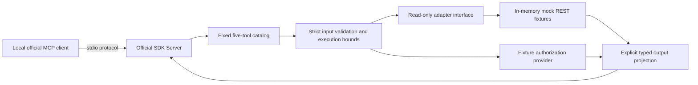

# Phase 2A: isolated, read-only MCP prototype

Date: **12 November 2026 (Asia/Calcutta)**.

**Phase 2A: PASS within the offline mock scope. Phase 2B live REST integration: NO-GO.**
The independent service implements the five requested tools and exercises the
official SDK through real local stdio processes. Every identity, task and workload
value is invented. These results do not establish production authentication,
delegation, tenant isolation, browser recovery or deployment readiness.

The user's Phase 2A instruction authorizes this isolated prototype. It does not
close the [Phase 1.5 live-stage gates](PHASE_1_5_FULLSTACK_SECURITY.md), authorize
OAuth implementation or approve a Department ownership/migration decision.
Existing ZeaPlay application/authentication code, schemas, migrations, UI,
Compose configuration and staged work are outside this change.

## Independent protocol and security audit — 12 November 2026

**Final audit: PASS for the isolated Phase 2A prototype after five verified
refinements. Phase 2B live REST integration: NO-GO.** This section supersedes
the implementation-stage test/dependency assessment below. Original evidence
was read and preserved; the independent audit has its own
[`audit-d3f4fa0f8b9c4272b0ddd47238eaf952`](../../mcp-server/checks/audit-d3f4fa0f8b9c4272b0ddd47238eaf952/verification.json)
artifacts. No privilege escalation, foreign fixture disclosure, write operation,
database connection or production REST connection was reproduced.

The audit read the feasibility contracts, this report, all twelve service modules,
the tests, package/lock and retained protocol/JUnit/scope evidence. The original
95-case suite independently reran **95 PASS** before fixes. Tests were extended
with a hard-coded expected catalog, real stdio argument/identity attacks, raw
legacy JSON-RPC requests and same-session concurrency. The new checks initially
reported **9 PASS / 2 FAIL**; both failures below were reproduced before repair.
The final new-project suite reports **106 PASS / 0 FAIL / 0 SKIPPED** in 25.71 s.

### Findings and corrections

| ID | Verified finding | Final disposition |
|---|---|---|
| **P2A-A1 — explicit null bypasses object schema** | A real legacy stdio `tools/call` with `arguments: null` returned a successful default list, although the advertised input schema accepts an object. This did not alter identity or expose forbidden records. | **Corrected; low validation severity.** `server.py` distinguishes explicit null from omission using the SDK model's supplied-field set and rejects null with protocol -32602. All five tools are covered. Omitting optional arguments still works through both SDK protocol modes and raw legacy stdio. |
| **P2A-A2 — malformed text misclassified** | A direct component call with an unpaired Unicode surrogate failed UTF-8 argument encoding and returned `UPSTREAM_INVALID`; no adapter call occurred. | **Corrected; low error-classification severity.** Argument serialization/UTF-8 failures now join model-validation failures as `INVALID_ARGUMENTS`. Non-finite/non-JSON/deeply recursive argument values fail in the same input stage. This component result is not claimed as an invalid-byte wire-frame test. |
| **P2A-A3 — affected test dependency pin** | `pytest==9.0.2` matched **CVE-2025-71176 / GHSA-6w46-j5rx-g56g** (also PYSEC-2026-1845), concerning Unix temporary-directory handling. Windows exploitation was not asserted. | **Corrected.** Pin and isolated environment updated to **pytest 9.0.3**, the published patched release. [Maintainer release](https://github.com/pytest-dev/pytest/releases/tag/9.0.3), [advisory](https://github.com/advisories/GHSA-6w46-j5rx-g56g). |
| **P2A-A4 — affected build dependency pin** | `setuptools==80.9.0` matched **GHSA-xmj3-9gf7-h52w**, a Windows path escape in legacy wheel installation, and **CVE-2026-59890 / GHSA-h35f-9h28-mq5c**, concerning macOS Unicode exclusions in source distributions. Neither exploit was executed. Normal local pip wheel installation is not proof the legacy vulnerable path was used. | **Corrected.** Build-system pin, lock and isolated environment updated to **setuptools 84.1.0**. The Windows advisory names 84.1.0 as patched. For the macOS issue, OSV/PyPI report 83.0.0 as fixed; the maintainer page instead lists affected versions through 82.0.1 and has no patched-version entry. 84.1.0 lies outside both published affected ranges. [Windows advisory](https://github.com/pypa/setuptools/security/advisories/GHSA-xmj3-9gf7-h52w), [macOS advisory](https://github.com/pypa/setuptools/security/advisories/GHSA-h35f-9h28-mq5c). |
| **P2A-A5 — shared pytest scratch cleanup** | The original commands used pytest's default `pytest-of-<user>` root. Its numbered-directory retention can prune previous runs belonging to other projects. Source review of `_pytest/tmpdir.py::getbasetemp` confirmed the shared cleanup path. | **Corrected; test-isolation severity.** The new project's `conftest.py` supplies a fresh, resolved, owned `zeaplay-phase2a-pytest-*` root when the operator has not supplied one. Final execution proves that root was used and existing shared scratch entries stayed unchanged. Earlier default-root cleanup cannot be retrospectively certified; no claim is made that all historical shared pytest scratch survived. |

[Before-fix failures](../../mcp-server/checks/audit-d3f4fa0f8b9c4272b0ddd47238eaf952/before-fixes.txt)
and [original dependency matches](../../mcp-server/checks/audit-d3f4fa0f8b9c4272b0ddd47238eaf952/dependencies-before.json)
are retained. No application, OAuth, live adapter, schema or product policy was changed.

### Criterion-by-criterion final assessment

PASS below is bounded to the mock stdio prototype, not production certification.
There is no outstanding FAIL among these fifteen Phase 2A criteria; the separate
live-integration gate remains BLOCKED by prerequisites listed later in this report.

| # | Requested criterion | Assessment | Evidence and boundary |
|---|---|---|---|
| 1 | Correct MCP SDK usage | **PASS** | Official 2.3.0 low-level `Server`/typed handlers, SDK negotiation/stdio/client; tools-only capability, correct error/result forms and both executed protocol versions. Explicit-null gap corrected. This is selected protocol verification, not exhaustive conformance certification. |
| 2 | Independent service architecture | **PASS** | Own package, venv, lock and source layout; installed-wheel/source parity verified; no FastAPI/application imports or configuration dependency. |
| 3 | Exact five-tool allowlist | **PASS** | Discovery order/names checked against five literal expected names, independently of `CATALOG`; repeated discovery stable. |
| 4 | No write operations | **PASS** | Only fixed mock read methods; synthetic GET intents; delete/update/generic tool names and arbitrary write methods rejected over raw stdio. Local logs/artifacts are not business writes. |
| 5 | No direct database connections | **PASS** | Source/import inspection and retained AST test; negative SQLite probe is blocked before connection. No application DB/test module was invoked. |
| 6 | No production REST connectivity | **PASS** | No live HTTP adapter/origin/token setting; offline socket/DNS guard probes pass. Only the auditor's public advisory/PyPI checks and isolated dependency installation use the internet. |
| 7 | No embedded secrets | **PASS** | Source review identifies invented fixture sentinels only, not real credentials/keys. Private profiles are explicitly omitted; projection, log and artifact scans pass within their stated pattern coverage. |
| 8 | No model-controlled identity | **PASS** | Launch-only fixture principal; all five tools reject user/tenant/actor/role/scopes/context/URL/token arguments; metadata cannot change the principal. |
| 9 | Strict tool inputs | **PASS after fixes** | Extra fields, coercion, enums, IDs, oversized search/argument bytes and malformed argument types rejected. Explicit null is a protocol error; omitted optional arguments retain defaults. UTF-8 validation errors are safe input errors. |
| 10 | Bounded output and pagination | **PASS** | Strict page/size/string caps, explicit clipping, duplicate text+structured byte budget and small error response. These do not bound SDK frame parsing or supply remote request-rate/queue quotas. |
| 11 | Safe authorization rejection | **PASS** | All five tools reject absent, revoked, inactive and unscoped fixture authority; hidden/nonexistent IDs use the same `NOT_FOUND`; post-await authority recheck remains covered. |
| 12 | Cross-tenant fixture isolation | **PASS** | Tenant A/B SDK processes remain separate; same-tenant forbidden assignments and other-department tasks remain hidden. Concurrent requests do not change actor or mix results. This is synthetic policy evidence only. |
| 13 | Safe errors | **PASS after fix** | Fixed safe tool errors and static protocol errors; no sensitive marker echoed from malformed requests, cursor or credential arguments. Simulated failures/timeouts remain sanitized; cancellation propagates. |
| 14 | Discovery and execution | **PASS** | Five schemas and successful structured results checked; real modern/legacy stdio, omitted defaults, raw malformed requests, cancellation, output validation and concurrent calls pass. |
| 15 | Existing ZeaPlay application unchanged | **PASS for scope** | Before/after hashes preserve all starting files outside six permitted Phase 2A edits; Git index unchanged. Existing app/auth/DB/UI/Compose/Phase 1.5 files were not modified or executed. Functional application regression was NOT RUN. |

### Tests independently executed

| Level | Final cases | Description |
|---|---|---|
| Unit/direct component | **12 PASS** | Settings, redaction/logging, cancellation, capacity-wait deadline and malformed Unicode classification |
| In-process SDK integration | **77 PASS** | Retained 76 cases plus 12 simultaneous calls proving peak adapter concurrency stays at configured capacity 2 |
| Real stdio — official SDK client/server | **12 PASS** | Retained five plus two protocol-mode attack suites, four authority states across every tool and 24 concurrent mixed calls on one session; all correlations unique and responses correctly associated |
| Real stdio — raw legacy wire client | **2 PASS** | Actual initialize/initialized handshake, tools-only capability, discovery, malformed arrays/strings/bools/names, unknown writes/methods/cursor, all-tool null rejection and subsequent valid calls; raw peer avoids SDK argument normalization |
| Offline guard subprocess | **1 PASS** | Network/SQLite/subprocess operations blocked before I/O |
| CLI/configuration subprocess | **1 PASS** | Readiness, invalid identity/settings, forbidden HTTP mode and ignored app environment |
| Static source boundary | **1 PASS** | Application/DB/network-client import boundary and GET-only mock intents |
| **Total** | **106 PASS** | Only `mcp-server/tests`; no skipped cases |
| Real browser/full stack | **NOT EXECUTED** | No backend authentication, PostgreSQL/Redis/presence/UI tests in this audit |
| Live REST/OAuth/production/LLM/external host | **NOT EXECUTED** | No real credentials, connections, deployment, customer migration, full remote hardening or LLM prompt-injection acceptance |

The additional evidence recorder completed **10 more successful SDK stdio tool
invocations**, five per mode: **2026-07-28** (`auto`) and **2025-11-25** (`legacy`).
Those ten are not added to the 106 pytest case count. This audit does not treat
synthetic authentication as actual browser/backend authentication.

Reproduction after the README setup and installing the updated lock/local wheel:

```powershell
.\mcp-server\.venv\Scripts\python.exe -I -m pytest mcp-server/tests -q --junitxml=mcp-server/checks/audit-d3f4fa0f8b9c4272b0ddd47238eaf952/final.xml
.\mcp-server\.venv\Scripts\python.exe -m pip check
ruff format --check mcp-server/src mcp-server/tests mcp-server/scripts
ruff check mcp-server/src mcp-server/tests mcp-server/scripts
```

Evidence: [baseline rerun](../../mcp-server/checks/audit-d3f4fa0f8b9c4272b0ddd47238eaf952/baseline.txt),
[final output](../../mcp-server/checks/audit-d3f4fa0f8b9c4272b0ddd47238eaf952/final.txt),
[JUnit](../../mcp-server/checks/audit-d3f4fa0f8b9c4272b0ddd47238eaf952/final.xml),
[protocol/calls](../../mcp-server/checks/audit-d3f4fa0f8b9c4272b0ddd47238eaf952/protocol.json),
[modern schemas](../../mcp-server/checks/audit-d3f4fa0f8b9c4272b0ddd47238eaf952/schemas-auto.json),
[legacy schemas](../../mcp-server/checks/audit-d3f4fa0f8b9c4272b0ddd47238eaf952/schemas-legacy.json),
[verification](../../mcp-server/checks/audit-d3f4fa0f8b9c4272b0ddd47238eaf952/verification.json)
and [scope preservation](../../mcp-server/checks/audit-d3f4fa0f8b9c4272b0ddd47238eaf952/scope-final.json).
[Final test-isolation evidence](../../mcp-server/checks/audit-d3f4fa0f8b9c4272b0ddd47238eaf952/test-isolation.json)
records the unique root and unchanged shared scratch entries. Cleanup closes/waits
for exact owned subprocesses; pytest's unique scratch root is retained for review.
The new venv packages and retained evidence also remain local. No container,
application service, database or volume cleanup was attempted.

### Dependency and protocol-source review

All **36 active exact pins** were queried against the public **OSV exact-version
API and PyPI vulnerability metadata**. The original matches were limited to the
two packages above, including duplicate advisory aliases. After updating them,
both feeds completed for all 36 pins with **zero matching published advisories**
and no yanked locked packages at the timestamp in
[dependencies-final.json](../../mcp-server/checks/audit-d3f4fa0f8b9c4272b0ddd47238eaf952/dependencies-final.json).
`pip check`, exact installed-pin parity and rebuilding/reinstalling the local wheel
with setuptools 84.1.0 passed. This is a point-in-time package metadata review;
it does not cover unknown vulnerabilities, installer/bootstrap tools, the Python
interpreter/Windows, bundled binary components or exploitation on other platforms.

The official [low-level SDK contract](https://py.sdk.modelcontextprotocol.io/advanced/low-level-server/)
confirms that this API requires application input validation. The audit checked
[2026 tool/result/error requirements](https://modelcontextprotocol.io/specification/2026-07-28/server/tools),
[legacy tool requirements](https://modelcontextprotocol.io/specification/2025-11-25/server/tools)
and [stdio framing/stdout requirements](https://modelcontextprotocol.io/specification/2025-11-25/basic/transports).
The SDK emits transport-specific protocol metadata; raw legacy requests exercised
the actual wire rather than assuming an in-process client proves serialization.
Tool annotations are descriptive only. Per-process fixture context is expressly
not remote per-request authentication. Broader remote quotas/rate limits and
hostile-frame admission remain prerequisites, not certified security properties.

The [SDK security advisory index](https://github.com/modelcontextprotocol/python-sdk/security/advisories)
was also reviewed. The configured stdio prototype has no HTTP/OAuth/task-storage
surface and mcp 2.3.0 did not match the queried affected ranges. In particular,
the [audience-validation advisory](https://github.com/modelcontextprotocol/python-sdk/security/advisories/GHSA-w4fh-qvv9-3v23)
requires correct verifier/resource configuration even on patched SDK versions;
upgrading alone does not implement future delegated authorization. External-schema
fetch and HTTP-body/session advisories reinforce the existing live-stage gates.

### Modified files and live-stage decision

Existing files edited by this audit only:

- `mcp-server/src/zeaplay_mcp/server.py`: reject explicit null arguments.
- `mcp-server/src/zeaplay_mcp/service.py`: classify malformed serialization as input failure.
- `mcp-server/pyproject.toml` and `mcp-server/requirements.lock.txt`: patched test/build pins.
- `mcp-server/tests/conftest.py`: unique owned default pytest temporary root.
- `docs/mcp/PHASE_2A_MCP_PROTOTYPE.md`: this audit and historical-evidence qualification.

Added: `mcp-server/tests/test_independent_audit.py` and this audit's evidence
directory. All original check artifacts are preserved. No live adapter, OAuth,
Settings UI, migration, application service or production deployment was added.

**Phase 2B live REST: NO-GO / BLOCKED.** Resolve the separately documented
Department/shared-configuration ownership decision, media authorization review
and Phase 1.5 B02 recovery gate; establish reviewed user-bound delegation and live
scope/resource/revocation enforcement; then prove fixed-route REST integration
on disposable resources. Remote transport additionally needs request-local
identity, audience/issuer validation, ingress/rate/queue quotas, outbound controls
and safe durable auditing. The isolated prototype is ready as a test foundation,
not as permission to connect it to live ZeaPlay. Stop after Phase 2A refinement.

## Architecture and scope



There is no live adapter, database driver usage, FastAPI import, token forwarding,
credential acquisition, arbitrary REST proxy or network listener. REST route
strings are inert identifiers describing future mappings. The adapter exposes
only three read methods, not a generic method/path/URL facility. It records
synthetic `GET` intents; it sends no HTTP requests and modifies no business data.

The CLI installs a Python audit hook after the event loop is initialized. It
denies DNS, socket connections/binding/datagrams, SQLite connections, subprocess
execution and imports of the application/common database clients during service
execution. A subprocess probe verifies denial before I/O against reserved test
targets. This is defense in depth for trusted local code, **not an OS sandbox**.
The official client launches the stdio child; the child cannot launch children.
Package installation used public PyPI; that setup traffic is separate from
offline runtime tests and never targets the ZeaPlay backend.

```text
mcp-server/
  pyproject.toml                 independent package and test/lint settings
  requirements.lock.txt         exact runtime/build/test dependencies
  README.md                     local setup, launch and verification
  src/zeaplay_mcp/
    __main__.py                 stdio lifecycle and local readiness CLI
    config.py                   explicit typed process settings
    server.py                   official SDK discovery/call handlers
    catalog.py                  immutable tool allowlist, schemas and scopes
    auth.py                     future authorization contract + fixture provider
    adapter.py                  read-only protocol + offline mock implementation
    fixtures.py                 deterministic two-tenant invented data
    models.py                   strict Pydantic inputs and structured outputs
    service.py                  admission, timeout, recheck and projection
    security.py                 offline guard, redaction and safe JSON logs
    errors.py                   fixed safe error codes/messages
  tests/                        new-project tests only
  scripts/record_protocol_evidence.py
  checks/                       retained test/protocol/schema/scope evidence
```

`.venv`, build artifacts, caches and bytecode are ignored locally. No dependency
was added to the existing application. No container, application server or
database was started, stopped, queried or migrated for Phase 2A. Verification
subprocesses use disposable empty working directories and synthetic authority.

## Verified SDK and transports

The environment actually executed is **Windows / Python 3.14.3**. The new package
declares Python >=3.11; other Python versions and operating systems were not run.
It uses official **`mcp==2.3.0` and `mcp-types==2.3.0`**, with
`pydantic==2.14.3` and `anyio==4.16.0`. All transitive runtime/build/test versions
are pinned in the [lock](../../mcp-server/requirements.lock.txt), including the
Windows-only marker on `pywin32`. Dependency resolution passed `pip check`.

The SDK release and supported APIs were checked against the official
[v2.3.0 release](https://github.com/modelcontextprotocol/python-sdk/releases/tag/v2.3.0),
[PyPI package](https://pypi.org/project/mcp/) and
[Python SDK documentation](https://py.sdk.modelcontextprotocol.io/).
The implementation uses the v2 low-level `Server`, `Client`, tool types and
`stdio_server`/`stdio_client` APIs, not a hand-written JSON-RPC implementation.

Only **stdio** is enabled. `--transport streamable-http` exits 2; there is no HTTP
listener, loopback HTTP mode, `/health` route or public deployment. SDK wire tests
negotiated **2026-07-28** in `auto` mode and **2025-11-25** in `legacy` mode.
These are executed SDK interoperability results, not compatibility claims for
every MCP host. Tool discovery includes explicit input/output JSON Schemas and
`readOnlyHint: true`, `openWorldHint: false`; annotations are hints, not enforcement.

## Tool contracts

The [feasibility report](../MCP_FEASIBILITY_REPORT.md),
[architecture](PHASE_1_ARCHITECTURE.md),
[permission model](MCP_PERMISSION_MODEL.md),
[session revocation](PHASE_1_3_SESSION_REVOCATION.md),
[tenant security](PHASE_1_4_TENANT_SECURITY.md) and
[Phase 1.5 audit](PHASE_1_5_FULLSTACK_SECURITY.md) informed the implementation.
Current task/information/activity/schema source was read without importing it.

| Tool | Accepted arguments | Intended future REST mapping | Mock output |
|---|---|---|---|
| `zeaplay_list_tasks` | `page=1`, `page_size=20`, optional `search`, `status`, `priority` | GET `/tasks/page` | Visible task cards + paging/counts |
| `zeaplay_get_task` | Required `task_id` | GET `/tasks/{id}/information`, fixed `section=overview` | Minimized overview + `as_of`/coverage |
| `zeaplay_list_overdue_tasks` | Same bounded query as list; no `quick_filter` argument | GET `/tasks/page`, fixed `quick_filter=overdue` | Visible overdue cards + paging/counts |
| `zeaplay_list_subtasks` | Required `task_id`; `page=1`, `page_size=25`, optional `search` | GET `/tasks/{id}/information`, fixed `section=subtasks` | Parent-bound child page + `as_of`/coverage |
| `zeaplay_get_workload_summary` | Empty object only | GET `/tasks/activity`, current authorized user only | Fixed synthetic self workload + coverage |

Workload is deliberately **self-only** in this prototype. The report's optional
other-user selection is withheld; no unresolved reporting permission decision
is needed to run it. Owner/Manager fixtures cannot select someone else's workload.

Bounds and projection:

- Pages are strict integers **1..10,000**; page sizes **1..100**; search strings
  at most **200 characters**. Boolean, float and string integer coercion is denied.
- Task IDs are **1..36 ASCII letters/digits/underscore/hyphen**. Paths, query
  strings, URLs and encoded separators fail validation. This is a deliberately
  narrow local ID grammar; live compatibility with historical IDs needs review.
- Parent status values are `WAITING_FOR_REQUIREMENT`, `TODO`, `IN_PROGRESS`,
  `BUG_FIXING`, `IN_REVIEW`, `BLOCKED`, `ON_HOLD`, `DONE`, `DEPLOYED`, `FAILED`,
  `GRAVEYARD`. Priority is `LOW`, `MEDIUM`, `HIGH`, `URGENT`; values are case-sensitive.
- Subtask status is independently `TODO`, `IN_PROGRESS`, `PAUSED`, `TESTING`,
  `COMPLETED`. The source information endpoint does not supply an edit version;
  this read projection does not invent one.
- `/tasks/page` supplies `title`/`assigned_to_id`; information overview supplies
  `name`/`assignees`. The adapter fixture models that distinction; projection maps
  `name` to tool `title` and the single assignment ID to `assigned_to_id`.
  Grouped assignments remain separate parent IDs; no sibling expansion occurs.
- Overdue uses the fixed fixture clock **2026-11-12T00:00:00Z**, a past non-null
  due date and the source's completed set **DONE/DEPLOYED**. `FAILED`/`GRAVEYARD`
  are not silently excluded. Sorting is stable by ID. Mock search covers task
  title/description or child name; it is not a full backend search emulation.
- All models reject unknown fields. No argument accepts a user/tenant/actor,
  credential, endpoint, URL, HTTP method, section or arbitrary quick filter.
- Task cards expose ID, bounded title, status, priority, assignment ID and
  aware timestamps. Overview adds bounded description/team; subtasks expose
  ID/title/status/completion/planned dates. Workload excludes contexts and names,
  preserves `capacity_seconds`/`remaining_capacity_seconds` as null when unknown
  and never invents configured capacity. Its values are fixed fixtures, not analytics.
- Text caps: title **256**, description **4,000**, team **128**, coverage and
  capacity note **256** characters. Redaction precedes clipping. `truncated`
  signals clipping, including coverage/note clipping. Page counts are not
  silently changed to fit output bytes. IDs, enums, dates and numbers are validated.
- Every result contains `ok`, a generated 32-hex `correlation_id`, `source: mock`,
  `untrusted_content: true`, nullable typed `data` and nullable safe `error`.
  `structuredContent` matches the JSON text content exactly. Tool failures set
  `isError: true`. Complete schemas are retained in
  [tool-schemas.json](../../mcp-server/checks/tool-schemas.json).

## Authorization seam and fixture policy

`AuthorizationContext` represents user, tenant, OAuth client/grant identities,
scopes, role/department, active/revoked state and policy revision. The provider
contract supplies admission, current-context revalidation and object authorization.
The service requires `tasks:read` or `workload:read`, applies fixture resource
visibility and rechecks current authority after awaited reads before releasing
output. A revocation-during-read case fails closed.

This is an interface for future integration, **not implemented OAuth or delegated
authentication**. Fixture grant/client labels and scope strings have no authority
outside the mock. No shared Owner/Admin token exists. An Owner fixture is merely
invented local role data; no production administrator credential is acquired.

Launch setting `ZEAPLAY_MCP_FIXTURE_IDENTITY` selects one fixed principal for the
whole local stdio process. Tool arguments, `_meta`, headers and task text cannot
select or switch it. Separate processes demonstrate simultaneous tenant A/B
clients without shared mutable identity. This process-level provider must not be
reused as remote multi-user session authentication.

| Fixture label | Synthetic authority/visibility |
|---|---|
| `a-member` | Alice: own assignments, created tasks; three tenant A tasks |
| `a-peer` | Bob: two separate assigned tenant A tasks |
| `a-observer` | One followed tenant A task |
| `a-manager` | Four tenant A tasks via fixture department/ordinary access; excludes other department |
| `a-owner` | All five tenant A tasks; no tenant B access |
| `b-member`, `b-owner` | One tenant B task; no tenant A access |
| `a-revoked`, `a-inactive`, `a-no-scopes` | Denied before adapter invocation |
| Missing setting | `AUTH_REQUIRED`; no default privileged principal |

Fixture rules check tenant first, then owner/admin, creator, assignee, follower or
same-department Manager access. Lists filter **before** pagination and counts;
direct/subtask reads require an authorized parent. Nonexistent, foreign-tenant
and otherwise hidden task IDs all return `NOT_FOUND` without data. These simplified
rules are test behavior, not a replacement for canonical backend authorization.
The synthetic adapter carries private policy fields for these checks and adds
deliberate private extras to stress projection. It is not a byte-for-byte live
REST response or proof a future HTTP adapter can safely authorize from those fields.

## Reliability, safe failures and observability

Serialized tool arguments are capped at **4,096 UTF-8 bytes** before model
validation. The local SDK parses frames before that check; this is not a network
ingress/frame-memory limit or a hostile-client sandbox. Remote parser/body limits,
session admission and queue quotas are future requirements.

| Process setting | Default | Permitted values |
|---|---|---|
| `ZEAPLAY_MCP_FIXTURE_IDENTITY` | Missing/denied | Fixture labels above |
| `ZEAPLAY_MCP_SCENARIO` | `normal` | `normal`, `timeout`, `upstream_failure`, `slow` |
| `ZEAPLAY_MCP_TIMEOUT_SECONDS` | 1 second | 0.01..10 seconds |
| `ZEAPLAY_MCP_MAX_OUTPUT_BYTES` | 131,072 | 1,024..131,072 bytes |
| `ZEAPLAY_MCP_MAX_CONCURRENCY` | 4 | 1..16 active tool calls per process |

Unknown `ZEAPLAY_MCP_*` names fail startup; no dotenv file is read. Existing
application `VEE_*` database configuration is ignored. Failure scenarios are
operator-only configuration, not model parameters. Timeout/slow delay list reads;
other reads remain usable for cancellation recovery tests. Upstream failure
simulates a sensitive raw exception without returning or logging its body.

The deadline includes capacity wait and awaited adapter work. Cancellation
propagates through the SDK/AnyIO stack, releases capacity and leaves the connection
usable. Fixture projection is bounded and synchronous; no claim is made of hard
preemption of arbitrary CPU work or a future non-cooperative HTTP adapter.
The output budget counts both duplicate JSON text and structured content, with
512 bytes reserved for protocol metadata. An oversized success becomes a small
safe `OUTPUT_LIMIT` error rather than dropping rows or changing pagination.
Protocol discovery/catalog schemas are fixed and outside this per-call budget.

Fixed tool codes: `AUTH_REQUIRED`, `AUTH_DENIED`, `NOT_FOUND`, `INVALID_ARGUMENTS`,
`TIMEOUT`, `UPSTREAM_UNAVAILABLE`, `UPSTREAM_INVALID`, `OUTPUT_LIMIT`,
`INTERNAL_ERROR`. Only timeout/unavailability are retryable. Unknown tools return
protocol error **-32602**; unknown protocol methods return **-32601**. Failures
do not echo arguments, raw upstream errors, identity records or stack traces.

Application logs are JSON on stderr, with tool, correlation ID, outcome, elapsed
milliseconds and mock marker. No arguments, task text, tokens or profiles are
logged. The formatter allowlists fields and drops raw SDK messages/exception
rendering. Text redaction covers common JWT/Bearer/password/API-key/token patterns,
including quoted assignments. It is defense in depth; arbitrary secret detection
is not guaranteed. There is no durable audit sink, customer secret handling or
production monitoring integration.

The malicious fixture contains instructions to reveal secrets/call `delete_task`
and a reserved `production.invalid` URL. Text is returned as **untrusted data**;
no URL is fetched and no tool is created or executed from it. Synthetic private
profiles, emails, notes and fixture secret markers are omitted/redacted. This
proves deterministic projection and no execution by this service; it does not
prove an LLM/host will resist all prompt injection. No LLM test was executed.

## Setup, launch and local health

Use the [README commands](../../mcp-server/README.md) from the repository root.
They create a separate `.venv`, install the exact lock, install only this local
package with `--no-deps --no-build-isolation`, and use `python -I` for execution.
Do not run existing backend test modules or use application environment files.
The normal stdio process is controlled by the SDK client and exits when it closes;
there is no resident service deployment or application cleanup command.

`--check` is a separate local CLI operation returning `alive`, `ready`, `mode`,
`transport` and `live_rest: false`. Exit 0 means fixture settings/required scopes
are usable; exit 3 means no usable fixture authority; invalid settings exit 2.
It does not contact an upstream dependency or certify production readiness.
The process may start without identity so discovery can work, but every tool call
is denied. Future readiness must check approved dependencies safely without
revealing identity or configuration secrets.

## Implementation-stage verification and evidence (retained)

Original implementation-stage suite: **95 passed, 0 failed, 0 skipped**. The
independent audit above supersedes this count and updates the test/build pins.
Parameterized cases count
individually. Only `mcp-server/tests` was collected, using this project's installed
wheel and virtual environment. Earlier 85-case initial output is retained; later
contract/boundary refinements are covered by the final suite.

| Test level | Executed result | Scope |
|---|---|---|
| Unit/direct component | **11 PASS** | Five settings bounds, four redaction/log cases, direct cancellation/capacity release and queue-inclusive deadline |
| Static source boundary | **1 PASS** | AST rejects application/DB/network-client imports in service source; mock adapter exposes only GET intents |
| In-process official SDK integration | **76 PASS** | Five schemas/results; strict arguments; all-tool missing/revoked/inactive/unscoped denial; seven role sets; ten parent/child forbidden lookups; paging/filter/overdue; private projection; upstream failures; truncation/output budget; revalidation; malformed upstream; protocol errors |
| Offline guard subprocess | **1 PASS** | DNS, TCP connect, loopback bind, SQLite and child execution denied before I/O |
| Real stdio official SDK integration | **5 PASS** | Modern/legacy discovery and five calls each; concurrent tenant A/B processes; metadata impersonation denial; missing identity/timeouts/failures; actual cancellation and subsequent successful call |
| CLI subprocess/configuration | **1 PASS** | Fixture readiness, missing/invalid identity, forbidden HTTP mode, rejected origin/token config, ignored application DB env |
| Real browser/full-stack application | **NOT EXECUTED in Phase 2A** | No browser authentication, FastAPI/DB/Redis/presence tests; prior Phase 1.5 evidence remains separately qualified |
| Live REST/OAuth/deployment | **NOT EXECUTED / NOT IMPLEMENTED** | No real credentials, token exchange, live tenant security, HTTP deployment, load/failover or external MCP host/LLM acceptance |

Commands actually used (from repository root):

```powershell
.\mcp-server\.venv\Scripts\python.exe -m pip --isolated install --no-deps --no-build-isolation ./mcp-server
.\mcp-server\.venv\Scripts\python.exe -I -m pytest mcp-server/tests -q --junitxml=mcp-server/checks/pytest-final.xml
.\mcp-server\.venv\Scripts\python.exe -I mcp-server/scripts/record_protocol_evidence.py
.\mcp-server\.venv\Scripts\python.exe -m pip check
ruff format --check mcp-server/src mcp-server/tests mcp-server/scripts
ruff check mcp-server/src mcp-server/tests mcp-server/scripts
```

Ruff **0.16.5** was the existing host tool, not a new runtime dependency. Test
dependencies were pinned independently (`pytest==9.0.2`, `jsonschema==4.26.0`)
for these historical runs. The current test pin is `pytest==9.0.3`; the current
build pin is `setuptools==84.1.0` after the independent advisory review above.
JSON Schemas are checked as Draft 2020-12, including successful result validation
with format checking and text/structured-content equality. The separate evidence
recorder adds **10 successful real stdio tool invocations**, five per protocol
mode, beyond the pytest case count.

Evidence:

- [Final test output](../../mcp-server/checks/pytest-final.txt) and
  [JUnit cases](../../mcp-server/checks/pytest-final.xml).
- [Protocol negotiation and calls](../../mcp-server/checks/protocol.json),
  [schemas](../../mcp-server/checks/tool-schemas.json),
  [modern stderr](../../mcp-server/checks/stdio-auto.stderr.jsonl) and
  [legacy stderr](../../mcp-server/checks/stdio-legacy.stderr.jsonl).
- [Static/dependency/artifact verification](../../mcp-server/checks/verification.json)
  and [change-scope preservation](../../mcp-server/checks/scope-final.json).

The scope comparison hashes the tracked/unignored starting files and Git index;
the initial dirty work is preserved. New files are confined to `mcp-server/` and
this report. Scope verification is a file-preservation check, not runtime proof
that the entire preexisting application behaves correctly. No unsafe existing
test module, migration, Docker command, application API or database was executed.

## Implementation-stage acceptance and remaining live-integration requirements

| # | Phase 2A acceptance criterion | Assessment |
|---|---|---|
| 1 | Independent service | PASS; separate package/venv/pins |
| 2 | Five read-only tools | PASS; fixed catalog, no writes/generic forwarding |
| 3 | SDK discovery | PASS; in-process and real stdio |
| 4 | Valid schemas | PASS; Draft 2020-12 input/output checks |
| 5 | Typed outputs/bounded paging | PASS; strict projection and explicit clipping/byte errors |
| 6 | Offline mock adapter | PASS; deterministic fixtures and runtime denial probes |
| 7 | Missing identities denied | PASS; no fallback Owner |
| 8 | Fixture tenant isolation | PASS; synthetic roles only, not production authorization |
| 9 | No write operations exposed | PASS; exactly five read tool names |
| 10 | Existing functionality unchanged | PASS for change scope; preexisting files/index preserved. Application regression NOT RUN |
| 11 | Isolated tests | PASS; 95 cases, only new project |
| 12 | Live limitations documented | PASS; live stage remains blocked |

**Phase 2B: NO-GO for live connection.** The next stage requires separately
authorized work and evidence addressing all of the following:

1. Close or explicitly approve the affected ownership/security scope: global
   mutable Department records, shared Kanban configuration policy and media tenant
   authorization review. Decide Department tenant ownership, shared-ID splitting,
   administration rights, deletion/archive behavior and historical mapping before
   migration design becomes executable. No Department migration was created/run here.
2. Resolve Phase 1.5 **P15-A5/B02**: PostgreSQL atomic rotation evidence does not
   explain the intermittent full-suite browser recovery timeout. Require a root
   cause and clean repeatable native multi-tab recovery evidence, while preserving
   revoked-session, tenant A→B→A, absolute-expiry and presence guarantees.
3. Establish reviewed user-bound delegation: issuer/audience/client validation,
   consent/grant lifetime and revocation, effective scope intersection, current
   tenant/user/role/navigation/resource checks and fail-closed policy-store behavior.
   Browser access tokens and existing arbitrary API scope labels are insufficient.
   Do not forward the incoming MCP token or share an Owner/Admin credential.
4. Implement a separate reviewed live authorization provider and fixed-route HTTP
   adapter. Backend authorization remains authoritative on **every** read and child
   expansion. Validate real response schemas/nullable fields, error/status mapping,
   timezone/overdue/search semantics, scope enforcement and any GET side effects;
   never trust fixture-only policy attributes, model-supplied context or cached
   privileges. Preserve unknown capacity and business coverage limitations.
5. Use disposable synthetic backend resources for live integration, browser and
   revocation/concurrency tests. Demonstrate field minimization, related-object
   authorization, no credential leaks and owned-resource cleanup. No production
   database/customer census or full historical migration chain is certified here.
6. Before remote transport, add authenticated request-local identity, strict
   Host/Origin/TLS rules, lifecycle/session and ingress/body limits, bounded queues,
   per-principal quotas, durable safe audits, outbound origin/redirect restrictions,
   secret management, dependency/security review and operational health/failure
   policy. The local audit hook is not a remote security boundary.

The adapter/provider seams and mock protocol tests are ready to support future
approved development. They do not authorize a live REST connection, production
rollout, OAuth implementation or Settings UI. **Stop after Phase 2A.**
