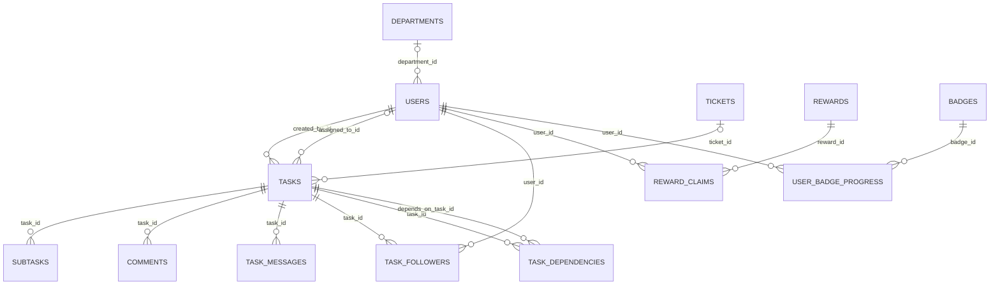
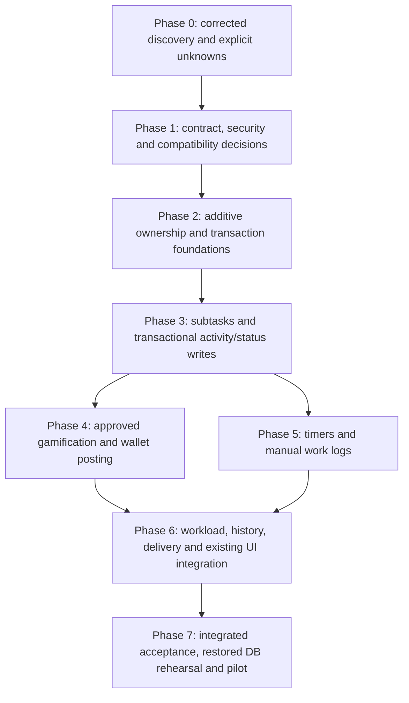

# ZeaPlay Subtask V2 — Phase 0 architecture and implementation plan

> Current local ports subsequently moved to the 7000 series: see [the port migration report](zeaplay-7000-ports.md). Historical addresses below describe the original inspection; the current frontend is `http://localhost:7300`.

> Final review (3 November 2026): use the [20-requirement acceptance matrix](zeaplay-subtask-v2-final-acceptance.md), [release notes](zeaplay-subtask-v2-release-notes.md) and [deployment checklist](zeaplay-subtask-v2-deployment-checklist.md) for the latest disposition. Production release remains blocked; earlier phase results retain their original execution scope.

> Current implementation status (3 November 2026): Phases 1–7 are documented in the later phase reports. This document remains the historical Phase 0 source inspection; its “not started” statements describe that inspection date. See [Phase 7 integration, security and readiness results](zeaplay-subtask-v2-phase7-verification.md) and [rollout/recovery prerequisites](zeaplay-subtask-v2-phase7-rollout.md) before any activation. Production deployment is not authorized or performed.

Inspected: **2 November 2026 (Asia/Calcutta)**. Scope: repository inspection, disposable validation, and this document only. No feature, business-rule, schema, page, running-service, or production-data changes were made.

Senior source review: **2 November 2026**. Sections 13–15 record corrected findings, coverage gaps and the final readiness checklist. Section 10 is the revised dependency map for **Phases 1–7**, superseding the initial ten work packages. Discovery is verified against this repository; implementation and deployment are **not started**. Production-dependent questions remain explicitly open.

## 1. Evidence boundary and architectural decision

The inspected repository is `F:\Projects\zeaplay-05\zea-play-08-05-26\zea-play`, at Git HEAD `584b368f1fb2fafd4fcda6459a7573ce2e8d8b24`, **including the existing dirty working tree**. It is not the separate `F:\Projects\Zeaplay-V2` checkout. Product naming does not establish the implementation stack. No applicable `AGENTS.md` was found in this checkout or its checked ancestor directories.

The actual application is React/TypeScript/Vite, FastAPI/Pydantic, SQLAlchemy/Alembic, PostgreSQL-oriented persistence, Redis, native FastAPI WebSockets, and a separate Node/Socket.IO presence service. Subtasks currently are boolean checklist rows. Extend these existing engines and pages; do not introduce a second application, task engine, reward wallet, or notification center.

All findings below refer to current source unless explicitly labelled **proposal**, **baseline execution**, or **not verified**. A file declaring a table, router, worker image, or flag is not proof that it is deployed or active. Production schema, migration revision, configured points, tenant counts, data quality, provider delivery, container contents, and live endpoints were not inspected. Private `.env` files and persisted application databases were excluded from the validation copy. No credentials are included here.

### Principal findings

| Finding | Evidence | Consequence for implementation |
| --- | --- | --- |
| A subtask has only `id`, `task_id`, `title`, `completed` | `backend/app/models.py:624`; `schemas.py:442`; `frontend/types.ts:1185` | Assignment, statuses, priority, estimates, activity, and work logs require additive extension. |
| Backend and frontend task status enums differ | `backend/app/models.py:57`; `frontend/types.ts:420` | Backend supports BUG_FIXING/DEPLOYED; frontend TaskStatus omits both. Correct contract parity in a later approved change before relying on all backend states in UI controls. |
| Main task tenant is inferred from `task.creator.tenant_id` | `routers/tasks.py:155`, `:198`; `models.py:520` | Tenant backfill and ownership reconciliation must precede composite constraints or tenant-index migrations. |
| Some existing task index migrations assume an absent model column | `alembic/versions/9c8d7e6f5a4b_add_task_list_calendar_indexes.py`; `backend/sql/tasks_indexes.sql` | A single Alembic head does not certify upgrade safety. |
| Task completion awards directly to `users.points`; ticket tasks also have a separate ledger path | `services/gamification.py:108`; `tickets/workflow_service.py:890`; `tickets/models.py:520`, `:703` | Preserve current credit/debit behavior; extend the existing XP ledger rather than introduce a competing wallet. |
| Frontend point displays and simulators differ from persisted rules | `frontend/utils/taskPoints.ts`; `taskScoreMatrix.ts`; `components/GamifiedXPSimulator.tsx` | Do not adopt a visual calculator as authoritative scoring logic. |
| Task read and write permissions are not fully distinct | `routers/tasks.py:160`, `:182`, `:2614` | Followers can reach some existing mutation handlers. New capabilities need explicit operation checks; changing legacy permissions is a separately reviewed fix. |
| Startup/import code performs DDL, normalization, seeding, and starts workers | `database.py:29`, `:64`; `main.py:567` | Do not import/run the installed application to inspect schema or run baseline tests. |
| Timer/work-log services were not found in active source | `models.py`, `routers/`, task UI; migrations-only reporting tables | Presence, elapsed deadline time, and shift displays are not actual tracked work. |

## 2. Actual frontend architecture and extension surfaces

| Responsibility | Existing paths and behavior |
| --- | --- |
| Boot and routing | `frontend/index.tsx` mounts React StrictMode and TanStack `QueryClientProvider`; `services/queryClient.ts` supplies the shared client. `App.tsx` uses React Router `createHashRouter`, `RouterProvider`, and nested routes. |
| Providers | `hooks/useAuth.tsx` owns authentication, theme, and shared search; `hooks/useNavigation.tsx` loads/revalidates tenant navigation; loading and toast providers are already available. |
| Task workspace | `pages/AllTasks.tsx` is the canonical `/tasks/*` shell. It mounts existing `Tasks.tsx`, `KanbanBoard.tsx`, `CalendarView.tsx`, and `GanttView.tsx` lazily, retains visited views, synchronizes URL filters, and invalidates queries on task changes. `utils/taskNavigation.ts` preserves legacy bookmarks and UUID detail links. |
| Detail and creation | `components/TaskDetailModal.tsx` fetches the task, its assignee group, and comments; edits through the API; toggles checklist completion and supports transfer-request approvals. It does not implement the main-task designated-approver UI. It is also opened by `components/Layout.tsx` from notifications. `CreateTaskModal.tsx` creates checklist inputs with completion flags, assignees, followers, estimates, recurrence, dependencies, attachments, and ticket-linked tasks. `components/TaskTemplateModal.tsx` is an additional checklist-template creation surface used from existing task views. |
| Shared UI | `components/ui/`, including `MultiSelect.tsx`, `MentionPicker.tsx`, `SingleSelect.tsx`, task status/priority badges and tooltips; `components/loading/`; `hooks/useToast.tsx`; `Avatar.tsx`; existing Headless UI dialogs and lucide/heroicons. Reuse actual exported primitives after checking their props. |
| Header | `components/Header.tsx` contains desktop/mobile header layouts, dashboard logo links, global search, theme/profile controls, clocks, refresh, and notification bell. Notifications fetch on mount, every 30 seconds, and `APP_REFRESH_EVENT`. Preserve its mobile menu and existing controls; add only a bounded timer/workload indicator if a later phase requires it. |
| Network boundary | Despite its name, `services/mockApi.ts` is the real Axios API adapter. It maps backend snake_case to frontend camelCase, caches requests, maps errors, and invalidates task/detail/group/comment caches after mutations. `services/tokenStorage.ts` owns token storage. Do not bypass this boundary from new components. |
| Task query lifecycle | `hooks/useTaskList.ts`, `useTaskCache.ts`, `useTaskPrefetch.ts`, `useTaskView.tsx`, and `utils/taskEvents.ts`. Query identity includes token/user/role; backend cache keys also incorporate role/department. Extend existing invalidation so all four views agree. |
| Gamification | `pages/Achievements.tsx` combines achievement/reward/level surfaces; `PointsTableSettings.tsx`, `RewardManagement.tsx`, `LevelsManager.tsx`, and `TemplateEditor.tsx` provide configuration. |
| Existing activity precedent | `components/Tickets/TicketActivityTimeline.tsx`, `TicketStatusTimeline.tsx`, `TicketApprovalPanel.tsx`; `pages/TicketPage.tsx`. Reuse visual conventions and pagination concepts without replacing ticket timelines. |
| Reports and workload hints | `pages/Reports.tsx` loads tasks/users and computes reports in the browser. Calendar counts and creation-form estimated-workload labels exist; there is no verified capacity/actual-work monitoring backend. `ClockAssistant/` shows local time/call advice, not running task time. |

`frontend/package.json` declares React 19, React Router 7, Vite 6, TypeScript 5.8, TanStack Query 5, Axios, Zod, React Hook Form, FullCalendar, Recharts, Framer Motion, and Socket.IO client. Installed baseline Vite was 6.4.2. Presence of Express or `@prisma/client` in frontend dependencies does not establish a backend or ORM; the active Python server uses SQLAlchemy and no Prisma schema was found in the inspected source.

**Proposal:** extend the current task detail modal with bounded subtask, activity, status-history, and work-log sections. Extend the current creation/template forms. Keep routes, the four task views, layout, header controls, ticket UI, and the established notification bell. Phase 0 adds none of these UI changes.

## 3. Actual backend architecture

| Layer | Source and integration contract |
| --- | --- |
| Application | `backend/app/main.py`: FastAPI application, global navigation dependency, CORS/static mounts, startup/shutdown lifecycle, and router registrations. Many routers are mounted both at their bare paths and under `/api`. |
| Persistence | `database.py`: synchronous SQLAlchemy engine/session, dependency `get_db`, pool configuration, declarative `Base`, and import-time compatibility helpers. PostgreSQL drivers are psycopg/psycopg2; SQLite is used in local/test paths. |
| Validation | `schemas.py` contains Pydantic task/subtask/user/configuration contracts; `tickets/schemas.py`, `chat/schema.py`, and `webhooks/schema.py` cover domain contracts. Existing checklist validation is minimal: title is a string, completion is boolean, and task update fields are optional. New contracts need bounded titles, finite nonnegative estimates, valid timestamps, and explicit omission/null semantics. |
| Authentication | `auth.py`: password hashing and access/refresh JWT helpers. `routers/auth.py`: login, register, refresh, logout, generated scoped tokens and presence token. `dependencies.py` decodes bearer tokens, loads the actual user, validates token type and UUID tenant equality, and rejects inactive users for active-user dependencies. Role authorization must use the actual dependency path, not assume scopes alone enforce object access. |
| Authorization | `dependencies.py`: active/admin/owner/API-admin dependencies, tenant and role helpers. `permissions.py`: separate API/navigation capabilities. `navigation_registry.py`, `navigation_guard.py`, `services/navigation.py`, `services/navigation_sockets.py`: page ceilings and tenant policy gates for HTTP aliases and sockets. Navigation can restrict existing authority; it cannot grant an operation. |
| Task engine | `routers/tasks.py` concentrates creation, grouping, filtering, templates, transfer requests, completion, approvals, dependencies, follower resolution, XP hooks, notification hooks, and checklist updates. It currently owns commits. Extract shared services incrementally after characterization tests; preserve response shapes and side effects. |
| Ticket engine | `tickets/router.py`, `service.py`, `workflow_router.py`, `workflow_service.py`, `task_engine_service.py`, `task_link_service.py`, `approvals_service.py`, `timeline_service.py`. Both legacy `TicketTask` rows and ticket-linked global `Task` rows exist. |
| Points/rewards | `services/points_table.py`, `gamification.py`, `badge_engine.py`, `rewards.py`; routers for config, achievements, badges, rewards, levels and logs. |
| Notifications/events | `services/notifications.py` delegates to `notification_dispatcher.py` and `push_service.py`. Tickets additionally use `notifications/service.py`, `events/bus.py`, email templates, and webhooks. These are distinct existing paths; reconcile delivery deliberately rather than dispatch both blindly. |
| Audit | `models.AuditEvent` is generally inserted in the business session. `services/audit_logger.py` writes richer `AuditLog` entries through a process-local queue/daemon and separate session. The latter can lose events on process failure and is not transactionally coupled to a task update. |
| Files, backups, integration | Existing storage adapters in `storage/`, media/avatar services, `backups/registry.py`, `backups/scope.py`, `backups/service.py`, `routers/data_admin.py`, `integrations.py`, and webhook dispatcher. New fields/entities must participate in backup/export/restore scope and relation validation. |

`routers/seasons.py`, `seasonal_rewards.py`, `user_progress.py`, and `pipelines.py` exist, but are not included by the inspected `main.py` registrations. Their presence is not proof of reachable APIs or active point effects. `Level` APIs are mounted. No source Celery application/task definitions or reporting-worker implementation were found in the inspected application; production Compose references prebuilt worker images.

The existing global feature-flag catalog includes `tasks.subtasks`, `tasks.points`, `tasks.time_tracking` and many page/permission labels, managed through `pages/MasterControl.tsx` and `routers/feature_flags.py`. These names do not prove feature implementation or enforcement: task mutation/scoring handlers do not consult those flags. Tenant navigation policy is a separate enforced mechanism. A future V2 kill switch must be checked by backend services and dispatchers, with optional UI hiding, rather than relying on a stored label.

## 4. Current entities, relationships, enums, and ownership

### Core task graph



| Entity | Current fields/relationships and relevant limitations |
| --- | --- |
| `users` | String(36) ID; UUID `tenant_id` indexed/non-null; unique global email; role, department, manager ID/email, shifts/breaks/timezone; `points`, created/completed counters, clarity scores, claimed/unlocked ID JSON arrays. `manager_id` is an optional string, not a self-FK. `projects` is a JSON list, not a Project relationship. |
| `departments` | String ID, globally unique name; no tenant column. `Task.team` is a free string, not its FK. Do not equate equal team strings with tenant membership or department ownership. |
| `tasks` | String ID, status/priority/team, one nullable assignee per row, creator, group ID, dates, recurrence/self reference, optional ticket FK, approval fields, clarity, attachments/tags JSON, `estimated_hours`, generated search vector. No direct tenant/project field. Deleting creator cascades tasks; assignee deletion sets null. |
| `subtasks` | String ID, required task FK with cascade, title, non-null boolean `completed`. No assignee, due date, priority, status enum, timer, order, estimate, nested parent, activity timestamps, or reward field. Do not describe this checkout as already having richer subtask lifecycle logic. |
| `task_dependencies` | Composite key `(task_id, depends_on_task_id)` to tasks. Completion checks all dependencies are DONE/DEPLOYED; update rejects self-dependency. No verified general cycle detection. |
| `task_followers` | Composite key `(task_id,user_id)`, created timestamp, cascading FKs. Observers are distinct from assignees and are excluded from assignee point calculations. |
| `task_group_id` | Multi-assignee create persists separate Task rows sharing this indexed value. Title/description/priority patches propagate to group peers. Status, completion, checklist rows, and rewards belong to each persisted task. Count Task IDs for actual records; grouping is not a parent/subtask relation. |
| `comments`, `task_messages` | Separate task-linked content tables; TaskMessage has mentions, edit/delete markers and timezone-aware timestamps. Task-detail comments use `/comments`. Neither is a complete immutable task activity ledger. |
| `task_transfer_requests`, `approvals` | Transfer from/to/requester/approver state; generalized approvals coexist with task-specific approval columns and ticket approval cycles. Preserve existing workflows and IDs. |
| `tickets`, `ticket_tasks`, `ticket_task_links` | Tickets have explicit tenant UUID, participant/follower/approval/status/history/SLA data. Ticket tasks have UUID IDs and their own enums/points. Linked global tasks use string IDs plus `tasks.ticket_id` and a link table. `TicketTaskLink.ticket_id` is a ticket FK; `task_id` is only String(36), with no task FK, and uniqueness is `(tenant_id,ticket_id,task_id)`. Backup registry validates its task relationship at application level. Do not infer a DB constraint from that registry or merge these ID domains. |
| `audit_events`, `audit_logs` | Both lack a tenant column in current models. AuditEvent stores actor/type/entity/payload/time; AuditLog stores before/after, metadata, request/source/status/severity, retention/delete information. Task PATCH adds only changed field names to its AuditEvent payload; rich diffs go through the separate asynchronous AuditLog writer. |
| Gamification | `points_table_config` is singleton ID 1 with JSON table and creation/clarity/manager settings. `achievements`, `user_achievements`, `badges`, `badge_rules`, `user_badge_progress`; rewards/icons/claims/logs; levels/nodes/edges/events/seasons/user progress. These are not uniformly tenant-owned. |
| Existing ledgers | `points_ledger`: tenant, user, legacy ticket/task UUID reference columns, `points`, `reason`, `created_at_utc`, `created_by`. These identity columns are not declared FKs in its model. `xp_ledger`: tenant, user, event type, signed points, generic ref type/ID, created/deleted time. No unique idempotency key/rule snapshot or immutability enforcement in the latter; no live XP writer/reader was found beyond model/backup infrastructure. It is a reuse candidate, not an existing canonical transaction service. |
| Notifications | User-linked `notifications`, `push_subscriptions`, per-user/module `notification_preferences`; ticket notification storage also exists. Notification ownership generally derives through the user. |
| Policy/configuration | `navigation_policies` fields are exactly `tenant_id` (String(36) primary key), `pages` JSON, `version`, `updated_by`, `updated_at`; there is no preferences column. Personal sidebar preferences live in browser storage. `feature_flags` has global key primary key, no tenant/version. API/SMTP/OAuth/email configuration has varying tenant support; never expose provider secrets in activity or snapshots. |

**Project boundary:** no mounted Project router or mapped `Project` entity was found. `ChatConversation.project_id`, badge-event project conditions, and `User.projects` metadata exist, but do not establish a relational project task hierarchy. Preserve them. If the deployed service has a separate project module, obtain its schema/contracts before adding project ownership or FKs; this repository alone cannot certify it.

### Adjacent persistence to preserve

`models.py` also maps avatar assets, media files/items, tool categories/tools/user favorites, SMTP/API/OAuth/email configurations, owner reset tokens, release notes and Kanban columns. Chat maps conversations, participants, messages, reactions, attachments, pins and mentions; conversation tenant ownership and participant membership are separate from task follower permissions. Backups map `backup_jobs` and `export_presets` in `backups/models.py`. Ticket persistence additionally includes followers/participants, approval users/cycles/items, comments/mentions/attachments, activity/status/close/audit events, SLA policies, notifications and webhook subscription/delivery records in `tickets/models.py`. New task features must not replace or repurpose these entities.

There are **14 additional reporting tables declared in migrations but without corresponding active mapped models/routers in this checkout**: `employee_day_sessions`, `hourly_report_slots`, `sales_visits`, `report_templates`, `daily_reports`, `report_comments`, `reporting_audit_events`, `report_notifications`, `report_leaderboard_entries`, `weekly_report_summaries` (`1a2b3c4d5e6f_add_reporting_module_tables.py`); `report_timeline_events`, `report_task_snapshots` (`2b3c4d5e6f7g_add_reporting_timeline_and_task_snapshots.py`); `report_checkins`, `report_email_provider_configs` (`3c4d5e6f7g8h_add_reporting_v2_tables_and_user_fields.py`). They carry tenant/session/employee/report references and uniqueness/index rules. A deployed reporting-worker image may still use them. Inventory them on the restored database before designing work logs; retain them and coordinate through explicit adapters if needed. They are not evidence of an existing task running-timer API.

### Status and priority compatibility

Main task **backend** values are `WAITING_FOR_REQUIREMENT`, `TODO`, `IN_PROGRESS`, `BUG_FIXING`, `IN_REVIEW`, `BLOCKED`, `ON_HOLD`, `DONE`, `DEPLOYED`, `FAILED`, `GRAVEYARD` (`backend/app/models.py:57`). The **frontend** `TaskStatus` has only nine values: `WAITING_FOR_REQUIREMENT`, `TODO`, `IN_PROGRESS`, `BLOCKED`, `IN_REVIEW`, `ON_HOLD`, `DONE`, `FAILED`, `GRAVEYARD` (`frontend/types.ts:420`); BUG_FIXING and DEPLOYED are absent. The initial assertion that both enums matched was wrong. Backend completion set is **DONE and DEPLOYED**; current frontend points projection recognizes only DONE. Main-task approval values match as lower-case `none`, `pending`, `approved`, `rejected`, independent of task status. Recurrence values match as `NONE`, `DAILY`, `WEEKLY`, `MONTHLY`, `AFTER_COMPLETION`.

Task priorities are **LOW, MEDIUM, HIGH, URGENT**, without an implicit numeric weight. `_ensure_priority_allowed()` currently imposes no extra restriction. Tickets use LOW/MEDIUM/HIGH/**CRITICAL**; legacy ticket task statuses are OPEN/IN_PROGRESS/COMPLETED. Ticket-link mapping converts CRITICAL to URGENT. Never replace existing enum values with simulator difficulty labels.

`main.py` contains compatibility normalization for legacy `BATTLE_PLAN`, `CASE_FILED`, `TACTICAL_SHIFT`, `CONQUERED`, and `FALLEN` values. PostgreSQL enum names/value storage and lower-case approval values differ; migrations must preserve the actual storage convention.

Current checklist toggles emit subtask badge events and invalidate task caches, but **do not synchronize parent completion**, create a typed status history, or award a fixed direct subtask-completion amount. Parent completion does not require all checklist items completed. Parent completion does require main-task dependencies completed. Any new parent aggregation/handoff policy is a future business decision, disabled for legacy tasks by default.

## 5. Existing point, bonus, penalty, reward, and achievement rules

### Persisted global-task rules

`services/points_table.py` resolves a normalized team-name match (lowercase alphanumeric), falling back to `Other`; missing/malformed entries use defaults. Positive penalty inputs normalize to negative values. Creation and clarity values normalize to nonnegative integers. Configuration is read from the database singleton; the following are **source defaults, not verified production settings**.

Reuse its resolver rules, but account for side effects: `get_points_table_config()` ensures the table exists and **commits** when initializing the singleton. It is not currently a pure read inside a caller-owned transaction. Initialize required configuration through the planned migration/provisioning path and introduce a read-only calculation adapter before relying on atomic task/activity/ledger transactions. Reward service methods and ticket event/link helpers also own commits today; do not call them inside a new transaction while assuming they only flush.

Creation default: **10 points to creator per created Task row**, including template assignment. Two assignees normally produce two rows and 20 creation points, not one shared 10-point award (`routers/tasks.py:1435`, `:1735`). Ticket-linked creation uses a separate handler and must not be assumed to award this creation bonus.

Completion in `gamification.award_task_completion_points`:

```text
assignee delta = base + beforeDueBonus   if completed_at <= due_at
               = base + overduePenalty  if completed_at > due_at
               = base                   if either date is missing
```

Assignee completion counter increments. There is no role/difficulty/time-duration/season multiplier in this helper. A manager creator receives the configured manager-overdue penalty only when the assignee differs, completion is late, creator is MANAGER, and creator department matches task team after normalization. Default manager penalty is **0**. A changed clarity rating credits the creator `clamp(int(rating),0,5) * clarity_points_per_star` (default **5**); it does not reverse the earlier rating credit.

Task PATCH and `/complete` guard awards by a transition from outside the completed set to inside it. DONE→DEPLOYED does not award again. Reopening and completing again can award again, and concurrent calls lack a ledger uniqueness guard. Completion timestamp may remain from an earlier completion. Approval-required tasks receive points on completion while approval is pending; approval/rejection does not implement a compensating deduction. Creating a task already completed does not call the completion helper through the ordinary create flow. Preserve these facts until separately approved rule changes exist.

All default team rules are listed as `(base, early bonus, late penalty)` in priority order:

| Team | LOW | MEDIUM | HIGH | URGENT |
| --- | --- | --- | --- | --- |
| Data Team | 10,5,-5 | 15,10,-10 | 25,15,-15 | 40,20,-20 |
| Lead Generation | 15,5,-10 | 25,10,-15 | 40,15,-20 | 60,20,-25 |
| Marketing Team | 15,5,-10 | 25,10,-15 | 35,15,-20 | 55,20,-25 |
| IT Support | 10,5,-5 | 20,10,-10 | 30,15,-15 | 50,20,-20 |
| Sales Team | 20,10,-15 | 35,15,-20 | 50,20,-25 | 70,25,-30 |
| Management | 10,5,-5 | 20,10,-10 | 30,15,-15 | 45,20,-20 |
| Finance Team | 15,5,-10 | 25,10,-15 | 40,15,-20 | 55,20,-25 |
| Hyper Automation | 20,10,-15 | 35,15,-20 | 50,20,-25 | 75,25,-30 |
| ZeaCRM | 20,10,-15 | 35,15,-20 | 55,20,-25 | 80,25,-30 |
| URL Factory | 25,10,-20 | 40,15,-25 | 60,20,-30 | 85,25,-35 |
| Target Access Hub | 15,5,-10 | 25,10,-15 | 40,15,-20 | 60,20,-25 |
| Client | 10,5,-10 | 20,10,-15 | 35,15,-20 | 50,20,-25 |
| Other | 10,5,-5 | 20,10,-10 | 30,15,-15 | 45,20,-20 |

### Verified synthetic examples

Executed the actual services on a fresh disposable SQLite database with its required deterministic search function; outbound sockets were blocked and notification delivery mocked. No application data or real pricing/reward configuration was used. Assertions passed:

| Example | Observed result |
| --- | --- |
| Default creation getter | 10 |
| Other/HIGH, completion exactly at deadline | 30 + 15 = **45** to assignee |
| Other/HIGH, one second late | 30 − 15 = **15** |
| Other/HIGH, no deadline | **30** |
| Unknown team/HIGH | Falls back to `{base:30, beforeDueBonus:15, overduePenalty:-15}` |
| Clarity rating 4 | **20** to creator |
| Active fixture badge, bonus 7, threshold one matching subtask completion | First event **+7**; repeated event leaves total badge credit **7**, not 14 |
| Pending reward costing 30, starting spendable balance 100 | Balance **70**, overall XP **100** |
| Reject that pending claim | Balance **100**, overall XP **100** |

The fixture script and output are retained with baseline evidence (section 11). These demonstrate service arithmetic, not live production rates or concurrent correctness.

### Other scoring paths and discrepancies

| Path | Verified source behavior |
| --- | --- |
| `services/time_bonus.py` | Standalone helper: BONUS at `completion <= allowed*5/6`; PENALTY strictly above `allowed*4/3`; NONE between. For 3 hours allowed: 2.5h BONUS, 4h NONE, 4h+1s PENALTY. Its 18 tests pass. No active task-award caller was found. |
| `frontend/utils/taskScoreMatrix.ts` | Browser-local role matrix: user creation 5/rating 2, staff creation 10/rating 3; PENALTY at <=20% duration; BONUS above 20% through 2/3; otherwise NONE. Owner skips penalty. Settings use localStorage. This differs from backend arithmetic. |
| `components/GamifiedXPSimulator.tsx` | Illustrative task-type base, difficulty/role/department multipliers, +12 approval bonus, +25%/-35% time deltas. It does not persist wallet awards. |
| `frontend/utils/taskPoints.ts` | Display projections count only DONE as completed, unlike backend DONE/DEPLOYED. They also display pending-overdue penalties before backend completion credit. These projections are not a ledger of actual deductions. |
| Legacy `tickets/workflow_service.complete_ticket_task` | On first COMPLETED transition, credits explicit `TicketTask.points` only if assignee exists and differs from creator; writes `PointsLedger`. Existing completed row returns early. No team/priority formula in this path. |
| Badge engine | Active rulesets match entity/event/priority/assignment/creator/project/pipeline conditions, count/time-window/negative-reset logic, AND/OR and tier prerequisites. Once progress is EARNED, subsequent calls skip it. Bonus XP is added to `users.points`. Candidate users are actor, assignee, creator; tables/rules are not tenant-partitioned. No event ID deduplication or concurrent once-only award guarantee exists. |
| Legacy achievements | `gamification.py` skips old achievement grants/checks if the `badges` table exists; startup `seed_badges_from_achievements()` bridges old data. Fallback IDs check first/5 completions, 3 high/urgent completions, urgent completion, 5 creations, and average clarity >=4 over >=3 ratings. Preserve unlocked IDs and badge progress. |
| Rewards | `services/rewards.py`: claimability checks active/expiry/balance/department; deducts `xp_required`, snapshots `xp_spent`; auto-redeem is REDEEMED, otherwise PENDING. Rejecting PENDING refunds the snapshot. `User.overall_xp_points = spendable points + non-rejected claim XP`; do not sum ledger credits blindly or replace spendable points with lifetime XP. |
| Levels/seasons | `LevelEvent` records unlock/claim events and `UserProgress` stores progress. `routers/levels.py:404` checks XP threshold and records CLAIMED; its comment explicitly leaves reward-service integration unimplemented. A success message there is not proof of reward redemption. Season multiplier is stored but not used by global-task completion helper. |

**Proposal:** no automatic new subtask award/penalty amount. Introduce versioned server policy and a preview using the same service that applies awards. Preserve current task/reward balances and existing formulas. Decide separately whether repeat completion, clarity edits, approval gating, and negative totals should change; do not silently repair them while adding subtasks.

## 6. Existing API contracts and integration points

Paths below are backend paths; many also have `/api` aliases. `frontend/nginx.conf` strips `/api/` when proxying to backend, whereas Vite preserves it. Client base URL and actual deployment determine the external URL. Do not blindly double-prefix `/api`.

| Contract | Existing request/response and hook |
| --- | --- |
| `GET /tasks` | Full list with `assignee_name?` and `skip_overdue_notifications=true`. This legacy query omits follower-only tasks for users/managers, unlike detail access and `/tasks/page`. Setting `skip_overdue_notifications=false` can create overdue/escalation notifications, commit and send Webex; it is not a universally side-effect-free GET. |
| `GET /tasks/page` | Paginated `TaskListResponse`: `items`, `page`, `page_size`, `total`, `total_pages`, `status_counts`, `next_cursor`, `has_more`. Page size defaults to 20, maximum 200. Filters include search, enum status/priority, assignee/team/tag, due/created date, quick filter and sort. Uses `_apply_task_visibility`, which includes followers. These filters/semantics must not be attributed to legacy `GET /tasks`. |
| `GET /tasks/kanban`, `/tasks/calendar/summary`, `/tasks/calendar/tasks` | Kanban columns/page, calendar day counts and task rows. Calendar supports timezone and civil-day bounds via `task_calendar.py`; preserve exclusive next-midnight/DST behavior. |
| `GET /tasks/{id}`, `/{id}/summary`, `/{id}/group`, `/tasks/leaderboard` | Detail/summary/group/leaderboard shapes differ. `TaskRead` includes existing subtasks, dependencies, followers, timestamps, approval data; preserve these fields and group semantics. |
| `POST /tasks` | `TaskCreate`: title/description/status/priority/team, scalar/list assignee fields, group, dates/recurrence, clarity/attachments/estimate/tags, followers, dependency IDs, checklist array. Returns **list of TaskRead**, even for one assignee. |
| `PATCH /tasks/{id}` | Partial `TaskUpdate`. Sending `subtasks` is a **replacement/synchronization list**: existing matching IDs updated, new IDs inserted, omitted existing children deleted. Omit the field to preserve subtasks. This is a major compatibility boundary for richer children. |
| `PATCH /tasks/{id}/subtasks/{sid}` | `{title?:string, completed?:boolean}`; returns the entire **TaskRead**, not SubtaskRead. Authorizes through parent access; emits badge events, invalidates caches, schedules n8n event. |
| `POST /tasks/{id}/complete`, `/{id}/approve` | Completion returns TaskRead, checks dependencies and updates approval state; approve accepts `{decision:"approved"|"rejected",comment?}` and requires designated approver. The approve handler does not itself call `_ensure_task_tenant`; strengthen any new wrapper before reuse. |
| Task templates/transfers | `/tasks/task-templates...`, `/tasks/transfer`, `/{id}/transfer-requests`, `/tasks/transfer-requests/{request_id}/approve`. Keep template checklist strings and transfer workflow compatible. Several transfer/approver lookup paths do not validate tenant as consistently as normal PATCH. |
| Comments | `GET /comments/task/{id}`, `POST /comments`, delete by comment ID. Parent tenant check exists; comment permission is stricter/different from general follower visibility. Do not assume task-read means comment-write. |
| Tickets | `/tickets/{id}/activity`, `/timeline`, `/timeline.csv`, approval/participant/follower endpoints; `/api/tickets/{id}/tasks` creates/lists global linked tasks. Preserve ticket auto-resolution in `task_link_service.handle_task_completion`. |
| Duplicate declarations | `tickets/workflow_router.py` also declares `PATCH /api/tasks/{task_id}` and `POST /api/tasks/{task_id}/complete` for legacy TicketTask. The global-task `/api` router is registered first. Review on the installed FastAPI **0.141.1** confirmed first matches are `routers.tasks.update_task`/`complete_task`, but OpenAPI operations describe `TicketTaskRead` from the later ticket workflow handlers. This is a real routing/documentation mismatch; deployed-version verification is still outstanding. |
| Notifications/push | `GET /notifications`; POST `/notifications/read-all`, `/read`, `/{id}/read`; DELETE `/{id}`; `/push/vapid-public-key`, `/subscribe`, `/unsubscribe`, `/test`; GET/POST `/notification/preferences`. Identity is authenticated user, not client `userId`. |
| Points/feature configuration | GET/PATCH `/config/points`: owner-only. GET/PUT `/feature-flags/`: owner-only; no PATCH route. Global navigation gating applies independently. |
| Navigation policy | GET `/navigation`: active user. PUT `/navigation`: owner/admin; only owner can change availability/allowed roles, admin can change hiding. Optimistic version check and AuditLog write are already atomic in this router. |
| Logs/audit | GET `/logs`: manager/admin/owner (`get_current_admin` includes manager). GET `/logs/audit` and `/logs/audit/export`: active-user dependency plus global navigation gate and internal scope filter. GET/PATCH `/logs/retention`, POST `/logs/retention/apply`, POST `/logs/audit/{log_id}/retry`: staff dependency plus internal checks. These do not all have owner-only access or one shared permission model. |

### Proposal: additive contracts within the existing backend

Use the existing task prefix, snake_case schemas, Axios mapping, active-user dependency, navigation gates, and parent authorization. Names below are proposed, not implemented:

```text
GET    /tasks/{task_id}/subtasks                 -> paginated SubtaskV2Read
POST   /tasks/{task_id}/subtasks                 -> SubtaskV2Read (201)
PATCH  /tasks/{task_id}/subtasks/{subtask_id}     -> preserve legacy TaskRead;
                                                   extend optional fields only
POST   /tasks/{task_id}/subtasks/{sid}/transitions -> {task: TaskRead, event_id: string}
DELETE /tasks/{task_id}/subtasks/{sid}           -> policy-controlled archive (204)
GET    /tasks/{task_id}/activity?cursor=&limit=  -> immutable event page
GET    /tasks/{task_id}/status-history           -> status-event projection
POST   /tasks/{task_id}/work-logs                -> manual WorkLogRead (201)
GET    /tasks/{task_id}/work-logs                -> permission-filtered page
POST   /tasks/{task_id}/timer/start              -> active WorkLogRead
POST   /tasks/{task_id}/timer/stop               -> closed WorkLogRead
GET    /tasks/timer/current                     -> current user's entry or null
GET    /tasks/workload?from=&to=&timezone=&user_id=&department_id=
                                                 -> scoped workload summary
```

Register fixed paths (`timer/current`, `workload`) before dynamic `/{task_id}` paths. Transition input should require `{to_status, expected_version, reason?, request_id}`; manual log input `{subtask_id?, started_at, ended_at, note?, request_id}`; timer start `{subtask_id?, request_id}`. Server derives actor, tenant, duration, policy version and awarded points. Never accept a client point delta, tenant override, arbitrary author, or authoritative duration for a running timer. Use 401 unauthenticated, 403 disallowed operation, 404 foreign/missing object, 409 stale/invalid transition or duplicate active timer, 422 invalid data. An idempotent replay of the same request returns its original result; conflicting reuse fails.

For richer create/read contracts, include `id, task_id, title, completed` plus optional new assignment/status/date/estimate/version fields. Keep `{title,completed}` clients valid. Do not change existing PATCH response type to an envelope without an explicitly separate versioned endpoint. The proposed transition endpoint can return an envelope because it is new.

## 7. Realtime, queues, notifications, and activity delivery

`services/task_events.py` publishes JSON on Redis `<cache_prefix>:tasks:events`; a daemon subscriber forwards events to `ws/tasks.py`. Normal task publishers include tenant in invalidations such as `{type:"task.changed", tenant_id, action, task_id?}`. Native task sockets authenticate JWT/user/tenant, check navigation, heartbeat every 25 seconds, and broadcast to a tenant connection set. **The manager's missing-tenant fallback broadcasts to every tenant connection**; normal publishers supply tenant, but the consumer is not fail-closed for malformed/missing ownership. Object visibility is not checked for each task ID. The frontend `useTaskWebSocket.ts` reconnects with backoff; messages invalidate task queries through AllTasks. Socket open/reconnect itself does not trigger a resync callback. Without Redis, publication is a no-op; there is no durable replay. Do not add sensitive activity payloads to this broadcast.

`ws/chat.py`, `chat/realtime.py` and `/ws/tickets/{id}` are native domain sockets. Task/chat sockets are registered bare and under `/api`; ticket-chat is registered bare only in `main.py`. A proxy may expose `/api/ws/tickets/{id}` by stripping `/api`, but that is not a direct backend alias. `presence-server/src/server.js` separately uses Express/Socket.IO, Redis adapter/history/pubsub and presence JWT authentication; `frontend/hooks/usePresence.ts` connects with Socket.IO. Presence online keys contain tenant/user identifiers. Some legacy chat room names are based on space ID rather than tenant; its JWT middleware has no database active-user recheck and falls back to tenant `default` when absent. Do not reuse that channel as a new authorized task stream. Presence online time is not work time.

In-app notifications are durable `Notification` rows retrieved by the header's 30-second polling. `services/notifications.create_notification` uses the dispatcher, which writes history and synchronously attempts browser push according to module preference. Push needs server VAPID settings, an active user subscription, and browser permission; `frontend/hooks/usePushNotifications.ts` registers `/sw.js`. The worker displays push and focuses/navigates on click. Current notification deep links such as `/tasks/{id}` must be tested with hash routing and any proxy; a push payload string alone does not prove navigation works. No dedicated live bell SSE/WebSocket stream was found.

`webhooks/dispatcher.py` already has persisted `WebhookDeliveryLog` attempts and retry scheduling, driven by an in-process thread. `queue_webhook_deliveries()` adds/flushes within the supplied session; `dispatch_webhook_deliveries()` commits; `webhooks/service.enqueue_event()` uses another session/commit. Ticket `events/bus.py` fans out existing email/notification/webhook work and can commit separately. `create_history_notification()` flushes and invokes n8n before the caller's final commit, and push delivery is also synchronous before that commit. Rich `AuditLog` usually uses an in-memory queue of 2,000, a daemon writer, and fallback synchronous write when full; navigation policy already writes AuditLog synchronously in its own business transaction. Reuse that demonstrated transaction/version pattern. These mechanisms do not together form a universal transactional event bus. Compose worker images are external to the source implementation inspected here.

**Proposal, not an approved new infrastructure requirement:** persist task/subtask state, activity/status event and approved XP delta atomically. Reuse existing webhook delivery rows/dispatcher for webhooks. Only add channel-neutral outbox data if Phase 1 proves existing records cannot cover durable in-app/push coordination; correlate each channel to one event rather than maintain two webhook retry queues. Reuse calculation and payload builders, not their current pre-commit send/commit wrappers. Retries require unique `(event_id, recipient_id, channel)` identities; do not claim exactly-once external delivery. Explicitly resync authorized HTTP data on reconnect, reject missing-tenant task events, and preserve polling fallback. Existing notification/entity enums have no dedicated SUBTASK value, and reward/achievement types resolve to no push module; plan any event additions or reuse of task notifications explicitly. No second socket service or bell is required.

## 8. Proposed schema, indexes, and migration strategy

Everything in this section is a design proposal. No migration was created or run.

### Proposed additive changes

| Existing/new entity | Proposed columns/constraints and purpose |
| --- | --- |
| Extend `tasks` | Nullable UUID `tenant_id` during expansion, later non-null after verified creator backfill; integer `version` server-default 1 for optimistic locking; optional `subtask_workflow_version` with legacy mode retained. Keep all IDs/statuses/groups/ticket links. Add unique `(tenant_id,id)` for composite child FKs. |
| Extend `subtasks` in place | UUID `tenant_id`; nullable `assigned_to_id`, `created_by_id`, `priority`, `due_at`, `estimated_seconds`, `started_at`, `completed_at`; bounded string `status` and `workflow_version`; `sort_order`, `version`, created/updated timestamps; optional `archived_at`. Preserve existing `completed`. No nested-subtask tree unless explicitly required later. |
| Subtask compatibility | Suggested initial V2 states TODO/IN_PROGRESS/BLOCKED/IN_REVIEW/DONE, stored as checked strings rather than changing the parent PostgreSQL enum. Backfill `completed=false -> TODO`, `true -> DONE`. Map V2 DONE to `completed=true`; old boolean writes map to TODO/DONE through the same service. Do not invent historical completion/assignment timestamps; record migration provenance. |
| Extend `audit_events` as task activity authority | Add nullable UUID `tenant_id`, string `task_id`, `subtask_id`, `request_id`, `source`, integer `entity_version`; optional structured `before`/`after` JSON. Retain old `event_type/entity_type/entity_id/payload`. Use `task.status_changed`/`subtask.status_changed` with `{from_status,to_status,reason}` in payload. Status history is an indexed projection of the same event, not a second conflicting log. Legacy rich AuditLog continues unchanged. |
| Candidate extension of `xp_ledger` | Confirm deployed ownership/consumers before adopting this currently dormant model. Candidate fields: nullable `event_id`, `idempotency_key`, `rule_version`, `calculation_snapshot` JSON, actor/user/task/subtask references, `reversal_of_id` UUID; unique `(tenant_id,idempotency_key)` for new non-null keys. Retain signed `points`, references, existing rows and meaning. A new transactional posting service and append-only rules would still be required; a table declaration is not a working ledger engine. |
| New `task_work_logs` | String ID; UUID tenant; user/task/subtask references; source TIMER/MANUAL; UTC start/end; integer duration seconds after close; note; void/correction reference; version and timestamps. Check end>=start, finite/nonnegative duration, manual entries closed. Partial unique `(tenant_id,user_id)` for an unclosed non-void TIMER row enforces one running timer across tabs/devices. A user-row lock serializes overlap checks. |
| Optional `task_event_outbox` | Only if existing delivery infrastructure cannot cover the approved channels. Candidate ID, tenant, event FK, sanitized payload and retry state; reuse `WebhookDeliveryLog` for actual webhook attempts. Do not create a second webhook retry implementation. |
| Candidate `task_workflow_settings` | Tenant UUID primary key, version, V2 activation switches, scoring-policy reference/snapshot, workload policy, updated-by/time. Reuse existing points resolver/configuration inputs; do not create a second editable points table. Versioned tenant overrides need an approved ownership/configuration migration. Existing global FeatureFlag cannot provide tenant pilot isolation. |
| Optional `user_work_capacity` | Tenant/user/date-effective schedule/timezone and available minutes only when capacity-based reporting is approved. Do not assume an eight-hour workday or convert existing shift strings to capacity without validation. Counts/estimates can ship with capacity explicitly unknown. |

Use the existing string Task/User IDs and native UUID ticket/tenant IDs correctly. New FKs must validate tenant alongside ID: unique `(tenant_id,id)` on users/tasks/subtasks where needed, and composite FK from `(tenant_id,task_id,subtask_id)` to a corresponding unique child identity. Simple ID FKs do not prevent a child being attached across tenants. Actor references must survive account deletion as nullable IDs plus safe display snapshots where retention requires it; do not cascade-delete audit/XP history with a task. Define archival and export behavior before enabling hard-delete routes for V2-managed records.

Do not apply blanket `ON DELETE SET NULL` to a composite actor FK if it would also null a non-null tenant column; choose an explicit archival/reference policy or a supported column-scoped action. Nullable `subtask_id` alone cannot enforce parent ownership for parent-only log rows: retain `(tenant_id,task_id)` validation as well. Old writers omit newly added tenant columns, so setting them non-null before all writers/worker images are compatible is unsafe. Append-only event/ledger rules must accommodate existing backup restore/reset paths through explicit controlled contracts; they are not already enforced by SQLAlchemy models.

Recommended indexes after tenant backfill: tasks `(tenant_id,assigned_to_id,status,due_at)` and `(tenant_id,created_by_id,created_at,id)`; subtasks `(tenant_id,task_id,sort_order,id)` and `(tenant_id,assigned_to_id,status,due_at)`; activity `(tenant_id,task_id,created_at,id)`, plus subtask/type filters; work logs `(tenant_id,user_id,started_at,id)` and `(tenant_id,task_id,started_at,id)`; ledger `(tenant_id,user_id,created_at,id)` and unique idempotency key; outbox `(status,available_at,id)`. Use keyset pagination with time/ID tie-breaker. Test actual query plans before adding redundant indexes. PostgreSQL concurrent indexes need Alembic autocommit handling and an invalid-index recovery path; SQLite needs its own supported path.

### Migration sequence and safeguards

1. Inventory a restored production schema and `alembic_version` without starting the app: columns/types, enum values, FKs, indexes, generated search column, row ownership, orphan/foreign relations, and legacy ticket/reporting tables. The repository has 26 revisions, one source head `d4f6a8b0c2e4`, and no missing parent revision IDs; this is graph evidence only. Some core tables rely on `create_all` rather than an initial all-core Alembic migration. Do not stamp a database just to bypass divergence.
2. Verify a database backup by restoring it to a named disposable database. Capture counts/IDs, wallet balances/counters, claims/XP spent, achievement/badge progress, task status/group/checklist/dependencies, ticket links and attachment references. Retain PostgreSQL major version and existing media stores. Never run raw `9c8...`/performance SQL against a model-created tasks table without tenant reconciliation.
3. Agree an explicit bootstrap strategy before rollout. This checkout has **no effective `VEE_BOOTSTRAP_SCHEMA` setting** in app config/startup; setting that variable alone does not suppress `create_all`, enum updates, seed logic or import helpers. **Alembic env.py imports app.database, whose import-time helpers can perform DDL even without app startup.** `alembic current`/migration environments are therefore not assumed read-only. Use independent DB inspection without app imports, and rehearse migration execution only against the restored disposable target. Any later gating change must be narrowly reviewed/tested.
4. Add nullable fields/new tables with no balance recalculation and no rename/drop. Match the actual current Alembic head at implementation time, including dirty migrations already owned by other work. Do not edit published old revisions to fix new assumptions.
5. Backfill in bounded, restartable batches: task tenant from verified creator; subtask tenant through task. Report ambiguous/orphan/cross-tenant links for repair; never assign them to a default tenant or guess from team/email. Keep rollback/progress evidence. Existing creator-derived access remains authoritative until parity is proven.
6. Backfill only reproducible state: boolean/status mapping, deterministic subtask ordering (document chosen order), versions. Old subtasks lack an order/history timestamp; a chosen stable order is not recovered original chronology. Audit tenant/task attribution is best effort; unknown records stay preserved and hidden from tenant history. Do not fabricate old work logs or award history.
7. Validate ownership and FK/index constraints before setting non-null/validating composite FKs. PostgreSQL NOT VALID/VALIDATE can reduce validation locking; rehearse separately from SQLite table-rebuild needs. Set bounded lock/statement timeouts and stop on validation failures.
8. Deploy compatible readers and disabled V2 writes. Then enable dual-compatible writes through the shared services. Crucially, legacy `TaskUpdate.subtasks` replacement must not delete/recreate rich V2 children from a stale checklist payload: reject stale/destructive V2 replacements with 409 and guide client reload, or use a deliberate protected compatibility adapter. Preserve IDs and metadata on accepted boolean/title updates.
9. Establish a cutover balance snapshot; begin new idempotent ledger entries without replaying historical task credits or duplicating `points_ledger`. Introduce V2 scoring only after policy approval. Never reconstruct lifetime XP from incomplete historical events.
10. Pilot one tenant; reconcile child/parent state, activity, points, work duration and notification delivery. Rollback disables V2 writes/dispatch, retains additive columns/history, and deploys a compatible application. A binary rollback to an old replacement writer can destroy rich subtasks; test compatibility before calling it safe. Image rollback is not database rollback. Do not downgrade/drop populated ledger or history tables to roll back a feature.

## 9. Tenant, RBAC, and workload requirements

### Actual current access versus proposed capabilities

| Actor | Current task behavior | Required V2 boundary |
| --- | --- | --- |
| Owner/admin | All creator-owned tasks in the same tenant through task helpers | Tenant restriction remains mandatory, including activity, workload, timers, exports and score previews. |
| Manager | Own-created/assigned/followed tasks plus tasks assigned within manager's department | Retain current visibility; do not silently interpret `manager_id` as unrestricted recursive access. Explicitly authorize departmental workload and any later report-hierarchy scope. |
| User | Creator/assignee/follower task visibility; general task update reuses read access | Distinct create/edit/assign/transition/log/approve/monitor permissions for V2. New watcher status does not automatically grant edits or point credit. |
| Ticket-linked task actor | `_ensure_task_update_access` restricts updates to creator/assignee even for staff | Preserve ticket-specific rules and ticket participation/approval checks. |
| Follower/watcher | In-app update recipient; present in task read helper and thus some current writes | Keep follower data/subscriptions; require separately defined mutation authority in V2, without silently tightening old behavior for legacy records. |
| Inactive/foreign user | Active dependency rejects inactive; normal task helpers hide foreign tenant tasks | Recheck on reads/writes, timer start/stop, socket reconnect/delivery, manager changes and background jobs. |

Tenant comes from authenticated user and validated JWT, never body/query/header overrides. Every supplied task/subtask/user/dependency/follower/manager/approver ID must be resolved in the same tenant. Task lookup must bind child ID to its actual parent; a globally unique ID is not an authorization check. Use a central access service for HTTP, sockets, notifications and workers, preserving legacy behavior until approved changes are explicitly enabled.

Existing gaps requiring separate tests/remediation before broad V2 rollout: follower edit coupling; designated task approve without explicit parent-tenant guard; some transfer and ticket-task approver lookups missing same-tenant checks; global points/reward/badge/department configuration; general AuditLog access where admin/owner can return nonconfiguration rows without tenant filtering (`routers/logs.py:_apply_scope_filters`). No PostgreSQL RLS policies were found in source. Application filters are the current boundary; absence of RLS in source is not proof of deployed database configuration.

Workload must distinguish **assigned records, assignee-group count, open subtask count, estimated effort, logged actual work, running timer elapsed, and capacity**. Never add both a parent's estimate and its children for the same workload unit; select a versioned policy (for example parent estimate for legacy tasks and child estimates for opted-in V2 tasks). Unknown estimates/capacity remain unknown. BLOCKED/ON_HOLD time is not automatically work; online presence and time between assignment and completion are not work logs.

Task terminal states for workload exclusion and parent aggregation must be explicitly approved; completion scoring currently recognizes DONE/DEPLOYED while FAILED/GRAVEYARD have different semantics. Do not introduce numeric priority weights or utilization thresholds without policy. A user sees their own allowed work; managers get permitted departmental aggregates; admin/owner aggregates remain tenant-scoped. Apply visibility before aggregation so hidden task counts cannot leak. Server computes UTC durations; date windows use the user's/profile-selected IANA timezone with half-open bounds. Pause/stop/reassignment/archival/offline recovery and manual corrections need explicit contracts. Retain corrections as auditable superseding/voiding entries rather than silently overwriting elapsed history.

## 10. Dependency map and acceptance gates for Phases 1-7

This is the revised proposed phase breakdown. It replaces the initial ten work packages; there was no pre-existing approved seven-phase specification to infer. No phase is started by this review. All work stays in this application and preserves existing pages/contracts.



| Phase | Prerequisites | Bounded scope and reuse | Exit gate |
| --- | --- | --- | --- |
| **1 - Contracts and security baseline** | Corrected Phase 0; read-only deployed-schema evidence still required before migration decisions | Agree status parity, subtask states, parent aggregation, watcher/manager/approver powers, reopen/clarity/approval scoring policy, timer overlap and workload counting. Characterize route collisions and fix exposure paths in a separately authorized implementation change. Reuse navigation's version-check/same-transaction audit pattern and existing test fixtures. | Operation/tenant/route matrix documented; critical negative cases covered; runtime/OpenAPI contract decision recorded; unknown project/worker ownership explicit. No new feature enabled. |
| **2 - Ownership and transaction foundations** | Phase 1 contracts and restored schema inventory | Reconcile bootstrap/Alembic drift, add compatible tenant/version/event/log schema, choose the existing ledger/delivery reuse strategy, and extend `backups/registry.py`/`scope.py`. Extract shared access and transaction adapters from task, scoring and notification code without carrying over unsafe helper commits. | Empty/model-created/migrated/restored DB rehearsals on the required PostgreSQL major version; old IDs/balances/claims/relations unchanged; no cross-tenant FK paths; legacy writers compatible; rollback proven. |
| **3 - Subtask workflow and activity authoring** | Phase 2; approved transition/permission contracts | Extend existing Subtask rows and checklist/forms; shared task/subtask mutation service writes versioned activity/status events in its business transaction. Preserve boolean adapters, group/template behavior and existing task responses. New scoring remains disabled pending Phase 4. | Old clients work; stale replacement cannot erase rich rows; tenant/parent/operation checks pass; repeated/invalid transitions and dependency cycles tested; task/event rollback together. |
| **4 - Gamification posting** | Phases 2-3; explicit scoring and repeat-completion policy | Use existing point resolver, reward-wallet semantics, badge rules and candidate XP ledger. Add one transactional posting entry point with approved rule snapshots, idempotent event identity and serialized/atomic balance updates. Coordinate legacy TicketTask PointsLedger writes rather than duplicate them. | Same event posts once; distinct concurrent awards both persist; reward claim/refund races tested; no historical recalculation; display preview and persisted calculation agree under the same rule version. |
| **5 - Timers and manual work logs** | Phases 2-3; approved time/overlap/correction policy | Add one source of actual work records, with existing API adapter and bounded detail/header controls. Reuse calendar timezone helpers where applicable. Do not convert presence or elapsed deadlines into work. | Multi-tab/device exclusivity, retryable start/stop, UTC/DST, overlapping entries, manual corrections, reassignment/archive/inactivity and offline recovery verified. No duplicate parent/child duration. |
| **6 - Workload, read projections and delivery/UI integration** | Phases 3-5; scoring and time inputs verified | Add authorized workload/history APIs and extend existing task views, detail/create/template forms, Reports/Achievements surfaces and notification bell. Reuse webhook delivery retries, push preferences and task sockets; add only missing channel coordination. | Filter before aggregation; unknown estimates/capacity remain explicit; reconnect/polling recovers state; no pre-commit delivery; recipient/deduplication/deep-link checks; desktop/mobile/keyboard and existing workflows pass. |
| **7 - Integrated acceptance and tenant pilot** | Phase 6 and all earlier exit gates | Complete auth/navigation/object-scope integration, PostgreSQL concurrency/constraint/migration tests, restore/rollback rehearsal, query plans and bounded tenant pilot. Preserve unrelated dirty work; do not switch database major versions as part of feature deployment. | Production-shaped evidence, balances/history/durations reconciled, no unresolved tenant exposure on affected paths, deployment/rollback artifacts verified and an explicitly authorized activation. |

Phases 4 and 5 can be scheduled independently only after Phase 3's contracts are stable; this diagram does not delegate work or authorize parallel implementation. Phase 6 depends on both. Activity/status **writing** starts in Phase 3; Phase 6 exposes authorized read projections, so UI work never substitutes for audit authoring. Transactional event/ledger primitives in Phase 2 are prerequisites, not a second business engine.

Future suites may include `backend/tests/test_subtask_v2.py`, `test_task_activity.py`, `test_task_work_logs.py`, `test_task_workload.py`, plus real wallet/badge/reward concurrency and migration tests, and frontend API/query/detail tests. These are proposed files, not existing coverage or Phase 0 implementation. Use disposable PostgreSQL for locks, uniqueness, typed UUIDs, enum/index and transaction behavior; SQLite alone cannot certify those gates.

## 11. Baseline execution, existing failures, and validation commands

### Executed baseline

Validation used a source copy at:

```text
C:\Users\Lenovo\AppData\Local\Temp\zeaplay-phase0-db967772949d4b53a8ee900e1a2f1b6e
```

The copy excluded `.env*`, databases, caches, backend media and virtual environments. Frontend `node_modules` was reused via a junction; builds wrote only disposable `dist`. Backend database settings were synthetic; outbound socket connects were blocked, except Python's internal Windows socketpair used by asyncio. No package install, shared database, live API, container rebuild/restart, migration upgrade, push delivery or deployment was performed. Logs and disposable runners remain in that temp directory; they are not committed and may be removed by normal temp cleanup.

Host tools: Python **3.14.3**, Node **24.14.1**, npm **11.15.0**. Installed Python packages: FastAPI **0.141.1**, Starlette **1.6.0**, SQLAlchemy **2.0.52**, Pydantic **2.13.4**, Alembic **1.19.1**, pytest **9.1.1**, httpx **0.28.1**, anyio **4.14.2**. Dockerfiles target Python **3.11**, frontend Node **18**, presence Node **20**; host results do not certify those image environments. Requirements use version ranges rather than a fully pinned Python lock.

| Check | Result | Evidence/limits |
| --- | --- | --- |
| `npm test` in frontend | **PASS: 41 tests**, exit 0 | `baseline-frontend-tests.txt`; existing Node test runner/tsx suites. |
| `npm run build` in frontend | **PASS**, exit 0; 4,467 modules | `baseline-build.txt`; 12.26s. Lottie `eval` warning and >500kB chunk warning; main bundle ~3.39MB/~958KB gzip. Vite build does not run TypeScript checking. |
| `npx --no-install tsc --noEmit` | **FAIL: 113 diagnostics**, exit 2 | `baseline-typecheck.txt`; no new frontend code was added. |
| Full backend `pytest backend/tests` in isolated runner | **FAIL during collection: 4 errors**, exit 2 | `baseline-backend.txt/.xml`; `test_generate_token.py`, `test_oauth2_server.py`, `test_task_list.py`, `test_ticket_tenant_permissions.py` create SQLite Task schema without `to_tsvector`. No full-suite pass claimed. |
| Backend excluding those four collection-blocked files | **FAIL overall: 274 passed, 24 setup errors**, exit 1 | `baseline-focused-final.txt/.xml`; all 24 errors in chat fixtures, same missing SQLite `to_tsvector`; 171.74s. Counts are not additive with the targeted repeat below. |
| Task safety/calendar + standalone time rule | **PASS: 44 tests**, exit 0 | `baseline-tasks-final.txt/.xml`; 26 task-tab regression tests plus 18 time-rule tests, 36.61s. Task fixture mocks XP/notifications; this does not test real completion rewards. |
| Real point/badge/reward fixture assertions | **PASS**, exit 0 | `phase0_points.py`, `baseline-point-examples.txt`; section 5 results. Notification sending mocked; no concurrency/production configuration claim. |
| `python -m alembic heads` from disposable backend | **PASS: `d4f6a8b0c2e4 (head)`** | Static AST graph check: 26 revisions, no missing parents. No database current/upgrade proof. |
| Python AST parse of app + Alembic files | **PASS: 152 files** | Syntax-only; no imports, startup or bytecode write required. |
| `node --check presence-server/src/server.js` | **PASS** | Syntax only. |
| Presence `npm test` | **NO COVERAGE: 0 tests**, exit 0 | No presence test files discovered. Zero tests is not behavioral certification. |
| Image builds, runtime/browser E2E, Redis/push/email delivery, real PostgreSQL upgrades/constraints | **NOT RUN** | Phase 0 did not access installed services or production. |

Passing subsets in the broader run: API-settings migrations 5; backup manager 55; avatar/profile 60; navigation policy 49; navigation readiness 27; socket auth 4; socket navigation 8; settings security 21; task tabs 26; time rules 18; chat 1 pass/24 errors. This is a source/disposable baseline only.

Typecheck diagnostics by file: Ballpit 54; seedData 23; LevelsPage 8; mockApi 7; TemplateEditor 6; TicketDetailDrawer 3; NotesBoard 2; TaskTemplateModal 2; one each in CreateLevelModal, CreateTaskModal, CreateUserModal, Achievements, LevelsManager, PointsTableSettings, TicketPage and mentionUtils. Representative failures include Ballpit instance-field/constructor/member typing, missing new Task fields in seed fixtures, API DTO mismatches, and `mentionUtils` calling `replace` on `never`. All are pre-existing with respect to this documentation-only phase.

Initial validation harness issues were corrected and are **not application failures**: the first copy filter accidentally omitted `frontend/components/media`, then was recopied before the successful build/final typecheck; an overbroad socket block initially prevented Windows asyncio's internal socketpair, then was narrowed before the final backend run. The point fixture was adjusted to use file-backed disposable SQLite and valid fixture emails. Earlier harness outputs are retained for traceability; the final result rows above identify the valid runs.

### Exact commands to repeat against the retained disposable copy

Run in PowerShell. These do not authorize pointing fixtures at an installed/shared database.

```powershell
$auditRoot = 'C:\Users\Lenovo\AppData\Local\Temp\zeaplay-phase0-db967772949d4b53a8ee900e1a2f1b6e'
Set-Location "$auditRoot\frontend"
npm test
npm run build
npx --no-install tsc --noEmit

Set-Location $auditRoot
python phase0_pytest.py backend/tests --basetemp=pytest-repeat-full
python phase0_pytest.py backend/tests --ignore=backend/tests/test_generate_token.py --ignore=backend/tests/test_oauth2_server.py --ignore=backend/tests/test_task_list.py --ignore=backend/tests/test_ticket_tenant_permissions.py --basetemp=pytest-repeat-focused
python phase0_pytest.py backend/tests/test_task_tabs_review.py backend/tests/test_time_bonus.py --basetemp=pytest-repeat-task
python phase0_points.py
node --check presence-server/src/server.js

Set-Location "$auditRoot\backend"
python -m alembic heads
Set-Location "$auditRoot\presence-server"
npm test
```

The disposable `phase0_pytest.py` sets test environment/memory app DB, disables outbound n8n/Redis configuration, clears optional PostgreSQL fixture URLs, disables bytecode/cache writes, and blocks outbound `socket.connect` except the standard-library socketpair. Legacy tests still create their hardcoded SQLite files, safely inside the disposable cwd. Do not run them from this workspace root: some call `drop_all` at module import on relative database files already present here. `backend/checks/run_legacy_regressions.py` is an existing isolation helper, but its blanket socket block is incompatible with Windows fallback socketpair and does not solve search-function schema failures.

### Recreate validation after temp cleanup

Use a fresh temp source copy, excluding secrets/data and retaining all frontend source directories. This reproduces the copy strategy; do not exclude every directory named `media`, because `frontend/components/media` is source code.

```powershell
$sourceRoot = 'F:\Projects\zeaplay-05\zea-play-08-05-26\zea-play'
$auditRoot = Join-Path ([IO.Path]::GetTempPath()) ('zeaplay-phase0-' + [guid]::NewGuid().ToString('N'))
New-Item -ItemType Directory -Path $auditRoot | Out-Null
$env:ZEA_PHASE0_SOURCE = $sourceRoot
$env:ZEA_PHASE0_COPY = $auditRoot
@'
import os, pathlib, shutil
src = pathlib.Path(os.environ['ZEA_PHASE0_SOURCE'])
dst = pathlib.Path(os.environ['ZEA_PHASE0_COPY'])
def exclude(folder, names):
    ignored = set(shutil.ignore_patterns('node_modules','dist','venv','.venv',
        '__pycache__','.pytest_cache','.ruff_cache','.env*','*.db','*.db-*',
        '*.pyc','*.log','*.pid')(folder, names))
    if pathlib.Path(folder).resolve() in {src / 'backend', src / 'backend/app'}:
        ignored.add('media')
    return ignored
for name in ('backend','frontend','presence-server','assets'):
    shutil.copytree(src / name, dst / name, ignore=exclude)
'@ | python -
New-Item -ItemType Junction -Path "$auditRoot\frontend\node_modules" -Target "$sourceRoot\frontend\node_modules" | Out-Null
```

Save the following runner as **`phase0_pytest.py` in the disposable copy**, then repeat the pytest commands above with the fresh `$auditRoot`. The standalone `phase0_points.py` command requires the original retained fixture script; the source-copy recipe does not recreate it, so that command is NOT RUN after cleanup unless the fixture is restored. It is validation harness code, not application implementation:

```python
import inspect, os, socket, sys
from pathlib import Path
os.chdir(Path(__file__).parent)
os.environ.update(VEE_DATABASE_URL='sqlite:///:memory:', VEE_ENVIRONMENT='test',
    VEE_JWT_SECRET_KEY='phase0-fixture-signing-key',
    VEE_JWT_REFRESH_SECRET_KEY='phase0-fixture-refresh-key',
    VEE_REDIS_URL='', VEE_CACHE_REDIS_URL='', VEE_ENABLE_N8N_FORWARDING='false',
    PYTHONDONTWRITEBYTECODE='1')
for key in ('ZEA_BACKUP_TEST_URL', 'ZEA_REVIEW_POSTGRES_URL'):
    os.environ.pop(key, None)
sys.dont_write_bytecode = True
original_connect = socket.socket.connect
def guarded_connect(self, address):
    caller = inspect.currentframe().f_back
    if caller.f_code.co_filename == socket.__file__ and caller.f_code.co_name == '_fallback_socketpair':
        return original_connect(self, address)
    raise RuntimeError('Phase 0: outbound sockets blocked')
socket.socket.connect = guarded_connect
import pytest
raise SystemExit(pytest.main(sys.argv[1:] + ['-q', '--tb=short', '-p', 'no:cacheprovider']))
```

For later implementation validation, use this same isolation boundary and add the newly created suites to `phase0_pytest.py` arguments. PostgreSQL validation must instead use an explicitly named disposable database and a test runner that only permits that database; do not globally remove the outbound guard and reuse production `.env`. On a restored disposable database, the exact Alembic inspection/rehearsal commands are `python -m alembic current`, `python -m alembic heads`, `python -m alembic upgrade head`, followed by the migration/RBAC/ledger/concurrency suites created in Phases 2-7. These upgrade commands were **not run in Phase 0**. `upgrade head --sql` is insufficient proof here because several historical revisions inspect live schema.

## 12. Deployment and remaining verification risks

`docker-compose.yml` builds backend/frontend/presence, uses PostgreSQL 16 and Redis 7, maps backend 6211/frontend 6300/presence 6212/PostgreSQL 6432, and persists `postgres_data`/`backend_media`. `docker-compose.prod.yml` describes PostgreSQL 15, Redis, prebuilt application/worker images, frontend port 6200, backend 6211 and presence 6212. `docker-compose.github.yml` is a source-build overlay, not a complete independent production stack. Do not switch PostgreSQL 15 volumes to PostgreSQL 16 or infer which Compose file is currently deployed.

`scripts/deploy-vps-github.sh` prepares backup/media/rollback handling and switches only backend/frontend/presence in an existing stack. It explicitly warns startup may mutate schema and image rollback does not restore the database. It was read, not executed. Preserve configured origins, including `play.zeacrm.com` and `todoplay.urlfactory.website`; backend CORS uses `VEE_CORS_ALLOW_ORIGINS`, presence uses `PRESENCE_CORS_ORIGINS`. Vite API URLs are build-time; runtime presence injection lives in `frontend/docker-entrypoint.d/99-runtime-config.sh`. Verify actual URL resolution and WebSocket proxy upgrades in the intended environment.

`GET /health` and `/doc/health` return static app status, not DB/Redis/schema readiness (`main.py:668`). A 200 alone cannot certify a migration or working task mutation. No repository `.github` workflow directory was found; frontend scripts have no lint/typecheck command, and build omits tsc. There is no verified source-owned worker CI gate or browser E2E script in package scripts, though existing `frontend/checks/` has manual fixture/browser evidence from earlier work.

Before rollout, resolve the SQLite baseline failures and approved typecheck work or explicitly baseline them; pin/rehearse the actual deployment dependency set; prove migration/runtime parity on a restored PostgreSQL database; verify all route aliases and ticket-task collisions; add concurrency/tenant/permissions tests; and validate backup restoration including new data. The dirty checkout contains uncommitted navigation/settings/profile/backup/task work: implementation must preserve that work and use a bounded change set. This Phase 0 document is an implementation plan, not production certification or authorization to run migrations/deployments.

## 13. Senior review findings and corrections

### Review method and evidence

The review rechecked reported source paths, Python model/schema/decorator ASTs, TypeScript enums/DTO mapping, all 52 default team/priority tuples, scoring helpers and their callers, role dependencies, main router registrations, migration graph, deployment definitions and test fixtures. An inventory resolved 123 unambiguous file references; shorthand names were resolved by frontend/backend section context. `/sw.js` means `frontend/public/sw.js`, not a root source file. Proposed future tests and temporary fixture scripts are explicitly not repository source files. Bare `models.py`/`schemas.py` in the core sections mean `backend/app/models.py`/`backend/app/schemas.py`; ticket/chat/backup files always use their domain context.

A SHA-256 comparison found **410 of 410 inspected application, migration, test, frontend and presence files identical to the initial Phase 0 disposable source snapshot**. New findings therefore expose omissions/inaccuracies in the report or existing behavior, not feature regressions from this review. AST inventory found 79 mapped model classes, 48 enums and 293 router-decorated endpoints; the two task association tables are additional SQLAlchemy Tables. These counts are source inventory, not deployed schema counts. Effective registered routes include aliases and other mounts, so they must not be equated with decorator count.

Review evidence is retained outside the repository at:

```text
C:\Users\Lenovo\AppData\Local\Temp\zeaplay-phase0-review-a8308d719b4c4b2ea966f6b70a819d23
```

`source-inventory.json` records model fields/enums/route declarations; `source-manifest.json` records compared source hashes. `route_review.py`/`route-review.txt` inspect the copied app without startup or DB/provider connections. `behavior_review.py`/`behavior-review.txt` exercise real handlers/services on a fresh synthetic SQLite database with FK checks/search-function fixture, injected active identities, mocked external integrations/audit queue/badge side effects, and outbound sockets blocked except internal asyncio socketpair. The behavior app deliberately mounts relevant routers without the global navigation dependency: these are **operation/object-scope characterizations**, not real-login or production penetration tests. Navigation may restrict access but must not substitute for missing object ownership checks. No real credentials, user data, external messages or production services were involved.

### Prioritized findings

Each finding is pre-existing relative to this documentation-only review. “Reproduced” means the disposable handler/service characterization above; “source” means inspected code, not an executed exploit or PostgreSQL concurrency test.

| ID / priority | Evidence and corrected conclusion | Required gate / disposition |
| --- | --- | --- |
| **R01 — High: status/DTO parity** | Backend `TaskStatusEnum` has 11 states; frontend `TaskStatus` has 9, omitting BUG_FIXING/DEPLOYED. `frontend/services/mockApi.ts:mapTask` and generic `Task` omit backend `ticket_id`, `approval_required`, `approval_status`, `approver_id` and `assigned_at`; separate `mapTicketLinkedTask` preserves some ticket-specific fields. The task-detail modal approves transfers, not designated main-task completion. Initial parity/UI claims were corrected. | Phase 1 must define supported contracts and Phase 3/6 preserve all fields through the correct adapter. Add fixtures for every backend status, ticket-linked task and approval state; do not assume a DTO round-trip is lossless. |
| **R02 — High: runtime/OpenAPI disagreement** | On installed FastAPI 0.141.1, effective first matches for PATCH `/api/tasks/{task_id}` and POST `/api/tasks/{task_id}/complete` are the global task handlers. OpenAPI instead documents later legacy ticket handlers and `TicketTaskRead`. `GET /tasks/task-templates` correctly matches the static template route, not generic task detail. | Resolve the API contract and duplicate declarations in later authorized work; verify runtime and schema together on the actual deployment dependency set before generating clients. No route was changed here. |
| **R03 — High: transfer and designated approval tenant gaps** | `routers/tasks.py:820` loads a transfer request/task without `_ensure_task_tenant`/access validation; a synthetic tenant-B admin approved tenant-A's request (**200**). Request creation at `:689` checks parent access but not target-user tenant. `approve_task` at `:2452` can return/mutate a tenant-A task for its legacy foreign designated approver (**200**). `tickets/task_engine_service.py` verifies approver existence, not tenant. Ordinary PATCH's stronger checks do not protect these separate paths. | Negative tests per path and alias, target/parent/approver same-tenant validation and operation authority are Phase 1 blockers before reuse. Foreign designated approval reproduction assumes a pre-existing invalid cross-tenant link, which current schema permits. |
| **R04 — High: audit/templates/reward administration exposure** | Tenant-B admin saw tenant-A task AuditLog and template rows in synthetic GETs. `routers/logs.py:_apply_scope_filters` scopes selected configuration records but returns general task logs across tenants for owner/admin; manager department query also lacks tenant predicate. `tasks.py:list_task_templates` is globally queried; template assignment target users/department are not consistently tenant checked. `services/rewards.py:list_claims`, `approve_claim`, `reject_claim`, `list_logs` do not accept a tenant filter. Claim administration restricts role to owner/admin, which is not tenant ownership. | Reuse `backups/scope.py` ownership-graph concepts and registry relations where semantics fit; do not assume all live routers already use them. Audit/templates are reproduced; claim/reward paths are source findings needing authenticated integration tests. Shared catalog intent and tenant-owned claims/history must be separated. |
| **R05 — High: push endpoint ownership** | `routers/push.py:unsubscribe` authenticates but `services/push_service.py:revoke_subscription` searches only endpoint. Tenant-B fixture user revoked tenant-A endpoint (**204**, `revoked_at` set). `save_subscription` also rebinds an existing endpoint to the caller without checking previous ownership. VAPID public-key GET has no user dependency. | Add user/tenant ownership checks/tests to subscribe/unsubscribe in later authorized work; reassignment policy must explicitly account for legitimate browser account switching. Do not describe all push paths as scoped merely because subscribe receives the current user's ID. |
| **R06 — High: read/write and list contract inconsistencies** | A follower could read detail and paginated list but legacy `/tasks` returned no row; the same follower patched a checklist item (**200**). `_ensure_task_update_access` reuses read access on non-ticket tasks; `update_subtask` uses `_ensure_task_access` even for ticket-linked tasks, bypassing the stricter ticket update helper. `get_task_group` authorizes one task then returns same-tenant peers without each peer's object check. Initial generalized visibility statement was narrowed. | Phase 1 needs explicit operation and group visibility contracts. Keep legacy behavior characterized; a V2 observer capability cannot inherit edit/completion powers accidentally. Ticket parent write restrictions must apply consistently to child mutations. |
| **R07 — High: point/counter lost updates and duplicate credits** | `gamification.py` and badge/reward paths use ORM read-modify-write, without row locks/version checks/atomic increments. A controlled two-session stale-read interleaving of two real **+45** awards ended at **145**, not **190**, from starting 100; completed counter ended 1, not 2. Sequential DONE→TODO→DONE on a separate task credited **+90** and incremented completion counter twice. No current global-task unique award event exists. | Phase 4 must serialize/atomically update wallets and counters while deduplicating the same business event. Unique event identity alone does not prevent losing two distinct awards. Repeat-completion policy requires approval; the reproductions are not proof of PostgreSQL locking behavior. |
| **R08 — High: refund/badge/claim races** | Reward balance check and debit are separate operations; rejected claim status check and refund are separate operations; Badge EARNED check and `user.points += bonus_xp` are not one guarded transition. `RewardClaim` has no model-level `(user_id,reward_id)` uniqueness, and startup repair removes a legacy uniqueness constraint to support multiple claims. `UserBadgeProgress` uniqueness prevents duplicate rows but does not itself guarantee once-only credit on an existing row. | Add concurrent claim/reject/approve/earn tests, guarded transitions and balance locking. Do not restore a global reward-claim unique key that would break `allow_multiple_claims`; design policy-aware idempotency. These race cases are source findings, not executed concurrent reward tests. |
| **R09 — High: unsafe recalculation/history interpretation** | Current task history display in `Achievements.tsx:pointsHistoryItems` is recomputed from task snapshots/current local points config through `taskPoints.ts`; it is not a persisted XP history API. Editing team/priority/due/config can change displayed historical points while banked points stay unchanged. Clarity edits credit each changed rating in full; current display represents only the latest rating. Legacy TicketTask points, main-task points, rewards and badge credits have different paths. | Preserve wallet/counters and claim `xp_spent`; store new rule snapshots at posting; never backfill balances by summing current task projections. The dormant `XpLedger` needs an owner/service contract before reuse; neither ledger is currently a complete reconstruction of `users.points`. |
| **R10 — High: date/time inconsistency** | Task due dates are normalized to naive UTC in normal create/update, but PATCH `completed_at` is assigned directly. Synthetic creator PATCH with UTC-aware `completed_at` and naive due date raised **TypeError: can't compare offset-naive and offset-aware datetimes** in the real completion helper. Reopen leaves old completion time; repeated completion can reuse it. Work effort is not currently logged. | Phase 1/5 must define UTC persistence/API conversion and reopening semantics; test aware/naive, due equality, profile/browser zones, DST and fractional estimates. Timer scoring must not silently activate the currently uncalled `time_bonus.py` formula. |
| **R11 — High: ownership/schema/bootstrap gaps** | Task lacks direct tenant; department catalog is global; manager ID, TicketTaskLink.task_id and ledger identity columns lack the FKs suggested by their names. Model and index migration disagree on `tasks.tenant_id`. Alembic env imports DDL-capable `database.py`; a false `VEE_BOOTSTRAP_SCHEMA` setting has no suppressing effect. These are source facts, not proof of a particular installed schema. | Independent restored-schema inventory before schema design; bounded backfill/constraint validation; review all old writer/worker compatibility; no arbitrary stamp or default-tenant backfill. Use registry `references()` and scope traversal as reusable application validation, not a substitute for DB constraints. |
| **R12 — Medium/High: delivery durability and scope** | Notification helper flushes then calls n8n/push before caller commit; async audit queue can persist an event for a failed transaction or lose it on exit. Existing webhook retry rows already provide durable delivery state and must be reused. Socket consumer missing-tenant fallback broadcasts across tenants; normal producers include tenant. Reconnect does not automatically refetch. | Phase 2/6 need caller-owned transactions, post-commit dispatch, recipient/tenant checks, fail-closed socket envelopes and explicit resync. Reuse existing channels/dispatcher and add only missing durable coordination. No evidence supports a second socket server, notification center or unconditional second webhook outbox. |
| **R13 — Medium: baseline/coverage overstatement** | Forty-four targeted tests mock task rewards/notifications; time-rule tests exercise a disconnected helper. Presence test script runs zero tests. Initial full suite did not execute past four collection errors. Navigation readiness tests verify configuration audit isolation, not every general AuditLog row. Existing broad backup tests do not certify live router tenant filtering. | Keep executed checks and proposed gates distinct. Add the coverage in section 14; do not cite passing unrelated suites as safety evidence for new gamification/timer/tenant behavior. |

### Reuse inventory refined by the review

Reuse the existing Subtask/Task IDs and tables; `TaskRead`/`TaskUpdate` compatibility; `mockApi` mapper and query invalidation; four task views and existing modals/header; `task_calendar.py` and frontend civil-day helpers; ticket activity/status visual conventions; existing Notification/preferences/push worker; native task socket and Redis channel; webhook delivery log/queue/retry machinery; points resolver, badge engine, wallet/reward claim snapshots; backup ownership/reference registry; and navigation's optimistic update plus same-transaction AuditLog pattern.

Do not call the current `XpLedger` a complete active XP engine, infer a Project module from metadata, infer timers from a feature flag, infer a Celery source worker from an image name, or infer an enforced FK from an application-level backup reference. New workflow settings must reference the existing points policy source rather than create an independently editable formula system. A new channel-neutral outbox or capacity table remains a design decision contingent on the deployed schema and required channels/capacity policy.

## 14. Coverage gaps, baseline provenance and verified contracts

### Exact schema and enum facts checked

Current **Task mapped columns** are `id`, `title`, `description`, `status`, `priority`, `team`, `task_group_id`, `ticket_id`, `assigned_to_id`, `created_by_id`, `approval_required`, `approval_status`, `approver_id`, `created_at`, `updated_at`, `due_at`, `assigned_at`, `completed_at`, `recurrence_rule`, `recurring_task_id`, `clarity_rating`, `attachments`, `estimated_hours`, `tags`, `search_vector`. Other class attributes such as `creator`, `subtasks`, `dependencies`, `followers` are relationships, not extra columns. Current **Subtask columns** are exactly `id`, `task_id`, `title`, `completed`; its `task` is a relationship. Current **NavigationPolicy columns** are exactly the six listed in section 4. All new columns/tables/statuses in section 8 remain proposals.

Role values match across backend/frontend: `user`, `admin`, `manager`, `owner`. There is no supervisor/watcher role enum; watcher means a relationship/capability, while `manager_id` is reporting metadata. Main-task priority, main-task approval, recurrence, ticket status/priority and legacy ticket-task status/priority enum values match their counterpart declarations. **Main task status parity fails**, as corrected in section 4. SQL sorting ranks for priorities/statuses are presentation order, not numeric gamification weights. The 13-team × 4-priority source-default table was rechecked mechanically: all **52 tuples match source**. Actual configured production values remain NOT VERIFIED.

Subtask schema `Optional` fields accept explicit nulls; title has no Pydantic maximum/nonblank rule even though DB title is String(255)/non-null. `TaskBase.estimated_hours` lacks finite/nonnegative bounds and clarity lacks a schema 0–5 bound (the scoring helper clamps). Future strict validation must distinguish omission from null and handle old invalid records without claiming those guards already exist. Do not change existing validation behavior silently while implementing the report.

Reported source routes were checked against decorators plus `main.py` inclusion/prefix rules. HTTP bare and `/api` aliases are not identical to frontend hash routes or Nginx-exposed URLs. The exact corrected admin methods/dependencies are in section 6; public VAPID key, active-user audit scope and legacy task list are exceptions to broad “all endpoints are scoped/owner-only/read-only” claims. Router decorators enumerate potential routes; effective ordering/OpenAPI was separately checked for both duplicate task operations. Mounted `levels/{id}/progress` GET can create/commit missing UserProgress. It is another read-looking endpoint with writes, not a pure reporting input.

### Missing automated coverage

| Area | Existing evidence | Missing required unit/integration cases |
| --- | --- | --- |
| Task contracts/statuses | 26 task-tab tests; frontend navigation/cache tests | All 11 backend statuses through generic/task-linked DTOs and UI controls; approval/assigned-at/ticket fields round-trip; runtime versus OpenAPI; bare versus `/api`/proxy routes. |
| Tenant and operations | Tenant task/comment tests; navigation/config and backup scope tests | Transfer create/decision and target tenant; designated approver; template list/assignment; reward claims/logs/refunds; generic audit/export/retention/retry; push ownership; follower writes on ticket-linked subtasks; manager departmental/hierarchy scope; per-peer group visibility. Use real JWT/global navigation as well as handler tests. |
| Main-task scoring | Time helper unit tests plus temporary arithmetic fixtures | Real completion endpoints with points/notifications enabled, self/unassigned/create-as-completed, DONE/DEPLOYED transitions, repeat completion/reopen/approval rejection, repeated clarity, unknown team, mutable rules and exact wallet/counter/claim invariants. |
| Concurrent scoring/rewards | Navigation version-conflict test is a reusable pattern, not wallet coverage | Same-event dedupe, two distinct simultaneous awards, badge earn once, lost updates across task/reward writers, duplicate/parallel claims, parallel reject/refund/approve. Require PostgreSQL transactions and no mocked posting service. |
| Subtasks/activity/status | Basic preservation tests; checklist UI | Stale whole-array replacement, duplicate/foreign child IDs, optional/null validation, parent-child authorization, cycles/ordering/archive, before/after correctness, append-only retention, rollback together, paginated consistent history and duplicate requests. |
| Time/workload | Calendar timezone/DST tests; no running timer/work-log implementation | One timer across tabs/devices; repeated start/stop, ownership, time overlap, server/client UTC, manual correction, negative/nonfinite/fractional durations, offline/restart/reassignment; scoped aggregation and no parent/child double count; capacity unknown versus zero. |
| Delivery/realtime | Socket auth/navigation tests; push implementation | Missing tenant envelope, per-object recipient scope, Redis disconnect/reconnect/refetch, pre-commit rollback, preference-disabled/unsupported/denied push, hash deep links, delivery retries/dedupe and process restart. Zero presence tests remains a gap. |
| Migrations/deployment | Static 26-revision graph and selected SQLite/offline migration tests | Current production-shaped schema versus model-created schema; startup/import DDL; untracked revisions already applied/not applied; tenant backfill ambiguity; PostgreSQL 15/16 constraints/indexes/locking; older application/worker write compatibility; complete export/restore/rollback with proposed new entities. |

### Existing failures and confidence boundary

Section 11's retained logs/XML were re-read during review: **41 frontend tests pass; Vite build passes; TypeScript has 113 diagnostics; full backend has 4 collection errors; reduced backend has 274 passes/24 setup errors; targeted task/time run has 44 passes**. The latter counts overlap the reduced run. Their source is unchanged in the 410-file comparison, so these results predate this review and any new feature implementation. They do **not** establish when the defects first entered Git or whether they predate other uncommitted work; no historical release bisect was performed.

The 4 collection and 24 setup errors are missing SQLite `to_tsvector` fixture compatibility, not evidence of failed PostgreSQL business assertions. The TypeScript failures span the pre-existing files listed in section 11. The initial omitted-media copy, overbroad socket block and invalid synthetic fixture email were validation-harness mistakes, not application regressions. Main status mismatch, scope gaps, routing mismatch and point/time risks are current source findings independently of those harness mistakes.

The broad build/test suites were **not rerun** during this review because their relevant source was unchanged; their earlier results are retained baseline evidence, not new executions. New route/OpenAPI inspection and synthetic behavior characterizations were run successfully (the assertions deliberately confirm the observed defects). This does not mean the affected safety properties pass. Full Docker/production/PostgreSQL/browser/delivery validation remains **NOT RUN**.

## 15. Final Phase 0 readiness checklist

**Discovery outcome:** repository findings corrected and evidence attached. **Implementation/deployment outcome:** NOT STARTED; affected changes must satisfy the open gates below. An accurate report can identify unresolved production facts without pretending they have been verified.

| Check | Status | Evidence / next dependency |
| --- | --- | --- |
| Correct checkout, HEAD and dirty-tree boundary recorded | **PASS** | Same HEAD; 410 relevant source files match initial baseline. This review changes only this report. |
| Reported files, model fields, route declarations, roles, status/priority/approval/recurrence values checked | **PASS for source review** | AST/source inventory; incorrect status parity, navigation fields, permissions and list API statements corrected. |
| Source-default point rules, actual writers and spendable/lifetime distinction verified | **PASS for discovery** | 52 tuples, retained service examples, real repeat-completion and stale-read characterizations; no live configuration claim. |
| Existing engines and adjacent relationships identified; duplicate-infrastructure assumptions removed | **PASS for discovery** | Existing audit/version pattern, dormant ledger, webhook retry queue and backup scope distinguished. |
| Baseline successes/failures recorded without claiming full-suite/production success | **PASS for reporting** | Retained logs/XML rechecked; new probes clearly separated. |
| Seven-phase dependencies and bounded acceptance gates defined | **PASS for planning** | Section 10; Phases 4/5 follow Phase 3 and both precede Phase 6; all precede Phase 7. |
| Runtime/OpenAPI and backend/frontend status/DTO parity resolved in application | **FAIL — existing gap** | R01/R02; Phase 1 contract decision and later implementation/tests required. No speculative fix in this review. |
| Affected cross-tenant and operation exposure paths fixed and authenticated tests pass | **FAIL — existing gap** | R03–R06/R12; handler repros and source findings, real-login suite still required in Phase 1. |
| Complete historical XP reconstruction available | **FAIL — unavailable** | Current ledgers/projections are incomplete; do not use reconstruction as a migration prerequisite or recalculate balances. Preserve a verified cutover snapshot instead. |
| Repeat-completion, clarity edits, approval gating, subtask scoring, time and workload policy approved | **OPEN** | Phase 1 business contracts. No default new award/penalty/capacity values invented. |
| Deployed schema/revision/worker/project-module ownership independently inventoried | **NOT RUN** | Required before Phase 2. Repository absence is not production absence. |
| Backup restored; tenant backfill/constraint/index/bootstrap and old-writer compatibility rehearsed | **NOT RUN** | Phase 2 on disposable production-shaped PostgreSQL; image rollback alone is insufficient. |
| Wallet/counter/refund/badge concurrency and UTC timestamp hazards resolved | **FAIL for current safety; future validation NOT RUN** | R07–R10; controlled stale-read/time error evidence, PostgreSQL correctness gates in Phases 4/5/7. |
| Timers, work logs, workload APIs, immutable event reads, durable new channel coordination implemented/tested | **NOT RUN — future features** | No implementation exists from this phase; follow Phases 3–6 after prerequisites. |
| Full frontend typecheck, full backend suite and presence behavior coverage pass | **FAIL / incomplete baseline** | 113 diagnostics; SQLite collection/setup errors; zero presence tests. Fix or explicitly approve isolated unrelated baseline debt before claiming later acceptance. |
| Integrated UI/auth/proxy/delivery, restored-DB migration, tenant pilot and rollback accepted | **NOT RUN** | Phase 7; requires all relevant earlier gates and explicit deployment authorization. |

**Stop condition honored:** no application source, schema, business logic, running service or production data was changed to resolve these findings. Phase 1 implementation must be separately requested; this review completes correction of the discovery report and leaves its unresolved decisions and production checks visible.
