# ZeaPlay V2 final production-readiness assessment

> Subsequent local runtime repair (3 November 2026): the rebuilt `zeaplay_v1` backend exposed missing V2 columns in its unversioned persistent database. A backup/restore rehearsal and guarded additive local repair are recorded in [the local schema repair report](zeaplay-local-v2-schema-repair.md). The affected local APIs now pass authenticated checks. This is later local-installation evidence; the historical runs below and outstanding production release gates retain their scope.

Reviewed 3 November 2026 in `F:\Projects\zeaplay-05\zea-play-08-05-26\zea-play`, Git HEAD `584b368f1fb2fafd4fcda6459a7573ce2e8d8b24` plus the existing dirty source. **NO-GO for production.** Phases 0–7 have substantial executed source/disposable coverage, but the security, quality and target-environment gates below remain open. No release commit, deployment, production migration or installed-service restart was performed.

The actual application is FastAPI/Pydantic, SQLAlchemy/Alembic, PostgreSQL, React/TypeScript/Vite, native task WebSockets and existing Redis/notification infrastructure. It is not the separate Prisma-based `Zeaplay-V2` checkout. Read the [historical Phase 0 architecture](zeaplay-subtask-v2-architecture.md), [Phase 7 evidence](zeaplay-subtask-v2-phase7-verification.md), [release notes](zeaplay-subtask-v2-release-notes.md), [deployment checklist](zeaplay-subtask-v2-deployment-checklist.md) and [rollout/recovery runbook](zeaplay-subtask-v2-phase7-rollout.md) together.

## Evidence and result meanings

**PASS** below means the named repository/disposable contract has executed supporting evidence, not a production certificate. **PARTIAL** means implemented or tested portions have evidence but a required broader gate is unverified. **FAIL** means an executed gate has a real failure. **NOT RUN** identifies an operation or environment that was not tested. Runs must not be added together as distinct-test totals when their cases overlap.

The final review used a new owned sanitized source copy, synthetic data, PostgreSQL 15 on localhost:15467, Redis 7 on localhost:16379 and an outbound-restricted pytest runner. No production database, media, passwords or private runtime configuration was copied into that fixture. A comparison covered 462 application/migration/test/frontend code files with no mismatches before the last targeted API-contract addition; the final source manifest/parity record includes that addition and later test edits. Secret scanning was a separate network-disabled, read-only local inspection of Git blobs and tracked environment content; its public evidence contains classifications and locations only.

Python was 3.14.3, Node 24.14.1, Ruff 0.16.5, Gitleaks 8.24.2 and isolated pip-audit 2.10.0. The actual production images and their dependency sets were not rebuilt or scanned. The local tool installation lives only in the owned verification directory. All modified production source and frozen migration contracts are hashed in [the final evidence directory](verification/zeaplay-subtask-v2-final-review/README.md).

## Final acceptance matrix

Paths are relative to the repository root. Test modules are under `backend/tests/` unless `frontend/test/` is specified. Detailed counts and test names are in [results.json](verification/zeaplay-subtask-v2-final-review/results.json).

| Requirement | Implementation location | Test | Result | Notes |
| --- | --- | --- | --- | --- |
| 1. All 20 confirmed requirements / Phases 0–7 | Phase 0–7 reports; canonical files in rows below | PostgreSQL feature cohort; final gate/API tests; frontend suite | PARTIAL | Implementation evidence exists; the combined production acceptance gate is not complete. Do not label all 20 production-verified. |
| 2. Old tasks and rewards preserved | `backend/app/models.py`; Alembic `e5a7c9d1f3b5`–`k1a3c5e7f9b1`; `services/subtask_rewards.py` | `test_phase7_migrations.py`; `test_subtask_schema_rehearsal.py`; historical completed-child and integrated legacy checks | PASS | Each revision retried before advancing. Fingerprints of original columns in 81 tables unchanged, including 500 old children, 100 rewards, 200 events and 100 inbox rows. No historical audit synthesis/recalculation. Actual target restore is not included. |
| 3. Additional subtask scoring | `backend/app/services/subtask_rewards.py`; `points_table.py`; `gamification.py` | `test_subtask_reward_calculation.py`; `test_subtask_rewards.py`; integrated workflow test | PASS | 1/2/3/5/100 children, other priorities, legacy exclusion, deterministic creation order, deletion and out-of-order completion. First eligible child has no base/bonus/penalty. Display override does not change parent-priority reward. |
| 4. Idempotent, auditable ledger | `backend/app/tickets/models.py` (`XpLedger`); `services/audit_logger.py`, `subtask_rewards.py`, `wallet.py`; frozen audit/reward guards | `test_subtask_reward_audit.py`; foundation checks; interrupted HTTP payout test | PASS | Concurrent workers/completion, replay, reversals, negative wallet, transaction interruption and scoped signed totals tested. Existing user wallet is opening balance plus signed movements; no global reconstruction from incomplete legacy ledger. |
| 5. Bonus and penalty | `backend/app/services/gamification.py`; `subtask_rewards.py`; captured `Subtask.reward_timezone` | Calculation boundaries, DST/deadline tests and `test_authenticated_workflow_rewards_information_notifications_and_legacy` | PASS | Existing team/priority values reused. Compare confirmed child actual end against captured creator-zone planned-end-day boundary, including equality; never copy parent's already-earned adjustment. |
| 6. Manual actual times remain user-controlled | `backend/app/schemas.py`; `services/audit_logger.py`; `frontend/components/SubtaskEditor.tsx` | `test_subtask_workflow.py` manual-confirmation/action/legacy cases; activity tests | PASS | Start/Pause/Resume/Testing/Complete and timers do not populate or overwrite manual actuals. Aware input, UTC storage, date order, version checks and explicit confirmation enforced server-side. |
| 7. Parallel elapsed does not double-count productive hours | `backend/app/services/task_activity.py` (`record_work`, `allocate`, `capacity`); interval/correction models | `test_task_activity.py`, `test_task_activity_audit.py`; notification workload-union check | PASS | Server event elapsed and confirmed work intervals remain separate. Overlap conflicts/correction and union allocation, pause, timezone/DST and configured capacity tested. No invented organization-wide hours limit. |
| 8. Atomic five-parent-task enforcement | `backend/app/services/task_activity.py`; unique slot/parent constraints and activity guards | Real concurrent HTTP starts in `test_phase7_system.py`; PostgreSQL race/lock cases in activity suites | PASS | Five distinct personal parent scopes, sixth denial, pause frees slot, conditional resume, same-parent children and duplicate/versioned actions covered. Client ticking introduces no per-second writes. |
| 9. Complete supported task/subtask activity history | `backend/app/services/audit_logger.py`; `task_information.py` (`event_index`, `events`); canonical task/comment writers | Workflow atomic audit, history pagination, status-stream/version ordering and permission cases | PASS | Supported new changes join existing authorized legacy logs/comments and ledger facts. Separate workflow/personal streams; hidden or missing historical transitions are not invented. This is not a claim that every legacy writer historically recorded every field. |
| 10. Complete Task Info modal | `frontend/components/TaskInformationModal.tsx`; task details triggers; `backend/app/services/task_information.py` | Fresh information/review tests and frontend tests; earlier Phase 7 real modal/browser checks | PASS | Five tabs, shared triggers, pagination/search, empty/legacy states, recipient totals and live invalidation supported. Earlier 72 browser assertions include 21 real API/UI checks and transport-fixture checks; they were not all repeated in this final review. Frontend source is unchanged and hash-compared. |
| 11. Notification recipients and permissions | `backend/app/services/workload_notifications.py`; existing inbox/preferences/push; `backend/app/ws/tasks.py`; `frontend/utils/notificationAlerts.ts` | Fresh notification/review suites; Redis replay/recovery tests; frontend notification tests | PARTIAL | Tenant/role/live-recipient deduplication, removed watchers, retries, stale/out-of-order events and unread counts pass. Real OS/provider delivery, closed-browser behavior and actual n8n/provider restarts are NOT RUN. External delivery remains at least once. |
| 12. API input validation and tenant ownership | `backend/app/routers/tasks.py`, `auth.py`; canonical access helpers and validators; `tickets/workflow_router.py` schema visibility | Fresh real-JWT system/negative tests, watcher cache revocation and OpenAPI contract tests | PARTIAL | Feature mutation/read boundaries have executed coverage. Public existing-tenant registration is blocked. OpenAPI now describes canonical handlers rather than shadowed legacy ticket DTOs. Every unrelated application API/provider is not security-certified by these suites. |
| 13. Safe migrations | `backend/alembic/versions/`; `backend/sql/zeaplay_v2_phase7_readiness.sql`; frozen schema guards | Full-chain legacy rehearsal, interrupted DDL rollback, repeat upgrades, read-only gate and six drift cases | PARTIAL | Disposable PostgreSQL passes. Gate now verifies 52 exact trigger contracts and six index contracts, including ordinary-write enablement. Restored target-schema compatibility/lock duration and real backup recovery are NOT RUN; indexes are not universally concurrent. |
| 14. Backend performance | `services/task_information.py`, `task_activity.py`, `workload_notifications.py`, `task_events.py`; indexed models | Fresh history/memory profiles, 200-user snapshots, 207-recipient replay, backlog query plans, Redis burst | PARTIAL | Bounded reads/fanout verified locally; workload scan still executes 2,339 SQL statements for 200 employees. Sustained same-tenant payout contention, production-sized load and deployment latency/memory budgets are not certified. |
| 15. Frontend build and accessibility | `frontend/package.json`; existing modal/editor/header components and tests | Fresh `npm test`, `npm run build`, `tsc`; earlier five mobile-tab axe checks | PARTIAL | 81 tests and build PASS. Typecheck FAIL: 112 diagnostics, exactly the previous set. Earlier modal axe run had zero violations/incomplete checks with contrast excluded; whole-app/contrast accessibility is NOT RUN. |
| 16. Existing features remain functional | Existing authentication/navigation/settings/profile/backup/time-bonus/task/ticket modules | Fresh 257 selected existing tests; Phase 7 system compatibility cases; earlier legacy modules | FAIL | Selected supported regressions pass. Earlier five obsolete modules still have 31 failures, 2 errors and 2 passes; no full installed ticket/Calendar/Gantt/reporting/achievement E2E certification. No standalone Project subsystem was found; profile `projects` JSON is not one. |
| 17. Containers/services/environment intact | Existing Dockerfiles, Compose topologies and protected runtime configuration | Source/config hashes; installed-container observation; final cleanup record | PARTIAL | This review did not edit Compose/Dockerfiles/dependency manifests/private configuration or restart installed services. Existing dirty Compose changes were preserved. Target image compatibility, externally supplied Celery/reporting workers and actual environment readiness remain unverified. |
| 18. No secrets committed | Git history, tracked `backend/.env`, `frontend/.env`; release code scan | Network-disabled local Gitleaks history scan (10 commits), current HEAD/worktree comparison | FAIL | Four credential-material findings remain in current tracked environment content and history; five current-code matches are reviewed fingerprints/timezone false positives. No credential values are published. Validity/revocation was NOT RUN; rotation/source hygiene/history coordination are required. |
| 19. Recovery requirements documented | `docs/zeaplay-subtask-v2-phase7-rollout.md`; deployment checklist; release notes | Source review of backup/migration/health/recovery commands; migration interruption tests | PASS | Backup-first, restored target rehearsal, writer inventory, bounded migration locks, compatible forward repair/artifact fallback, health and stop criteria documented. No destructive rollback or history deletion. Actual production recovery is NOT RUN. |
| 20. No untested behavior called verified | This matrix; current/earlier results and manifests | Executed JUnit/logs, source parity, separate prior evidence and NOT RUN entries | PASS | Synthetic/disposable/source, browser transport fixtures, installed services and external production are explicitly distinguished. Failures/skips are retained; no deployment or complete production proof is claimed. |

Disposition: **11 PASS for the stated source/disposable scope, 7 PARTIAL, 2 FAIL. Overall NO-GO.** Passing individual contracts does not waive the combined release gate.

## Confirmed defects repaired in this review

1. **Post-commit cache errors:** Redis `get`, `setex` and scan/delete failures could abort the HTTP response after durable task mutation. Redis cache operations now fail open to authoritative SQL, use bounded socket operations with no command retry, sanitize/rate-limit warnings and invalidate in batches of 100 keys. Invalid JSON is a miss. The initial actual HTTP regression failed before repair; final tests pass, including a stopped real owned Redis server.
2. **Stale authorization caches:** replaying an old page, Kanban response or calendar aggregate after removing a watcher exposed data/counts. User/Manager responses now always run current scoped queries. Owner/Admin caching retains existing tenant/user/access keys. Six role/path combinations and both privileged cache roles pass. No task DTO, permission grant or UI design was changed.
3. **Weak rollout gate:** same-table trigger presence and same-named indexes could mask missing immutability or concurrency protection. Six real PostgreSQL mutations (dropped, disabled and replica-only triggers; spoofed idempotency/queue indexes) passed the old gate incorrectly. All are rejected by the strengthened read-only gate; intact schema and read-only fingerprints still pass. Handler identity is checked, not cryptographic function-body attestation against a malicious database owner.
4. **Runtime/OpenAPI disagreement:** canonical task PATCH/completion handlers are registered before same-path legacy ticket handlers, while OpenAPI previously published `TicketTaskRead`. Two tests reproduced this. Only the shadowed decorators' `include_in_schema` flags changed; runtime order, handlers, permissions and ticket endpoints remain present. Generated documentation now describes actual `TaskRead` responses. This closes the Phase 0 R02 contract finding for those two paths without rewriting ticket logic.

## Accounting examples verified by executed assertions

These values are the existing **IT Support / HIGH** configuration, not newly invented global values. Other configured teams/priorities keep their own existing values.

| Eligible new-policy children | Additional available base | Earned before completion |
| --- | ---: | ---: |
| 1 | 0 | 0 |
| 2 | 30 | 0 |
| 3 | 60 | 0 |
| 5 | 120 | 0 |
| 100 | 2,970 | 0 |

The fresh PostgreSQL integrated test records:

| Component | Main task | Additional subtasks | Combined |
| --- | ---: | ---: | ---: |
| Base earned | 30 | 60 | 90 |
| Bonus earned | 15 | 15 | 30 |
| Penalty | 0 | -15 | -15 |
| Net newly earned | 45 | 60 | 105 |

Opening wallet 100 + newly earned 105 = **205**. Child one has no new-policy entries. Child two earns separate BASE +30 and BONUS +15; child three earns BASE +30 and PENALTY -15. Reopening child two appends REVERSAL -30 and -15 referencing the original entries, leaving main earned 45, additional net 15 and wallet **160**. Reprocessing the same state adds no further credit. Concurrent workers, repricing, deletion/restoration, reassignment, legitimate spending/negative reversals and interrupted payout are covered separately. No arbitrary cap was added.

For a managed scope, authoritative earned balance equals the sum of its signed ledger entries per recipient. Wallet movement equals signed adjustments from the recorded opening wallet; the entire historical wallet is not assumed to be reconstructed by this newly scoped ledger. Unknown historical main payout data remains unknown in the modal.

## Executed checks and limitations

Fresh results and retained before/after failures are in [machine-readable evidence](verification/zeaplay-subtask-v2-final-review/results.json). The main fresh PostgreSQL feature cohort passes **302 tests, zero failures/skips**, 585.50 seconds. Final PostgreSQL cache/schema/migration checks pass **21 with one intentional stopped-Redis-only skip**; the stopped-real-Redis HTTP test separately passes. Fresh existing SQLite regression modules pass **257 tests**. The final SQLite/cache/real-Redis rerun passes **16 with one intentional offline-only skip**. After the last two documentation-only route flags changed, the affected OpenAPI/integrated HTTP rerun passes **11** (including overlapping system cases). Frontend tests pass **81/81** and the production bundle succeeds in **11.74 seconds**, retaining large-chunk/Lottie warnings. Runs overlap and are not summed.

TypeScript has **112 errors**, zero added/removed relative to the preceding verified diagnostics. Broad explicit `ruff check backend` has **2,464 findings**; the changed small cache/new test files pass, and existing task-router diagnostic counts are unchanged. The preceding Ruff report used a different file inventory; the final report does not mislabel its aggregate difference as newly introduced product defects.

Fresh frontend lock audit reports **21 advisories: 1 critical, 14 high, 3 moderate, 3 low**. Fresh isolated backend audit of the installed 90-package requirements closure reports **69 advisories in 10 packages**; no missing/incompatible declared requirements were found. These are fixture/lock findings, not proof of deployed exploitable versions or a clean production image. Dependency upgrades require reviewed compatibility work; blindly running audit fix would not establish readiness.

The earlier five legacy module failures are explicitly earlier evidence, not fresh green regressions. Phase 0 already recorded collection/typecheck/lint and stale fixture debt. The Phase 7 legacy run found missing employer/password field assumptions and incompatible authentication/navigation fixtures. This review does not assert that every later failure existed before V2 began, nor silently treat those failures as acceptable. The unfiltered entire suite and full browser E2E were not rerun in this final review.

Earlier Phase 7 browser evidence remains hash-linked: 72 assertions distinguish real API/UI from synthetic native-delivery/two-tab/slow-read fixtures, and five mobile modal-tab axe checks exclude contrast. New final code did not change frontend source. Real provider/OS delivery, closed-browser notifications, target restore, target images, production pilot and actual rollback remain NOT RUN.

## Performance findings

Fresh PostgreSQL activity pages return 25 rows from histories of 100 and 5,000 using **10 queries and zero writes** in both cases, measured **0.1659 / 0.1574 seconds**, traced Python peak approximately **0.83 MB**. These are local fixture measurements, not production memory/latency guarantees.

The fresh 200-user, 20-concurrent snapshot profile uses **7 queries per snapshot**, zero writes, approximately **1.56 seconds** total and **152.76 ms p95**. A 200-employee maintenance scan uses three batches and **2,339 SQL statements**, approximately **3.14 seconds**. This per-employee query cost remains a target-load optimization concern. Financial writers also retain the tenant advisory barrier to prevent wallet/guard lock inversions; sustained same-tenant payout throughput is not certified by read throughput.

After disabling membership-sensitive body caching, a 250-task member page of 25 uses **10 SQL statements, zero writes**, approximately **0.172 seconds** locally. This measures the security tradeoff but does not prove high-volume production capacity. The 207-recipient repeated event uses bounded inserts with one durable row per authorized recipient. Actual query-plan tests select event/ledger/activity lookup indexes and the pending-notification partial chronology index. The real Redis 100-event burst retains one in-flight handler. Healthy clients do not poll per task/user and render clocks locally.

## Release blockers and recovery boundary

- **Credentials:** remove tracked private environment content from the reviewed release after provisioning protected configuration and rotating/revoking affected material. Coordinate history cleanup; no automatic index/history rewrite occurred. Storage credentials and Web Push key transitions require installation-aware handling. Scanner output does not prove key validity or exploitation.
- **Quality/security:** resolve TypeScript, lint, dependency and legacy regression gates; validate the actual release images, presence service and all external writers/providers.
- **Target proof:** restore a protected sanitized target backup, reconcile schema drift without blind stamping, rehearse migration locks/rollback and run installed regressions/accessibility, closed-browser/provider checks and sustained load/pilot acceptance.

This review preserved private configuration, runtime containers and unrelated dirty source. It did not commit/push/deploy, migrate a shared database, alter reward activation or rotate provider credentials. Owned fixture resources are identified and cleaned up separately. The final checklist and existing runbook contain the operator commands, rollout order, health/stop criteria and non-destructive recovery process. A pre-V2 image or old dump must not replace accepted new writes or immutable reward history.

## Phase dependency map

```mermaid
flowchart LR
    P0["0: repository discovery"] --> P1["1: schema, audit, ledger, intervals"]
    P1 --> P2["2: managed workflow and confirmed times"]
    P2 --> P3["3: deterministic rewards and compensations"]
    P3 --> P4["4: personal activity and workload"]
    P3 --> P5["5: authoritative task information"]
    P4 --> P5
    P4 --> P6["6: scoped durable notifications"]
    P5 --> P6
    P6 --> P7["7: integration, security, recovery"]
    P7 --> Review["Final review: repair defects, retain failures"]
    Review --> Gates["Close secret, quality, target and recovery gates"]
    Gates --> Approval["Explicit production authorization"]
```

