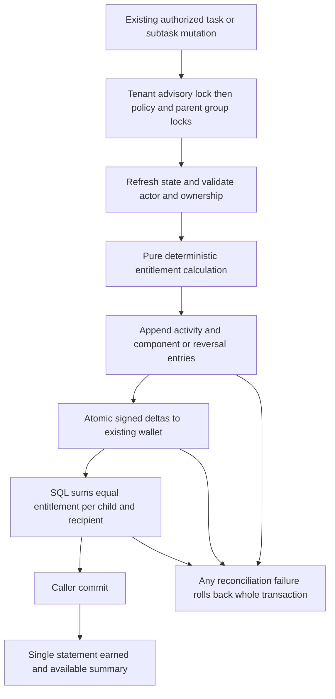

# Phase 3 reward security, accounting and concurrency audit

Reviewed and hardened on 2 November 2026 against this checkout's Phase 0 architecture and Phase 3 implementation. Scope: the additional-subtask reward engine, its existing XP ledger, financial transaction boundaries, reward summaries, and the shared wallet's claim/refund integration. No frontend pages, reward values, achievement rules, installed databases or deployment configuration were changed.

**Result: source/disposable verification passes. Production deployment and activation were not performed.** The pre-existing whole-suite SQLite collection failure remains; this is not a claim that the entire application is certified.

## Accounting invariant and its scope

For each `(tenant, task, subtask, recipient, subtask-additional-v1)` scope:

```text
signed SUM(xp_ledger.points) = deterministic current earned entitlement
```

Summing these scopes gives the same equality per parent task and user. Former recipients have zero entitlement after reassignment, and their signed original/reversal totals must equal zero. Negative entitlements and positive reversals of penalties are valid.

`subtask_rewards.reconcile()` now independently groups the persisted signed ledger in SQL by child and recipient and compares it with the pure calculator's current entitlement before allowing commit. Failure rolls back the entire caller transaction, including parent changes flushed before reconciliation. The existing SQL wallet arithmetic applies exactly the newly appended signed deltas in that transaction; it does not replace the wallet with a projected task total.

The wallet `users.points` also contains historical opening balances, main-task awards, achievements, authorized administrative adjustments and claim debits/refunds. It is **not** the earned balance for this one policy. `overall_xp_points` also accounts for claims under the existing model. Tests separately assert opening wallet plus actual financial operations equals closing wallet. No fabricated opening-ledger entries or historical main-task events were introduced, and historical wallet/ledger completeness cannot be certified from these legacy records.

## Defects repaired

| Finding | Repair and evidence |
| --- | --- |
| A missing points singleton caused the calculation getter to commit unrelated caller changes. | `services/points_table.py` returns existing configured values or transient existing defaults without DDL, insertion or commit. A regression test reproduced the unwanted commit before the fix and now verifies rollback. Configuration provisioning remains in its existing routes/migrations. |
| The generic Phase 1 adjustment repository accepted the reserved policy without posting its wallet delta; a missing `ref_type` could hide such rows from reconciliation. | `services/audit_logger.py` reserves this policy for the transactional engine. Reconciliation detects policy aliases and fails closed. New database guards require matching policy/reference tags, child reference and engine event type. The generic-repository bypass was reproduced before repair. |
| A reversal could reference another reversal, while reconciliation interpreted only unreversed original components. | Forward-only v4 guards reject chains and require original BASE/BONUS/PENALTY references. Existing exact-negation, same-scope and unique-reversal constraints remain. The database gap was reproduced before repair. Malformed imported/pre-existing chains are refused, not automatically repaid. |
| An inner payout savepoint could roll back money while leaving earlier flushed parent priority/assignment changes committable by a caller that caught the exception. | Reconciliation explicitly aborts the whole financial transaction on failure. Tests interrupt before wallet adjustment, after SQL adjustment, and during the second recipient update; a subsequent caller commit persists none of the repricing. |
| Policy configuration trusted a potentially stale detached owner role. | Re-read role, active status and tenant after obtaining the tenant lock. A demoted detached owner cannot activate or modify the policy. |
| An assignee with a first, still-unpaid policy child had no ledger reference preventing a tenant move. | V4 guards protect assignment ownership even before any payout. PostgreSQL locks recipient ownership during child creation/parent writes. A concurrent first-child/recipient-tenant-move test permits only one compatible outcome to commit. |
| Shared reward claims could race through their eligibility checks, and parallel rejections could refund twice. Claim history/refund lookup and reward logs lacked tenant filtering. | Serialize claim eligibility/debit and resolution/refund by recipient then claim; refresh locked state. Check active role and tenant in the service. Filter claim history through the claimant's tenant and logs through their actor's tenant. Concurrent duplicate claims produce one success/one conflict; duplicate refunds produce one success/one already-resolved response. Foreign-tenant reads return no private claims/logs and foreign resolutions return 404. Existing shared reward catalog semantics and costs remain. |
| Cached children/priority could be combined with a fresh ledger, displaying a paid reward as still available. | One SQL statement now reads ordinal counts, current priority/assignment, policy snapshot and signed ledger aggregates. A two-session regression reproduced `earned=65, available=30` before repair and now returns `earned=65, available=0, capacity=45`. |
| Unordered set iteration made posting/input ordering vary between processes. | Sort calculation children, reconciliation keys and original references deterministically. Isolated tests permute every input order, including legacy rows and creation-time ties. |
| Malformed policy snapshot types could produce internal key/type errors. | Validate the snapshot contract and fail with a useful conflict before calculation/posting. No fallback silently changes an activated policy. |

The generic adjustment repository remains available for other policies under its original contract. It never becomes an alternate payout API for this policy. Claims and logs with no safely attributable actor are not exposed through tenant log listing; their stored history is retained. Existing manager access to reward-log reads is preserved; claim approval/rejection remains Owner/Admin only.

## Failure-scenario verification

Tests are in `backend/tests/test_subtask_reward_calculation.py`, `test_subtask_reward_audit.py`, and the existing `test_subtask_rewards.py`. They use synthetic users, separate tenant UUIDs, full model-derived schemas and real transactions. API tests execute actual routes with synthetic authentication dependencies; they do not exercise production authentication/providers.

| Requested scenario | Verified behavior |
| --- | --- |
| 1. Same completion twice | Current-version repeated Complete actions conflict; stale versions conflict. Neither adds credits. Reconciliation replay is a no-op. |
| 2. Simultaneous completion | Same child/version: exactly one success and one 409. Different qualifying children: each receives its own entitlement once. |
| 3. Duplicate workers | Four workers reconcile both an initially unposted synthetic completion and an already-paid state. Exactly one BASE/BONUS pair remains credited. |
| 4. Delete first child | Recompute creation ordinals; reverse rewards on the new first eligible child. Legacy and deleted children do not occupy positions. |
| 5. Completed delete/restore | Reverse on deletion; append fresh appropriate components on restoration. Keep originals and reversals permanently. |
| 6. Reopen | Exactly negate prior base/bonus/penalty components. Reprocessing leaves rows and balances unchanged. |
| 7. Parent priority | Reprice from the existing parent/team resolver, including a competing worker/priority edit. Display override never changes point value. |
| 8. Reassign completed child | Follow the existing inherited parent assignee: reverse the old recipient, credit the new recipient, preserve both histories. Interrupted second-recipient posting rolls back both. |
| 9. Change deadlines/eligibility | Re-evaluate the child's manually confirmed actual end against its captured-timezone end-of-planned-day deadline. Reverse invalid bonus/penalty before replacements. Explicit owner rule refresh and flags are tested. |
| 10. Different completion order | Counts 1, 2, 3, 5 and 100 completed in reverse order; equal creation instants use ID. Exactly the original first eligible row has zero reward. |
| 11. Negative balances | No clamp. A legitimate reversal after spending can make the wallet negative. A configured -100 penalty on a 30 base yields -70 earned; reopening appends -30/+100 and returns earned to zero. This -100 is a synthetic test configuration, not a new production reward value. |
| 12. Unauthorized modification | Observer/inactive/foreign workers cannot post; stale owner authority fails. Direct HTTP attempts to set points, policy marker or captured reward timezone fail validation. Generic adjustment bypass is blocked. |
| 13. Tenant leakage | Task reads, group reads, activity history, mutations, policy settings, claims and claim logs are scoped. Database guards reject foreign assignees and tenant moves incompatible with policy ownership. |
| 14. Historical migration | No retagging, fake events, payout backfill or reward recalculation. Full Phase 2-to-3 rehearsal and v3-to-v4 upgrade compare original records unchanged; incompatible reserved-policy records stop the migration. |
| 15. Interrupted transaction | Injected exceptions before/after wallet SQL, during reassignment, and actual PostgreSQL connection invalidation before commit leave no partial payout. Retry after a successful commit/lost response posts nothing extra. |

Isolated calculation tests need no database/session, clocks or wallet data. They verify all supported counts, permutations, legacy exclusion, deletion, exact deadline equality, spring/fall DST day ends, eligibility flags, zero-base suppression and penalties larger than base.

## Separately executed accounting example

The actual existing `Other` High configuration resolves to base 30, on-time bonus 15 and late penalty -15 in these synthetic fixtures. Three new-policy children are completed: first on time, second on time, third late. The real main-task award helper is invoked separately on time.

| State | Main base | Main bonus | Additional base | Subtask bonus | Subtask penalty | Final earned in example | Wallet, opening 100 |
| --- | ---: | ---: | ---: | ---: | ---: | ---: | ---: |
| All three complete | 30 | 15 | 60 | 15 | -15 | 105 | 205 |
| Reprocess same state | 30 | 15 | 60 | 15 | -15 | 105 | 205 |
| Reopen second child | 30 | 15 | 30 | 0 | -15 | 60 | 160 |

The first child has no additional BASE, BONUS or PENALTY entry. Initial new-policy ledger rows are `BASE +30`, `BONUS +15` for child two and `BASE +30`, `PENALTY -15` for child three. Reopening child two appends `REVERSAL -30` and `REVERSAL -15`, each referencing its original row. New-policy earned moves from 60 to 15; main-task earned remains 45. Main-task history was not fabricated into this subtask ledger. Machine-readable executed examples are retained alongside the test evidence.

## Transaction and dependency map



The existing tenant lock is intentionally coarser than a parent lock: frozen audit triggers take shared user locks, so independent parent payouts to one wallet otherwise risk lock upgrades. Parent/group ordering, database idempotency uniqueness and unique reversal references remain in place. This audit adds no queue, wallet, ledger table, arbitrary reward cap or retry-based award counter.

## Migration and rollout

Dependency: `e5a7c9d1f3b5 -> f6b8d0e2a4c6 -> g7c9e1f3a5d7 -> h8d0f2a4c6e8`.

New `h8d0f2a4c6e8_reward_accounting_guards.py` installs v4 guards without editing frozen v1-v3 definitions. PostgreSQL preflight locks users/tasks/subtasks/ledger against concurrent writes, with a five-second lock timeout and 120-second statement timeout. SQLite uses an explicit write transaction. It validates existing reserved-policy data, installs guards transactionally, and performs no data updates. The rehearsal removes v4 guards first to exercise an actual v3-to-v4 transition, upgrades twice, and compares all original selected user/task/subtask/activity/ledger rows unchanged. Invalid aliases are refused without rewriting or paying them. Destructive downgrade is refused.

Before a real rollout, verify the installed revision/schema and a restorable full backup, resolve the already documented historical migration mismatch, and apply the forward migration before enabling compatible writers. This work did not run that installed upgrade. Guard DDL needs a bounded writer pause; this is not a lock-free production migration. Rollback retains history and additive schema; use compatible writers or read-only operation and roll forward. Disabling future activation alone does not make old writers compatible with existing policy rows. Database owners/superusers remain trusted operators; application RBAC is not a sandbox against an operator disabling triggers.

PostgreSQL `EXPLAIN (ANALYZE, BUFFERS)` used 10,000 unrelated synthetic historical ledger rows and 10,000 unrelated checklist rows. The planner naturally chose `ix_xp_ledger_task_ref` and `ix_subtasks_task_policy` for the scoped lookups; no planner switches forced index use. Plans are retained in evidence. Small selected scopes may sort using a lean existing index instead of the wider reward-order index. These plans are selectivity evidence, not a production throughput benchmark; no speculative duplicate index was added.

## Changed files in this audit

- `backend/app/services/subtask_rewards.py`: pure calculation, deterministic reconciliation, complete rollback, ledger invariant, owner refresh, consistent summaries.
- `backend/app/services/subtask_reward_guards_v4.py`: new immutable accounting/ownership guard contract.
- `backend/alembic/versions/h8d0f2a4c6e8_reward_accounting_guards.py`: forward guard migration and safe refusal paths.
- `backend/app/models.py`: install v4 on fresh model-derived schemas.
- `backend/app/services/points_table.py`: transaction-safe configured/default reads.
- `backend/app/services/audit_logger.py`: reserve new-policy posting for the engine.
- `backend/app/services/rewards.py`: claim/refund serialization and tenant checks.
- `backend/app/routers/rewards.py`, `backend/app/routers/logs.py`: pass the authenticated actor to scoped reads.
- `backend/tests/test_subtask_reward_calculation.py`, `backend/tests/test_subtask_reward_audit.py`: isolated and transactional adversarial tests.

Unrelated dirty source, local databases, private configuration and running application containers were preserved.

## Executed verification and remaining limits

Evidence directory: `docs/verification/zeaplay-subtask-v2-phase3-audit/`. Counts overlap; do not add them.

| Check | Result |
| --- | --- |
| Pre-fix adversarial regressions | **FAIL as expected:** unwanted config commit, generic posting bypass, reversal-chain acceptance. Separate stale-summary regression also failed before repair. |
| Final reward unit/transaction/API matrix with disposable PostgreSQL 15 | **PASS: 61**, zero failures/skips. Concurrency tests use actual PostgreSQL connections; synthetic HTTP fixtures use SQLite. |
| Final SQLite reward/workflow/task API matrix | **PASS: 94**, eleven PostgreSQL-only skips. A final **eight-check SQLite follow-up** verifies the stronger per-child/recipient SQL postcondition, negative earnings, examples, rollback and summary behavior; it also passes. |
| Earlier broad regressions during hardening | **PASS: 200 SQLite**, fifteen skips; **153 PostgreSQL-configured matrix**, zero skips. Includes audit, migration, workflow, task route and time-rule coverage; SQLite run also includes backup regressions. Later targeted checks cover subsequent summary/ownership hardening. |
| Forward migration after final lock/preflight refinement | **PASS: 2 PostgreSQL and 2 SQLite**, including actual v3 guard transition, repeat upgrade, unchanged records, invalid-data refusal and destructive-rollback refusal. |
| Query plans and component examples | **PASS**, captured by executed integration tests. |
| New engine/guard/migration/test Ruff | **PASS**. Existing whole-module/repository lint has unrelated findings and is not certified. |
| Changed-source identity and whitespace | **PASS**: all eleven changed backend files match the isolated tested source; scoped diff whitespace check passes. |
| Whole backend collection | **FAIL: four existing SQLite `to_tsvector` collection errors**, reproduced in both the retained pre-audit source and current source. Modules: `test_generate_token`, `test_oauth2_server`, `test_task_list`, `test_ticket_tenant_permissions`. No full-suite success claimed. |
| Frontend build, full browser flow, application Docker runtime, installed migration and production load | **NOT RUN in this backend audit**. Earlier phase results remain historical evidence only. Local Python is 3.14; application Python 3.11 runtime was not recertified here. |

The isolated runner excludes private environment files and blocks outbound sockets except its owned loopback PostgreSQL fixture. An empty scratch `assets` directory permits full-suite import; it contains no application media. No production dump or credentials were used. Temporary database/container cleanup is recorded in the evidence summary.

Repeat from the retained sanitized source copy, never from a shared database installation:

```powershell
$auditRoot = Get-Content "$env:TEMP\zea-phase3-audit-current.txt"
Set-Location -LiteralPath $auditRoot
python -B review_pytest.py backend/tests/test_subtask_reward_calculation.py backend/tests/test_subtask_reward_audit.py backend/tests/test_subtask_rewards.py backend/tests/test_subtask_workflow.py backend/tests/test_task_tabs_review.py -o junit_family=xunit1 --junitxml=certified-sqlite.xml

# Requires a separately owned disposable PostgreSQL fixture at this port/name.
$env:ZEA_TASK_AUDIT_TEST_URL = 'postgresql+psycopg://phase1@127.0.0.1:54317/zea_subtask_phase1'
python -B review_pytest.py backend/tests/test_subtask_reward_calculation.py backend/tests/test_subtask_reward_audit.py backend/tests/test_subtask_rewards.py -o junit_family=xunit1 --junitxml=certified-postgres.xml
Remove-Item Env:ZEA_TASK_AUDIT_TEST_URL
```
