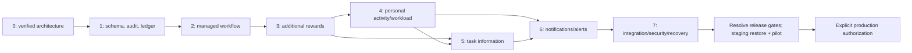

# ZeaPlay V2 Phase 7 integration and release assessment

> Superseding final review: [acceptance matrix](zeaplay-subtask-v2-final-acceptance.md), [release notes](zeaplay-subtask-v2-release-notes.md), [deployment checklist](zeaplay-subtask-v2-deployment-checklist.md). The final review adds cache-outage/live-membership repairs, a stricter read-only rollout gate and a redacted Git-history secret assessment. Results below remain evidence of the earlier Phase 7 runs; they are not silently updated to later results.

Verified 3 November 2026 against this checkout's dirty source, including Phases 0–6. **Integration verification and rollout preparation are delivered. Production release approval remains blocked. No production deployment or installed-database migration was performed.**

This report supersedes earlier phase snapshots for the executed checks below. It does not convert their historical findings into production observations. The [Phase 0 architecture](zeaplay-subtask-v2-architecture.md), Phase 3–6 audit reports, [rollout/recovery instructions](zeaplay-subtask-v2-phase7-rollout.md), and [machine-readable evidence](verification/zeaplay-subtask-v2-phase7/results.json) form the handoff.

## Integration repairs

| Finding | Final change and verification |
| --- | --- |
| Public `/auth/register` accepted a caller-selected Owner role in an existing tenant | Confirmed **201 before / 403 after** with an unauthenticated synthetic HTTP probe. Public registration now provisions only a new workspace, serializing the empty-tenant check with the existing tenant lock and SQLite write reservation. All four role attempts into an existing tenant are denied. Two simultaneous registrations for a new tenant produce one 201 and one 403. Existing authenticated `/users` creation, tenant derivation and login remain usable. |
| A Redis interruption could leave the task listener stopped while browser sockets remained connected | The existing single listener retries with bounded backoff, resubscribes, handles malformed messages, stops/restarts cleanly, and sends an authorized tenant-scoped `tasks.resync` invalidation on subscription. Header refetches task, activity and inbox projections. A real disposable Redis disconnect/recovery and 100-event burst pass. |
| Each Redis message previously queued another fanout coroutine | The existing listener now waits for one fanout at a time. There is one outstanding fanout per API listener, not an unbounded future queue or one worker per task/user. Existing per-socket send timeouts and semaphore remain in use. No per-second database writes were introduced. |
| Publication failure after a successful database commit could surface as an HTTP error | Task-event publication is best effort with a sanitized warning; committed ledger/activity/notification rows remain authoritative. Reconnect/resync recovers invalidations. Durable external notification delivery retains its existing retry path. |
| SQLite HTTP activity requests opened deferred savepoints before acquiring their write reservation | A real six-request HTTP race reproduced `database is locked`. The existing write-savepoint helper now uses `BEGIN IMMEDIATE` for its outer SQLite transaction. PostgreSQL behavior is unchanged. The repaired six-request scenario, rollback/foundation tests and financial/notification/activity regression subset pass, including Python 3.11/Linux execution. |
| Older test fixtures drifted as phases accumulated | The legacy-schema rehearsal now excludes later activity/correction tables together with the work intervals they reference. The socket test double supplies real socket state. Shared SQLite test setup registers only the generated-column DDL function; it does not claim PostgreSQL full-text-search equivalence. Legacy TestClients no longer launch global schema seeds/maintenance workers; these paths have explicit migration, worker and startup-wiring tests. |

No reward values, eligibility formula, manually entered actual times, page design, task identifiers, or historical point entries were changed. The registration restriction is an intentional security contract change; clients enrolling users into an existing workspace must use authenticated user management.

## Executed results

Runs use source-only disposable copies without `.env`, persisted databases, production media or private configuration. PostgreSQL 15 runs in owned schemas on localhost:15467; owned Redis uses localhost:16379. Outbound sockets in test runners are blocked except those fixtures and standard-library socket-pair plumbing. Main Windows tools were Python 3.14.3 and Node 24.14.1. A separate network-disabled Linux/Python 3.11.17 container exercised the final integrated tests and calculation boundaries.

| Check | Actual result |
| --- | --- |
| Complete Phase 1–6 database/financial/workflow/activity/information/notification cohort plus initial Phase 7 cases, PostgreSQL | **PASS: 275**, zero failures/skips, 686.62 s. |
| Final tenant-registration repairs plus existing integrated/foundation checks, PostgreSQL | **PASS: 33**; the subsequently added authorized-user compatibility case also **PASS: 1**. These runs overlap earlier coverage and must not be summed as distinct tests. |
| Final integrated HTTP suite, SQLite | **PASS: 9**, including six concurrent activity requests, interruption rollback, all registration roles/race, and authorized user creation/login. |
| SQLite foundation and corrected concurrency checks | **PASS: 26; SKIP: 2** PostgreSQL-only checks. |
| Final SQLite reward-audit, notification-review and activity regression after the reservation repair | **PASS: 65; SKIP: 11** PostgreSQL-only checks, 130.45 s. |
| Broad SQLite source sweep before that final reservation repair | **PASS: 528; FAIL: 1; SKIP: 29**, 922.76 s. The failure is the HTTP activity race repaired above and subsequently rerun successfully. The entire broad sweep was not rerun after that change. Five obsolete legacy modules were evaluated separately. |
| Actual pre-V2-to-head migration chain, immediate revision retries, legacy fingerprints and PostgreSQL interrupted-DDL rollback | **PASS**, included in PostgreSQL results. Added final read-only rollout gate and wrong-revision rejection: **PASS: 1** separately. No fabricated historical audits or reward recalculation. |
| Real Redis disconnect/resubscribe/burst/restart, handler-timeout recovery, authorized resync, publication failure, actual startup callback wiring | **PASS: 4**, final rerun 10.35 s. |
| Final Linux/Python 3.11 integrated/schema/history/calculation cohort | **PASS: 23; SKIP: 2** PostgreSQL-only rollout/DDL checks, 16.67 s. This is the existing disposable validation image, not proof of a newly built production image. |
| Frontend Node tests | **PASS: 81**, zero failures/skips. |
| Frontend production bundle | **PASS**, 21.72 s; existing Lottie/eval and large-chunk warnings remain. |
| Browser integration | **PASS: 72 assertions**: 21 real API/UI workflow/points/modal/activity checks; 48 existing notification/slow-read/reconnect/two-tab checks with synthetic transports; 3 new Header resync checks. Actual JWT-authenticated WebSocket connectivity was also confirmed. |
| Accessibility | All five actual information-modal tabs at mobile width: **0 violations / 0 incomplete** in the executed WCAG A/AA/2.1 checks, with contrast excluded. Existing workload-form check also reports zero. This is not a full-application accessibility certification. |
| New tests/fixture/shared event-service Ruff, owned Python syntax and scoped whitespace | **PASS**. Whole-repository Ruff: **FAIL, 2,434 findings**, versus 2,439 before Phase 7 fixes; no bulk formatting or unrelated cleanup performed. Only counts/rule/file summaries are archived, avoiding source snippets that might contain configuration literals. |
| Whole frontend TypeScript | **FAIL: 112 existing diagnostics**. Comparison of initial and final normalized diagnostics: **0 added / 0 removed**. Vite build does not run this check. |
| Legacy auth/token/OAuth/task-list/ticket/chat modules, isolated processes after collection support | **FAIL: 31 assertions / 2 setup errors; PASS: 2**, across 35 cases. These modules contain stale required fields, `password_hash` instead of `hashed_password`, missing tenant/auth expectations and overrides incompatible with the global navigation guard. See individual results, not a claimed green regression. |
| Presence service | Supported `npm test` executes **0 tests**; source syntax check passes. Dependency audit cannot run against its absent lockfile (`ENOLOCK`). No functional presence certification. |
| Rollout configuration and migration graph | **PASS**: production/source-build Compose parses with synthetic variables and env-file resolution disabled; Alembic reports one head, `k1a3c5e7f9b1`. No production configuration was loaded. |
| Dependency security | Frontend lock scan: **21 advisories** (1 critical, 14 high, 3 moderate, 3 low). Installed backend-fixture dependency closure: **69 advisories in 10 of 90 packages**, all declared requirements satisfied. These are scanned fixture/lock versions, not an inspection of deployed images. No unreviewed dependency upgrades were made. |
| Installed/prod migration, target backup restore, new release-image build, actual provider/OS background push/sound, live n8n delivery, target-size load and deployment rollback | **NOT RUN**. |

An initial unfiltered legacy run progressed beyond earlier collection failures but triggered a Windows/Python 3.14 native access violation while legacy TestClients launched global maintenance threads against shared in-memory SQLite. It produced no valid final suite result. The test lifecycle is now isolated; individual legacy modules were rerun and their remaining failures are reported above. Initial copy omissions (`app/backups`, required empty assets directory), selector/casing assumptions, and a psycopg percent-placeholder issue in the readiness-test harness were corrected. They are not claimed as application defects or passing runs.

## End-to-end scenario matrix

| Scenario | Verified behavior |
| --- | --- |
| A — Subtask management | Real login/JWT/navigation guard and task create/edit APIs; all new rows require ordered planned dates, legacy rows retain null dates; explicit actual-time confirmation and UTC conversion; Start/Pause/Resume/Testing/Complete/Reopen; original times retained; inherited/overridden priority; expected-version conflicts, direct HTTP rejection and transactional audit coverage. The real existing editor creates the third child, records actuals and completes/reopens it without page redesign. |
| B — Points | 1/2/3/5/100 child fixtures, deterministic creation order, out-of-order and concurrent completion, zero first-child base/bonus/penalty, parent-priority values, deadline boundaries, repeated requests/workers, deletion/restore/reopen/reassignment/repricing, reversals, negative wallets and interrupted payout. Existing legacy markers/balances remain readable and unchanged. |
| C — Parallel activity | Six simultaneous authenticated HTTP starts yield five successes and one 409; pause frees a slot, resume needs capacity. Existing browser header/popup shows all five persisted contexts after reload, live elapsed values survive, and UI pause changes the stored count to four. Manual work is explicitly confirmed, idempotent and overlap-rejected; interval unions, DST, drift and concurrency are covered by existing suites. |
| D — Information modal | Both icon and information action open the same five tabs; real aggregation endpoints provide authoritative ledger values and audit actors, individual chronology, planned versus actual times and priority. Search/pagination, legacy/empty/private histories, 5,000 events, mobile width, Escape/focus, and realtime invalidation are exercised. |
| E — Notifications | Employee/creator/reporting-manager/watcher relationship recipients, overlapping roles, removed memberships, module/tenant filtering, deadline/capacity preferences, unread/read/dismissed counts, retry and deduplication tests. Two-tab browser delivery/sound deduplicates and never prompts for permission automatically. Real database storage and real socket authorization are exercised; native push/OS/provider behavior uses deterministic test doubles and remains an external acceptance gate. |
| F — Regression | Existing navigation/role/settings/profile/backup/task-tab/calendar/Gantt contract/time/gamification/achievement hooks and notification suites are exercised. Login and authorized user CRUD have new real-HTTP checks. There is no standalone Project ORM/router/page in this checkout; `users.projects` is profile JSON. Do not invent a project-management subsystem or claim its E2E acceptance. Reports remain existing client-side aggregation; a full authenticated report-page/ticket/kanban/calendar/Gantt installation walkthrough is not certified by these API/utility checks. Obsolete ticket/chat/auth tests and missing presence coverage remain explicit release gaps. |

## Verified accounting examples

The fixtures use the existing **IT Support / HIGH** rules: base 30, before-due bonus 15, overdue penalty -15. Other teams/configurations can have different existing values; HIGH is not globally hardcoded to 30. Completion exactly at the captured child deadline is on time. Manual completion timestamps and the captured creator timezone determine child timing.

| Eligible new-policy children | Additional base capacity | Earned before completion |
| --- | ---: | ---: |
| 1 | 0 | 0 |
| 2 | 30 | 0 |
| 3 | 60 | 0 |
| 5 | 120 | 0 |
| 100 | 2,970 | 0 |

The executed financial example starts the employee wallet at 100. Main-task payout is base 30 + bonus 15 = **45**. Child two earns base 30 + bonus 15 = **45**. Child three earns base 30 + penalty -15 = **15**. The first child adds nothing. Additional-child totals are BASE **60**, BONUS **15**, PENALTY **-15**, net **60**. Total newly earned in the example is **105**, closing wallet **205**. Reopening child two adds separate reversals **-30 / -15**, leaving main earned 45, child net 15, wallet **160**. Reprocessing produces no further credit. The browser separately verifies a LOW display override still earns the HIGH parent's **30 + 15**, followed by **-45** compensation and net zero.

For each managed reward scope, signed immutable ledger totals equal authoritative earned amounts and wallet movement from the recorded opening balance. **Do not compare the entire legacy wallet directly with the new-policy ledger**: opening balances, legacy task/achievement credits and reward claims predate this ledger contract. Missing historical main payout evidence remains explicitly unknown in the information modal; it is not reconstructed, silently backfilled or computed differently in the frontend.

## Performance and security assessment

- Final PostgreSQL history profiles fetch 25 records from 100 and 5,000 events with **10 queries, zero writes** in both cases. Traced Python peaks are approximately **1.53 MB / 0.71 MB**, and measured local read times **0.219 / 0.216 seconds**. These are cold-process fixture observations, not production memory limits or latency guarantees.
- Existing 200-user / 20-concurrent snapshot tests execute seven queries per snapshot, with zero writes. Query plans use tenant/user activity, task/ledger and manual-work indexes. The pending-notification 5,000-row fixture selects the partial chronology index without a sort.
- The 200-employee scan takes three batches and **2,339 SQL statements**, measured **5.604 seconds** in the final PostgreSQL run. It remains an optimization/target-load observation point; batching does not make the per-employee workload scan constant cost.
- Existing financial writes take the tenant advisory barrier before parent/group and user locks. Concurrent payout correctness is tested; sustained same-tenant payout throughput is not load-certified. The 200-user snapshot profile is read throughput, not reward-posting throughput.
- A 207-recipient two-replay test uses six INSERT statements and one durable row per authorized recipient. The live Redis 100-event burst has one handler in flight; socket fanout remains bounded and checks current identity per event. Client tests verify no healthy per-task/per-user HTTP polling, one pending refresh during bursts, hidden-tab suppression, reconnect refetch and cleanup. Clocks tick in the client.
- Tenant ownership and object access are checked through actual JWT/database roles and canonical task visibility, including the repaired public registration boundary. Notification live visibility prevents former watchers from reading new task data. Audit/ledger/work-interval immutability, idempotency, version conflicts and rollback are database/transaction tested. SQL rollout validation returns aggregate counts only.
- No production credentials/configuration/data were read or exported. Dependency advisories, obsolete regression fixtures and missing external acceptance are **release blockers**, not claims that production was scanned or remediated. No arbitrary accounting cap, daily-hours policy, duplicate queue, parallel reward wallet or replacement UI was added.
- Delivery is at least once outside the database: provider acceptance followed by a crash can precede acknowledgement. Stable notification IDs, tags and bounded worker receipts reduce replay; a 1,000-ID client window is not permanent exactly-once OS presentation. Redis Pub/Sub itself is not durable; reconnect resync recovers current authoritative state, not every transient invalidation.
- The Redis recovery check forcibly disconnects the actual Pub/Sub connection; it is not a complete Redis-server outage test. Existing cache reads/invalidation are separate call sites. The publication repair does not certify every cache-dependent API during a prolonged Redis outage; include that fault test in staging.

## Final readiness checklist and dependency map

| Gate | Status |
| --- | --- |
| Phase 0 repository architecture and scope identified | PASS — historical discovery retained; this report describes later implementation |
| Phase 1 schema/audit/ledger/manual-work foundation and safe additive chain | PASS in disposable schema rehearsal |
| Phase 2 workflow/planning/manual actuals/priority/server validation | PASS in source integration and real editor |
| Phase 3 deterministic points, compensations, legacy protection, transaction/concurrency | PASS in PostgreSQL and isolated accounting tests |
| Phase 4 per-user five-parent capacity, persistent clocks and distinct productive work | PASS in concurrency and real browser checks |
| Phase 5 information aggregation, five tabs, scoped pagination/history | PASS in API/browser/accessibility checks performed |
| Phase 6 durable scoped notifications, deduplication, preferences, recovery | PASS for source/database/browser transport checks performed |
| Phase 7 integrated security/concurrency repairs, evidence, rollout/recovery preparation | PASS for delivered scope |
| Whole TypeScript, repository lint, dependency security and obsolete legacy tests | FAIL — named debt above; release is not green |
| Target backup restore, schema drift reconciliation, image/provider/pilot/load/recovery rehearsal | NOT RUN — required before production activation |
| Production deployment | NOT RUN — requires explicit authorization |



## Changed files and API/event contracts

Production changes are limited to `backend/app/routers/auth.py`, `backend/app/services/audit_logger.py`, `backend/app/services/task_events.py`, `backend/app/ws/tasks.py`, `backend/app/main.py`, and `frontend/components/Header.tsx`. Existing HTTP response DTOs are unchanged. Public registration into an existing tenant now returns **403**; authorized `/users` creation remains the supported enrollment path. The shared socket adds the data-free `tasks.resync` event; no new public task/reward endpoint or schema revision is introduced.

Verification changes: `backend/tests/conftest.py`, `test_subtask_schema_rehearsal.py`, `test_navigation_sockets.py`, and new `test_phase7_system.py`, `test_phase7_migrations.py`, `test_phase7_performance.py`, `test_phase7_realtime.py`; guarded `backend/checks/phase7_browser_app.py`; read-only `backend/sql/zeaplay_v2_phase7_readiness.sql`; this report, rollout instructions, Phase 0's status note and the Phase 7 evidence directory. Source SHA-256 entries distinguish this work from the pre-existing dirty tree.

## Reproduction

Use a **sanitized owned verification copy**, not the working application directory: legacy tests create/drop hardcoded relative SQLite databases at import. The archived `review_pytest.py` must sit beside `backend/`, with the owned marker and an empty `assets/` directory. Supply the explicitly guarded local fixtures; never substitute an installed database URL. Store JUnit/log output outside private data directories.

```powershell
# From the owned copy; archived runner blocks all other outbound destinations.
$env:ZEA_TASK_AUDIT_TEST_URL='postgresql+psycopg://phase1@127.0.0.1:15467/zea_subtask_phase1'
python -B review_pytest.py backend/tests/test_phase7_system.py backend/tests/test_phase7_migrations.py backend/tests/test_phase7_performance.py
Remove-Item Env:ZEA_TASK_AUDIT_TEST_URL
$env:ZEA_PHASE7_REDIS_URL='redis://127.0.0.1:16379/15'
python -B review_pytest.py backend/tests/test_phase7_realtime.py
python -B review_pytest.py backend/tests/test_subtask_reward_audit.py backend/tests/test_workload_notification_review.py backend/tests/test_task_activity.py
# In the sanitized frontend:
npm test
npm run build
npx tsc --noEmit --pretty false
npm audit --json
```

The final frontend fixtures/scripts and result JSON distinguish actual HTTP/SQL/socket integration from synthetic native/browser-transport checks. Serve the guarded API fixture on localhost:16217 and Vite on localhost:6325 with `VITE_API_URL=/api`, `VITE_API_BASE_URL=/api`, `VITE_API_PROXY_TARGET=http://127.0.0.1:16217`. Copy `phase7.tsx.fixture` into scratch `frontend/checks/phase7.tsx` and load it through a scratch HTML entry. Axe checks require the local test axe asset. The Phase 6 browser regression scripts reference the archived Phase 6 fixture. None of these synthetic entry points is placed in production frontend source.

Owned Vite/API fixture servers are stopped and owned PostgreSQL/Redis containers removed after verification. Existing installed ZeaPlay and Paradise containers remain running; their images, volumes and private configuration were not changed. See the explicit [cleanup record](verification/zeaplay-subtask-v2-phase7/cleanup.json).
